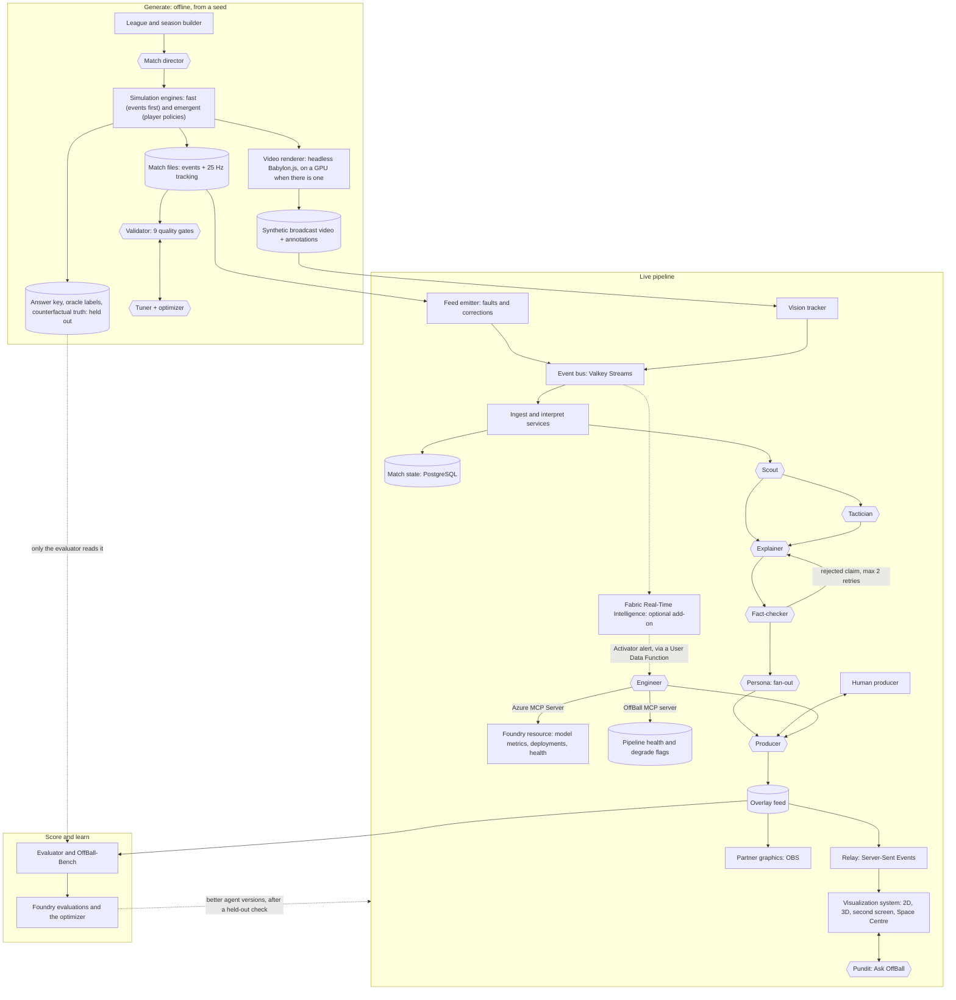
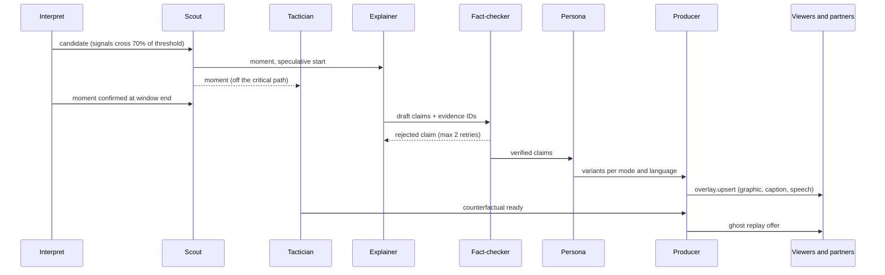
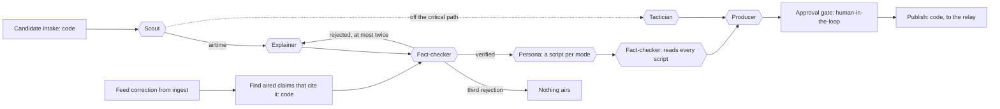
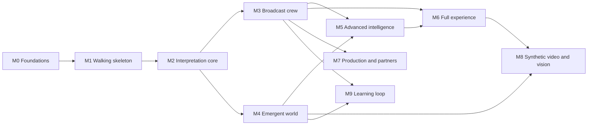

# OffBall: Product Requirements Document

**Making space visible: explainable off-ball match intelligence from synthetic football data**

| | |
| --- | --- |
| Event | Microsoft Premier League Hackathon |
| Document | Product requirements, full-potential plan, 21 October 2026; backend, AI and deployment specified 24 October 2026; hosting moved to Vercel and an Ubuntu VM, with Microsoft Foundry the only Azure service and models from OpenRouter, 26 October 2026; the VM, Foundry and the web app in one Azure subscription, 27 October 2026 |
| Planning basis | Full scope at its highest potential. Work is ordered by dependency, not by date, and nothing is cut to fit a schedule. A few trims that leave the core intact are recorded in ADR 0005. |
| Prize targets | Grand Prize; Category Prize: Best Multi-Agent System (fallback: Best Use of Microsoft Foundry Project) |
| Technology focus | Priority 1: Microsoft Foundry, Microsoft Agent Framework and MCP (our own server, plus Azure MCP Server at runtime). Priority 2: Microsoft Fabric Real-Time Intelligence, as an optional add-on outside the milestones (ADRs 0001 and 0005). GitHub's developer tools are not part of the plan (section 17). |
| Product name | OffBall (working name, pending a name check) |

All times in this document are Pacific Time (PT) unless stated otherwise. Rule references such as "rule 4.7" point to sections of the hackathon's Official Rules.

---

## Contents

1. [Summary](#1-summary)
2. [Scope at a glance](#2-scope-at-a-glance)
3. [Hackathon context](#3-hackathon-context)
4. [Rules compliance matrix](#4-rules-compliance-matrix)
5. [Problem](#5-problem)
6. [Vision and product principles](#6-vision-and-product-principles)
7. [Goals and non-goals](#7-goals-and-non-goals)
8. [Users, modes and surfaces](#8-users-modes-and-surfaces)
9. [Solution: the five-stage pipeline](#9-solution-the-five-stage-pipeline)
10. [Signature experiences](#10-signature-experiences)
11. [Architecture and backend services](#11-architecture-and-backend-services)
12. [Synthetic data generator](#12-synthetic-data-generator)
13. [Interpretation models](#13-interpretation-models)
14. [Agents](#14-agents)
15. [Experience design](#15-experience-design)
16. [Visualization system](#16-visualization-system)
17. [Microsoft technology](#17-microsoft-technology)
18. [Platform, deployment, operations and trust](#18-platform-deployment-operations-and-trust)
19. [Evaluation and success metrics](#19-evaluation-and-success-metrics)
20. [How we score against the judging criteria](#20-how-we-score-against-the-judging-criteria)
21. [Demo video and judge testing](#21-demo-video-and-judge-testing)
22. [Submission package](#22-submission-package)
23. [Roadmap](#23-roadmap)
24. [Risks](#24-risks)
25. [Submission checklist](#25-submission-checklist)
26. [Open questions](#26-open-questions)
27. [Beyond this PRD](#27-beyond-this-prd)
28. [References](#28-references)

---

## 1. Summary

Most of what decides a goal happens away from the ball, but live graphics and statistics describe only the ball. OffBall makes space visible. It ingests a live synthetic match feed and computes, frame by frame, who controls each part of the pitch, what each square metre is worth, and whose movement created it. Eleven AI agents in three crews, built on Microsoft Foundry and Microsoft Agent Framework and connected through MCP, then find the off-ball moments that create chances, explain why they matter, prove the cause by re-running the moment without the run, fact-check every claim, and tailor the story to each viewer. One of them, the Engineer, keeps the live show healthy through Azure MCP Server. Microsoft Fabric Real-Time Intelligence can join later as an add-on for dashboards, alerts and season-scale answers. The agents also learn: their scores on an open benchmark feed Foundry's Agent Optimizer, and a new version goes live only if it scores better on matches it has never seen.

Viewers get that story in the form that suits them: timed overlays on a 2D tactical view or a 3D broadcast view, captions and spoken commentary in English, Spanish and French inside an interface in ten languages, an audio-described feed for blind and low-vision fans, a second-screen companion, answers to their own questions, and the chance to change one player's decision and watch the moment re-run. A dedicated visualization system keeps every one of those views in sync with the match clock, holds its frame rate, reads clearly in any theme and for colour-blind viewers, and steps down gracefully from a GPU-rendered 3D scene to a plain 2D canvas or a pre-rendered clip on weaker devices, instead of breaking.

The foundation is a synthetic football world: a fictional 20-club league whose matches come from two calibrated simulation engines. Because we own the world, we know the truth. Every planted moment has a known answer, every player's intent is logged, and any moment can be replayed with one thing changed. That lets OffBall show how often its AI is right, and lets anyone measure their own system the same way through an open benchmark.

What we submit:

- A public GitHub repository, newly created for this hackathon
- A hosted web demo that judges can use free until the end of judging, plus one-command deployment locally or on any Ubuntu VM
- A demo video under two minutes
- A project description naming the Microsoft and Azure technologies used
- OffBall-Bench: an open synthetic dataset and benchmark for off-ball moment detection, with answer keys and a datasheet

---

## 2. Scope at a glance

OffBall is planned at its highest potential. Work is ordered by dependency, not by date, and nothing is cut to fit a schedule. The Official Rules still govern everything (section 4).

| Area | Scope |
| --- | --- |
| Planning | Dependency-ordered milestones, each one demoable (section 23) |
| Simulation | Two engines: an events-first engine for scale, and an emergent engine where 22 player policies make the play happen (12.4) |
| Tracking | 25 Hz with body orientation; a 10 Hz feed derived for calibration checks |
| League | 20 clubs, 500 players, a full 380-match season |
| Story moments | 16 types plus 2 null types, plus emergent moments labelled by the generator's oracle |
| Quality gates | 9, including a discriminator gate and a diversity gate; 5 must pass, and 4 are reported against their targets (12.10) |
| Interpretation | Space control, space value (EPV), off-ball scoring opportunity, off-ball credit, run classification and counterfactual credit, with ghost players from the engine's re-runs, plus pass difficulty and xG |
| Agents | 11 in three crews, including an Engineer that uses Azure MCP Server at runtime; human-in-the-loop, checkpoint resume, A2A and a public MCP endpoint |
| Learning | Agents improve against OffBall-Bench through Agent Optimizer and procedural memory, each gated on held-out matches (14.9) |
| Visualization | A tiered visualization system: WebGPU 3D, WebGL2, Canvas 2D and pre-rendered fallbacks, adaptive quality, declarative charts (section 16) |
| Modes | 6: Casual, Learn, Analyst, Player focus, Audio-described and Broadcaster |
| Languages | Captions and voice in English, Spanish and French; the interface in 10 languages |
| Fan features | Ask OffBall voice Q&A, Change one decision, the tactics board, a second-screen companion, the Space Centre whip-around, share cards and vertical clips |
| Broadcaster | Live partner protocol with retractions; an OBS reference template; a producer console with human approval |
| Auto-eventing | From tracking, and from synthetic broadcast video through a vision pipeline |
| Microsoft technology | Three hero technologies used in depth: Foundry, Agent Framework and MCP with Azure MCP Server (priority 1); Fabric Real-Time Intelligence (priority 2) is an optional add-on (ADRs 0001 and 0005); GitHub's developer tools are not used (section 17) |
| Evaluation | Answer-key scores, a public benchmark, human studies, red-teaming, chaos-recovery and visual-performance scores |

---

## 3. Hackathon context

This section summarises the parts of the Official Rules that shape the product, so this PRD can be read on its own.

### 3.1 The challenge

Build an AI-powered solution that turns **synthetic football events** into **explainable match intelligence**: real-time narratives and automated recaps suitable for studio, broadcast or streaming, which fans in any market can tailor. The solution runs as one pipeline with five stages:

| Stage | What the challenge asks for |
| --- | --- |
| Ingest | Take synthetic match events as they happen: passes, shots, tackles, possession changes, pressure events, match metadata |
| Interpret | Turn events into meaningful statistics, patterns and context |
| Explain | Say why a moment matters, not only that it happened |
| Render | Produce output that can sit on screen alongside the match, timed and machine-readable enough for synchronized overlays |
| Personalize | Make the same intelligence two genuinely different experiences for an analyst and a casual fan: modes, favourite clubs, favourite players, a player-focus mode, language, a chosen metric |

The challenge also lists feature areas to consider: player identification with speed and distance indicators, pass quality, speed metrics, auto-eventing, narrative generation, explainability, data innovation and multi-language storytelling. Section 9.2 maps each one to OffBall.

The rules warn against doing only half the job: a project that only generates metrics has no audience, and one that only personalizes has nothing to personalize. OffBall does both.

### 3.2 Key dates

Listed because some rules depend on them, such as judge access until the end of judging (rule 4.8). They don't set the scope of this plan.

| Milestone | Date and time (PT) |
| --- | --- |
| Registration period | 29 Sep 2026, 9:00 am to 20 Oct 2026, 12:00 pm (closed) |
| Submission and hackathon period | 6 Oct 2026, 9:00 am to 27 Oct 2026, 11:59 pm |
| Judging period | 27 Oct 2026, 9:00 am to 10 Nov 2026, 11:59 pm; the demo must stay live, free and unrestricted throughout |
| Winners announced | By 20 Nov 2026, 11:59 pm; prize forms due 10 business days after Microsoft sends them |

### 3.3 Eligibility and team

- Up to 4 individuals per team, each at the age of majority where they live. One member is the **Representative**, who enters the submission on the team's behalf.
- Residents of places where US or local law prohibits taking part are not eligible. The rules name Brazil, Quebec, Russia, the Crimea region, Cuba, Iran, North Korea, Sudan, Syria and other OFAC-designated countries.
- Also not eligible: employees, representatives and agents of Microsoft or the Premier League, and their immediate family and household members; anyone involved in running the hackathon; judges and their employers; and affiliates of any of these.
- The project must not have received financial or preferential support from Microsoft: funding, a development contract or a commercial licence (rule 4.12).

### 3.4 How we are judged

- **Stage one (pass or fail):** does the project reasonably fit the theme and use the required technologies?
- **Stage two:** five equally weighted criteria, 20% each:
  1. Technological implementation: creative and optimized synthetic data, software quality, use of the hero technologies, clean and documented code
  2. Agentic design and innovation: agentic patterns, orchestration, MCP integration, multi-agent collaboration, novelty
  3. Real-world impact and applicability: problem size, production readiness, impact on users and businesses
  4. User experience and presentation: design, a video that communicates value, a balance of frontend and backend
  5. Adherence to the hackathon category
- **Ties** go to the higher score on criterion 1, then criterion 2, and so on down the list.
- Judges may judge only from the video, description and images, without testing the app. **The video and description must stand on their own.**
- Judges may reassign a project to a better-fitting category.

The hero technologies named in criterion 1 are Microsoft Foundry, Microsoft Agent Framework, Azure MCP, GitHub Copilot agent mode, Microsoft Fabric, the GitHub SDK, the GitHub CLI, Azure app and AI services, and Azure databases.

### 3.5 Prizes we target

A project can win one Grand Prize and up to one Category Prize.

| Prize | Per team member |
| --- | --- |
| Grand Prize, first place | $4,000 cash as an e-gift card, a Premier League match ticket (approx. $1,000), a $50 Premier League store voucher |
| Grand Prize, second place | $2,500 cash as an e-gift card, a Premier League match ticket, a $50 store voucher |
| Category Prize (each) | $1,500 cash as an e-gift card, a $50 store voucher |

**Our category: Best Multi-Agent System** (the prize table in the rules calls it Best Multi-Agent Orchestration). Judges assess whether specialized agents have distinct roles, coordinate through shared state and effective handoffs, recover from failures, and deliver an end-to-end outcome a single agent could not reach as effectively. Accepted orchestration approaches include GitHub Copilot, Microsoft Agent Framework and A2A. Section 14 is written against these tests.

---

## 4. Rules compliance matrix

Every rule that constrains the product, and how OffBall meets it. Owners are named at kickoff (open question 1).

| Rule | Requirement | How OffBall complies | Evidence | Owner |
| --- | --- | --- | --- | --- |
| 1 | Submit within the submission period | Every milestone leaves the project submittable (section 23); the Representative submits on the Projects page within the period | Projects page entry | Representative |
| 3 | Eligible entrants; teams of up to 4; one Representative | Roster checked against the exclusions in 3.3 before submitting | Internal roster (not part of the submission) | Representative |
| 4 | A new solution that answers the challenge and fits at least one category | All five stages implemented (section 9); category Best Multi-Agent System (section 14) | Description, video, repo | All |
| 4.3 | Installs and runs consistently, and works as the video and description show | `docker compose up` locally, `infra/main.bicep` and `deploy/up.sh` on Azure, with the web app on a Blob Storage static website, and the hosted demo; the video is recorded from the deployed build; CI runs smoke tests, visual regression and quality gates on every push | README, CI badges, hosted URL | Platform lead |
| 4.3 | Runs on its intended platform | Web app for current desktop and mobile Chrome, Edge, Safari and Firefox, installable as a PWA; rendering tiers cover devices without WebGPU (16.2); platform stated in the description | Description, device test matrix | Experience lead |
| 4.3 | New projects only, created after the registration period opened on 29 Sep 2026 | New repository created in October 2026; no code carried over from earlier projects | Git history | All |
| 4.3 | Authorized use of third-party SDKs, APIs and data | Calibration data only under MIT and CC BY 4.0 (12.2); 3D models, textures and fonts are our own, CC0 or SIL OFL; dependencies used under their licences, and OpenRouter under its terms | `ATTRIBUTION.md`, `LICENSE`, lockfiles, SBOM | Data lead |
| 4.4 | Pitch: what we built, which Microsoft and Azure technologies, what it does, what problem it solves | Draft in 22.1 | Projects page | Representative |
| 4.4 | Video under 2 minutes, showing the project running on its platform, at a public YouTube, Vimeo, Facebook Video or Youku URL, with no unlicensed third-party marks or music | 1:55 cut recorded from the live app; fictional clubs and players; no league or club marks; no music, or only music we have rights to; synthetic voices only, none imitating a real person | Public video URL | Experience lead |
| 4.4 | A public GitHub repository | Repo public no later than submission; open-source licence (MIT proposed) | Repo URL | Platform lead |
| 4.4 | Not a winner in any other contest; no prohibited content | Not entered elsewhere; no obscene, violent, defamatory, political, alcohol, drug or tobacco content; Content Safety filters on every generated text the Pundit returns | Review before submission | Representative |
| 4.5 | Multiple submissions must differ substantially | One submission only | n/a | Representative |
| 4.6, 4.11 | Original work, solely owned; open source allowed when licences are followed and we build on it | All product code written by the team; open-source libraries used as dependencies, not resubmitted as our own | Repo, `ATTRIBUTION.md` | All |
| 4.7 | Synthetic, football-realistic data; no footage is provided; any footage used must be licensed | All match data is synthetic. Real open data only fits aggregate parameters, and the novelty and discriminator gates show no real sequence is copied (12.10). The only video is our own synthetic broadcast render of our own 3D scene; no real footage is used. | Quality-gate report, `DATASHEET.md`, README "Data provenance" section | Data lead |
| 4.8 | Judges get a working link, free and unrestricted until judging ends; login details if it's private | Public URL with no login, live until 10 Nov, 11:59 pm PT; replay mode served from the web app's Blob Storage static website, independent of the backend VM; static fallback build and pre-rendered clips in the repo | Testing instructions | Platform lead |
| 4.9 | All materials in English | Description, video narration, README and testing notes in English. Other languages are a feature, and English is always available. | Submission | All |
| 4.10 | One authorized Representative | Named at kickoff (open question 1) | Projects page | Team |
| 4.12 | No financial or preferential support from Microsoft | No Microsoft funding, contract or special licence; Azure used on terms open to every entrant | Team confirmation | Representative |
| 5 | Changes after the submission period only with Microsoft's permission | Submission treated as final at the end of the submission period | n/a | Representative |
| 7 | Promotion Entities get a perpetual, royalty-free, commercial licence to the submission; no malware | Only material we can license that way: our own code and assets, fitted parameters from commercially usable sources (StatsBomb excluded, 12.2), CC0 or OFL assets; code, dependency and secret scanning in CI | `ATTRIBUTION.md`, CI security scans | Platform lead |
| 8.2 | Each winner's role in creating the submission is verified | Internal contribution log kept for affidavits (not published, see rule 14) | Internal log | Representative |
| 14 | No team member's personal data in submission materials | No names, emails or photos of team members in the repo, video or app. The app collects no viewer personal data: preferences stay in the browser, Pundit questions and voice audio are processed in memory and not stored, and pairing codes expire. Human-study results are published only as aggregates. | Repo review | Representative |

---

## 5. Problem

Fans see the pass and the finish, not the gap that made both possible. Take a decoy run that drags a centre-back 10 m out of position: it never appears in the numbers, and the player who made it gets no credit.

| Audience | What they miss today |
| --- | --- |
| Casual fans | The off-ball movement that creates chances; they only see the ball |
| New fans and younger fans | Why anything happens at all; tactical language is a wall |
| Blind and low-vision fans | Audio commentary describes the ball, and almost never the shape of the play or where space is opening |
| Analysts, coaches and scouts | Space and off-ball value, which usually arrive after the match from tactics cameras and tracking tools, and rarely credit the player who made the space |
| Broadcasters | Explainable space graphics live, which today need tracking data, an analyst in the gallery and a graphics operator |
| Fans outside English-speaking markets | Tactical storytelling in their own language and football vocabulary |
| AI builders and researchers | Ground truth: real tracking can't say what a player intended or what would have happened without their run, so football AI is hard to test |
| Everyone | Trust: AI commentary that explains things can't easily be checked, so a wrong story can go to air |

**Problem statement.** During a live match, detect the off-ball moments that create chances, prove why they mattered, and render them as synchronized visuals, words and sound tailored to each viewer, with every claim traceable to the data.

**Pitch.** OffBall makes space visible: watch the gap open before the goal, see what would have happened without the run, and hear it told your way.

---

## 6. Vision and product principles

**Vision.** Every viewer, in any language and at any level of football knowledge, sees the play behind the play, and can trust what they are told about it.

| Principle | What it means in practice |
| --- | --- |
| Show the space, don't just say it | Every explanation has a visual anchored to the pitch: a gap ring, a run arrow, a ghost. Words point at pictures. |
| Every claim is traceable | Each number and statement cites event or frame IDs, and nothing unverified airs. |
| Ground truth by construction | We generate the world, so we can grade the AI against what really happened, including what didn't happen. |
| Deterministic where possible, agentic where judgement is needed | Physics, metrics and verification of numbers are code. Agents decide what matters, how to say it and to whom. |
| Degrade, never lie | Every failure path ends in something simpler that is still true: a lower rendering tier, a graphic left off air, silence. Agents never fall back to templates or rules, and nothing unchecked airs. |
| Graceful everywhere | Visuals hold their frame rate, stay in sync and stay legible from a phone on 4G to a 4K broadcast output, in light and dark themes, for colour-blind viewers and with reduced motion. |
| One intelligence, many experiences | Casual, learner, analyst, player-focused, audio-described and broadcaster views are different products built on the same verified facts. |
| Open by default | Data contracts, the benchmark, the MCP tools and the overlay protocol are public, so others can build on OffBall. |

---

## 7. Goals and non-goals

### 7.1 Goals

1. **A synthetic football world.** A fictional 20-club league and season; matches from two calibrated engines; 25 Hz tracking with body orientation; a held-out answer key of planted moments, oracle labels for emergent ones, and counterfactual truth for every labelled moment.
2. **Live off-ball intelligence.** Find space-creating moments and put a verified explanation on screen within 3 s (p95) of the moment ending, at 1x match speed, for up to 10 concurrent live matches.
3. **Proven causes.** A counterfactual replay ("what if the run hadn't happened?") for every aired moment, within 15 s, with off-ball credit given as a distribution rather than a single guess.
4. **A multi-agent system that earns its agents.** Eleven agents in three crews with distinct roles, typed handoffs, shared state, human-in-the-loop, recovery from injected failures, and an outcome no single agent matches (section 14).
5. **Graceful visualization.** 2D and 3D match views, overlays and charts that stay frame-synced, hold their frame-time budgets, adapt quality to the device, and have a text equivalent for every visual (section 16).
6. **Six viewing modes**, with captions and voice in English, Spanish and French and the interface in ten languages, plus a second-screen companion and the Space Centre whip-around.
7. **Accessibility as a feature.** An audio-described mode designed for blind and low-vision fans, and WCAG 2.2 AA across the product.
8. **Broadcast-ready output.** A timed, revisable overlay protocol with a reference template for OBS, and a producer console with human approval.
9. **Proof in the submission.** A fidelity report for the data, OffBall-Bench scores for the AI, visual-performance scores for the renderer, and an agent trace showing a failure and its recovery, all shown in the video.
10. **Production readiness.** One-command deploys, SLOs, load and chaos tests, security baselines, cost controls and a transparency note.
11. **Three hero technologies, used in depth.** Microsoft Foundry, Microsoft Agent Framework and MCP (with Azure MCP Server at runtime) carry the agent system. Each is visible in the video and named in the description (section 17). Microsoft Fabric Real-Time Intelligence can add live analytics and alerts later (17.4).
12. **Agents that learn.** OffBall-Bench is the agents' training signal as well as their exam: every released version scores better than the last on held-out matches, and the video shows it (14.9).

### 7.2 Non-goals

- Real match footage, or ingesting real tracking in the submitted demo. No footage is provided (rule 4.7), and the demo stays fully synthetic. A real-data adapter is a production path, described in section 27.
- Real clubs, players, badges, kits, league marks or commentators' voices.
- Betting, odds or fantasy features.
- User accounts or stored viewer data.
- Native app-store apps. The installable PWA covers phones, tablets and TVs with a browser.
- Biomechanics or 3D pose estimation. 3D players are animated from speed and orientation, not from estimated poses.
- Coaching advice for real teams. The tactics board (10.11) explores what works in OffBall's synthetic world, where the engine is the referee.

---

## 8. Users, modes and surfaces

### 8.1 Viewing modes

The same verified intelligence reaches six audiences as genuinely different experiences, not one caption at six lengths.

| Mode | Who | What they see and hear | Example |
| --- | --- | --- | --- |
| Casual fan | Follows the game, not the tactics | One overlay at a time: the runner, the gap, the pass; plain words; voice optional; no numbers they don't need | "Watch No. 9. This run isn't to get the ball. It's to pull a defender away." |
| Learn | New and younger fans | Casual, plus a short definition the first time each idea appears, a pause-and-explain button, and a personal glossary that grows as they watch | "That was a decoy run: a run made so a teammate gets space. You've now seen 2 today." |
| Analyst | Coach, scout, data-literate fan | Space-control field, space value, defender displacement in metres, zone control %, pass difficulty, xG, off-ball credit with intervals, momentum ribbon, counterfactual split view, evidence panel with event and frame IDs, and charts on demand | "Decoy run: No. 9 moves 20 m on a diagonal. CB No. 5 tracks 10.8 m. Space created 41 m² (90% interval 33–48); without the run, the gap stays shut in 29 of 32 re-runs." |
| Player focus | Fan of one player | The view follows that player, with a running tally of off-ball work: runs made, defenders dragged, space and threat created, sprints and distance, and season context | "Your player has dragged 3 defenders and created 41 m² of space, with no shot yet. That's a season high." |
| Audio-described | Blind and low-vision fans, and anyone listening without a screen | A spoken description of shape and space, not just the ball, paced to the play, with optional stereo-panned cues for where on the pitch space is opening | "Kestrel attack left to right. Ball with No. 8 in midfield. No. 9 sprints diagonally to the right wing, and Ashmoor's No. 5 follows. A gap opens in the centre, just outside the box. No. 10 runs into it." |
| Broadcaster | Studio producer, rendering partner | The producer console: a queue of upcoming graphics with confidence and evidence, approve, hold, skip and retract controls, a recap builder, and the live overlay protocol | `overlay.upsert` and `overlay.retract` messages with start and end times and evidence IDs |

### 8.2 Personalization controls

In every mode, without an account and kept on the device:

- Language (10 at launch, 15.3) and voice on or off
- Favourite club: its colours, "your team" framing, and spoiler-safe recaps
- Favourite player: highlighted on the pitch, with milestones called out
- One metric the viewer cares about, for example pass difficulty, sprint speed or space created
- Overlay density (minimal, standard, rich) and reduced motion
- Theme: light, dark or high-contrast
- Adaptive density: the viewer hides or shows groups of pitch graphics from an Overlays menu on the pitch; the app remembers it for each mode and shows fewer graphics in a mode where they hide two groups, on device only (15.2, 15.9)

Viewers set these at first run (15.8) and change them any time in the Personalize drawer (15.9).

### 8.3 Surfaces

| Surface | For | What it does |
| --- | --- | --- |
| Match view (web app, installable PWA) | Everyone | 2D tactical and 3D broadcast views, overlays, captions, voice, the analyst panel, replay controls and Change one decision |
| Second-screen companion | Fans watching on a TV or another screen | Pairs with a 6-character code or QR code; shows player focus, stats, charts and Ask OffBall while the main screen shows the match |
| First run | New viewers | Four skippable choices with a live preview of how captions will read (15.8) |
| Space Centre | Fans following a whole matchday | Live whip-around across up to 10 matches that jumps to the biggest off-ball moment anywhere (15.10) |
| Producer console | Broadcasters | Approves and schedules graphics, retracts corrected ones, builds recaps, and shows latency, cost and agent traces |
| Partner overlay feed | Rendering partners | A live Server-Sent Events protocol plus JSONL files, with JSON Schemas and a reference HTML template for OBS |
| Recap and share | Fans and social teams | Halftime and full-time recaps, share cards, vertical clips and data exports |
| Developer surfaces | Developers and other agents | A read-only REST API, a public read-only MCP endpoint, A2A agent cards for the Pundit and Producer, and TypeScript and Python SDKs |

---

## 9. Solution: the five-stage pipeline

### 9.1 Stage by stage

| Stage | OffBall component | What it does |
| --- | --- | --- |
| Ingest | Feed emitter, the event bus (Valkey Streams), the live service's ingest; vision tracker for synthetic video | Streams events and 25 Hz frames at 1x to 60x with realistic feed faults: late events, duplicates, corrections, frame drops. Or derives tracking from synthetic broadcast video. Deduplicates, reorders within a 2 s window, interpolates frame gaps up to 0.4 s and applies corrections. Can mirror the stream into Fabric Real-Time Intelligence if that add-on joins (17.4). |
| Interpret | Interpret service and model library (deterministic code and trained models; no LLM) | Space control, space value, off-ball scoring opportunity, off-ball credit, run classification, physical metrics, pass difficulty, xG, team shape and pressure, the control index and momentum, and auto-eventing. Emits candidate moments with signal strengths. |
| Explain | Broadcast crew: Scout, Tactician, Explainer, Fact-checker | The Scout picks moments for airtime. The Tactician proves the cause with counterfactual re-simulations. The Explainer writes structured claims with evidence. The Fact-checker verifies each claim, and re-verifies aired claims after a correction. |
| Render | Producer agent, overlay feed, the relay, visualization system, partner template | The Producer schedules graphics without collisions, with human approval where configured. The overlay feed carries timed, anchored graphics, voice lines, chart specs and retractions. Renderers draw them in sync with the frame clock at the best quality the device can hold. |
| Personalize | Persona agent, Pundit agent, viewer settings | Re-voices and filters per mode, club, player, metric, language and voice; answers each viewer's own questions; adapts overlay density on device. |

### 9.2 Challenge feature coverage

| Challenge feature area | Coverage | How OffBall delivers it |
| --- | --- | --- |
| Player identification: real-time name tags, speed and distance indicators at thresholds | Full | Name tags on the 2D and 3D views. Badges appear above 25.2 km/h (sprint), at 19.8 km/h for high-speed running in the analyst view, and at each kilometre covered. |
| Pass quality: distance, accuracy, difficulty | Full | Pass distance and completion per player and team. Difficulty on a 0–10 scale from a model trained on the generator's true completion probabilities, so its calibration is measured, not assumed. |
| Speed metrics: ball speed and shot speed | Full | Computed from the ball's tracked 3D path; shown on passes and shots above set thresholds. |
| Auto-eventing: generate metrics automatically rather than by hand-tagging | Full | Events derived automatically from raw tracking and scored against the generator's ground-truth events (13). Auto-eventing from synthetic broadcast video follows when the video renderer is built (10.9, deferred). |
| Narrative generation: key narratives, player-performance context, milestones, recaps | Full | Live moment narratives; season context ("the third defender No. 9 has dragged today, and the 41st this season"); milestones; halftime and full-time recaps with replays, share cards and vertical clips. |
| Explainability: control vs chaos, pressure changes, game rhythm | Full | Every moment explained by its cause and proved by counterfactual. A control index shows control versus chaos. Press-height and line-height shifts mark pressure changes. A momentum ribbon of space value shows game rhythm. |
| Data innovation: create or extend synthetic, football-realistic datasets | Full | The calibrated two-engine generator, orientation-aware tracking, oracle labels, counterfactual truth, synthetic broadcast video with annotations, and OffBall-Bench (section 12) |
| Multi-language storytelling | Full | Captions and voice in English, Spanish and French, each with a reviewed football glossary; the interface in ten languages, with right-to-left layout for Arabic |

---

## 10. Signature experiences

Eleven experiences that carry the product. Each lists its acceptance criteria.

### 10.1 The space layer

The core view: a live field showing which team controls each part of the pitch, with gap rings where space opens, run arrows for the runs that opened it, and pass lines into the gap.

- The control field updates at the display's refresh rate from 25 Hz data, with no visible stepping.
- A gap ring appears no later than the pass into the gap.
- Colour is never the only encoding: contested space also shows contour lines (16.3).

### 10.2 "What if they hadn't run?"

For each aired moment, the Tactician re-simulates the moment from the observed state, 32 times with the run and 32 times without it, and shows the difference as translucent ghost players in a split or overlaid replay.

- Ready within 15 s (p95) of the moment ending.
- Credit is a distribution: captions quote the median, and the analyst view shows the 90% interval.
- On OffBall-Bench, the Tactician's estimate is compared with the generator's true counterfactual (19.2).

### 10.3 Off-ball credit

Every player gets **Space Created** (m²) and **Threat Created** (gain in space value) for their off-ball work, per moment, per match and across the season, with a leaderboard per club and for the league.

- Defenders get credit too, for cover shadows and runners correctly passed on (12.7).
- Per-role checks confirm the model doesn't systematically under-credit any position (18.7).

### 10.4 Ask OffBall

Fans ask questions by text or voice ("Why does Ashmoor's left side keep getting overloaded?"). The Pundit plans queries, runs them through the MCP tools over the match and the season (14.8), may hand off to the Tactician for a what-if, has every claim fact-checked, and answers in the viewer's mode and language, often with a chart.

- Every answer cites evidence; anything it couldn't verify is labelled as such.
- Out-of-scope or unsafe requests are declined.
- Answers that include a chart return a declarative chart spec, rendered in the viewer's theme (16.4).

### 10.5 Audio-described match

A spoken feed that describes shape and space, designed with and for blind and low-vision fans, paced so it never talks over itself, with optional stereo-panned cues for where on the pitch space is opening.

- Works with the screen off.
- Spoken lines never lag the play by more than 4 s.
- Tested with blind or low-vision users where we can recruit them; any part not tested that way is labelled unverified in the report.

### 10.6 Producer console and live corrections

A human producer sees the queue of upcoming graphics with confidence and evidence, and can approve, hold, skip or retract them, or switch to automatic. When the feed corrects an event (for example, a goal reassigned to another scorer), the Fact-checker re-verifies every aired claim that cited it, and the Producer retracts or patches the graphic with a visible "Correction" tag.

- Correction to retraction on screen within 5 s.
- Every producer decision is logged in the trace.
- The Engineer agent's health notes, and any degrade flag it changed, appear in the console with an undo.

### 10.7 Space Centre

A matchday whip-around: the Scout ranks moments across up to 10 concurrent matches, and the view jumps to the biggest off-ball moment anywhere, with a ticker of the others.

- No moment is shown out of its own match's clock.
- A viewer can pin a match to stop the whip-around.

### 10.8 Recap package

Halftime and full-time recaps of the top space moments, a Space Created leaderboard, shareable player cards, and vertical clips rendered from the 3D view with captions burned in and a synthetic-data label.

- Recaps can be made spoiler-safe.
- Clips render headlessly in the cloud and stay under 30 s.

### 10.9 Synthetic broadcast video and vision auto-eventing

**Deferred beyond this submission (27).** The rest of this subsection is the design for when it is built.

The 3D scene is rendered as broadcast-style video with a moving camera, together with exact per-frame annotations: bounding boxes, player IDs, pitch positions and camera parameters. A vision pipeline detects and tracks players, maps them to the pitch, and auto-events the match from video alone. Its output is scored against the generator's truth.

- The video pipeline feeds the same interpret service as the tracking feed.
- The annotated video set is published for computer-vision researchers.

### 10.10 Change one decision

Viewers pick a player at a moment and change one thing they did: make a different run, hold the line instead of following, play a different pass. The Tactician re-runs the moment from that point 32 times with the change, and OffBall shows what would have happened next to what did, on the pitch and in numbers. It turns "what if they hadn't run?" (10.2) from one question OffBall asks into any question a viewer asks, within the options the moment really offered.

- **Only options the moment offered.** The choices are the ones open to that player at that moment, worked out from the observed state: the run types the run classifier knows, a pass to each teammate with its difficulty, and the defending options (track the runner, pass the runner on, hold the line). They are ranked by modelled value. The generator's own decision log stays held out (12.9) and is used only to grade the results.
- **One change per re-run.** Everything else plays out from the observed state as the engine would play it. Changing two decisions at once, or placing players freely, belongs to the tactics board (10.11).
- **The same visual grammar.** Ghost players with dashed trails follow the changed path, the control field switches to the changed world, a ring shows where space opens or stays shut, and a changed pass is drawn dashed (15.2). Side by side works as it does for 10.2.
- **Results as distributions.** How often the gap opens, and how many shots and goals, out of 32 re-runs; space created with its 90% interval; the best chance's xG. Each sits beside what happened. Casual and Learn get one plain sentence and the counts; Analyst adds intervals and each option's modelled value.
- **Labelled for what it is.** A simulation of a synthetic match from the observed state, not a prediction or coaching advice; AI-generated and fact-checked like any caption.

Acceptance criteria:

- In replay, every option's result is precomputed and shows within 2 s; live, a result is ready within 15 s (p95), the same budget as 10.2.
- On OffBall-Bench, the Tactician's result for a changed decision is compared with the generator re-running the same change from its checkpoint (19.2).
- Re-runs are rate-limited per viewer. When the Tactician is busy, the viewer gets a place in line, and options already re-run stay one click away (15.11).
- Fully usable by keyboard and screen reader: players and options are listed as well as shown on the pitch, and the result is announced.

### 10.11 Tactics board

Viewers set up a situation themselves and ask OffBall how to score from it. They place players from the two clubs on the pitch, or start from any frame of a match, and can give some of them an action: a run, a pass, a press, holding the line. The Tactician proposes the plans worth trying, the engine plays each one forward many times, and OffBall shows the plans that most often lead to a goal, explained and fact-checked like any caption.

- **From a frame or a blank pitch.** "From here" copies every position at the current frame of a replay; "Blank" places both starting XIs in their clubs' shapes. Players are dragged into place, and a line drawn from a player gives him an action.
- **The engine is the referee.** In OffBall's world the engine is the ground truth, so playing a set-up forward is the true answer for that set-up, not an estimate of one. Each plan is played 64 times and gives how often it leads to a shot and to a goal, the xG of its best chance and the space it creates, with 90% intervals. This is what lets the board answer the question 10.10 has to estimate.
- **The AI suggests and explains; it never computes.** The Tactician proposes candidate plans from the options the set-up offers, using the same option lists as 10.10: up to three attackers' runs from the types the run classifier knows, and passes with their difficulty. It tests them through the engine and ranks them by goals per re-run. The Explainer writes why the best plans work (who gets dragged, which gap opens, who arrives in it) as claims with evidence, and the Fact-checker checks every claim against the re-runs. No number comes from a model (13).
- **Hidden state stays hidden.** Re-runs give each player what the observed data supports: his role, his club's style and the physical numbers measured from his tracking. They never use the generator's held-out attributes or decision log (12.9).
- **The same visual grammar.** Plans are drawn as dashed run and pass arrows, ranked in a side list. The chosen plan replays as ghost players, with the control field switching to its world and a ring where space opens (15.2, 16).
- **Labelled for what it is.** What works in OffBall's synthetic world, for learning ideas such as decoy runs and third-man runs. It is not a prediction, and not coaching advice for real teams.

Acceptance criteria:

- A plan the viewer draws gets its result within 10 s (p95); the Tactician's three best plans for a set-up arrive within 30 s.
- Every claim about a plan cites its re-runs and passes the Fact-checker; a plan whose explanation fails is shown with its numbers only.
- Set-ups are checked before they run: at most 11 a side, everyone on the pitch, one ball, and offside judged at the start as in a match.
- Re-runs are rate-limited per viewer, sharing 10.10's budget and its place in line (15.11).
- Fully usable by keyboard and screen reader: players are placed from a list with their coordinates, plans are listed as well as drawn, and results are announced.

---

## 11. Architecture and backend services

This section shows the whole system, then specifies the backend that runs it: the services, the stream and API the finished frontend reads, the data stores, and how replays and live runs are made. The agents are specified in section 14 and deployment in section 18. `INTEGRATION.md` says what the frontend reads; this section says what sends it.

### 11.1 System overview



Hexagons are AI agents, each defined and versioned in Microsoft Foundry, using models from OpenRouter, and run by Agent Framework workflows on the backend VM; everything else is deterministic code. Agents reach match data through the OffBall MCP server, and the Engineer reaches Foundry's own health through Azure MCP Server (most of those lines are left out to keep the diagram readable). The web app is served from a Blob Storage static website, and everything else in the diagram runs on the VM (section 18). The answer key, oracle labels and counterfactual truth live on a separate volume that no live-pipeline container mounts.

### 11.2 Components

| Component | Runs on | Language and notes |
| --- | --- | --- |
| Calibration fitter | Developer machine, CI | Python; reads downloaded open data, writes `calibration/params.json` |
| League builder, both engines, feed emitter | The backend VM, under Docker Compose | Python and NumPy, with Numba for hot loops where profiling shows it pays; seeded and deterministic |
| Video and clip renderer | The VM's GPU when it has one, or a developer machine; headless Babylon.js | TypeScript; the same scene code as the 3D view |
| Vision tracker (deferred, 10.9) | A GPU, as for the renderer | Python; detector, tracker and pitch registration |
| Live service: ingest, interpret and relay | The VM | Python; each worker owns some matches, by a hash of the match ID (11.4) |
| Agents | Defined and versioned in Microsoft Foundry Agent Service, with models from OpenRouter through a Foundry gateway connection; run by Microsoft Agent Framework workflows in the `api` service on the VM | Each agent gets only its own tools from the two MCP servers; A2A endpoints for the Pundit and Producer from the framework; improved by the learning loop (14.9) |
| OffBall MCP server | The VM | Match-data tools for agents; a public read-only subset for developers |
| Azure MCP Server | The VM, from Microsoft's container image, in read-only mode | Foundry's own health for the Engineer: model metrics, deployments and resource health (14.8) |
| Match state | PostgreSQL on the VM; the last minute of frames in the live service's memory | Keyed by match; events, metrics, agent messages, workflow checkpoints |
| Analytics (optional add-on, ADRs 0001 and 0005) | Microsoft Fabric on its trial capacity: Eventstream, Eventhouse, Real-Time Dashboards, Activator, OneLake, notebooks, Power BI (18.9) | KQL views of possession, territory, momentum, pressure and agent latency; alerts; season-scale questions (17.4) |
| Season search | The OffBall MCP server, over the season's moment file | Season moments and explanations for the Pundit and season context; KQL answers season-scale questions once Fabric joins |
| Real-time delivery | The live service's relay, sending Server-Sent Events behind Caddy on the VM | Overlay feed and frames to browsers, second screens and partners (11.6) |
| API | The VM | Python (FastAPI); the calls the frontend makes (11.7) |
| Counterfactual workers | The VM | Python; run the emergent engine from the observed state for the Tactician, 32 re-runs in parallel, as many at once as the VM's cores allow |
| Web app | Blob Storage static website | TypeScript; visualization system (section 16), PWA |
| Evaluator | CI job, and a job on the VM for the test split | Scores overlay feeds and agent outputs against held-out keys |

### 11.3 Meeting the frontend

The frontend is finished and runs on stand-ins that produce the same messages and answers a backend will (`INTEGRATION.md` section 1). The backend's job is to replace each stand-in with a service that sends the same shapes, so the frontend works unchanged apart from the small changes listed in `INTEGRATION.md` section 9. Every stand-in stays as the fallback when the backend can't be reached, so the demo never breaks.

| Frontend stand-in | Replaced by | Interface | Spec |
| --- | --- | --- | --- |
| `lib/feed/emitter.ts`: frames, graphics, captions, voice lines, clock and score | The live pipeline, delivered by the relay | The stream: the relay's Server-Sent Events, or a JSONL replay file | 11.6 |
| `decide`, `retract`, `queue` and `correct` in `lib/feed/store.ts` | The API's producer actions and the broadcast crew's correction path | `POST …/approvals`; results come back on the stream | 11.7, 14.11 |
| `answer` and `suggestions` in `lib/pundit.ts` | The `ask` workflow, led by the Pundit | `POST …/ask`, streamed | 11.7, 14.11 |
| `DECISIONS` and `scenarioFor` in `lib/decisions.ts` | The `decide` workflow and the counterfactual workers | `GET …/decisions`, `POST …/runs` | 11.7, 14.11 |
| `lib/recap.ts` | The `recap` workflow | `GET` and `PUT …/recaps/{kind}`; `recap.published` on the stream | 11.7, 14.11 |
| `lib/content.ts`, `lib/stats.ts` | The interpret service's metric registry, cached | `GET …/stats/{name}` | 11.7 |
| `MATCHDAY` in `lib/content.ts` | The Scout's ranking across a round's matches | `round.moments` on the round's stream | 11.6 |
| `lib/pairing.ts`, which pairs tabs on one device | A relay group per pairing code | `GET /api/negotiate?pair=`, then `POST /api/pair/{code}` to send | 11.6 |
| Sample results in `lib/eval.ts` and `lib/stats.ts` | The evaluator, the quality gates and Foundry evaluations | `GET /api/eval/latest` | 11.7, section 19 |
| The device's own voices in `lib/audio.ts` | Speech from Azure AI Speech, made when a line is published | `speech[locale].audio_url` | 14.11 |
| `public/clips/*.mp4` | The renderer jobs | Clip URLs in recap moments | 11.4 |

Two frontend changes come on top of `INTEGRATION.md` section 9, both small: the negotiate call also names the viewer's language, so the Persona writes only the languages someone is watching (14.4); and the producer console sends a run's producer token with its actions (11.7).

**New contracts.** These shapes are in use today but not yet published. Each one is added to `offball/contracts`, exported to `contracts/` and checked in CI like the rest (BE-1).

| Contract | Shape taken from | Used by |
| --- | --- | --- |
| `frame-message.schema.json` | `FrameMessage` in `web/src/lib/feed/types.ts` (`INTEGRATION.md` note 1) | Relay, frontend, partners |
| `answer.schema.json` | `Answer` in `web/src/lib/pundit.ts` | Pundit, API |
| `decision-point.schema.json`, `decision-result.schema.json` | `DecisionPoint` and the result in `INTEGRATION.md` 6.2 | Tactician, API |
| `recap.schema.json` | `RecapPackage` and `RecapMoment` in `web/src/lib/recap.ts` | Producer, API |
| `match-script.schema.json` | `MatchScript` in `offball/generator/script.py` | Match director |
| `alert.schema.json` | The typed alert Fabric publishes (17.4) | Engineer, producer stream |
| `round-moments.schema.json` | `MatchdayGame` in `web/src/lib/content.ts`, with positions in metres (`INTEGRATION.md` note 4) | Scout, Space Centre |

Version 2.1 of the contracts settles the other notes in `INTEGRATION.md` section 8. Ghost tracks move to `[t_ms, x, y]` once the frontend loads match windows from the backend; until then the relay converts them to the moment time the frontend reads. `speech[locale]` gains an optional `audio_url`.

### 11.4 Services

All Python services ship in one container image, `offball`, with one command per service (`offball serve live`, `offball serve api`, and so on), so there is one build, one dependency set and one version to roll back. The renderer has its own image, because it needs Node, Chrome and ffmpeg.

| Service | Runs as | Does | Scales on |
| --- | --- | --- | --- |
| `live` | Compose service, one or more workers | For each match it owns: ingest (deduplicate, reorder within 2 s, interpolate short gaps, apply corrections), interpret (metrics and candidate moments) and relay (the stream, 11.6). It keeps the match's last 60 s of frames in memory and serves them to `api`, `mcp` and `cf-workers`. | Matches: each worker owns some, by a hash of the match ID, up to `LIVE_MAX_MATCHES` |
| `api` | Compose service (FastAPI), with the crews inside it (ADR 0002) | The calls in 11.7: negotiate, questions, decisions, recaps, stats, producer actions and live runs; and the agent workflows | Worker processes |
| `mcp` | Compose service (FastMCP from MCP SDK 1.x, streamable HTTP) | The OffBall MCP server: the agents' tools and the public read-only endpoint (14.8) | Worker processes |
| `cf-workers` | Compose service, a process pool | Counterfactual and changed-decision re-runs: the emergent engine from the observed state, 32 runs in parallel, called over HTTP by the MCP tools | One process per core it is given |
| `evaluator` | A Compose job run on demand (`offball eval bench`), and a CI job | Scores overlay feeds and agent outputs against the truth volume; it serves no endpoint | One run at a time |
| `azmcp` | Compose service, Microsoft's Azure MCP Server image | Azure MCP Server for the Engineer (14.8) | One |
| `emitter` | Compose service | Plays each live match onto its `feed` stream at 1x to 60x, with faults (12.5) | One task per match |
| `generator` | Compose service, at low CPU priority | Generates matches, fills the live-run pool (11.9) and writes truth to the truth volume | One match at a time |
| Crews | Agent Framework workflows inside `api`, running the agents defined in Foundry (14.11) | The agents | One workflow per live match |
| `renderer`, `vision` | Containers that run only when the VM has a GPU and `ENABLE_GPU` is set (18.10) | Clips and synthetic video; auto-eventing from video | One per clip or video |
| `caddy` | Compose service | TLS and routing for every public path on the VM (18.12) | One |
| `postgres`, `valkey` | Compose services | Match state (11.8); the event bus, degrade flags, relay tokens and rate limits (11.5, 11.8) | One each |
| `aspire` | Compose service, the .NET Aspire Dashboard | Traces, metrics and logs from every service (18.8) | One |

Every service except `live` and the two stores is stateless, and `live` holds only what it can rebuild: if a worker stops, Compose restarts it and it replays its matches' last minute from the event bus.

The code lives in the `offball` package: `offball/services/` (the live service's ingest, interpret and relay; the API; and the state store that exists today), `offball/mcp/`, `offball/agents/` and `offball/eval/`. Locally and on the VM, every service runs from the same images under Docker Compose (18.10, 18.15).

### 11.5 The event bus

Valkey Streams on the VM carry the live data. Valkey is the BSD-licensed, open-source fork of Redis, and its streams give the pipeline what it needs from a log: order within a stream, consumer groups, and re-reading from any position. Each hub is one stream per match, `{hub}.{match_id}`, so each match's messages stay in order, and every consumer is idempotent on `(match_id, seq)`, so re-reading a stream after a restart creates no duplicates.

| Stream | Written by | Read by (consumer group) | Carries | Retention |
| --- | --- | --- | --- | --- |
| `feed.{match_id}` | Emitter, vision tracker | `live` (`live`) | Raw feed messages, faults included (12.8) | 1 day |
| `insights.{match_id}` | `live`, crews | `live`'s Fabric forwarder (`fabric`), once Fabric joins (17.4) | Clean events, metrics each second, candidates, overlays and agent hops, for the KQL views (17.4) | 1 day |
| `alerts` | The API, for Fabric's User Data Function (17.4) | Engineer (`engineer`); `live` (`producer`) | Typed alerts | 1 day |

At 10 live matches the bus carries about 250 frames a second plus events, overlays and metrics, a small load for one Valkey instance (18.3). Streams are trimmed to a day by entry ID, and Valkey's append-only file keeps them through a restart. Locally the same Valkey image runs under Compose (18.15).

**How `feed` is read, as built.** `offball/services/bus.py` carries each live run's feed through `feed.{match_id}` when `VALKEY_URL` is set; without it the emitter hands messages straight to ingest, as tests and replay builds do. Because each match has exactly one owner (11.6), `live` reads the stream by position rather than through the `live` consumer group: a run notes where the stream ended when it started, tags its entries with its run ID, and reads them back until its end marker. A new run of the same match therefore never takes the old run's entries, and re-reading after a restart creates no duplicates, because ingest drops any `seq` it has seen. The consumer group returns if `live` splits into several workers that share matches.

Counterfactual re-runs are requests, not a stream: the Tactician's tools call `cf-workers` over HTTP, and requests beyond its free processes wait in line with a place and a wait (11.7).

### 11.6 The stream

The relay, the part of the `live` service that sends the stream, turns the pipeline's state into the messages in `INTEGRATION.md` section 4 and sends them to viewers, partners and producers.

**Groups.** The relay sends Server-Sent Events from one endpoint, `GET /api/stream`, with four kinds of group:

| Group | Who joins | Receives | Can send |
| --- | --- | --- | --- |
| `match.{match_id}` | Viewers and the partner template | `frame`, `overlay.upsert`, `overlay.retract`, `clock.sync`, `match.status`, `recap.published` | No |
| `producer.{match_id}` | The producer console, with a producer token (11.7) | Everything the match group gets, plus `pending` and `held` overlays, `incident` (the Engineer's notes and flag changes, 10.6) and `alert` | No; actions go through the API |
| `pair.{code}` | A main screen and its phones (15.5) | `hello`, `state` and `bye`, unchanged from `web/src/lib/pairing.ts` | Yes, to its own group only, through `POST /api/pair/{code}` |
| `round.{round_id}` | The Space Centre | `round.moments`: the moments ranked across the round's matches, whenever the ranking changes and at least every 7 s | No |

**Connecting.** A client asks `GET /api/negotiate` for a connection URL, naming the match, round or pairing code, and its language. The URL carries a random token, stored in Valkey with its group and expiry, that lets it join only that group and send only to a pairing group, so there is no signing key to keep. Negotiate also records the viewer's language for the match, and the relay counts its connections per language, so the Persona writes only the languages someone is watching (14.4). Any `live` worker can serve any viewer: a match's owner publishes its messages to a Valkey channel per group, and every worker with viewers in that group sends them on. Tokens last an hour, or two for pairing to match the code's life, and the frontend fetches a new one when it reconnects (`INTEGRATION.md` section 9). Each message is one event. Every client, whether viewer, phone, producer or partner, reads the same Server-Sent Events, and anything a client sends, from a producer's approval to a phone's `hello`, is an API call (11.7).

**What the relay guarantees.**

- **Approval before audience.** Overlays that are `pending` or `held` go only to the producer group. The match group first sees an overlay when it is `auto` or `approved`. The frontend already hides unapproved overlays, so nothing changes there, and unapproved graphics never reach a public stream.
- **One writer per match.** Each match is sent by exactly one `live` worker, its owner, so revisions go out in order. A correction sends the replacement upsert first, then the retraction (`INTEGRATION.md` 4.3).
- **The clock never stops.** `clock.sync` goes out every second for every live match, from kick-off until the last viewer leaves, including quiet spells and after full time, because to the frontend silence means a stall.
- **Nothing late.** An upsert whose `t_end_ms` is already behind the viewers' 1.5 s buffer is counted as a late drop and not sent, since the frontend would drop it anyway. The late-drop rate is one of the Engineer's latency signals.
- **One transport.** The stream is Server-Sent Events only (ADR 0005). The frontend's WebSocket reader stays in the code, but nothing serves it.
- **Partners too.** Partners read a match group's messages at `GET /api/matches/{match_id}/stream` without negotiating, or a JSONL file for replays.

**Data rate.** JSON frames, as the frontend reads them today, measure about 740 bytes each: 1.1 MB a minute at 25 Hz, against the 0.5 MB budget in 16.7. Caddy's gzip brings that to 0.34 MB a minute at 1x, within the budget (measured, open question 15). Contract 2.1 adds a compact binary frame, quantized and delta-encoded as 16.7 assumes, carried base64-encoded in its event and decoded in the frontend's worker, for headroom and parsing time.

### 11.7 The API

One FastAPI service on the VM, at `https://{api host}/api`, which accepts browser calls from the web app's origin (18.12). The paths and shapes are the ones the frontend proposes in `INTEGRATION.md` section 6, which are the TypeScript types it already uses, so a backend that returns them needs no UI change. OpenAPI is generated from the code, and the TypeScript and Python SDKs from OpenAPI (12.8).

| Call | Replaces | Access | Answers |
| --- | --- | --- | --- |
| `GET /api/matches`, `GET /api/matches/{id}` | The fixed match in `web/src/lib/match.ts` | Public | Matches with their round and status; one match's `match.json` with its moment windows, so the frontend can show any match (`INTEGRATION.md` section 9) |
| `GET /api/negotiate` | Direct feed URLs; tab-to-tab pairing | Public | A relay URL for one group (11.6) |
| `GET /api/stream` | The feed URL the frontend is given today | The token from negotiate | One group's messages as Server-Sent Events (11.6) |
| `POST /api/pair/{code}` | `BroadcastChannel` in `pairing.ts`, across devices | The pairing token | `202`; the `hello`, `state` or `bye` goes out to the pairing group (11.6) |
| `GET /api/matches/{id}/stream` | `npm run feed:serve` | Public | The match's stream as Server-Sent Events |
| `POST /api/matches/{id}/ask` | `answer` in `pundit.ts` | Public, rate-limited | Server-Sent Events: a `tool` event per tool call, then the `answer` (`INTEGRATION.md` 6.1) |
| `GET /api/matches/{id}/suggestions` | `suggestions` in `pundit.ts` | Public | Three questions about what just happened |
| `GET /api/matches/{id}/decisions` | `DECISIONS` in `decisions.ts` | Public | The decision points in a window, each with its options ranked by modelled value |
| `POST /api/matches/{id}/decisions/{point_id}/runs`, `GET …/runs/{run_id}` | `scenarioFor` in `decisions.ts` | Public, rate-limited | `200` with the result when it was precomputed; `202` with a place in line; `429` when busy |
| `POST /api/tactics/runs`, `GET /api/tactics/runs/{run_id}` | Nothing yet: the tactics board is a new screen (10.11) | Public, rate-limited | A set-up, and optionally the viewer's plan, in; `202` with a place in line; then the plans ranked by goals per re-run, with their distributions, ghost tracks and verified explanations |
| `GET /api/matches/{id}/recaps/{kind}` | `useRecapPackage` in `recap.ts` | Public | The recap package and its moments |
| `PUT /api/matches/{id}/recaps/{kind}` | `publishRecap` in `recap.ts` | Producer | Publishes it, and `recap.published` goes out on the stream |
| `GET /api/matches/{id}/stats/{name}` | `content.ts`, `stats.ts` | Public | Panel numbers and chart data, in the frontend's shapes |
| `POST /api/matches/{id}/approvals` | `decide` and `retract` in `store.ts` | Producer | `202`; the result arrives on the stream for every screen at once |
| `GET /api/matches/{id}/overlays/{overlay_id}/trace` | `traceFor()` in `ProducerConsole.tsx` | Producer | The steps behind one graphic: agent, start, end and kind |
| `POST /api/matches/{id}/flags/{flag}/undo` | The console's static undo | Producer | Reverts a degrade flag the Engineer changed (10.6) |
| `POST /api/live-runs` | The live-run limit state (15.11) | Public, fair use | A live match or Space Centre round with a producer token for it, or a place in line |
| `GET /api/eval/latest` | Sample results in `eval.ts` and `stats.ts` | Public | Raw distributions, bins, gate results and benchmark scores; the frontend computes the statistics itself |
| `GET /api/matches/{id}/events`, `…/frames`, `…/overlays` | Nothing | Public | Read-only developer access (8.3) |
| `POST /api/alerts` | Nothing | Fabric's User Data Function, with its own token (18.11) | `202`; the alert joins the `alerts` stream (17.4) |

The public MCP endpoint is the `mcp` service's own, and the `api` service serves the A2A agent cards for the Pundit and Producer, from Agent Framework (14.8, 17.2).

**Producer access without accounts.** Producer actions change what other people see, so they need authority, but judges must be able to try the console freely (rule 4.8, 21.2). Starting a live run returns a producer token: a random value stored with the run's record in PostgreSQL, valid for that run's matches while the run lasts, so there is no signing key to keep secret. Whoever starts a run produces it, with no account. The showcase replay's console keeps working on the device, as it does today. A broadcaster's own deployment signs producers in with Microsoft Entra ID and an app role instead (open question 18).

**Fair use.** At most 10 live matches run at once (18.3): one Space Centre round, or up to ten single matches, with one run per client at a time. Questions and re-runs are limited per client. The live-run limit is exact, because runs are records in PostgreSQL. The per-client limits are counters in Valkey that expire within minutes, keyed on a hash of the client's address that is never logged (18.6). Every limit answers `429` with `queue_position` and `eta_s`, which the frontend already shows as its busy states (15.11).

**Errors map to designed states.** Every failure a backend can cause already has a state in the frontend (15.11, and the table in `INTEGRATION.md` section 9). The API returns those conditions and never invents new ones.

### 11.8 Data stores

| Store | Table, key or path | Holds | Layout | Kept for |
| --- | --- | --- | --- | --- |
| PostgreSQL | `matches` | Match metadata, status, clock, score and live-run records | Keyed by `match_id` | Showcase and benchmark: for good; live runs: 7 days |
| | `envelopes` | Every typed hand-off: the event-sourced log (14.3) that `offball/services/state.py` keeps locally today | Keyed by `(match_id, seq)` | As `matches` |
| | `overlays` | The current revision of every overlay, read by the API and the replay export | Keyed by `(match_id, overlay_id)` | As `matches` |
| | `checkpoints` | Agent Framework workflow checkpoints, through our PostgreSQL implementation of the framework's checkpoint storage interface | By `match_id` | 1 day after full time |
| | `runs` | Counterfactual and changed-decision results, so an option already re-run stays one click away | Keyed by `counterfactual_id` | As `matches` |
| | `incidents` | The Engineer's incidents and flag changes | By day | 30 days |
| | `recaps` | Recap packages, automatic and published | By `match_id` | As `matches` |
| Valkey | Streams | The event bus (11.5) | `{hub}.{match_id}` | 1 day |
| | `flags` | The degrade flags, and nothing else (14.7); every change is announced on a channel | One hash | Current values |
| | Tokens and limits | Relay tokens (11.6) and per-client counters (11.7) | Keys with an expiry | Up to 2 hours |
| VM volumes, served by Caddy | `datasets` | Match files, benchmark sets (12.11) and the season's moment file for `search_moments` | `{set}/{match_id}/` | Versioned by content hash; the published sets also as GitHub release assets |
| | `feeds` | Replay streams as JSONL | `{match_id}/{name}.jsonl` | Rebuilt by the pipeline (11.9) |
| | `media` | Clips, posters, share cards and speech audio | `{match_id}/…` | As `matches` |
| Truth volume | `truth` | Answer keys, intents and counterfactual truth (12.9) | `{set}/{match_id}/` | Versioned; mounted only by the generator and the evaluator |
| Fabric (optional add-on, ADRs 0001 and 0005) | Eventhouse and OneLake | KQL tables from `insights`; copies of the published sets (17.4) | By match and time | 30 days in the hot cache |

PostgreSQL and Valkey keep their data on the VM's disk and listen only on its internal network (18.12); the load test (18.3) shows whether 10 live matches at once need more than their defaults. Frames aren't stored anywhere new: `live` keeps each match's last minute in memory, and the event bus and the match files hold the rest. The replays, clips and posters the web app plays by default ship in its build on the static website, so they never depend on the VM (OPS-9). Nothing in any store identifies a viewer (18.6).

### 11.9 Replays, live runs and the showcase

**Replays are made by the real pipeline.** `offball replay {match_id}` runs the whole live pipeline headless at 60x with demand-driven fan-out off, so every mode and language is produced, every counterfactual and changed-decision option is run, speech is synthesised and both recaps are built. It writes the stream to `feeds/{match_id}/replay.jsonl`, with the API's answers beside it. Then it checks the result the way the frontend would: every message against the contracts with the same check as `web/tests/unit/contracts.spec.ts`, and every item in the `INTEGRATION.md` section 10 checklist that a script can check. A replay that fails isn't published, and the web app's built-in replay stays the fallback.

**Live runs draw on a pool.** Generating a directed match takes minutes: the showcase took 718 s with its retries and counterfactual runs. So a judge's live run doesn't generate a match on demand. The generator keeps a pool of matches and rounds made in advance, and a live run emits one at 1x through the real pipeline, with the agents working live. A new match is generated in the background to refill the pool.

**The showcase matches the frontend.** The frontend is built around one moment (`INTEGRATION.md` section 2), and the generated showcase (`m07`) agrees with it, with no change to the frontend:

| Attribute | Frontend and generated `m07` |
| --- | --- |
| Goal moment | Period 2 from 63:00 (`t_ms` 1,080,000): Velmar's run, Hendricx following, the gap, the pass, Arkwell's shot and the goal each on the frontend's beat, to within 0.3 s |
| Kestrel Bay's attacking direction in period 2 | Left to right |
| Names, numbers and roles | The frontend's 22 starters; the names pass the same blocklist check as every generated name (gate 7) |
| Players on the pitch during the moment | Exactly those 22 |
| Score | 0-0 until the goal |

The frontend's stand-in numbers, such as the space the run created, give way to the computed ones arriving on the stream. A parity check (`tests/test_showcase_parity.py`) reads the frontend's own `web/src/lib/match.ts` and fails the build if the two drift apart.

### 11.10 Backend requirements

| ID | Requirement |
| --- | --- |
| BE-1 | Every message and response validates against the published contracts. CI exports the schemas from code and fails on any difference from `contracts/`, and validates every generated replay with the frontend's own contract test. |
| BE-2 | The frontend needs no change to use the backend beyond the small changes listed in 11.3, and every stand-in stays the fallback. |
| BE-3 | Each match's stream has one writer. Revisions only go up, and a correction sends its replacement before its retraction. |
| BE-4 | `clock.sync` goes out at least once a second for every live match, from kick-off until the last viewer leaves. |
| BE-5 | Unapproved overlays never reach a public group. |
| BE-6 | Nothing from the truth volume reaches any service but the evaluator. No other container mounts it, and a CI check fails if a live-pipeline module imports the truth contracts or opens `truth/`. |
| BE-7 | Every handler is idempotent on `(match_id, seq)` or `(overlay_id, rev)`, so replaying a partition or resuming a workflow never airs a duplicate. |
| BE-8 | Services are stateless. State lives in PostgreSQL and Valkey, apart from the last minute of frames, which `live` rebuilds from the event bus, so any service can restart at any moment. |
| BE-9 | A slow subscriber misses messages; it never stalls the pipeline. |
| BE-10 | The backend's share of the latency budget in 14.4: confirmation and candidate scoring within 300 ms (p95) of the moment ending, and the relay within 100 ms. |
| BE-11 | Live data per viewer stays within 0.5 MB a minute (16.7). |
| BE-12 | Costly public calls (questions, re-runs and live runs) queue with a place in line and a wait; they never fail silently. |
| BE-13 | Every number in a response or overlay comes from the metric registry (`offball/models/metrics.py`) or a model in section 13, with its evidence IDs. |
| BE-14 | No viewer data is stored or logged: no question text in telemetry, and client addresses only hashed, in memory. |
| BE-15 | The whole backend runs locally with `docker compose up` and no Azure subscription; with a model endpoint in `.env`, the crew runs too (14.14, 18.15). |

---

## 12. Synthetic data generator

The generator is the project's foundation and its main answer to the "optimized synthetic data creation" criterion.

### 12.1 Principles

- **Fit, don't copy.** Every number the generator draws comes from a fitted or calibrated distribution, never from a real match.
- **An LLM writes the script; seeded engines write the data.** An LLM cannot keep about 1,500 events and 3 million positions per match consistent. Engines are reproducible and testable. The Match director agent never writes a coordinate.
- **The engine steers, it doesn't puppet.** In the emergent engine, scripted moments are requested as intents with soft constraints. The play that results must still obey physics and tactics, and is verified afterwards. If a moment doesn't arise, the engine rewinds to a checkpoint and tries again with new random draws.
- **Ground truth by construction.** Every planted moment, every player decision and every counterfactual is recorded in held-out stores that only the evaluator reads.
- **A fictional league.** 20 clubs with 25-player squads. Names come from multilingual syllable sets, checked against a blocklist built from the calibration rosters and lists of professional clubs and players. No real badges, kits or league marks.
- **Reproducible.** The same seed and generator version produce byte-identical files.

### 12.2 Calibration data and licences

We fit distributions from two permissively licensed open datasets and ship only fitted parameters and reports. No real rows reach the app, the repo or the demo. This matters twice: rule 4.7 requires synthetic data, and rule 7 gives Microsoft and the Premier League a commercial licence to everything we submit.

| Source | Contents | Licence | What we fit | Decision |
| --- | --- | --- | --- | --- |
| [SkillCorner open data](https://github.com/SkillCorner/opendata) | 10 Australian A-League 2024/25 matches: 10 fps tracking of players and ball, dynamic events, phases of play; season aggregates for off-ball runs, physical output and passing | MIT; credit SkillCorner | Speed and acceleration by role; line spacing, team width and depth by phase; run types and how often they happen; how often defenders follow a run; the discriminator gate's real windows | Use |
| [Wyscout event data set (Pappalardo et al., 2019)](https://pmc.ncbi.nlm.nih.gov/articles/PMC6817871/) | 380 English first-division matches from 2017/18 plus six other competitions; events with coordinates | CC BY 4.0, as stated in the paper; cite the paper | Event rates per minute; pass length and angle by zone; possession length; shot locations and outcomes; how tempo shifts with score and time | Use |
| [Metrica Sports sample data](https://github.com/metrica-sports/sample-data) | 3 anonymised matches with tracking and events | No licence file; asks users to acknowledge the source | Laptop sanity checks only | Local only, never committed, nothing derived is shipped |
| [StatsBomb open data](https://github.com/hudl/open-data) | Event data for selected competitions | User agreement; offered for research and genuine interest; logo attribution | None | Excluded, because its terms may not allow rule 7's commercial licence |

**Rules for using calibration data**

- The repo holds download scripts, `calibration/fit.py`, `calibration/params.json` and `ATTRIBUTION.md`. It never holds raw files. CI downloads the sources at run time to compute gates and keeps only the reports.
- Player and club names are stripped at load time and never enter `params.json`.
- Both sources are converted to one pitch, 105 × 68 m. Wyscout uses a 0–100 scale; SkillCorner uses metres from the centre spot.
- SkillCorner sets movement physics, team shape and off-ball behaviour; Wyscout sets event rates and tempo. The Wyscout data is from 2017/18, so we accept some drift in tempo.
- SkillCorner is broadcast tracking: players off camera are missing or extrapolated. Before any comparison, synthetic frames pass through a simulated broadcast-camera mask, so gates compare like with like.
- Wyscout data is downloaded from the figshare original, not a mirror; one catalogue mirror labels it non-commercial.
- Before relying on SkillCorner, the team reads its LICENSE file text to confirm the MIT label in its README.

### 12.3 The OffBall League

- **20 clubs, 500 players, a 380-match season**, so narratives can draw on season context: form, records, milestones and leaderboards.
- **Player attributes:** role, pace, acceleration, stamina, passing, first touch, scanning (how often a player checks over the shoulder), run timing, decoy tendency, defensive discipline (when to track a runner and when to pass one on), composure and aerial ability.
- **Club styles:** press height and intensity, tempo, directness, width, defensive line height, rest-defence shape, build-up shape and how often players rotate positions. A style classifier must be able to tell clubs apart from 10 minutes of tracking (gate 8).
- **Kits and marks:** generated geometric badges and kits, with home and away colours chosen so every pairing passes the colour checks in 16.3.

### 12.4 Two engines

| | Fast engine (events first) | Emergent engine (player policies) |
| --- | --- | --- |
| How play is made | Samples what the ball does, then moves 22 players around those events | 22 player policies perceive, decide and move every tick; events emerge from movement |
| Speed target | 1,000 events-only matches in minutes | A 95-minute match with 25 Hz tracking in under 2 minutes on one CPU core |
| Used for | Season backdrop, calibration runs, CI smoke | Showcase matches, OffBall-Bench, counterfactuals, video |
| Ground truth | Events, planted moments | Events, planted moments, every player's intent, counterfactual truth |

**How the emergent engine works**

1. **Perception.** Each player has a view cone and a scanning rate. Outside the cone, they remember where others were, with delay and noise. This is what makes blind-side runs possible.
2. **Decision.** Every 200 to 400 ms, depending on decision speed, each player picks an option by utility. On the ball: pass, carry, shoot, clear or hold, scored by success probability times gain in space value. Off the ball in attack: support, run in behind, decoy, overlap, underlap, third-man run, check run or hold width, scored by expected space created against effort and fatigue. Off the ball in defence: mark, track the runner, pass the runner on, cover, press or drop, following the team's scheme and the player's discipline.
3. **Motion.** A kinematic model with limits on speed, acceleration, deceleration and turning rate per player. Fatigue lowers top speed and recovery.
4. **Ball.** 3D flight with drag and bounce, and rolling friction on the ground. Execution error grows with pressure and falls with skill.
5. **Duels and restarts.** Tackles and interceptions resolve by position and attributes. Throw-ins, corners, free kicks, penalties, goal kicks and kick-offs use set routines.
6. **Referee.** Offside, fouls, cards and stoppage time.
7. **Team tactics.** A phase machine (build-up, progression, final third, transition, set piece, defensive block) with press triggers.
8. **Directing.** The Match director's story moments are injected as intents for named roles in a time window. The engine checkpoints before each window, plays it, checks the moment's signals, and retries from the checkpoint with new draws until it succeeds (up to 20 times) or reports back to the Match director.
9. **Oracle.** Every decision is logged with its intent label and utility. Any labelled moment can be re-run from its checkpoint with one decision changed, which gives true counterfactual credit, and the truth that Change one decision is graded against (10.10).

### 12.5 Generator layers

1. **League and season builder.** Clubs, squads, attributes, styles and a fixture list.
2. **Match director (Foundry agent).** Turns a brief such as "a derby where the underdog's low block cracks late" into a match script: lineups, tactical changes, and 3–6 story moments with times, roles and intended outcomes. Output is validated against a JSON schema and dry-run in the engine before use.
3. **Tactical state timeline.** Values per team per minute for press height, tempo, line height and fatigue. They change at substitutions, cards, goals and scripted moments.
4. **Engine run.** The fast or emergent engine, as above. Every pass and shot carries its true success probability, which becomes ground truth for pass difficulty and xG.
5. **Feed emitter.** Replays a match as a stream at 1x to 60x, with realistic feed faults: about 1% late events, duplicates, corrections and optional frame drops.
6. **Truth writer.** Writes the answer key, intents and counterfactual truth to the held-out store.
7. **Video renderer.** Renders broadcast-style video and annotations from the 3D scene for selected matches and clips. Deferred beyond this submission (10.9, 27).

### 12.6 Calibration by simulation

Fitting distributions sets starting values. To make whole matches realistic, the engine's parameters (80 global ones, such as decision noise, run tendencies, press thresholds and movement pace) are tuned so its output matches the calibration data.

- **The Tuner agent proposes; an optimizer searches.** The Tuner reads gate reports and fidelity charts, forms a hypothesis ("defenders track decoy runs too often in the final third"), and chooses which parameters to search and within what bounds. An optimizer (Bayesian optimisation with Optuna) does the numeric search. The model never does the arithmetic.
- **Nothing gets worse unseen.** The Validator re-runs all nine gates on each candidate. A candidate must keep the five release gates passing (12.10), and what it does to the other four is reported with it. Accepted changes are committed with a calibration report and the Tuner's hypothesis log.

### 12.7 Story moments

Sixteen moment types cover the main ways space is created and denied, plus two null types that test whether the system invents credit. Thresholds are starting values, tuned by the detectability gate.

| Group | Moment | What happens | Signals it must leave |
| --- | --- | --- | --- |
| Runs | Decoy run | A striker runs diagonally wide, a centre-back follows, and a midfielder runs into the gap | CB displaced at least 8 m within 3 s; attackers' control of the gap zone up at least 40 points; a pass into the zone within 2 s |
| Runs | Overlap | A full-back runs outside the winger, and the defender has to choose | Wide-zone control flips to the attackers; a 2 v 1 for at least 1.5 s; a cross or cut-back follows |
| Runs | Underlap | A midfielder or full-back runs inside the winger into the half-space | Half-space control flips; the runner receives with at least 3 m of separation |
| Runs | Third-man run | A passes to B, who lays it off to C running beyond the line | C's run starts before B receives; the defensive line is broken within 2 passes |
| Runs | Blind-side run | An attacker runs across a defender's back while the defender watches the ball | The runner starts outside the defender's view cone; separation grows at least 3 m within 1.5 s |
| Runs | Timed run in behind | A runner times a run to beat the offside line | Onside at release (level or behind the line); at least 3 m beyond the line on receipt |
| Movement | False 9 drop | A striker drops into midfield, a centre-back steps up, and space opens behind | CB steps up at least 10 m; space behind the line grows at least 150 m² |
| Movement | Pinning | One attacker holds two defenders, freeing a teammate | Two defenders within 5 m of one attacker for at least 2 s; a teammate receives with at least 5 m of space |
| Movement | Rotation | Three attackers swap zones, and the defenders lose their marks | Zones swapped within 4 s; at least one defender switches marker; a receiver gains at least 4 m of separation |
| Movement | Set-piece screen | A near-post decoy or a block frees a header | The attacker who heads the ball has at least 2 m more separation than at the delivery's start |
| Team | Switch of play | The ball moves across quickly, and the far winger is isolated 1 v 1 | The block shifts across at least 1.5 s after the ball; the winger has at least 5 m of space on receiving |
| Team | Press broken | A high press commits 4 or more players, and one pass beats it | 4 or fewer defenders goal-side after the pass; attackers in transition at least 2 v 3 |
| Team | Fatigue gap | A tired full-back recovers more slowly after 70', and the opponent targets that flank | Recovery speed down at least 15%; that flank's share of attacks up at least 20 points |
| Team | Space lost | A team sits deeper after a goal or red card and concedes territory | Line height drops at least 8 m for 5 or more minutes; a field-tilt swing in the momentum ribbon |
| Team | Rest defence exposed | A turnover catches a team without cover | Fewer than 3 defenders behind the ball at the turnover; attackers outnumber defenders in a half-space within 3 s |
| Defence | Cover shadow | A defender's position cuts off a pass to an open player | The open player's pass probability drops at least 30 points; the ball goes backwards or sideways |
| Null | Null run | A decoy run where the defender correctly passes the runner on and no gap opens | No control flip; any credit the system gives counts as an invented moment |
| Null | Null overlap | An overlap the defence handles; no 2 v 1 forms | No wide-zone flip; any credit counts as invented |

Each benchmark match plants 3–6 moments, drawn so every type appears at least 10 times across OffBall-Bench. On top of the planted moments, the emergent engine produces moments naturally. The oracle labels those too, from logged intents confirmed by the moment's signal definitions, so the benchmark also tests detection in unscripted play. Oracle labels carry counterfactual truth only once their moments are re-run from a checkpoint (12.12).

### 12.8 Data contracts

Every format is versioned with `schema_version` and published as JSON Schema. Streams are documented with AsyncAPI and the REST API with OpenAPI, and the SDKs are generated from both.

- **Coordinates:** metres on a fixed 105 × 68 m pitch; x runs left to right, y bottom to top. Each team's attacking direction per period is stored in `match.json`.
- **Orientation:** radians, 0 facing positive x, counter-clockwise.
- **Time:** milliseconds since the period's kick-off, plus the period number. Frame IDs count 25 Hz frames within a period.
- **IDs:** strings prefixed by match, so they stay unique across a dataset.

| File | One row is | Key fields | Read by |
| --- | --- | --- | --- |
| `match.json` | A match | `match_id`, `seed`, `engine`, `generator_version`, clubs, lineups (`player_id`, name, number, role), kit colours, attacking direction per period, final score | Everything |
| `events.jsonl` | A ball event | `event_id`, `possession_id`, `period`, `t_ms`, `team_id`, `player_id`, `type`, `subtype`, `start_xy`, `end_xy`, `outcome`, `body_part`, `under_pressure`, `ball_speed_mps`, `related_event_ids` | Ingest, interpret, Fact-checker |
| `tracking.parquet` | A 25 Hz frame | `frame_id`, `period`, `t_ms`, ball x/y/z, x/y/orientation for each `player_id`; a 10 Hz derivative for calibration checks | Interpret, renderers |
| Feed message | A message on the stream | `seq`, `match_id`, `kind` (event, frame, correction, status), `sent_at`, `payload`, `corrects_event_id` | Ingest |
| `intents.jsonl` | A player decision | `player_id`, `t_ms`, `intent` (for example `decoy_run`), `utility`, `checkpoint_id` | Evaluator and model training (training split only) |
| `answer_key.json` | A labelled moment | `moment_id`, `source` (planted or oracle), `type`, `period`, `t_start_ms`, `t_end_ms`, `creator_id`, `dragged_ids`, `receiver_id`, `gap_zone` polygon, `expected` signals, `counterfactual`, `is_null` | Evaluator only |
| `overlays.jsonl` | An on-screen graphic or line | `overlay_id`, `rev`, `period`, `t_start_ms`, `t_end_ms`, `kind`, `layer`, `priority`, `anchors`, `mode`, `text` per locale, `speech`, `a11y_text`, `chart` (a declarative spec), `evidence_ids`, `confidence`, `approval`, `counterfactual_id`, `detected_moment_id` | Renderers, partners, evaluator |
| Video set | A clip or match | `video.mp4`, `camera.jsonl` (intrinsics and extrinsics per frame), `annotations.json` (COCO-style boxes with `player_id` and pitch position) | Vision tracker, researchers |

An event on the feed:

```json
{"schema_version": "2.0", "event_id": "m07-e0912", "possession_id": "m07-p0188",
 "period": 2, "t_ms": 1104200, "team_id": "kes", "player_id": "kes-08",
 "type": "pass", "subtype": "ground", "start_xy": [59.2, 40.4], "end_xy": [88.0, 40.3],
 "outcome": "complete", "body_part": "right_foot", "under_pressure": false,
 "ball_speed_mps": 17.6, "related_event_ids": ["m07-e0913"]}
```

An entry in the overlay feed:

```json
{"schema_version": "2.0", "overlay_id": "m07-o0041", "rev": 1, "period": 2,
 "t_start_ms": 1101000, "t_end_ms": 1106500, "kind": "run_arrow", "layer": "pitch",
 "priority": 2, "mode": "casual",
 "anchors": {"player_id": "kes-09", "from_xy": [84.0, 34.0], "to_xy": [91.0, 53.0]},
 "text": {"en": "Watch No. 9. This run is to pull a defender away.",
          "es": "Mira al 9. Esta carrera es para arrastrar a un defensor."},
 "speech": {"en": {"ssml_ref": "m07-s0041-en", "voice": "narrator-1"}},
 "a11y_text": {"en": "No. 9 runs from the centre towards the right touchline."},
 "evidence_ids": ["m07-f27525", "m07-f27650", "m07-e0912"],
 "confidence": 0.91, "approval": "auto", "counterfactual_id": "m07-c0007",
 "detected_moment_id": "live-0007"}
```

A retraction on the partner protocol, after a feed correction:

```json
{"type": "overlay.retract", "overlay_id": "m07-o0052", "reason": "correction",
 "corrects_event_id": "m07-e1033", "replacement_id": "m07-o0052r1",
 "sent_at": "2026-10-21T19:04:11.208Z"}
```

A labelled moment in the answer key:

```json
{"schema_version": "2.0", "moment_id": "m07-k03", "source": "planted", "type": "decoy_run",
 "period": 2, "t_start_ms": 1101000, "t_end_ms": 1106000, "creator_id": "kes-09",
 "dragged_ids": ["ash-05"], "receiver_id": "kes-10",
 "gap_zone": [[84, 34], [93, 34], [93, 46], [84, 46]],
 "expected": {"cb_displacement_m_min": 8, "zone_control_gain_pts_min": 40},
 "counterfactual": {"space_created_m2": 41.0, "epv_gain": 0.062, "gap_opens_without_run": false},
 "is_null": false}
```

Each overlay carries its own start and end time and revision number, so a rendering partner can sync it to the frame clock, and replace or retract it, without our renderer.

### 12.9 Truth isolation

- The answer key, intents and counterfactual truth are written to a separate volume on the VM. Only the generator, which writes it, and the evaluator mount it.
- Models that learn from oracle labels (the run classifier) train on the **training split only**. Test-split truth never leaves the held-out store.
- The Tactician's counterfactuals start from the **observed** state (tracking and events), not from the generator's hidden state, so it estimates credit the same way it would on real data.

### 12.10 Quality gates

Nine gates decide whether a generated match counts as good synthetic data. Five are release gates and must pass on every shipped set: consistency, detectability, novelty, diversity and determinism. The other four, realism, physics, behaviour and the discriminator, are reported against their thresholds, which stay the target; their gaps are published in `DATASHEET.md` and 12.12. All run in CI on every generator change; the Validator turns failures into a plain-language report on the web app's evaluation page. Thresholds are starting values.

| Gate | What it checks | Pass threshold |
| --- | --- | --- |
| 1. Realism | Synthetic against calibration distributions: event rates, pass length and angle, possession length, shot locations, player speeds, line spacing, team width | KS statistic at most 0.10 per statistic; team match totals inside the calibration 5th–95th percentile in at least 90% of matches |
| 2. Physics | Speed, acceleration, turning, ball speed, spacing, positions | Players at most 10.5 m/s, 7 m/s² accelerating and 9 m/s² braking, turning at most 15 rad/s; passes at most 35 m/s and shots at most 40 m/s; no two players closer than 0.5 m outside duels; nobody off the pitch except at restarts |
| 3. Consistency | Events and tracking agree, and match facts add up | Passer within 1.5 m of the ball at release and receiver within 1.5 m on arrival; score equals goals in the events; 11 a side minus red cards; offside calls match positions; time only moves forward; every possession ends in a turnover, shot, foul or stoppage |
| 4. Behaviour | Off-ball behaviour matches football | Run rates by type per 90 within SkillCorner season-aggregate ranges; defender follow rates within range; compactness and press metrics within range by phase |
| 5. Discriminator | A model can't tell synthetic from real | A classifier trained to separate 10 s synthetic windows (camera-masked, at 10 Hz) from calibration windows scores ROC AUC at most 0.65 on held-out windows |
| 6. Detectability | Every labelled moment can be found from the data alone | Its signals reach at least 2 standard deviations above the same zone outside moments; an oracle detector given the participants finds at least 95% |
| 7. Novelty | The data is genuinely synthetic (rule 4.7) | No synthetic possession's ball path within a set DTW distance of any calibration possession; no 10 s tracking window within a set nearest-neighbour distance; zero real names against the blocklist |
| 8. Diversity | No collapse into one kind of match | Scorelines, possession shares and style metrics span the calibration range; no two matches above a similarity threshold; every moment type appears at least 10 times; a style classifier names the club from 10 minutes of tracking with at least 80% accuracy |
| 9. Determinism | Runs can be reproduced | Same seed and version produce identical file hashes |

The detectability gate keeps the answer key fair: a moment the data cannot reveal would punish the pipeline for the generator's mistake. The video set has its own checks: projected 3D positions match annotations within 2 px, and every visible player has a box.

### 12.11 Datasets we ship

Every set can be regenerated from its seed. Only the small ones live in git.

| Set | Size | Contents | Purpose | Where it lives |
| --- | --- | --- | --- | --- |
| Showcase match | 1 match, Kestrel Bay v Ashmoor | A directed script with a 63' decoy-run goal and 4 other moments; events, tracking, overlays in every mode and caption language, voice, counterfactuals, camera paths | Demo video and the judges' live demo | Committed; video as a GitHub release asset |
| Showcase matchday | 10 matches of one round | Emergent-engine matches played at the same time: the showcase match, and nine that each plant one moment, with oracle labels | Space Centre | The VM's `datasets` volume, and a GitHub release |
| Smoke set | 18 short matches: 16 of 10 minutes, one of 30 and one of 24 | Every one of the 18 moment types planted at least once, one moment a match (the decoy run twice; space lost and fatigue gap share the 24-minute match) | CI tests, quality gates, visual regression | Committed |
| OffBall-Bench | 100 full matches with tracking | 70 with 3–6 planted moments; 20 with only null moments planted; 10 unscripted with oracle labels only; split into 40 dev and 60 test matches. Generated once, when the agents run on a real model, from the engine as it then stands | Scoring OffBall, and anyone else | GitHub release assets (public), with a copy on the VM; dev keys public, test keys held privately on the truth volume and scored by the evaluator on the VM |
| Season backdrop | 380 matches, events only | A full season from the fast engine; tracking for any match generated on demand | Season context and leaderboards | The VM's `datasets` volume, and a GitHub release |
| Video set | 500 clips of 30 s, plus 2 full matches | Broadcast-style 1080p video with annotations and camera parameters | Vision auto-eventing, computer-vision research | Deferred beyond this submission (10.9, 27) |
| Calibration runs | 1,000 fast-engine matches and 200 emergent-engine matches | Unscripted play across all 20 clubs | Realism, behaviour, discriminator and diversity gates | Regenerated in CI; only reports are kept |

At 25 Hz, a match is about 143,000 frames and 3.1 million player positions, an estimated 25–50 MB in Parquet, so the 100-match benchmark comes to roughly 2.5–5 GB. `DATASHEET.md` documents each set following *Datasheets for Datasets* (Gebru et al., 2021).

### 12.12 Calibration against real data: where it stands

As checked on 25 October 2026.

**The fit.** `offball fit` reads the sources from `calibration/raw/`, which git ignores, and keeps only numbers: `calibration/targets.json`, `calibration/fast_engine.json` and `calibration/reports/fit-report.md`. From 380 Wyscout matches (643,150 events) it fits per-match rates for passes, completion, pass length, long passes, shots, goals, conversion, shots in the box, possessions, fouls, offsides, corners and throw-ins, plus pass-length and shot-distance distributions and the fast engine's ball flow. From 210 SkillCorner player-seasons it fits distance per 95 minutes; the share of distance at 15–20 km/h, above 20 km/h and above 25 km/h; the share of time the ball is in play; peak speed; and off-ball runs by type. From SkillCorner's broadcast tracking of 10 A-League matches (10 Hz, only the players the camera saw) it fits bands for the six features of 10-second live-play windows that told our tracking from real tracking: acceleration (mean and 90th percentile), turning, players in view, and distance to the nearest teammate and nearest opponent. Tuning aims for the middle half (25th–75th percentile) of real values; gate 1 uses the 5th–95th. Three choices keep the comparison like for like. Possessions are team switches among passes, free kicks, shots and clearances, because Wyscout's touch and deflection events have no counterpart in a generated match. SkillCorner's physical numbers are season averages per player, so gate 1 compares a set's average against them rather than each match. Broadcasts cut away to replays at stoppages and SkillCorner leaves those frames out, so tracking is compared on live play only.

**What the fit changed in the engine.** Measuring against real data exposed missing mechanisms, not only wrong settings:

| Finding | Real | Engine before | Change |
| --- | --- | --- | --- |
| Crosses | 32 a match, 31% accurate; 16% of shots are headers | 41 a match, 50% found their man; a third of shots were headers | Cross delivery and aerial duels made harder and tunable |
| Throw-ins | 44 a match, from duels (about 14), clearances (10), passes (10), deflections and miscontrols (8) | 17, from misplaced passes only | Balls now go out from wide duels, deflections, heavy touches and clearances; a fast loose ball can run past a player |
| Ball in play | 56% of the time | 66–70% | Stoppages last longer, and players walk and mill about at restarts |
| Speed | 6.8% of distance above 20 km/h, 1.5% above 25 | 13–17% and 5% | Receivers run only as fast as they need to arrive with the ball; tunable caps for sprints and chases; players drift around their spot |
| Physics | | Players stopped dead at the touchline; markers on top of their man | Targets stay inside the pitch, so players brake; bodies repel sharply inside 0.6 m |
| Offsides | 2–6 a match | 0.8 | Passers read the line from where a runner was a moment ago, and sometimes misread it |
| Acceleration | 2.2 m/s² at the 90th percentile, through the camera | 3.7 | Ordinary changes of pace use part of a player's acceleration, rising steeply to full only for all-out efforts; intentions change smoothly |
| Team shape | Nearest opponent 6.3 m and nearest teammate 10.0 m, in view | 8.0 m and 11.4 m | The width of the shape in and out of possession, and how far it slides towards the ball, made tunable; tuning has barely moved the gap yet |

The engine now has 80 tunable parameters (`EngineParams`).

**Tuning.** Eight Optuna stages, each starting from the last one's best, each with the Tuner's hypothesis, search and losses logged in `calibration/params.json` and every trial in `calibration/reports/tuning-log-stage<n>.jsonl`:

| Stage | Trials | Parameters searched | Loss: start, best (confirmed) | What it went after |
| --- | --- | --- | --- | --- |
| 1 | 20 | 41 | 48.2, 7.7 | Shots at twice the real rate, possessions too long, too little jogging |
| 2 | 28 | 25 | 20.7, 5.7 | Too much sprinting; the ball in play too long |
| 3 | 60 | 25 | 4.95, 2.49 (2.0) | Pressing, duels and pace once sprints were capped |
| 4 | 8 | 2 | 2.42, 2.04 | Offsides: how late and how often passers misread the line |
| 5 | 45 | 22 | 3.60, 0.86 (1.52) | Jerky acceleration: easing into changes of pace |
| 6 | 40 | 18 | 28.4, 5.4 (5.6) | Gate 5's tells, now in the loss: the acceleration curve, smoothing and team shape |
| 7 | 50 | 28 | 5.4, 3.1 (4.1) | The sprint speed, distance, offsides and duels stage 6 cost |
| 8 | 30 | 11 | 3.1, 2.5 (3.2) | Fouls at half the real rate; the foul share was then set by hand |

Each stage's loss is against the targets and metrics of its time; from stage 6 it includes the six tracking bands, which is why it jumps. On 16 full-length matches the adopted parameters score 1.55 on the event and physical targets, against 1.72 before stages 6–8, and 1.0 on the tracking bands, against 27.6.

**How real the data is now.** Sixteen full, unscripted matches on the final engine (the full-length confirmation in `calibration/params.json`):

| Statistic (per match, both teams) | Generated, average of 16 | Real middle half | Real 5th–95th |
| --- | --- | --- | --- |
| Shots | 21.8 | 19.8–26.0 | 14.9–31.3 |
| Share of shots in the box | 0.56 | 0.50–0.65 | 0.39–0.75 |
| Goals | 2.1 | 1.0–3.9 | 0–5.0 |
| Passes | 939 | 866–1,024 | 766–1,175 |
| Pass completion | 0.79 | 0.79–0.83 | 0.74–0.86 |
| Median pass length | 16.4 m | 17.1–18.6 | 16.0–19.8 |
| Possessions | 218 | 240–277 | 212–309 |
| Fouls | 18.9 | 18.0–24.2 | 13.5–29.0 |
| Corners | 8.0 | 7.9–12.1 | 5.0–15.8 |
| Offsides | 2.5 | 2.0–5.8 | 1.0–8.0 |
| Throw-ins | 48.9 | 37.8–50.6 | 29.0–62.9 |
| Ball in play | 52% | 54–58% | 51–60% |
| Distance per outfield player | 10.6 km | 10.3–11.5 | 9.6–12.2 |
| Distance above 20 km/h | 4.6% | 5.3–8.1% | 4.3–9.7% |
| Distance at 15–20 km/h | 10.8% | 12.7–15.8% | 10.9–18.3% |
| Distance above 25 km/h | 2.3% | 0.9–2.0% | 0.6–2.8% |
| A typical player's peak speed | 29.7 km/h | 27.5–29.2 | 26.3–30.3 |

Every average sits inside the real 5th–95th range except running at 15–20 km/h, just below it. Through a broadcast camera, the median 10-second live-play window:

| Tracking feature | Generated | Real middle half | Real 5th–95th |
| --- | --- | --- | --- |
| Speed change, 90th percentile | 2.41 m/s² | 2.00–2.37 | 1.74–2.85 |
| Speed change, mean | 1.15 m/s² | 0.93–1.13 | 0.80–1.30 |
| Turning | 0.37 rad/s | 0.32–0.41 | 0.27–0.49 |
| Players in view | 12.7 | 13.3–17.0 | 10.9–19.1 |
| Nearest teammate | 11.4 m | 8.5–11.5 | 6.5–13.3 |
| Nearest opponent | 8.8 m | 5.4–7.3 | 4.3–8.6 |

**Gates.** `offball gates <set>` runs all nine and writes `calibration/reports/gates-<set>.md` (and `.json` with `--json`).

| Gate | Smoke set (18 short matches) | Calibration set (10 full matches) |
| --- | --- | --- |
| 1. Realism | Fail; short matches are too short to judge per-match rates | Fail: median pass length (3 of 10 matches inside the real 5th–95th), throw-ins (6), corners (7), completion and possessions (8 each) against 9 needed; players' peak speeds (KS 0.36) and distances (KS 0.12). Pass lengths (KS 0.08) and shot distances (KS 0.08) match |
| 2. Physics | Fail: 3,126 close pairs in 478,000 frames | Fail: 9,315 times two players were closer than 0.5 m, and 54 hard decelerations, in 1.44 million frames; twice the close pairs of the engine before stage 6 |
| 3. Consistency | Pass | Pass |
| 4. Behaviour | Fail: 0.81 runs in behind per 30 minutes against at least 1.21 | Fail: 0.95 against at least 1.21 |
| 5. Discriminator | Fail: ROC AUC 0.99 | Fail: ROC AUC 0.99, from 0.999 before stage 6. Its tells are now spacing (nearest opponent 8.4 m against 6.3), speed in view (90th percentile 3.7 m/s against 4.1) and acceleration (2.43 m/s² against 2.19) |
| 6. Detectability | Pass: 17 of 17 planted moments found, no null moment credited | No planted moments |
| 7. Novelty | Pass | Pass |
| 8. Diversity | Pass | Pass |
| 9. Determinism | Pass | Pass |

**Moments.** All 18 types have a plan, expected signals and a detector that reads only the observed data (16 detectors; each null type is judged by its parent's). The smoke set plants every type at least once, one moment a match and the decoy run twice: all 19 verify, and the detectors find all 17 planted moments and credit neither null one. How often a script verifies within 40 attempts depends on the type and the pairing. On the final engine, across the smoke fixtures and 38 trial matches: the timed run in behind verified in 6 of 7 pairings tried, fatigue gap in 5 of 5, space lost in 4 of 5, the null overlap in 3 of 7, the decoy run in 4 of 12, the cover shadow in 2 of 6, and the set-piece screen in 2 of 7 (one without its screen in place, which the plan now rejects). The other 11 types verified at their first pairing.

Planting on the calibrated engine shaped several plans, each through soft constraints logged as intents:

- In the decoy run, the nearest cover watches the ball for 4 s.
- In pinning, the two centre-backs hold the striker sitting in their seam for 3 s.
- In press broken, the passer finds the pocket he can reach, and may chip or loft the ball over the press.
- The cover shadow must be cast from inside the lane, not by the man pressing the passer.
- The set-piece screen is a timed routine:
  - The taker waits for the routine to be set.
  - The target stands beside his marker and times a run onto a whipped delivery.
  - The marker reacts 0.35 s late, and a screen set in his path costs him 0.5 s more. The engine's bodies only push each other apart, so the plan supplies the block.
  - Crossable free kicks count as well as corners.

The detectors' main limits:

- When two lanes close at the same pass, the cover-shadow detector reports the bigger drop, so a planted shadow on the other lane can go unfound.
- In open play the detectors also flag many genuine but minor moments. Around the showcase goal they find a switch of play, two blind-side runs and a third-man run besides the planted decoy run, so the Scout must rank them.

**The fast engine and the sets.**

- **Season.** `offball season` plays the 380-match season backdrop with the fast engine, events only and with a league table, in about 70 seconds. Its ball flow is a Markov model over a 6 × 4 zone grid fitted from Wyscout. On 60 matches every per-match average sits inside the real middle half: passes 957, completion 0.82, shots 25.4, goals 2.8, possessions 241, fouls 22, offsides 2.9, corners 10.5, throw-ins 42.
- **Benchmark.** `offball bench` writes and plays OffBall-Bench's 100 scripts: 70 with 3–6 planted moments, 20 with only null moments and 10 unscripted. They split into 40 dev and 60 test, and every type is planted 18–21 times.
- **Matchday.** `offball matchday` plays the 10 fixtures of round 27 together. Kestrel Bay v Ashmoor is the showcase match, and each of the other nine plants one moment around the hour: an overlap, a broken press, a third-man run, a fatigue gap, a switch of play, a cover shadow, space lost, a blind-side run and a rotation. Oracle labels cover the rest.
- **Oracle labels.** Both sets label the moments players make on their own: engine intents (decoy runs, overlaps, runs in behind) confirmed by the detectors' signal definitions, without counterfactual truth. They are sparse, none or one per unscripted calibration match.
- The matchday is generated, and all nine planted moments verify. The benchmark has not been generated yet.

**What is left.** Only one piece is needed for the agents: generating OffBall-Bench, once, when the agents run on a real model. Golden render tests already check the pipeline's output on eight stretches of the smoke set and the showcase (19.5). The video renderer is deferred beyond this submission (10.9, 27).

**Reported limits.** These stay targets, published here and in `DATASHEET.md`, but none blocks a release (12.10):

- Players standing too close (gate 2), now twice as often since stage 6, probably because braking is scaled down with acceleration.
- Runs in behind (gate 4).
- Team spacing, which the shape settings haven't fixed, and peak speeds that now sit above the real distribution (gates 5 and 1).
- Median pass length, possessions and running at 15–20 km/h, at the edge of the real range.
- Success rates for the decoy run, cover shadow and set-piece screen; benchmark scripts simply retry or move a moment.
- Oracle labels without counterfactual truth.

---

## 13. Interpretation models

All interpretation is deterministic code or trained models; no LLM computes a number. Models that need labels train on synthetic training-split truth and are validated on the test split.

| Model | Output | Method | Validated against |
| --- | --- | --- | --- |
| Space control | Control share per 1 m cell per team, 25 Hz | Physics-based pitch control (Spearman, 2018): time to intercept from player kinematics and ball flight | The generator's oracle control, from true player capabilities |
| Space value | Value per cell | Expected possession value surface (Fernández et al., 2021) with pass, carry and shot components: a 16 × 12 zone grid solved as a Markov chain from the training matches' events, the shot component from the xG model, weighted by pitch control for one frame | Realized possession outcomes; calibration error |
| Off-ball scoring opportunity | Scoring opportunity per attacker | Control × transition × scoring probability (Spearman, 2018): per-player pitch control, a normal transition kernel fitted to the training matches' passes, and the xG model | Realized chances on the test split |
| Off-ball credit | Space Created (m²) and Threat Created per player per moment | Space generation (Fernández and Bornn, 2018) from observed tracking: the gap zone's control against a counterfactual where the creator and the defenders they pulled moved only with their side; and the counterfactual workers' engine replays from the observed state, whose ghost players come from the engine rather than a learned ghosting model (ADRs 0005 and 0008) | The generator's true counterfactual credit |
| Run detection and classification | Run segments with a run type: in behind, overlap, decoy, support or back into shape, the types the generator labels often enough to learn; the director's rarer run types (underlap, third-man, blind-side, timed in behind, false-nine drop) come from the moment detectors | Gradient-boosted classifier over player-relative features taken along the run (position against the ball, the defensive line and the ball carrier; speed and direction; the nearest defender's distance and whether he follows; whether the runner was found) | Oracle intent labels; macro-F1 |
| Pass difficulty | 0–10 rating and a probability | Gradient-boosted model | True completion probabilities; Brier score against a distance-only baseline; reliability diagram |
| xG | Probability per shot | Gradient-boosted model | True shot probabilities; Brier score against a distance-and-angle baseline |
| Physical | Speed, distance, sprints (above 25.2 km/h), high-speed running (above 19.8 km/h), accelerations, fatigue index | Kinematics from smoothed tracking | Generator truth |
| Team shape and pressure | Line heights, width, compactness, press height, passes allowed per defensive action, counter-press time | Geometry over frames | Generator truth |
| Control index and momentum | Control versus chaos; field tilt; a momentum ribbon of space-value flow | Possession stability against transition rate; rolling space-value sums | Analyst review |
| Auto-eventing from tracking | Passes, carries, shots, duels, interceptions, clearances, crosses, set pieces | Rules plus a learned classifier over ball and player kinematics | Generator events; F1 per type |
| Auto-eventing from video | Detections, IDs, pitch positions, then events | Detector and multi-object tracker, pitch registration by homography, then the tracking eventer | Video annotations (HOTA, position error) and generator events (F1) |
| Candidate moments | Candidate windows with type and signal strength | Signal rules per moment type plus a learned scorer | Answer key recall and invented-moment rate |

The interpret service is the source of truth for every number. The browser computes its own smooth display version of the control field on the GPU from the same model (16.2), but captions and claims only ever use the server's values.

---

## 14. Agents

Eleven agents in three crews, defined and versioned in Microsoft Foundry Agent Service with models from OpenRouter, run by Microsoft Agent Framework workflows on the backend VM, and sharing state through the match-state store. This section is written against the Best Multi-Agent System tests: distinct roles, shared state, handoffs, failure recovery, and an outcome one agent could not reach as well.

### 14.1 Crews and roles

| Crew | Agent | Role | Reads | Writes | Tools (via our MCP server) | When it fails |
| --- | --- | --- | --- | --- | --- | --- |
| Data | Match director | Turns a brief into a match script | Brief, league | Match script (JSON) | `league_lookup`, `run_simulator` (dry run), `validate_script` | Invalid script retried up to 3 times, then the brief goes back to the team; if the engine can't realise a moment, the director revises it |
| Data | Tuner | Forms calibration hypotheses and steers the optimizer | Gate reports, fidelity charts | Hypotheses, search spaces | `compare_distributions`, `launch_calibration_job` | A hypothesis that doesn't improve the gates is logged as rejected; parameters only change when every gate passes |
| Data | Validator | Runs the nine gates and explains failures | Generated files, gate results | Plain-language gate report on the data-quality dashboard | `run_gates`, `compare_distributions`, `list_files` for an inventory of generated files and their content hashes | Report marked incomplete; CI still fails on the raw gate results |
| Broadcast | Scout | Picks which candidate moments deserve airtime, given score, time, recent airtime, active modes and producer settings | Candidate moments, match state | Ranked moments | `list_candidates`, `query_match_state` | Asked once more; if it still fails, the moment doesn't air |
| Broadcast | Tactician | Proves cause with counterfactual re-runs, shown as ghost players, re-runs a viewer's changed decision (10.10), and proposes and tests plans on the tactics board (10.11) | Moment, observed state, a changed decision, a viewer's set-up | Counterfactual result, ghost tracks, ranked plans | `list_options`, `run_counterfactual`, `get_ghosts`, `run_setup`, `compute_metric` | If a re-run times out, the explanation airs without a counterfactual, and the replay follows later or not at all |
| Broadcast | Explainer | Writes why the moment matters as structured claims, each with evidence | Moment, evidence, counterfactual, season context | Draft of claims with evidence IDs | `get_evidence`, `compute_metric`, `search_moments` | Rewrites after a Fact-checker rejection; after 2 rejections, nothing airs |
| Broadcast | Fact-checker | Verifies every claim independently: recomputes every number, checks every statement against the moment's signals, and re-verifies aired claims after corrections | Draft, evidence | A verdict per claim | `get_evidence`, `compute_metric`, `recheck_overlay` | If it times out, the moment is held back; nothing unverified airs |
| Broadcast | Persona | Re-voices and filters the verified claims per mode, club, player, metric and language; writes speech markup and audio descriptions | Verified claims, viewer settings | Overlay entries and speech | `glossary_lookup`, `translate` | Asked once more; if it still fails, that mode shows nothing for the moment |
| Broadcast | Producer | Schedules graphics: timing, priority, collisions, density, human approvals, retractions, recaps and Space Centre jumps | Persona output, producer settings, screen state | Scheduled overlay feed, recap packages | `schedule_overlay`, `retract_overlay`, `request_approval`, `render_clip` | Asked once more, with the reasons its schedule couldn't be published; if it still fails, nothing airs |
| Broadcast | Engineer | Watches the live system's health, diagnoses problems, applies pre-approved mitigations and explains incidents to the producer | The pipeline's health, ingest lag, Foundry's model metrics, and Activator alerts if Fabric joins | Incident notes, degrade-flag changes | Azure MCP Server: the Foundry resource's metrics, deployments and resource health. OffBall MCP server: `system_health`, `set_flag`, `query_match_state` | Alerts go straight to the human producer, and the client still steps down its rendering tier on its own |
| Fan | Pundit | Answers fans' questions by text or voice, grounded in match and season data, with charts where helpful | Question, match state, season | Answer with claims, evidence and an optional chart spec | `query_match_state`, `run_kql` once Fabric joins (17.4), `search_moments`, `run_sandboxed_analysis`; hands off to the Tactician, Fact-checker and Persona | Says what it couldn't verify; declines out-of-scope questions; Content Safety blocks unsafe ones |

### 14.2 Orchestration patterns

| Pattern | Where | Why |
| --- | --- | --- |
| Sequential pipeline | Scout → Explainer → Fact-checker → Persona → Producer | Each step needs the previous step's typed output |
| Concurrent fan-out and fan-in | Persona per mode and language; the Tactician runs in parallel with the Explainer's first draft | Keeps latency low |
| Maker-checker loop | Explainer and Fact-checker, at most 2 retries | A model grading its own claims misses its own mistakes |
| Generator-critic optimisation | Tuner and Validator, with the optimizer | Synthetic data improves by evidence, not by guesswork |
| Handoff | Pundit to Tactician for what-ifs; Pundit to Fact-checker and Persona | Specialists answer what they're best at |
| Human-in-the-loop | Producer and the human producer: approve, hold, skip, retract | Broadcast accountability |
| Event-driven re-entry | A feed correction makes the Fact-checker re-verify aired claims, and the Producer retracts or patches | Live data changes after air |
| A2A | The Pundit and Producer publish A2A agent cards; a broadcaster's own agent can request graphics or ask questions | Interoperability with partners' agents |
| MCP | Every agent's tools; a public read-only endpoint for developers and their agents | One standard tool interface |
| Monitor and remediate | The Engineer watches the pipeline's health through the OffBall MCP server and Foundry's through Azure MCP Server, takes Fabric alerts once Fabric joins, and flips pre-approved degrade flags | Recovery is coordinated across the crew, not only retried call by call |
| Evaluate and optimize | OffBall-Bench scores feed Agent Optimizer, and procedural memory feeds past runs back in (14.9) | Agents get measurably better instead of staying as written |

### 14.3 Shared state and handoffs

Agents never pass free text to each other. Each handoff is a typed message (`moment`, `counterfactual`, `draft`, `verdict`, `variant`, `overlay`, `approval`, `incident`) appended to the match-state store and announced on a queue. The store is event-sourced, so every hop is replayable. Agent Framework checkpoints each workflow to PostgreSQL, so a crashed worker resumes where it stopped without airing a duplicate. OpenTelemetry traces of every hop go to the Aspire Dashboard on the VM (18.8), and the producer console shows the trace for any graphic.

### 14.4 The live loop and latency budget



The Scout and Explainer start speculatively when a candidate's signals cross 70% of its threshold, before the moment ends. If the moment doesn't confirm, the draft is discarded.

| Step (after the moment ends, 1x) | Budget, p95 |
| --- | --- |
| Confirmation and candidate scoring | 300 ms |
| Scout | 300 ms |
| Explainer (most of the draft is already written) | 1,000 ms |
| Fact-checker (deterministic number checks take about 50 ms) | 600 ms |
| Persona, in parallel | 500 ms |
| Producer and delivery through the relay | 200 ms |
| Render on the client | 100 ms |
| **Graphic on screen** | **3,000 ms** |
| Spoken line (speech synthesis adds about 700 ms) | 4,000 ms |
| Counterfactual replay ready | 15,000 ms |

Persona fan-out is demand-driven: in live mode it only produces the languages some connected viewer is using (11.6), each in every mode, plus English. Replay mode precomputes every variant.

### 14.5 Failure recovery

| Failure | Detected by | Recovery | What viewers see |
| --- | --- | --- | --- |
| Model timeout or rate limit | Per-call deadline | One retry with backoff; then the step airs nothing (14.1) | Nothing for that moment |
| Malformed agent output | Schema validation | Re-ask with the validation error, at most twice | Nothing, until valid |
| Fact-check rejection | Verdict | Explainer rewrites twice; then nothing airs | Nothing for that moment |
| Tool failure | MCP error | Retry idempotent tools; a circuit breaker per tool | Nothing, or a caption with fewer claims |
| Worker crash mid-workflow | Heartbeat | Resume from the Agent Framework checkpoint | A short delay, never a duplicate |
| Feed gap, late or duplicate message | Sequence numbers | Deduplicate, reorder within 2 s, interpolate gaps up to 0.4 s, flag longer gaps | A "feed interrupted" chip after 2 s |
| Feed correction | Correction message | Re-verify, then retract or patch | A "Correction" tag |
| Token budget exhausted | Per-match token meter | Low-priority moments are skipped | Fewer graphics |
| VM outage | Uptime probes (18.16) | Replay is on the static website and keeps playing; live mode returns when the VM does, or on a new VM within an hour (18.17) | Replay keeps working |
| Latency drifting toward its budget | The Engineer, from the pipeline's health through the OffBall MCP server and Foundry's model metrics through Azure MCP Server, or a Fabric Activator alert once Fabric joins | The Engineer flips a degrade flag: a faster model for the Explainer, fewer live languages, or counterfactuals paused | Simpler graphics, still on time |
| Client can't keep its frame rate | Frame-time monitor | Steps down a rendering tier (16.2) | Simpler visuals, never a frozen screen |

The feed emitter's fault modes and a fault-injection setting in our own services (model timeouts, tool errors, worker crashes, added latency) inject these failures in CI and in a soak test before submission (18.13). Target: every injected fault ends with no unverified claim on screen.

### 14.6 Why several agents beat one

- A model grading its own claims misses its own mistakes, so the Fact-checker is separate, with separate instructions, tools and model.
- The Tactician's counterfactuals take seconds and must not block the caption, so they run beside the Explainer, not inside it.
- Airtime judgement (Scout), writing (Explainer), voice and language (Persona) and pacing (Producer) are separate concerns. Each prompt stays small, testable and individually evaluated.
- The Pundit reuses the broadcast crew by handoff, so a fan's question gets the same verification as a broadcast graphic.
- Keeping the show running is a different job from making it. The Engineer sees the whole system's telemetry and changes only degrade flags, so recovery decisions are made with everything in view, not inside each agent's retry loop.
- Section 19 measures this: a single-agent baseline with the same tools is scored on OffBall-Bench next to the crew.

### 14.7 Guardrails

- Agents only see the live pipeline's data. Truth stores have no agent credentials.
- Numbers in captions must come from tool calls, and claims are structured, so the Fact-checker can recompute every number.
- Services run as separate containers with least privilege, and no live-pipeline container mounts the truth volume (18.11). The crew gives each agent only the MCP tools its role needs: read access to match state, and write access only to its own message types.
- Each agent has a token and time budget per moment, enforced by Agent Framework middleware (14.11).
- Azure AI Content Safety, including prompt shields, screens Pundit inputs and any retrieved text before a model sees it.
- The Engineer can change nothing but the degrade flags (`explainer.model_tier`, `persona.live_languages`, `producer.density`, `tactician.enabled`, `voice.enabled`), through the OffBall MCP server's `set_flag` tool, which accepts only those flags and their allowed values; Azure MCP Server runs read-only. Every change is logged, shown in the producer console, and reverts after 10 minutes unless the producer keeps it.
- Models are chosen per agent by evaluation in Foundry: a small, fast model for the Scout, Persona, Producer and Engineer; a stronger reasoning model for the Explainer, Fact-checker, Tactician, Match director, Tuner, Validator and Pundit (14.13).
- New agent versions (instructions, skills or models) go live only through the learning loop's gate (14.9).

### 14.8 MCP tools

Two MCP servers. Our own serves match data and OffBall actions; Azure MCP Server serves Foundry's own health. The crew connects to both directly from the VM and gives each agent only its own tools. Foundry Toolboxes govern tools for agents whose tool calls run inside Foundry; ours run on the VM, so Toolboxes aren't used (17.1).

**OffBall MCP server**

| Tool | What it does | Public read-only? |
| --- | --- | --- |
| `query_match_state` | Match facts, events, frames and metrics for a time range | Yes |
| `get_evidence` | Resolves event and frame IDs into data | Yes |
| `compute_metric` | Computes a named metric deterministically | Yes |
| `list_candidates` | Candidate moments with signal strengths | Yes |
| `search_moments` | Searches season moments and explanations | Yes |
| `run_kql` | Runs a parameterised KQL query on the Fabric Eventhouse, once Fabric joins | Yes, from an allow-list |
| `list_options` | The options open to a player at a moment, from the observed state, ranked by modelled value (10.10) | Yes |
| `run_counterfactual`, `get_ghosts` | Counterfactual re-runs, including a viewer's changed decision, and ghost tracks | Rate-limited |
| `run_setup` | Checks a viewer's set-up and plays it forward with a plan of actions, returning the outcome distribution and ghost tracks (10.11) | Rate-limited |
| `run_sandboxed_analysis` | Runs analysis code in a sandbox; off, because this deployment has none (18.9) | No |
| `schedule_overlay`, `retract_overlay`, `request_approval`, `render_clip` | Producer actions | No |
| `run_simulator`, `run_gates`, `compare_distributions`, `launch_calibration_job` | Data crew actions | No |
| `glossary_lookup`, `translate` | Football glossary and translation | Yes |
| `system_health` | The pipeline's own readings for each match: ingest lag, late drops, each agent's latency and errors, tokens against the match's meter, and the current flags | No |
| `set_flag` | Sets one degrade flag to one of its allowed values; logged, shown in the producer console and reverted after 10 minutes unless the producer keeps it (14.7) | No |
| `list_files` | An inventory of generated files with sizes and content hashes, as evidence for the Validator's determinism and completeness checks | No |

**Azure MCP Server, at runtime**

Azure MCP Server 2.0, stable since April 2026, runs on the VM in its own container, from Microsoft's published image, started in read-only mode so it can't change anything in Azure. It signs in as the VM's managed identity (18.11), which holds roles on the Foundry resource and nothing else, so Foundry is all it sees.

| Start options | Identity's roles |
| --- | --- |
| Read-only mode; the `monitor`, `resourcehealth` and `foundry` namespaces | Reader and Monitoring Reader on the Foundry resource, and nothing else |

| Capability | Used by | What for |
| --- | --- | --- |
| Metrics query on the Foundry resource | Engineer | Latency, token throughput and throttled or failed calls on the Foundry side, from the platform metrics Azure keeps for every Foundry resource with nothing extra deployed |
| Resource health | Engineer | Whether the Foundry resource itself is degraded, so the Engineer can tell a model-side incident from one of ours |
| Foundry models and deployments | Engineer | What the project can call and with what capacity, so a mitigation names a tier that can take the load |

**How the Engineer connects.** The crew reaches the container over the VM's internal network; it has no public address (18.12). The pipeline's own side comes from the OffBall MCP server's `system_health`, and flags change only through `set_flag`, so Azure MCP Server needs no write access at all.

**Gaps, and what covers them.**

- It sees only Azure, so everything on the VM, from ingest lag to agent latency, comes from `system_health`.
- Models come from OpenRouter through Foundry's gateway connection (14.13), so Foundry's metrics show the calls Foundry makes but not OpenRouter's own queueing; `system_health` measures each call end to end.
- Platform metrics arrive a minute or so late, so they explain a slow trend, while `system_health` catches a sudden one.

Read-only mode and the `monitor` and `foundry` namespaces were checked against Microsoft's documentation on 26 October 2026 (section 28); the exact start options are open question 11.

During development, the team's MCP-capable coding assistant connects to Azure MCP Server too, to inspect the Foundry resource and its deployments.

### 14.9 The learning loop

The agents don't stay as written. OffBall-Bench gives them what most agent systems lack: a score against known truth. Two mechanisms use it. Statuses are as Microsoft's Foundry blog gave them up to 7 July 2026 and are checked again before dependent work starts (open question 13).

| Mechanism | What changes | Agents | Status |
| --- | --- | --- | --- |
| Agent Optimizer in Foundry | Instructions, reusable skills and model choice; model weights stay frozen | Scout, Explainer, Persona and Pundit first | Private preview; public preview expected July 2026. Whether it accepts prompt agents is open question 13 (below) |
| Procedural memory in Foundry Agent Service | Procedures learned from past runs ("when this happens, do these steps"), recalled in similar situations | Engineer (incident playbooks), Producer (pacing), Tuner (calibration fixes that worked) | Public preview |

**How Agent Optimizer runs**

1. The dev split of OffBall-Bench becomes the optimizer's task set. Each task is a moment window with pass or fail criteria from the answer key (found, right type, right creator, no invented credit, every claim verified), plus caption-quality scores per mode from Foundry's rubric evaluator.
2. A nightly CI schedule runs the optimizer. It scores the current version, generates candidate instructions, skills and model choices, and ranks them with per-task results and token cost.
3. Winning instructions and skills become a new version of the agent in Foundry.

Agent Optimizer works only with agents set up through `azd ai agent init`. Ours are set up that way as prompt agents, with hosted agents turned off, because hosted agents ship as container images through an Azure Container Registry, which this plan leaves out (18.9). Whether Agent Optimizer accepts prompt agents is open question 13. If it doesn't, the same loop runs as our own nightly CI job: a reasoning model proposes instruction changes from the failing tasks, Foundry evaluations score each candidate on the same task set, and the release gate below decides. Model choice is then a list of OpenRouter models to score, not a deployment to make.

**How procedural memory is used.** Memories hold agent procedures, never viewer data. The team reviews new procedures in the Foundry portal and can edit or remove any of them, and a time-to-live retires old, low-value ones. User memory and session memory stay off (18.6).

**The release gate.** Every new version, from either mechanism, must:

- beat the current version on the held-out test split, scored by the evaluator on the VM, the only place the test keys are mounted; the optimizer never sees test-split answers;
- show no regression on safety, groundedness, latency or cost;
- pass the AI red teaming agent's run, including the adversarial tests written from our responsible-AI policies (17.1).

Agent versions are numbered, new seeded matches join the benchmark over time so agents can't overfit one set, and the video shows the first and latest agent versions side by side.

### 14.10 Agent contracts and budgets

Each agent reads and writes published contracts (`contracts/agents/` and the additions in 11.3), runs on a model tier (14.13), and has a time and token budget per call that Agent Framework middleware enforces (14.7, 14.11). Budgets are starting values, set by measurement.

| Agent | Runs when | Reads | Writes | Tier | Time, p95 | Tokens in / out | If it fails |
| --- | --- | --- | --- | --- | --- | --- | --- |
| Scout | A candidate turns speculative or confirmed | `candidate`, match state | `moment` | Fast | 300 ms | 1,500 / 200 | Asked once more; then the moment doesn't air |
| Tactician | A picked moment wants a counterfactual, a viewer changes a decision, or a viewer asks the tactics board for plans | `moment`, the observed state, a changed decision or a set-up | `counterfactual`, `decision-result` | Reasoning, for choosing options and wording the verdict; the numbers come from the workers | 15 s | 3,000 / 300 | Asked once more; then the moment airs without a what-if |
| Explainer | The Scout picks a moment | A moment card (14.12), evidence, the counterfactual if it's ready, season context | `draft` | Reasoning | 1,000 ms after confirmation | 6,000 / 800 | Rewrites after a rejection, at most twice; then nothing airs |
| Fact-checker | A draft arrives, or evidence behind an aired claim is corrected | `draft` | `verdict` | Reasoning; it recomputes numbers with `compute_metric` | 600 ms | 5,000 / 400 | Asked once more; then the moment is held back |
| Persona | A draft passes | Verified claims, the modes and languages in demand | A `variant` per mode and language | Fast | 500 ms, in parallel | 2,000 / 600 per variant | Asked once more; then that mode shows nothing for the moment |
| Producer | Variants, a counterfactual or an approval arrives | Variants, screen state, producer settings | Overlays, `approval` requests | Fast | 200 ms | 2,000 / 300 | Asked once more, with the reasons; then nothing airs |
| Engineer | An alert, or a latency or error signal crossing its threshold | The pipeline's health through `system_health`; Foundry's metrics through Azure MCP Server | `incident` | Fast | Mitigated within 60 s | 8,000 / 600 per incident | Alerts go straight to the human producer |
| Pundit | A fan asks a question | The question, match state, the season | `answer` | Reasoning | 6 s | 12,000 / 1,200 | Asked once more; then the panel says it couldn't answer |
| Match director | A brief | The brief, the league | `match-script` | Reasoning | Offline | 8,000 / 2,000 | Asked again, up to 3 times; then the brief goes back to the team |
| Tuner | A gate report | Gate reports, fidelity charts | Hypotheses and search spaces | Reasoning | Offline | 10,000 / 1,500 | No change; the hypothesis is logged as not tried |
| Validator | Generated files | Gate results | Gate report | Reasoning | Offline | 8,000 / 1,000 | The report is marked incomplete; CI still fails on the raw gate results |

Every decision in the trace is a model's: the `decided_by`, `source`, `checked_by` and `translated_by` fields in the agent contracts read `agent`.

A token meter per match adds up every call. At 80% of the match's budget the Scout airs only high-priority moments; at 100% no new moments air until the next period (14.5).

### 14.11 Workflows

Seven Agent Framework workflows carry the crews. Each is a graph of executors, some of them agents and some plain code, joined by typed edges and built with `WorkflowBuilder`. The workflow diagrams in the README are drawn from the code by the framework's visualizer, so they can't drift (17.2).

| Workflow | Starts on | Steps | Patterns (14.2) | Runs on |
| --- | --- | --- | --- | --- |
| `broadcast` | Kick-off of a live match; it runs until full time | Candidate intake (code) → Scout → Explainer, with the Tactician beside it → Fact-checker, with up to two rewrites → Persona fan-out → Producer → approval gate → publish (code); plus a correction path from ingest back to the Fact-checker | Sequential, concurrent fan-out and fan-in, maker-checker, human-in-the-loop, event-driven re-entry | The `api` service, one workflow per match |
| `ask` | A fan's question | Safety screen (code, with Content Safety) → Pundit, with tool calls and an optional handoff to the Tactician → Fact-checker → Persona → answer | Handoff, maker-checker | The `api` service |
| `decide` | A viewer re-runs an option, or a replay build | List the options (code, cached) → 32 runs on the counterfactual workers → number checks (code) → Persona for the words → result | Concurrent fan-out | `cf-workers`, plus `api` for the words |
| `recap` | `match.status` reaching half time or full time | Producer picks and orders the moments → Persona tells each twice, with its result and spoiler-safe → `render_clip` → a package waiting for the producer | Sequential, human-in-the-loop | The `api` service |
| `engineer` | An alert on the `alerts` stream, or the Engineer's own check every minute | Diagnose through both MCP servers → choose from the playbook → set a degrade flag → incident note → revert after 10 minutes unless the producer keeps it | Monitor and remediate | The `api` service, one loop |
| `direct` | A brief, offline | Match director → `validate_script` → dry run → engine → revise any moment the engine can't realise | Generator-critic | `generator` on the VM, or a developer machine |
| `calibrate` | A calibration job, offline | Tuner → optimizer → the Validator's nine gates → accept or reject | Generator-critic optimisation | `generator` on the VM, or a developer machine |



**How the broadcast workflow behaves.**

- **Speculative start.** Candidate intake starts the Scout and Explainer when a candidate reaches 70% of its thresholds (14.4). If the candidate is discarded, intake cancels the run and nothing is published.
- **Checkpoints.** The workflow saves a checkpoint to PostgreSQL after every step, through our PostgreSQL implementation of the framework's checkpoint storage interface. A worker that dies resumes from the last checkpoint.
- **No duplicates.** Overlay IDs are derived from the candidate, mode, kind and position, so a resumed step writes the same IDs, and publish skips any revision already sent (BE-7).
- **Human approval.** The approval gate is the framework's request-and-response step. In automatic mode it answers itself from the producer's thresholds; otherwise it waits for the API's approvals call. A held graphic waits without blocking the moments behind it.
- **Speech.** Publish synthesises each spoken line with Azure AI Speech, for the languages in demand, writes the audio to the VM's `media` volume, served by Caddy, and adds its `audio_url` (11.3). If synthesis is slow or switched off, the device's own voice reads the line.
- **Middleware.** Every agent call passes through the same middleware: a budget check (14.10), structured-output validation with up to two re-asks (14.5), and an OpenTelemetry span carrying the envelope's `seq`, the `candidate_id` and any `overlay_id`. Question text is never written to a span (18.6).

### 14.12 Instructions, context and output

**Where each agent lives.**

```text
offball/agents/
  crew.py           the agents: instructions, tools and model tier for each
  broadcast.py      the broadcast workflow, built with Agent Framework
  pundit.py         Ask OffBall
  publish.py        turns the Producer's plan into overlay messages
  schemas.py        each agent's structured output
  llm.py            the model clients
  instructions/     one Markdown file per agent, versioned with the code
  locales/          the glossary in ten languages, and earlier draft lines kept for reference
```

**What an agent sees.** Code builds the context, keeps it small, and makes it the same every time for the same moment, so outputs can be compared across agent versions.

| Part | Contents | Given to |
| --- | --- | --- |
| Moment card | Type, period, clock and score; the players involved with name, number and role; each signal with its value, threshold, unit and evidence IDs; recent airtime | Scout, Explainer, Fact-checker, Persona, Producer |
| Metric catalogue | Every metric's name, unit, parameters and description, from `metrics.catalogue()` | Explainer, Fact-checker, Pundit |
| Voice guide | The mode's voice and limits from `INTEGRATION.md` section 5, with reference lines from the English language pack | Explainer, Persona |
| Glossary | The terms in the target language, from `offball/agents/locales` | Persona, Pundit |
| Season context | From `search_moments`: the player's and club's earlier moments and records | Explainer, Pundit |
| Producer settings | Density, approval mode and airtime spacing | Scout, Producer |

**What an agent writes.** Every output is JSON in its contract's schema, passed to the model as its structured-output format. Claims are typed: a number claim names its metric and parameters, so the Fact-checker recomputes it with `compute_metric` instead of trusting it (14.7). A caption may contain only numbers from verified claims, plus the live placeholders `{pts}`, `{m}` and `{speed}` that the frontend fills from the current frame (`INTEGRATION.md` 4.5). Before anything airs, the Fact-checker reads every script and flags any line with a number or a fact the verified claims don't support, and flagged lines don't air.

**Languages.** The agents write English, Spanish and French, and no others (ADR 0005). The Persona writes each one directly, with that language's glossary in context, rather than translating English, and English is always produced. A viewer whose interface is in one of the other seven languages gets captions and voice in English. The language packs in `web/src/lib/i18n/` are drafts awaiting native review (15.3), and the Spanish and French reviewers also check the glossary the agents use.

### 14.13 Models and deployments

| Tier | Agents | Served by | If it fails | Locally |
| --- | --- | --- | --- | --- |
| Fast | Scout, Persona, Producer, Engineer | A model from OpenRouter, through the Foundry project's gateway connection (17.1) | One retry; then the step airs nothing | Foundry Local, or OpenRouter with your own key |
| Reasoning | Explainer, Fact-checker, Tactician, Pundit, Match director, Tuner, Validator | A model from OpenRouter, through the same connection | One retry; then the step airs nothing | OpenRouter with your own key |
| Judge | Foundry's AI-assisted evaluators (14.15) | A model from OpenRouter, or one small deployment in Foundry if the evaluators need one (open question 19) | The evaluation run is retried | The same |
| Speech | Voice lines and audio description | Azure AI Speech neural voices through the Foundry resource, in English, Spanish and French (15.3) | The device's own voices, as today | The device's own voices |

**Models through OpenRouter, agents in Foundry (ADR 0004).** The agents' models come from OpenRouter, using the team's OpenRouter key. The Foundry project holds a bring-your-own-model gateway connection to OpenRouter's OpenAI-compatible endpoint, with the OpenRouter key stored in that connection, so the agents are still prompt agents in Foundry Agent Service and the key never sits on the VM. Whether OpenRouter works as such a connection is open question 13. If it doesn't, Agent Framework's OpenAI-compatible client calls OpenRouter directly from the VM, with the key in the VM's secrets directory (18.14), and the agents' instructions stay versioned in the repository and in Foundry. OpenRouter is set to use only providers that neither train on prompts nor keep them (18.6). Foundry's model router routes only models deployed in Foundry, so the Pundit runs on the reasoning tier.

Each agent is evaluated on the models OpenRouter offers, and the cheapest that meets its pass bar (14.15) is chosen. The model behind each agent version is recorded in its manifest, and the README's model table is generated from the manifests. Which models those are is open question 19.

**Starting models.** Both tiers start on GPT-6 Luna (`openai/gpt-6-luna`), at $0.10 per million input tokens and $0.50 per million output when chosen on 27 October 2026, with a 1.05 million token context, tool calls and structured output. The tiers differ in reasoning effort, which every call asks for: low on the fast tier, to stay near its budgets of a few hundred milliseconds (14.10), and high on the reasoning tier. Each call is also capped at 4,000 output tokens on the fast tier and 16,000 on the reasoning tier, thinking included: the visible answers in 14.10 are 200 to 1,200 tokens, OpenRouter holds back credit for the cap before each call, and no runaway answer costs more than about a cent. `OFFBALL_MODEL_FAST`, `OFFBALL_MODEL_REASONING`, `OFFBALL_EFFORT_FAST`, `OFFBALL_EFFORT_REASONING`, `OFFBALL_MAX_TOKENS_FAST` and `OFFBALL_MAX_TOKENS_REASONING` change them, and the evaluations decide whether they stay.

### 14.14 Without a model, no graphics

Every agent decision and every line an agent writes comes from a model. There are no templates, rules or code checks to fall back on: when an agent fails after its retry, that step airs nothing, and the outcome in the trace says why (14.5).

Without a configured model, the rest of the pipeline still runs: the feed, the live service, the stream, the moment detectors and the metric tools. Viewers then see the match, the clock and the score, but no captions or graphics, because only the agents may write them. The API says so when asked a question, and a replay build says so when it starts.

Data and plumbing stay deterministic, because they aren't decisions. The interpretation models and the metric registry are tools the agents call (section 13), and the publish step only turns the Producer's plan into contract messages, sending a plan it can't build back to the Producer (14.11).

### 14.15 Evaluating each agent

Section 19 scores the crew as a whole. Each agent also has its own task set and pass bar, run as Foundry evaluations: a fast subset on every pull request that touches the agent, and the full set nightly. A version that fails its own bar can't reach the release gate (14.9). Pass bars are starting values.

| Agent | Task set | Measured by | Pass bar |
| --- | --- | --- | --- |
| Scout | Candidate streams from the dev split | Answer-key moments picked; null moments aired; airtime spacing | Recall 90% or more of the candidates that match an answer-key moment; 0.3 or fewer invented moments per null match |
| Explainer | Moments with their evidence | Foundry groundedness; claim traceability; the rubric evaluator per mode | Groundedness 4.5 or more; every number claim names its metric |
| Fact-checker | Drafts with planted mistakes: a wrong number, a wrong player, a claim the signals don't support | Mistakes caught; correct claims passed | Catches 99% or more; passes 98% or more of correct claims |
| Persona | Verified claims in every mode and language | Mode named by a classifier; glossary consistency; length limits | Mode named 90% or more of the time; glossary and limits 100% |
| Producer | Busy windows with many moments | Collisions, holds under 2.5 s, late drops, density per mode | None |
| Tactician | Moments and changed decisions from the test split | Error against the generator's counterfactual truth and its own re-runs (19.2) | As in 19.2 |
| Pundit | 300 questions with answers from ground truth, plus out-of-scope questions and attacks | Accuracy, claims verified, refusals, attack success | 90% or more accurate; attack success 2% or less |
| Engineer | Faults injected during the soak test (18.13) | Time to mitigate; the right flag; revert on schedule | Within 60 s; every change logged and reverted |
| Match director | Briefs | Scripts valid against the schema; moments the engine realises | All valid; 90% or more realised within 20 attempts |
| Tuner | Gate reports from past calibration runs | Hypotheses that improve the gates | Improves the loss more often than a random search of the same size |
| Validator | Gate results with known failures | Failures named with the right cause | Every failure named |

The Fact-checker's planted-mistake set matters most, because the promise that nothing unverified airs rests on it. Its mistakes are made from real drafts by changing one number, player or relation at a time.

### 14.16 AI requirements

| ID | Requirement |
| --- | --- |
| AI-1 | No number reaches a viewer unless a tool computed it and the Fact-checker recomputed it, or it is a live placeholder filled from the current frame. |
| AI-2 | Agents hand off only typed contracts; free text never crosses an agent boundary (14.3). |
| AI-3 | Every agent output comes from a model, with no template or rule fallback; an agent that fails after its retry airs nothing (14.14). |
| AI-4 | No agent can read the truth volume, and no truth reaches an agent's context (12.9). |
| AI-5 | Every call stays within its agent's time and token budget, and every match within its token meter (14.10). |
| AI-6 | Every agent call is traced and linked to its envelope and to any overlay it produced (14.3). |
| AI-7 | Agent versions are numbered and immutable, and only the release gate promotes one (14.9). |
| AI-8 | The six modes are different content, not one caption at six lengths (8.1), as measured by mode distinctness (19.2). |
| AI-9 | Captions keep to each mode's voice and length limits (`INTEGRATION.md` section 5). |
| AI-10 | No viewer data enters a prompt except the fan's own question, which is processed in memory and not stored (18.6). |
| AI-11 | Every generated text, chart and clip is labelled AI-generated, and synthetic data as synthetic (18.7). |
| AI-12 | Every agent passes its own evaluation (14.15) before a new version can reach the release gate. |

---

## 15. Experience design

### 15.1 Match view

- **Layout.** The pitch takes the centre. Around it: the mode switcher, a caption bar, a timeline with moment markers and the momentum ribbon, and a side panel for evidence, stats and charts. On phones in portrait, the pitch turns vertical and the panel becomes a bottom sheet.
- **Header.** The score with a live indicator, the mode switcher, language, the "What if no run?" switch, Ask OffBall, the Personalize drawer (15.9), and a More menu holding the Space Centre (15.10), phone pairing and the keyboard shortcuts.
- **Views.** 2D tactical (top-down), 3D broadcast (a camera that pans and zooms like a TV director's), 3D tactical (high and wide), player cam and behind-goal. Any view can split to show the counterfactual beside the real play.
- **Replay.** Scrub, step frame by frame, jump between moments, and play at 0.25x to 60x. The replay bar also opens Change one decision (15.12).

### 15.2 Overlay grammar

| Kind | Shows | Notes |
| --- | --- | --- |
| `control_field` | Which team controls each area | Diverging colour plus contour lines (16.3) |
| `gap_ring` | Space that has just opened | Pulses once on entry, unless reduced motion is on |
| `run_arrow` | A run; solid for actual, dashed for planned | Draws slightly ahead of the runner |
| `pass_line` | A pass and its difficulty | Line weight carries difficulty; dashed for a pass that wasn't played |
| `ghost` | Counterfactual players | Translucent and desaturated; a dashed trail shows a changed path (15.12) |
| `offside_line`, `shape_lines` | Defensive line, team shape | Analyst view by default |
| `player_tag`, `badge` | Names, speed, distance, milestones | Collision-avoided labels |
| `caption` | The explanation | DOM text, never pixels |
| `stat_card`, `chart` | Numbers and declarative charts | Rendered in the viewer's theme |
| `correction` | A retracted or patched graphic | Always visible for 3 s |

Density per mode: Casual and Learn show one pitch overlay at a time; Analyst shows up to four; Broadcaster follows the producer. Every overlay holds for at least 2.5 s.

Adaptive density (8.2): an Overlays chip on the pitch opens a menu of the groups the current mode draws: space field, space rings, runs, passes, back line and player tags. Captions, cards and charts sit off the pitch and stay. Hiding a group takes it off the pitch at once. A toast confirms it with Undo, and the chip counts what is hidden. With "Adapt to what I hide or show" on, the default, choices are remembered per mode on the device. Hiding two groups in a mode also steps that mode's density down a level. With it off, choices last until the page closes. What-if views and changed decisions always show every group, because the viewer asked to see them.

### 15.3 Languages and voice

- **Ten interface languages:** English, Spanish, Portuguese, French, Arabic, Hindi, Indonesian, Mandarin Chinese, Japanese and Swahili (open question 4).
- **Captions and voice in three:** the agents write English, Spanish and French (14.12, ADR 0005). With the interface in any other language, captions and voice are in English.
- **A football glossary for each caption language** of about 300 terms, reviewed by native-speaking football fans, so terms such as "half-space" and "decoy run" stay consistent.
- **Right-to-left layout** for Arabic, with the pitch kept left-to-right for attacking direction and the panels mirrored.
- **Voice** from Azure AI Speech neural voices in English, Spanish and French, driven by speech markup from the Persona. No voice imitates a real commentator or person.
- **English is always one tap away** (rule 4.9).

### 15.4 Accessibility

- WCAG 2.2 AA across the product.
- The audio-described mode (10.5).
- A screen-reader live region announces moments at a rate limit, so it never floods.
- Full keyboard control, including moving between players and moments.
- Every chart and pitch overlay has a text equivalent and a data-table view (16.6).
- Reduced motion (16.10), resizable captions, and zoom to 200% without loss.

### 15.5 Second screen

The companion is the same PWA in a compact layout. It pairs by a 6-character code or QR code into a relay group (11.6); the code expires after 2 hours, and nothing identifies the viewer. It shows player focus, stats, charts and Ask OffBall, while the main screen shows the match.

### 15.6 Producer console

- A queue of upcoming graphics with confidence, evidence and a preview
- Approve, hold, skip or retract; automatic mode with thresholds
- A recap builder for halftime and full time
- Latency, cost and verification-rate meters
- The agent trace for any graphic, including retries and fallbacks
- Health notes from the Engineer, with an undo for any degrade flag it changed
- A link to the Fabric Real-Time Dashboard for match and system analytics, if Fabric joins (17.4)

### 15.7 Partner integration

- **Protocol:** Server-Sent Events, with message types `overlay.upsert`, `overlay.retract`, `clock.sync` and `match.status`; JSONL files for replays.
- **Reference template:** one HTML graphics template, `web/public/partner/index.html`, that runs as an OBS Browser Source, open source in the repo. It draws a transparent 1920 × 1080 page inside EBU R 95 graphics-safe: a score bug, a lower third for the commentary, stat cards, and a small tactical radar for pitch-anchored graphics, since a template can't know the broadcast camera. A what-if replay tells its story on the radar, under its ghosts. Captions queue in order and hold long enough to read. It honours producer approvals on a live feed and follows `overlay.retract` at once. It also answers CasparCG's `play`, `stop`, `next` and `update`, but only OBS is tested (ADR 0005). A key output draws every graphic white on black.
- **SDKs:** TypeScript and Python clients generated from the AsyncAPI and OpenAPI specs.

### 15.8 First run

First launch is four quick choices. Every step can be skipped, and nothing needs an account.

1. **How you watch:** the six modes as cards, each with a one-line description. Casual is preselected.
2. **Club and player:** Kestrel Bay, Ashmoor or no favourite, then a favourite player from that club.
3. **Language and voice:** the ten interface languages, each shown in its own script, and a voice switch.
4. **All set:** a summary of the choices and a button straight into the live match.

A live preview beside the steps plays a short decoy-run scene and rewrites its caption as each choice changes it, so viewers see the effect before they commit. "Skip, use defaults" is always visible. Choices are stored on the device and can be changed any time in the Personalize drawer.

### 15.9 Personalize drawer

A side drawer, opened from the match view's header, holds every control in 8.2.

| Control | Type | Effect |
| --- | --- | --- |
| Your club | Two club cards, or none | Highlights that club in the score and frames captions from its side |
| Favourite player | Select | Player focus follows them, and their milestones are called out |
| The number you care about | Chips: space created, pass difficulty, sprint speed | That metric is shown first wherever it appears |
| Overlay density | Minimal, standard or rich | How many overlays and tags share the pitch, and how strong the control field is |
| Adapt to what I hide or show | Switch, on by default, with what it has learned and a Forget button | Remembers the groups hidden from the pitch's Overlays menu for each mode, and steps a mode's density down after two (15.2) |
| Voice commentary | Switch | Spoken lines on or off |
| Reduced motion | Switch | The same as the system setting (16.10) |
| Caption size | Slider, 16–28 px | Caption and transcript text size |

The drawer is a labelled modal dialog that closes from its own button or the backdrop. Its settings stay on the device.

### 15.10 Space Centre

A matchday view for following up to 10 matches at once (10.7).

- **Spotlight:** the match with the biggest off-ball moment right now, with its pitch, ring, arrow and caption. It jumps to the next biggest every 7 s, and a progress bar shows when.
- **Ranked list:** the top five moments by space value, with the spotlighted one highlighted.
- **Match tiles:** every match with its score, clock, a momentum sparkline and a live "space heat" meter. A pulsing dot marks a live moment. Selecting a tile spotlights it and pins it.
- **Pin:** stops the whip-around; selecting it again resumes.
- **Ticker:** a scrolling line of moments from every match, which pauses on hover.

### 15.11 System states

Every state says what is happening, what OffBall is doing about it, and what the viewer can do.

| State | What viewers see |
| --- | --- |
| Loading a match | A skeleton pitch and three checks that tick off in order: feed connected, space model ready, agents joining |
| Feed stall | After 2 s without data, the picture freezes and dims with "Feed interrupted · holding the last frame"; late graphics are dropped (VIS-9) |
| Back in sync | A short toast saying the feed has recovered and whether anything was missed |
| Quality step-down | A toast naming the new rendering tier and when it will step back up (16.2) |
| Video fallback | Tier D clips with overlays burned in and a live caption track |
| Correction | The old claim struck through and replaced within 5 s, with a Correction tag for 3 s (10.6) |
| Couldn't verify | The Pundit answers what it could prove, marks the claim it couldn't check, and leaves that claim out |
| Out of scope | A one-line decline (for example, no odds or betting) and the nearest useful alternative |
| Empty Ask OffBall | Three suggested questions drawn from what just happened in the match |
| Offline | The last 10 minutes of the match kept on the device, and a note that live moments catch up on reconnect |
| Live-run limit | A place in line with an estimated wait, and the showcase replay ready now (21.2) |
| Re-running a decision | A bar counting the 32 re-runs, with Cancel; the pitch keeps the chosen option's preview (15.12) |
| Re-runs busy | A place in line with an estimated wait; options already re-run stay one click away |
| Reduced motion | Every state above, with fades instead of movement |

### 15.12 Change one decision

The flow for 10.10, inside the match view. The pitch stays in view the whole time, so viewers see what they are changing.

1. **Open it** from the replay bar's "Change a decision" button or the D key. The side panel (the bottom sheet on phones) becomes the decision panel, and the "What if no run?" switch turns off.
2. **Pick a player.** Players with a decision to change get a dashed lime ring on the pitch, and the panel lists them with the moment of each decision. Picking one on the pitch or in the list jumps the clock to that moment and pauses it.
3. **Choose what they do instead.** The options are cards in a radio group: what happened, marked as such, then the others in order of modelled value. Choosing one previews the changed path as a ghost with a dashed trail.
4. **Re-run.** A bar counts the 32 re-runs, and the viewer can cancel. In replay it takes about 2 s, so the step reads as a re-run rather than a jump.
5. **See the result.** The moment replays from the decision in the changed world: ghosts, field and ring. The panel shows a one-sentence verdict, the counts and numbers against what happened, the counterfactual ID and a fact-checked chip. Actions: watch again, side by side, change another decision, and back to the match.

One decision is changed at a time; choosing another starts again from the real match. Everything in the flow is reachable by keyboard, the list of players and options doubles as the screen-reader route, and the verdict is announced.

### 15.13 Design reference

The interactive design canvas covers every surface in this section and the visualization system in section 16: the match view, phone companion, first run, Space Centre, broadcast output, producer console, visual language, motion and system states. It lives at [OffBall output visualization](https://claude.ai/artifact/5EKqQGzUoxoFX78Jp5zJnq) and is private until it is shared from its Share menu.

---

## 16. Visualization system

Visuals are how OffBall makes space visible, so they get a system of their own: one rendering pipeline for every view, explicit quality tiers, rules for colour and motion, performance budgets, and tests. The aim is graceful visualization: every view stays in sync, holds its frame rate, reads at a glance, and steps down rather than breaking.

### 16.1 Requirements

| ID | Requirement |
| --- | --- |
| VIS-1 | Every visual is driven by one match clock and never shows data from a different moment than the pitch. |
| VIS-2 | Motion is smooth at the display's refresh rate (60 or 120 Hz) from 25 Hz data. |
| VIS-3 | Each tier meets its frame-time budget (16.7); when it can't, quality steps down automatically and steps back up when there is headroom. |
| VIS-4 | Every view works without WebGPU, and the essential story (pitch, players, ball, captions) works on any current browser. |
| VIS-5 | Colour is never the only encoding; every palette passes colour-vision-deficiency checks in light, dark and high-contrast themes. |
| VIS-6 | Every chart and overlay has a text equivalent and, for data, a table view. |
| VIS-7 | Agents and services emit declarative specs, never pixels, so the client can render them in the viewer's theme, language and accessibility settings. |
| VIS-8 | Broadcast outputs keep graphics inside EBU R 95 safe areas. |
| VIS-9 | A network stall freezes the picture cleanly with a buffering indicator; late overlays are dropped rather than shown out of sync. |
| VIS-10 | Every animation explains a change or a cause, uses the motion tokens (16.10), and has a reduced-motion version. |

### 16.2 Rendering pipeline and tiers


- **Match clock.** One clock drives every layer. In live mode it runs a 1.5 s jitter buffer and corrects drift from `clock.sync` messages. In replay it supports scrubbing and speeds from 0.25x to 60x.
- **Interpolation.** Positions are interpolated with cubic Hermite curves using velocities; the ball follows its 3D arc. The renderer never extrapolates more than 200 ms ahead.
- **Workers.** Decoding and the client-side control field run off the main thread, in Web Workers with OffscreenCanvas or as WebGPU compute.
- **Layers.** Pitch base (cached), field (control and value), shape, players and ball, annotations, then a DOM layer on top for captions, labels and charts. Text lives in the DOM so it stays sharp, shapes correctly in Arabic, Devanagari and CJK scripts, and is readable by screen readers.

| Tier | Needs | What renders | Target |
| --- | --- | --- | --- |
| A | WebGPU | 3D views with Babylon.js, control field as a GPU shader at 0.5 m display resolution, ghosts, all overlays | 60 fps, or 120 fps where the display supports it |
| B | WebGL2 | 3D views with Babylon.js, control field as a texture, all overlays | 60 fps |
| C | Canvas 2D | 2D view only, control field on a 2 m grid, all overlays | 30 fps or better |
| D | Video playback | Pre-rendered clips of the showcase and recap with overlays burned in, and a live DOM caption track; a static recap page if scripts are off | Plays everywhere |

At start-up, a capability probe and a 2-second benchmark pick a tier. While the app runs, the frame-time monitor steps down when the 95th-percentile frame time stays over budget for 2 s, and back up after 10 s of headroom. Within a tier, level of detail adapts too: player model detail, field resolution, label density and effects. Viewers can lock a tier.

### 16.3 Visual encoding

- **Shape language.** Arrows are movement (solid for actual, dashed for planned or counterfactual); rings are space; lines are passes; ghosts are what would have happened.
- **Control field.** A diverging map between the two teams' colours with a neutral, contested midpoint, interpolated in a perceptually uniform space (OKLab), plus contour lines at 25%, 50% and 75% control, so it reads without hue.
- **Space value.** A sequential single-hue map. No rainbow maps anywhere.
- **Team colours.** Fictional kits map to colour tokens. For each fixture, the system checks that the two teams' colours stay distinguishable under simulated deuteranopia, protanopia and tritanopia and against the pitch. If they don't, it switches to an alternate kit colour or adds a pattern.
- **Legibility over the pitch.** Labels and lines get a halo, and their contrast adapts to the brightness behind them. Text contrast is at least 4.5:1 and graphics at least 3:1.
- **Themes.** Light, dark, high-contrast, a broadcast theme tuned for TV output, and a print and export theme. All colours are tokens, so every theme is a token set.
- **Numbers.** Units always shown; metres to 1 decimal place, areas and percentages as whole numbers; tabular figures so columns align; intervals shown wherever the model gives one.
- **Motion.** Overlays enter with the standard easing and leave with the exit easing; the full motion system is in 16.10.

### 16.4 Charts

Pitch layers use our own renderer. Panel and report charts use one declarative grammar, Vega-Lite, so the same spec renders in the web app, in the README's images, in exported reports, and in Power BI through the Deneb visual. The Pundit and the Producer emit Vega-Lite specs that are validated against a schema; the client applies the theme, language and accessibility settings.

| Chart | Where | Shows |
| --- | --- | --- |
| Momentum ribbon | Timeline | Space-value flow per team over the match (diverging area) |
| Control index | Analyst panel | Control versus chaos over time |
| Space Created leaderboard | Analyst panel, recap | Off-ball credit per player, with intervals |
| Pass network | Analyst panel | Who passes to whom, and where they stand |
| Shot map | Analyst panel, recap | Shots sized by xG |
| Run map | Player focus | A player's runs by type |
| Physical sparklines | Player focus | Speed and distance over time |
| Shape and pressure | Analyst panel | Line heights, width and compactness over time |
| Occupancy and heat maps | Analyst panel, recap | Where players and teams spent time |
| Fidelity charts | README, video, eval dashboard | Synthetic against calibration distributions (overlaid ECDFs) |
| Reliability diagrams | README, eval dashboard | Calibration of pass difficulty, xG and space value |
| Benchmark dashboard | README, eval dashboard | OffBall-Bench scores over time |

### 16.5 Surfaces and screen sizes

| Surface | Layout |
| --- | --- |
| Phone, portrait | Vertical pitch; captions below; panel as a bottom sheet |
| Phone, landscape | Full-bleed pitch; caption overlay; panel as a drawer |
| Tablet | Pitch and a collapsible panel |
| Desktop | Pitch, panel and timeline |
| TV and 4K | A 10-foot layout with larger type and remote-friendly focus |
| Broadcast output | 1080p or 2160p at 16:9 with a transparent background option and EBU R 95 safe areas |
| Embed | An iframe widget in fixed sizes for publishers |

### 16.6 Accessible visuals

- Each chart has a generated, fact-checked text summary and a data-table toggle.
- Each pitch overlay has `a11y_text`, read by the live region.
- Players are keyboard-focusable on the pitch; focus shows their tag and stats.
- An optional sonification plays a stereo-panned tone where space is opening.

### 16.7 Performance budgets

| Measure | Budget |
| --- | --- |
| Time to first frame, replay, broadband | 2 s or less |
| Time to first frame, replay, 4G phone | 4 s or less |
| Frame time p95, tiers A and B, mid-range laptop with integrated graphics | 16.7 ms or less |
| Frame time p95, tier C, a four-year-old mid-range phone | 33 ms or less |
| Overlay drawn after it arrives | 100 ms or less |
| Initial JavaScript, compressed | 300 KB or less; 3D code loads on demand |
| Memory | 500 MB or less |
| Live data per minute of watching | 0.5 MB or less, using quantized, delta-encoded binary frames |

### 16.8 Export and sharing

Snapshots as PNG or SVG, share cards and vertical clips rendered in the cloud with Playwright and the 3D scene, and data as CSV. Every export carries a "synthetic data" and "AI-generated" label.

### 16.9 Visual quality assurance

- Visual regression with Playwright screenshots for every mode, theme, language direction and tier, from a fixed seed and a "golden set" of 50 frames.
- Frame-time benchmarks in CI on a reference scene, failing the build if a tier misses its budget.
- Colour-vision-deficiency snapshots of every palette.
- Automated accessibility checks (axe) plus a manual screen-reader pass per release.
- A device matrix covering Chrome, Edge, Safari and Firefox on desktop and mobile.
- Reduced-motion snapshots of every state in 15.11, and timing tests that fail any animation not built from the motion tokens.

### 16.10 Motion system

Motion shows cause and change: where space opened, what just updated, what the system is doing. If removing an animation loses no meaning, it goes.

**Principles**

- **Explain, don't decorate.** Every animation answers "what changed?" or "why?".
- **Faster than the play.** Interface motion finishes within 340 ms so it never lags the match. Only drawing on the pitch takes longer.
- **One thing at a time.** On the pitch, one overlay enters at a time and everything else holds still, so the eye knows where to go.
- **Reduced motion is a mode.** It is designed, not switched off.

**Duration tokens**

| Token | Duration | Used for |
| --- | --- | --- |
| `press` | 80 ms | Button press, scaling to 96% |
| `quick` | 150 ms | Hover, colour changes and exits |
| `base` | 220 ms | Switches, chips and small entrances |
| `smooth` | 340 ms | Mode pill, panels, drawers and toasts |
| `draw` | 600 ms | Rings and arrows drawing on the pitch |
| `hero` | 900 ms | Goal burst and count-ups, once per event |

**Easing tokens**

| Token | Curve | Used for |
| --- | --- | --- |
| `standard` | `cubic-bezier(0.2, 0, 0, 1)` | Anything entering or moving into place |
| `exit` | `cubic-bezier(0.3, 0, 1, 1)` | Anything leaving |
| `pop` | `cubic-bezier(0.34, 1.56, 0.64, 1)` | Chips, checks, switches and tags: a small overshoot |

**Micro-interactions**

| Interaction | Behaviour | Timing |
| --- | --- | --- |
| Mode switch | A pill slides under the chosen mode; the side panel's cards rise in, staggered | `smooth`, `standard`; 40–60 ms stagger |
| Caption reveal | Each word rises 8 px and unblurs; right to left for Arabic, character by character for Chinese and Japanese | 340 ms per word, 35 ms stagger, capped at 700 ms |
| Gap ring | The stroke draws, then pulses once | `draw`, then one 1.6 s pulse |
| Run arrow | Draws about 0.8 s ahead of the runner, so viewers see where the run is going | Follows the match clock |
| Pass line | Solid behind the ball, dashed ahead; the arrowhead pops on arrival | Follows the ball; `pop` |
| Tags and badges | Pop in with a slight overshoot | 450 ms, `pop` |
| Player hover or focus | The dot grows to 132% and the player's name appears | `quick` |
| Ball trail | Four fading positions behind the ball during passes and shots | Follows the ball |
| Goal | The score digit pops, a banner pops, and 14 particles burst from the ball | `hero`, once per goal |
| Verified chip | The chip pops, then its check mark draws | 450 ms each |
| Count-up | New numbers roll up from zero | `hero`, `standard` |
| Loading | A skeleton shimmer holds the space; content rises in when it arrives | 1.4 s shimmer cycle |
| Switch | The knob slides with a slight overshoot and the track colour fades | 260 ms `pop`; `base` |
| Toast | Rises with an overshoot, holds, then fades | `smooth` in, 3.5 s hold, `quick` out |
| Drawer | Slides in from the side over a fading backdrop | `smooth` |
| Stepper | The connecting line fills, the next step grows to 115%, and content slides in the direction of travel | 500 ms fill, 420 ms slide |
| Spotlight jump | The new match slides in with a soft lime sweep; a bar counts down to the next jump | 500 ms; 7 s cycle |
| Agent trace | Bars grow in the order the agents ran, at true proportions; a rejected step shakes once | Scaled from real timings |
| Live indicators | Live, listening, paired and on-air dots blink or ripple | 1.4–1.6 s loop |
| Broadcast graphics | The score bug slides in once; lower thirds wipe in and out; tags pop; stat cards rise | Each overlay's own start and end times; 600 ms wipes |
| Change one decision | Pickable players get a dashed ring; the chosen option card pops; a bar counts the 32 re-runs; the result's numbers count up as the ghosts draw their trails | `pop`; about 2 s in replay; `hero` |

**Rules**

- Only live indicators loop. Nothing else repeats.
- Movement on the pitch follows the match clock; interface motion never delays it.
- Numbers already on screen update in place; only new numbers count up.
- On the pitch, nothing bounces except a gap ring's single pulse.
- Animations change only transform and opacity, so they stay off the main thread and inside the frame budget (16.7).
- Every animation is built from the duration and easing tokens; there are no one-off values.

**Reduced motion**

- It follows the operating-system setting, or the switch in the Personalize drawer (15.9).
- Transitions become instant or a short fade. There are no pulses, no gliding, no particles and no word-by-word reveals.
- Player and ball movement stays, because it is the match itself.
- Live indicators stop looping and show a steady dot.

---

## 17. Microsoft technology

We concentrate on three hero technologies and use each one in depth, rather than touching every one lightly. A fourth, Fabric Real-Time Intelligence, is an optional add-on outside the milestones (ADRs 0001 and 0005). Judges score how well the hero technologies are used and may judge from the video and description alone, so each subsection below says where judges see it.

| Priority | Hero technology | Its job in OffBall |
| --- | --- | --- |
| 1 | Microsoft Foundry | Hosts, evaluates, improves, traces and red-teams every agent |
| 1 | Microsoft Agent Framework | Orchestrates the three crews, with recovery and human approval |
| 1 | MCP: the OffBall MCP server and Azure MCP Server | Carries every agent tool call; Azure MCP Server gives the Engineer Foundry's own health at runtime |
| 2, optional add-on | Microsoft Fabric Real-Time Intelligence | Live analytics, alerts and season-scale questions, if it joins (17.4) |

GitHub's developer tools (GitHub Copilot, the GitHub CLI and the GitHub SDK) are hero technologies too, but they are not part of this plan (17.6).

OffBall deploys everything to Azure: Microsoft Foundry, the web app on a Blob Storage static website, and the one Ubuntu VM that runs everything else. The models come from OpenRouter through a Foundry connection (18.9, 14.13, ADRs 0006 and 0007).

### 17.1 Microsoft Foundry (priority 1)

| Capability | How OffBall uses it | Where judges see it |
| --- | --- | --- |
| Agent Service | Holds all eleven agents as versioned prompt agents: instructions, model and output schema. The workflows on the VM run them, and their tool calls run on the VM (14.8) | Architecture slide; the trace at 1:26 in the video |
| Bring-your-own-model gateway connection | Connects the project to OpenRouter, so the prompt agents use OpenRouter's models and the key stays in Foundry (14.13). Foundry's model router routes only models deployed in Foundry, so it isn't used | README model table |
| Evaluations | Built-in evaluators (groundedness, relevance, fluency, tool-call accuracy) plus custom evaluators that score OffBall-Bench; a fast run on every pull request, a full run nightly | Results at 1:16 in the video; README |
| Tracing | Agent Framework's OpenTelemetry traces, viewed in the Aspire Dashboard on the VM. Foundry's own trace view needs Application Insights, which this plan leaves out (18.9) | The trace at 1:26 in the video |
| AI red teaming agent | Attacks the Pundit and Persona with prompt injection, unsafe requests and adversarial tests written from our responsible-AI policies (18.7): OffBall's one adversarial suite (ADR 0005) | README security section |
| Guardrails | Azure AI Content Safety prompt shields on the Pundit; groundedness detection as a second signal for the Fact-checker | README |
| Foundry Local | Runs agents offline in the local build | README quick start |
| Hosted agents | Not used. They ship as container images through an Azure Container Registry, and this plan deploys nothing to Azure but Foundry, so the workflows run on the VM (ADR 0002) | n/a |
| Agent-to-agent, A2A | The A2A tool lets the Pundit and Producer call partners' agents. Incoming A2A is served from the VM by Agent Framework (17.2), because the agents' tools run there | README; a partner demo script |
| Toolboxes, with Skills and Tool Search (public preview) | Not used. Toolboxes govern tools for agents whose tool calls run inside Foundry; ours run on the VM, where the crew gives each agent only its own tools (14.8) | n/a |
| Routines (public preview) | Not used. CI schedules run the nightly benchmark and optimizer, and the `match.status` event starts recaps (14.11) | n/a |
| Agent Optimizer (private preview; public preview expected July 2026) | Improves instructions, skills and model choice against OffBall-Bench, if it accepts prompt agents; otherwise our own nightly optimizer does the same job (14.9) | First against latest agent version at 1:16 in the video |
| Memory (procedural memory: public preview) | Learned procedures for the Engineer, Producer and Tuner; user and session memory stay off | README |
| Rubric evaluator (public preview) | Weighted criteria for caption quality in each mode, feeding the optimizer | README |

Statuses are as Microsoft's Foundry blog gave them up to 7 July 2026. Each is checked again before work that depends on it starts (open question 13), and each has a fallback (section 24).

### 17.2 Microsoft Agent Framework (priority 1)

| Capability | How OffBall uses it | Where judges see it |
| --- | --- | --- |
| Workflows | The three crews as typed workflow graphs: sequential, concurrent fan-out, maker-checker loop, handoff, and monitor and remediate (14.2) | Workflow diagrams generated from code in the README; the trace in the video |
| Hosting | The workflows run in the `api` service on the VM, running the agents defined in Foundry (ADR 0002) | Architecture slide |
| Checkpointing | Every workflow checkpointed to PostgreSQL, so a crashed worker resumes without airing a duplicate | Chaos results in the README |
| Human-in-the-loop | Producer approvals, holds and retractions | Producer console in the video |
| A2A | The Pundit and Producer publish agent cards and take partners' requests from the framework, served by the `api` service | README |
| MCP integration | Every tool call, on both MCP servers | The trace in the video |
| Middleware | Token and time budgets, structured-output validation, logging | README |
| Telemetry | OpenTelemetry on every hop | The trace in the video |

### 17.3 MCP and Azure MCP Server (priority 1)

| Server | How OffBall uses it | Where judges see it |
| --- | --- | --- |
| OffBall MCP server | Every match-data tool and OffBall action (14.8), plus a public read-only subset that any MCP client can connect to, to query a live match | README "Connect your MCP client"; judge testing notes |
| Azure MCP Server, at runtime | One instance on the VM, in read-only mode. It gives the Engineer the Foundry resource's metrics, deployments and health, so it can tell a model-side slowdown from one of ours; its identity can read only the Foundry resource (14.8) | The Engineer's mitigation at 1:26–1:43 in the video |
| Azure MCP Server, in development | The team's MCP-capable coding assistant uses it to inspect the Foundry resource and its deployments | README development section |

### 17.4 Microsoft Fabric Real-Time Intelligence (priority 2)

An optional add-on, outside the milestones (ADRs 0001 and 0005); this is the plan for if it joins. Fabric's trial capacity is a Fabric service, not an Azure deployment, so it fits the hosting plan in 18.9.

| Capability | How OffBall uses it | Where judges see it |
| --- | --- | --- |
| Eventstream | Takes events, metrics, overlays and agent hops from the `live` service, which pushes a copy of each match's `insights` stream to an Eventstream custom endpoint (18.12) | Architecture slide |
| Eventhouse (KQL) | Tables and materialized views for possession, territory, momentum, pressure, physical load and agent latency | KQL in `fabric/` |
| Real-Time Dashboards | A producer operations dashboard, an analyst dashboard, and a data-quality and benchmark dashboard | The dashboard at 1:04 in the video; README |
| Activator | Rules for patterns that build over minutes: a fatigue gap forming, a momentum swing, latency trending toward its budget. Each alert reaches the producer console and the Engineer through a User Data Function (below). | The alert at 1:04 in the video |
| Fabric data agent | Not used. It needs a paid F capacity, which is an Azure resource, and trial capacities don't support it. The Pundit asks the Eventhouse directly with parameterised KQL through `run_kql` (14.8, 18.9) | Ask OffBall at 1:04 in the video, through KQL |
| OneLake | A copy of the published benchmark, season and video sets, uploaded from their GitHub releases | `DATASHEET.md` |
| Notebooks | Calibration fits and benchmark analysis | `fabric/` in the repo |
| Power BI | Post-match and benchmark reports, with Vega-Lite visuals through Deneb | README |

**How Activator alerts reach the agents.** An Activator rule can send an email, send a Teams message, run a Fabric item (a pipeline, notebook, Spark job definition, Dataflow or User Data Function), or start a Power Automate flow. It has no webhook or Event Hubs output. So each rule runs a Fabric User Data Function and passes the alert's properties to it as parameters (parameter passing is in preview). The function posts a typed `alert` message to the API's `POST /api/alerts`, which adds it to the `alerts` stream, where the Engineer and the producer console pick it up (11.5, 11.7). A Power Automate flow calling the same endpoint is the fallback. Activator's latency isn't documented, so it only watches patterns that build over minutes; anything that needs seconds stays in the interpret service and the Engineer's own queries.

### 17.5 Supporting services

The Azure AI services OffBall uses come with the Foundry resource, so they count toward "Azure app and AI services" in criterion 1 without anything more deployed. With no Azure database in the plan, criterion 1's "Azure databases" isn't claimed. Everything else is open source or a hosting service, listed so the README can credit it. The last column says what breaks without each one.

| Service | How OffBall uses it | Without it |
| --- | --- | --- |
| Azure AI Speech, including the Voice Live API, through the Foundry resource | Voices in English, Spanish and French; speech input for Ask OffBall | No voice or audio description |
| Azure AI Translator, through the Foundry resource | Drafts the glossary in other languages for native reviewers (15.3) | Slower glossary review |
| Azure AI Content Safety, through the Foundry resource | Prompt shields, content filters and groundedness detection | Pundit unsafe to expose |
| Microsoft Entra ID | App registrations that let the VM and CI sign in to Foundry with no key in the repository (18.11) | Keys instead of identities |
| OpenRouter | The agents' models, through Foundry's gateway connection (14.13) | No graphics: the match streams without them (14.14) |
| Blob Storage static website | Hosts the web app, its replays and clips over HTTPS | No public app |
| One Ubuntu VM with Docker Compose | Runs the engines, the live service, both MCP servers, the workers, the API and the crews (11.4) | Nothing live runs |
| Valkey | The event bus, degrade flags, relay tokens and rate limits (11.5, 11.8) | No live feed |
| PostgreSQL | Match state, agent messages and workflow checkpoints (11.8) | No shared state |
| Caddy | TLS certificates and routing for every public path on the VM (18.12) | No HTTPS |
| .NET Aspire Dashboard (Microsoft-led open source) | OpenTelemetry traces of every agent hop, metrics and logs (18.8) | No traces |
| GitHub Container Registry | Images for every service, deployed by digest (18.13) | No deploys |
| Babylon.js and Playwright (Microsoft-led open source) | 3D views and the headless video renderer; end-to-end tests, visual regression and clip capture | No 3D, weaker tests |

The deployment keeps to these essentials. What each one replaced, and what is deliberately left out, is in 18.9.

### 17.6 Not in this plan

GitHub Copilot, the GitHub CLI and the GitHub SDK are not used as part of OffBall or presented to judges. The repository is still hosted on GitHub, because rule 4.4 requires a public GitHub repository, and CI and the container images live alongside it, but none of them is presented as a technology the solution uses.

Every Foundry capability in this section is confirmed available in our subscription and region before work that depends on it starts (open questions 2 and 13).

---

## 18. Platform, deployment, operations and trust

### 18.1 Environments and deployment

| Environment | For | Deployed by | AI | Data |
| --- | --- | --- | --- | --- |
| Local, offline | Development, and judges who run it themselves | `docker compose up` (18.15), with the same PostgreSQL, Valkey and Aspire Dashboard images as production | An OpenRouter key or a Foundry project in `.env`, or Foundry Local; with none, the match streams with no graphics (14.14) | The showcase and smoke sets from the repo |
| Local with cloud AI | Agent development | The same, pointed at a Foundry project | Foundry, with OpenRouter's models | As above |
| CI | Every pull request and merge | The same Compose stack on the runner, torn down after the run | Foundry, with OpenRouter's models | The smoke set |
| Preview | Every pull request's web app, built and tested | CI, with no hosted preview (ADR 0007) | None: the frontend's own stand-ins | The frontend's own |
| Production | The hosted demo judges use (21.2), and the soak test before submission | Images by digest onto the VM on a release tag, and the web app onto its static website from `main` (18.13) | Foundry, with OpenRouter's models | The showcase, matchday, benchmark and season sets |

There is one production VM and no separate dev environment: CI's throwaway stack tests every change end to end, and production takes only release tags. CI signs in to Foundry with workload identity federation, so it stores no Azure secret, and it reaches the VM with one deploy key that can run only the deploy command (18.11). Sections 18.9 to 18.18 specify the hosting, the deployment files, identities, network, pipeline, configuration, local setup, judging operations and recovery.

### 18.2 Service levels

| Measure | Target |
| --- | --- |
| Replay availability during judging | 99.9% |
| Live-mode availability during judging | 99% |
| Graphic on screen after the moment ends, p95 at 1x | 3 s or less |
| Spoken line, p95 | 4 s or less |
| Counterfactual replay ready, p95 | 15 s or less |
| Correction to retraction on screen | 5 s or less |
| Ask OffBall: first tool call shown, p95 | 1 s or less |
| Ask OffBall: answer, p95 | 6 s or less |
| Changed decision, p95 | 2 s precomputed; 15 s live (10.10) |
| API reads served from cache, p95 | 300 ms or less |
| Client frame-time budgets | As in 16.7 |

### 18.3 Scale

- Up to 10 concurrent live matches (a full matchday), on one VM.
- 10,000 concurrent replay viewers, served from the static website; replay needs nothing from the VM.
- 1,000 concurrent live viewers in total across the live matches, served by the VM's relay. At the 0.5 MB a minute budget (16.7) that is about 70 Mbit/s; with Caddy's gzip the JSON frames measure 0.34 MB a minute, about 45 Mbit/s (11.6).
- All three proven with a load-test script against production before submission, with the results in the README.
- The VM's size sets `LIVE_MAX_MATCHES` and the number of counterfactual workers. We first planned on 8 vCPUs, 32 GB of memory, 160 GB of SSD and a 1 Gbit/s link. The VM is 2 vCPUs and 4 GB (18.9): the stack measured about 1.2 GB with a live match, and the load test sets how many live matches it runs at once (open question 21).

### 18.4 Cost

- Replay mode is precomputed and served from the static website, which costs cents a month plus outbound transfer.
- The VM is a fixed price per hour while it runs, whatever the load: about $24 a month in Central India with its address and disk, from the subscription's credit (18.9).
- Model calls are paid from OpenRouter credit, and the key's credit limit caps them. Live runs are behind a fair-use limit and per-match token budgets enforced by Agent Framework middleware.
- Foundry bills the rest per call (Speech, Content Safety and evaluations), from the same credit as the VM.
- Cost per live match is measured and published in the README.

### 18.5 Security

- No secrets in the repository or the web build; CI signs in to Azure with workload identity federation, so it stores no Azure secret. The OpenRouter key lives in Foundry's gateway connection. The VM's only credentials, the passwords of its own PostgreSQL and Valkey, live in one root-only directory, written at install (18.14).
- The VM signs in to Foundry with its managed identity, and CI with a Microsoft Entra app registration, never with keys (18.11).
- The public endpoints are the web app's static website and one HTTPS port on the VM, which serves the API, the relay, the public MCP endpoint and media. Everything else on the VM listens only on its internal network, and the firewall allows nothing but SSH, HTTP and HTTPS (18.12). The API rate-limits its costly calls (11.7).
- Code, dependency, secret and container image scanning in CI, plus an SBOM; the VM installs security updates automatically.
- The truth store is a separate volume, mounted only by the generator and the evaluator.
- `SECURITY.md` explains how to report a vulnerability.

### 18.6 Privacy

- No accounts, no tracking cookies, no stored viewer data.
- Preferences and adaptive density stay in the browser.
- Pundit questions and voice audio are processed in memory and not stored.
- Telemetry is aggregate and contains no question text.
- Caddy keeps no access logs and the web app's storage account logs no requests, so no viewer's address is stored anywhere.
- Model calls go through OpenRouter only to providers that neither train on prompts nor keep them, set in OpenRouter's privacy settings, so a fan's question isn't kept there either.
- Pairing codes for the second screen expire after 2 hours.
- Foundry user memory and session memory stay off. Procedural memory holds agent procedures only, never viewer data.

### 18.7 Responsible AI

- Every generated caption, answer and export is labelled as AI-generated, and the app states that all match data is synthetic.
- Confidence and intervals are shown in the analyst view.
- Change one decision results are labelled as simulations of a synthetic match from the observed state, never as predictions or coaching advice. Tactics-board plans are labelled as what works in OffBall's synthetic world, never as advice for real teams (10.11).
- No betting, odds or fantasy features.
- No voice imitates a real commentator or person.
- Per-role fairness checks: off-ball credit is calibrated separately for defenders, midfielders and attackers, so no position is systematically under-credited.
- Human control in broadcast: the producer can approve, hold or retract anything.
- `TRANSPARENCY.md` describes what the AI does, how it is checked, its known limits and how to report a problem.

### 18.8 Observability

- Traces: every agent hop, tool call, retry and fallback, linked to the overlay it produced, sent over OpenTelemetry to the Aspire Dashboard on the VM.
- Dashboards: latency per step, verification and fallback rates, tokens and cost per match, client frame times and tier changes, in the same dashboard. It keeps recent telemetry in memory, so the numbers that must last, such as cost per match and incidents, are written to PostgreSQL.
- Match and system analytics in Fabric Real-Time Dashboards, with Activator alerts, once Fabric joins (ADR 0001).
- Incident notes from the Engineer, linked to the traces they cite.

### 18.9 Hosting and services

OffBall deploys to one Azure subscription, which holds Microsoft Foundry, the storage account whose static website serves the web app, and the VM that runs everything else (ADRs 0003, 0006 and 0007). The models come from OpenRouter, through a connection in Foundry (14.13, ADR 0004).

| Where | What runs there | Plan or size |
| --- | --- | --- |
| A Blob Storage static website | The web app (`web/`), with the replays, clips and posters it plays by default, over HTTPS from the VM's region | A Standard LRS storage account: cents a month for the 14 MB build, plus outbound transfer (18.3) |
| One Ubuntu VM | Everything else, under Docker Compose: `caddy`, `live`, `api` with the crews, `mcp`, `cf-workers`, `evaluator`, `emitter`, `generator`, `azmcp`, `postgres`, `valkey` and `aspire` (11.4) | An Azure VM in Central India, Standard_B2als_v2: 2 vCPUs, 4 GB and a 32 GB SSD, with Ubuntu 24.04 LTS and a managed identity. The 8 vCPUs and 32 GB first planned wait on the load test and a pay-as-you-go subscription (18.3, open question 21) |
| Microsoft Foundry | A resource and a project: the agents, the gateway connection to OpenRouter, evaluations, red teaming, and the Speech, Translator and Content Safety that come with the resource | Per call, from the subscription's credit (below) |

**The subscription.** An Azure for Students subscription holds the VM and Foundry (ADR 0006): $100 of credit for 12 months, renewable while the account holder is a student, with no card. Running the VM without a break until judging ends costs about $11, and Foundry bills only per call, so the credit covers judging (rule 4.8) with room to spare. The models come from OpenRouter, outside the credit, because Azure disables the subscription when the credit runs out unless it's upgraded to pay-as-you-go. Cost Management doesn't support the offer, so the credit balance in the portal stands in for budget alerts (18.16). The offer limits regions by policy, here to Korea Central, Australia East, Central India, Malaysia West and India South Central, and allows about 4 vCPUs per region. The VM's size is withheld only in some availability zones, which the VM doesn't use, so every allowed region offers it. The VM and the web app run in Central India, the cheapest of them, and Foundry in Australia East, where Agent Service supports the most models. Foundry model quota matters only for a judge deployment, if the evaluators need one (open question 19). The same Bicep deploys to a pay-as-you-go subscription unchanged.

**One tenant.** Foundry, the VM's managed identity, CI's app registration and, once it joins, Fabric share the subscription's Microsoft Entra tenant, so no connection has to cross tenants. A university's tenant may not let students create app registrations; only CI's evaluations need one.

**What replaced each Azure service.** Every replacement runs on the VM or in the web app's storage account, so Azure holds only Foundry, the VM and that account.

| Was | Now | Why it's enough |
| --- | --- | --- |
| Azure Container Apps | Docker Compose on the VM, with restart policies and health checks | One host carries the 10-match target (18.3), and the Python services already share one image (11.4) |
| Azure Container Registry | GitHub Container Registry | Images by digest, beside the repository; free for a public repository |
| Azure Event Hubs | Valkey Streams | Ordered streams per match, with consumer groups and replay, at a load one instance carries easily (11.5) |
| Azure Cosmos DB | PostgreSQL | The same records keyed by match, with JSON columns where the shape varies (11.8) |
| Azure Web PubSub | The live service's relay, sending Server-Sent Events behind Caddy | The same groups, tokens and messages (11.6), with clients sending through the API; the relay counts its own connections per language |
| Azure Blob Storage | The VM's volumes, served by Caddy; a storage account's static website for the web app and what it plays (ADR 0007); GitHub release assets for the published sets | Replays stay on the CDN, and the published sets get versioned public downloads (11.8, 12.11) |
| Azure App Configuration | A Valkey hash, with each change announced on a channel | Flags take effect at once, and only `set_flag` writes them (14.7) |
| Application Insights and Azure Monitor | OpenTelemetry to the .NET Aspire Dashboard; an external uptime service for probes (18.16) | Traces of every hop in one place; Foundry's own metrics still reach the Engineer through Azure MCP Server (14.8) |
| A managed identity per service | The VM's one managed identity, plus separate containers, users and volumes on the VM | Foundry sign-in with no secret anywhere; the truth volume is mounted only where it's used (18.11) |
| azd and Bicep for every resource | `infra/main.bicep` for the VM and Foundry, and `deploy/` for what runs on the VM (18.10) | Two commands rebuild the whole deployment |
| Container Apps serverless GPU | The VM's GPU if it has one, or a developer machine | The renderer is deferred (10.9), and the pre-rendered clips cover tier D |
| Foundry model deployments | OpenRouter's models, through Foundry's gateway connection | One key and one bill for every model, with the agents still defined in Foundry (14.13) |

**Fabric on the trial capacity.** Fabric stays an optional add-on (ADRs 0001 and 0005). When it joins, it runs on the free 60-day trial, which is a Fabric service rather than an Azure deployment, started by the team's business account in the same tenant (open question 17). The trial runs every Real-Time Intelligence workload but not the Fabric data agent, and a paid F capacity is an Azure resource, so the data agent is left out and the Pundit answers season-scale questions with parameterised KQL through `run_kql` (14.8). When the trial ends, Fabric items stop and the show keeps running without them (section 24).

**Left out on purpose.** Each of these adds cost and moving parts the product doesn't need. Any of them can be added later without changing how OffBall works.

| Not deployed | What does its job |
| --- | --- |
| Application Insights | The Aspire Dashboard holds the traces, and Foundry's metrics reach the Engineer through Azure MCP Server. Adding it would bring back Foundry's own trace view (17.1) |
| Foundry hosted agents | The workflows run on the VM, running agents defined in Foundry (ADR 0002); hosted agents would need an Azure Container Registry |
| A load balancer, a CDN in front of the VM, or a web application firewall | The static website serves the web app; the VM serves only the API, the relay and media, behind Caddy and the API's rate limits (11.7) |
| Key Vault or another secret store | The VM's few credentials live in one root-only directory, and the OpenRouter key in Foundry's connection (18.14) |
| Azure AI Search | `search_moments` searches the season's moment file, and KQL answers season-scale questions once Fabric joins |
| A second VM or region | Replay is on the static website and keeps playing through the VM's outage; live graphics pause until the VM returns, or a new one is built within an hour (18.17) |
| A staging or dev environment | CI's throwaway stack tests every change end to end, and production takes only release tags (18.13) |
| A private network | The VM's stores listen only on its internal network, and its firewall and network security group allow only SSH, HTTP and HTTPS (18.12) |
| Load-testing and chaos services | A load-test script and our own fault injection (14.5, 18.3) |
| A sandbox for `run_sandboxed_analysis` | The Pundit answers through its fixed tools, and the tool stays off (14.8) |
| Kubernetes | One VM needs no orchestrator beyond Compose |

### 18.10 Infrastructure as code

Two parts, both in the repository. `infra/main.bicep` creates the VM, Foundry and the web app's storage account in one deployment. `infra/web.bicep` makes the storage account, whose static website CI uploads the web build to (ADR 0007). `infra/vm.bicep` makes the VM, with its network, address, disk and managed identity, and `deploy/cloud-init.yaml` as its user data. `infra/foundry.bicep` makes the Foundry resource and project, the gateway connection to OpenRouter (its key passed in at deploy time and kept only in the connection), and the VM identity's roles. `deploy/` holds what runs on the VM.

| File | What it does |
| --- | --- |
| `deploy/cloud-init.yaml` | Prepares a fresh Ubuntu 24.04 VM: Docker, the firewall, automatic security updates, a `deploy` user, and the users that own the volumes |
| `deploy/compose.yaml` | Every service in 11.4, with images pinned by digest, restart policies, health checks, the internal network and the volumes |
| `deploy/Caddyfile` | The public host name and paths (18.12), with automatic certificates from Let's Encrypt |
| `deploy/up.sh` | One command on a new VM: writes the secrets directory, pulls the images, starts the stack, copies the showcase and smoke sets to the volumes, registers each agent version in Foundry from its manifest, and runs the smoke test |
| `deploy/deploy.sh` | The only command CI's deploy key may run: pull a release's images by digest, migrate PostgreSQL, restart what changed, and run the smoke test |

| Step | What it does |
| --- | --- |
| Azure, once per subscription | `az deployment group create` with `infra/main.bicep`; its only required inputs are the region, an SSH public key and the OpenRouter key (open question 2) |
| The stack, once per VM | `deploy/up.sh` with the VM's host name and the Foundry project endpoint |
| The web app | CI builds `web/` with the API's address and uploads it to the static website (`.github/workflows/site.yml`, 18.14) |
| Post-deploy smoke test | The replay loads, the API answers, and a 60x run of a smoke match puts a verified caption on the stream |

`ENABLE_GPU` is optional and starts the renderer only on a VM with a GPU. The Fabric items in `fabric/` are deployed when Fabric joins, and the live service pushes to its Eventstream only when that connection is set (18.14); without it, Fabric is skipped and the live view reads its numbers from the `live` service (section 24).

### 18.11 Identities and access

The VM's managed identity and one Microsoft Entra app registration for CI, both in the one tenant (18.9), and neither signs in with a stored key: the VM gets its tokens from Azure, and CI uses workload identity federation (ADR 0006). On the VM, separate containers, Unix users and volumes keep everything else apart.

| Identity | Used by | Access |
| --- | --- | --- |
| The VM's managed identity | `api` (the crews and speech), `evaluator` and Azure MCP Server, on the VM | Azure AI User on the Foundry project, to run the agents and evaluations through the gateway connection; Cognitive Services User on the resource, for Speech, Translator and Content Safety; Reader and Monitoring Reader on the resource, for Azure MCP Server, whose read-only mode keeps it to reads (14.8). No role on anything else |
| `offball-ci` | GitHub Actions | Azure AI User on the project, for the pipeline run and Foundry evaluations in CI; Storage Blob Data Contributor on the web app's storage account, to upload the build (ADR 0007); federated credentials for the main branch and release tags only |
| The truth volume | `generator` and `evaluator` | The only containers that mount it; it is owned by its own Unix user and has no public path |
| The deploy key | GitHub Actions, on a release | SSH as the `deploy` user, restricted to running `deploy/deploy.sh` (18.10); a secret of the repository's production environment, which only release tags can use |
| The Aspire Dashboard | The team | Reached only over an SSH tunnel, with its own browser token |
| Fabric's User Data Function, once Fabric joins | Posting alerts | A token for `POST /api/alerts` only (17.4, open question 12) |

### 18.12 Network

- **One public port on the VM.** Caddy listens on 443, and on 80 only to redirect and to answer Let's Encrypt. On `https://{api host}` it routes `/api/` to `api`, `/ws` to `live`'s relay, `/mcp` to the public read-only MCP endpoint, and `/media/` and `/files/` to the media and published-dataset volumes, with cache headers. The API accepts browser calls only from the web app's origin.
- **Internal only.** `live`'s internals, `cf-workers`, `evaluator`, `postgres`, `valkey`, `azmcp` and `aspire` publish no ports; the services reach each other on Compose's internal network.
- **Firewall.** The VM allows SSH with keys only, HTTP and HTTPS, and nothing else, in both its network security group and `ufw`. The team reaches the Aspire Dashboard and PostgreSQL over SSH tunnels.
- **Outbound.** The VM calls Foundry over HTTPS, pulls images from GitHub Container Registry, and, once Fabric joins, pushes `insights` to Fabric's Eventstream custom endpoint. If the direct OpenRouter fallback is in use (14.13), it calls OpenRouter too.
- **Live data skips the web host.** Browsers reach the relay and the Server-Sent Events stream on the VM directly; the static website serves only static files.
- A CDN, a web application firewall or a private network can be added later without changing any service.

### 18.13 Build, test and release

| When | What runs |
| --- | --- |
| Every pull request | Python: ruff, pytest, the schema check (BE-1) and the truth-import check (BE-6). Web: `npm run check`. Data: the smoke set through gates 2, 3 and 9, and a 60x run of a smoke match through the pipeline and the crew, in a throwaway Compose stack with the models through Foundry, checked like a replay (11.9). Agents: the fast evaluation of each agent changed (14.15). Deployment: `docker compose config`, the Caddyfile validated and the Bicep for the VM, Foundry and the web app's storage built. Security: code, dependency, secret and container image scans, and an SBOM. |
| Merge to main | The images are built once, tagged with the commit, and pushed to GitHub Container Registry; the web app is built and uploaded to its static website |
| Nightly | The full dev split through Foundry evaluations; the optimizer and the release gate (14.9); `npm run test:perf`. Calibration runs with all nine gates on the VM before the freeze, or on a developer machine |
| Before submission | A soak test on production: the load-test script at the targets in 18.3, with the emitter's fault modes and our own fault injection (14.5) |
| Release tag | `deploy/deploy.sh` on the VM with the tag's image digests; the agent versions registered in Foundry |

**Rollback.** `deploy/deploy.sh` takes the previous release's digests, Foundry keeps the previous agent version, and running the Site workflow on the previous commit restores the previous web build. Each is one command, and all three take under 5 minutes (OPS-6).

### 18.14 Configuration

| Kind | Where | Examples |
| --- | --- | --- |
| Service settings and switches | `deploy/compose.yaml`, with each machine's values in `/etc/offball/settings.env` | `STREAM_FRAME_BATCH=5`, `LIVE_MAX_MATCHES=10`, `CF_WORKERS`, `TOKENS_PER_MATCH`, `LIVE_RUNS_ENABLED`, `FAULTS` (CI and local only), `OTEL_EXPORTER_OTLP_ENDPOINT` for the Aspire Dashboard |
| Degrade flags | A Valkey hash that holds nothing else | `explainer.model_tier`, `persona.live_languages`, `producer.density`, `tactician.enabled`, `voice.enabled`: changed by the Engineer through `set_flag` or by the producer, and reverted after 10 minutes unless kept (14.7) |
| Web build settings | GitHub Actions variables, all public addresses | `VITE_FEED_URL` and `VITE_FABRIC_DASHBOARD_URL`, which exist; `VITE_API_BASE`, to add (`INTEGRATION.md` section 9) |
| Secrets | Never in the repository, CI logs or the web build | The OpenRouter key, only in Foundry's gateway connection (18.10). On the VM, in `/etc/offball/secrets/`, readable only by root and the services: the PostgreSQL and Valkey passwords that `up.sh` generates, and, if needed, the OpenRouter key for the direct fallback (14.13) and the Eventstream connection once Fabric joins. CI holds only the deploy key (18.11) |

A new setting rolls out with `deploy/deploy.sh`, which restarts only the services it changes. Degrade flags take effect at once, because services listen on the flag channel.

### 18.15 Local development

`docker compose up` runs everything on one machine with no Azure subscription, using the same PostgreSQL, Valkey and Aspire Dashboard images as the VM, so there are no emulators to drift from production.

| Container | What it is | Port |
| --- | --- | --- |
| `postgres` | PostgreSQL, for match state | 5432 |
| `valkey` | Valkey, for the event bus, flags and tokens | 6379 |
| `aspire` | The Aspire Dashboard, for traces, metrics and logs | 18888 |
| `offball` | The `offball` image: `live`, `api`, `mcp` and `cf-workers`, one container each, or all in one with `offball serve all` | API and stream 8000; MCP 8001 |
| `web` | The frontend's dev server, `npm run dev` | 5173 |

- `.env` holds your own OpenRouter key and the model names, or a Foundry project endpoint, as `.env.example` shows; without them the match streams with no graphics (14.14).
- `uv sync` installs the Python side; `uv run offball showcase` regenerates the showcase, and `uv run offball replay m07` builds its replay (11.9).
- `http://localhost:5173/#/match?feed=sse:http://localhost:8000/api/matches/m07/stream` shows the local pipeline in the finished frontend. The frontend's own feed server (`npm run feed:serve`, port 8787) keeps working beside it.
- Fabric has no local stand-in. Azure MCP Server runs locally when you are signed in with the Azure CLI; without it, the Engineer reads only the pipeline's own health through `system_health`.

### 18.16 Running through judging

The hosted demo must stay free, unrestricted and working from submission until 10 November 2026, 11:59 pm PT (rule 4.8).

- **Frozen after submission.** Production is treated as final at the end of the submission period (rule 5). Until judging ends, only operational changes reach it: restarts, and switching degrade flags and settings. No code, agent version or infrastructure change is deployed, and the learning loop runs only in CI, without releasing.
- **Replay first.** The judges' default path is the web app and the replay, both from the static website. They don't depend on any backend service, and with the backend down the built-in replay still plays (OPS-9).
- **Probes.** An external uptime service's free tier checks every 5 minutes that the web app, the replay feed and the API answer; once an hour, a scheduled CI run starts a live run of a smoke match, which must put a verified caption on the stream. Any failure alerts the team.
- **Cost.** The VM and Foundry are paid from the Azure for Students credit, and the models from OpenRouter credit with the key's credit limit set (18.9). The offer has no budget alerts, so the credit balance is checked in the portal every week, and the subscription is upgraded to pay-as-you-go before the credit could run out, so running out can't switch the demo off. The fair-use limits in 11.7 and the token meters per match cap spending.
- **On call.** The team keeps a rota through judging, with a short runbook for each alert, written from the Engineer's playbooks.
- **After judging.** Once the winners are announced, the VM's stack is stopped and the Foundry resource group is deleted. OffBall-Bench stays available as release assets, with its scoring command.

### 18.17 Backup and recovery

| What | How it's protected | Recovery |
| --- | --- | --- |
| Code, infrastructure and agents | The repository, `deploy/`, the Foundry Bicep and the agent manifests | `deploy/up.sh` on a new Ubuntu VM and a DNS change, in about an hour |
| Datasets and truth | Regenerable byte for byte from their seeds (gate 9); the published sets kept as GitHub release assets | Download, or regenerate |
| Match state | A nightly `pg_dump` kept on the VM, plus the provider's snapshots where it offers them. Live runs are disposable, and the showcase's replay can be rebuilt (11.9) | Restore the dump, or rebuild the replay |
| Frames in memory | Nothing, deliberately | `live` replays the last minute from the event bus |

Targets: the replay back within 15 minutes of any failure, and live mode within an hour.

### 18.18 Platform requirements

| ID | Requirement |
| --- | --- |
| OPS-1 | `infra/foundry.bicep` succeeds in a clean subscription with only a region and the OpenRouter key as input, and `deploy/up.sh` brings up the whole stack on a fresh Ubuntu 24.04 VM with only a host name and the Foundry endpoint. Optional parts (Fabric, GPU) are skipped cleanly when absent, and the app says what is off. |
| OPS-2 | `docker compose up` runs the whole pipeline with no Azure subscription; graphics air once a model endpoint is set (BE-15). |
| OPS-3 | No secrets in the repository or the web build. CI holds only the deploy key and signs in to Azure with workload identity federation, the OpenRouter key lives in Foundry's connection, and the VM's credentials live only in its root-only secrets directory (18.14). |
| OPS-4 | The VM and Foundry are tagged and paid from a credit whose balance is watched, or covered by a budget alert on a pay-as-you-go subscription; the OpenRouter key has a credit limit, and the VM's price is fixed. |
| OPS-5 | Every service has health and readiness endpoints and emits OpenTelemetry traces, metrics and logs. |
| OPS-6 | Any release can be rolled back in under 5 minutes, by redeploying a known image digest, agent version and web build. |
| OPS-7 | Production is frozen after the submission period, except for operational changes (rule 5). |
| OPS-8 | The hosted URL, the replay feed and the API are probed every 5 minutes through judging, with alerts. |
| OPS-9 | Everything a judge can reach keeps working with the backend down, and the static recap works with scripts off. |
| OPS-10 | Idle costs nothing beyond the VM's fixed price: Foundry and OpenRouter bill per call, and nothing else is metered. |
| OPS-11 | Every deployment can be rebuilt from the repository at a commit: images by digest, locked dependencies (`uv.lock`, `package-lock.json`) and pinned infrastructure versions. |
| OPS-12 | Nothing is deployed beyond the list in 18.9 without a short decision record in `docs/adr/` saying why. |
| OPS-13 | No Azure resource is created besides the Foundry resource and project, which hold the gateway connection and any judge deployment (ADR 0003). |

---

## 19. Evaluation and success metrics

### 19.1 OffBall-Bench

An open benchmark for off-ball moment detection, explanation and credit, built from the datasets in 12.11. The dev split ships with its answer keys. Anyone can score the dev split with `offball eval bench`. The test split's keys stay private on the VM, where the team scores it with the same command; outside teams send a test-split overlay feed to be scored and get back the metrics below. A single-agent baseline and a rules-only baseline are published next to OffBall's scores.

### 19.2 Metrics

Targets are starting values, confirmed after the first full benchmark run.

| Group | Measure | Target | How we measure |
| --- | --- | --- | --- |
| Detection | Planted moment recall | 85% or more within 3 s of their window | Test split, planted moments |
| Detection | Emergent moment recall | 70% or more | Test split, oracle-labelled moments |
| Detection | Invented moments | 0.3 or fewer per null match | 20 null matches |
| Detection | Moment type accuracy | 80% or more | Answer-key `type` |
| Credit | Creator named correctly | 80% or more | Answer-key `creator_id` |
| Credit | Counterfactual credit error | Within ±25% of truth on 80% or more of moments; rank correlation 0.8 or more | Answer-key `counterfactual` |
| Credit | Changed-decision results | Gap-open, shot and goal rates within ±10 points of the generator's own re-runs of the same change, on 80% or more of changed decisions | Generator re-runs from checkpoints, test split |
| Explanation | Traceable claims | 100% of numbers in captions cite an event or frame ID | Caption audit |
| Explanation | Unverified claims aired | 0 | Fact-checker logs and chaos runs |
| Explanation | Fact-check pass rate | 98% or more of aired claims verified on the first or second try | Fact-checker logs |
| Explanation | Groundedness | 4.5 or more out of 5 | Foundry groundedness evaluator |
| Personalization | Mode distinctness | Raters name the mode from a caption 90% or more of the time | Blind rating study |
| Personalization | Translation quality | 4 or more out of 5 for adequacy per language; glossary terms 100% consistent | Native-speaker review; glossary audit |
| Models | Auto-eventing from tracking | F1 0.95 or more for passes and 0.97 for shots | Generator events |
| Models | Auto-eventing from video | Player detection recall 0.95 or more; median pitch-position error 0.5 m or less; pass F1 0.85 or more | Video annotations and generator events |
| Models | Run classification | Macro-F1 0.80 or more | Oracle intents, test split |
| Models | Pass difficulty and xG | Brier score at least 10% better than their baselines | True probabilities |
| Models | Space value calibration | Expected calibration error 0.02 or less | Realized outcomes |
| Data | Quality gates | The five release gates pass on every shipped set; realism, physics, behaviour and the discriminator (AUC target 0.65 or less) are reported against their thresholds (12.10) | Gate report in CI |
| Agents | Crew against single agent | The crew beats the single-agent baseline on recall, invented moments and unverified claims | OffBall-Bench, run as Foundry evaluations |
| Agents | Pundit accuracy | 90% or more on a 300-question set built from ground truth | Question set |
| Agents | Prompt-injection resistance | Attack success 2% or less | Foundry AI red teaming agent |
| Agents | Chaos recovery | 100% of injected faults end with no unverified claim on screen; recovery within 10 s | Fault-injection runs |
| Agents | Engineer mitigation | Injected latency faults mitigated within 60 s; every flag change logged and reverted on schedule | Fault-injection runs |
| Learning | Gain per released version | Each released version beats the previous one on the test split for recall, invented moments and credit accuracy, with no safety, latency or cost regression | The evaluator on the VM |
| Learning | Procedural memory | The Engineer and Producer are measured with memory on and off; memory stays on only where it helps | Chaos runs and OffBall-Bench |
| Visualization | Frame-time budgets | Every tier within budget on its reference device | CI benchmark and device matrix |
| Visualization | Tier coverage | The essential story renders on every browser in the device matrix | Visual regression |
| Visualization | Colour and contrast | Every palette passes colour-vision-deficiency and contrast checks | Automated checks |
| Visualization | Motion | Every animation is built from the motion tokens, and every state in 15.11 passes in reduced motion | Timing tests and reduced-motion snapshots |
| Experience | Fan comprehension | 70% or more of casual viewers can explain why the showcase goal happened, against a ball-only baseline | Small A/B study, at least 20 people |
| Experience | Usability | System Usability Scale 75 or more | Same study |
| Experience | Accessibility | No critical axe violations; a manual screen-reader pass | Audits |
| Operations | Latency and availability | As in 18.2 | Feed timestamps against render timestamps; uptime probes |

### 19.3 Human studies

Small, real and documented: a fan comprehension A/B test and a producer walkthrough of the console. Interviews with coaches or analysts about usefulness, and sessions with blind or low-vision listeners, are optional and run only if we can recruit them (ADR 0005). Everyone gives consent, and only aggregate results are published (rule 14).

### 19.4 Continuous evaluation

Every pull request runs the smoke set through the gates, visual regression and a fast eval. A nightly CI run scores the full dev split with Foundry evaluations, runs the optimizer, and sends candidate versions through the release gate (14.9), with rubric-evaluator scores and the AI red teaming agent's run alongside. Any metric that drops past a set margin fails the run and raises an alert.

### 19.5 Golden render tests

Eight fixed stretches of generated play check what the pipeline sends the frontend, end to end. They work before OffBall-Bench exists and run on every pull request after. Each is about 30 s of play, 12 s either side of one planted moment: the showcase goal and the showcase's first null run, and from the smoke set an overlap, a null overlap, a third-man run, a switch of play, a broken press and a cover shadow.

- **Input.** `datasets/golden/<case>/feed.jsonl` holds the window's feed, with no faults, as the live service reads it.
- **Expectations.** `truth/golden/<case>/expected.json` is built from the answer key and the data. It lists who makes each moment, who is dragged and who receives, the run's path, the space it opens, the pass, and the score. Like every answer key, it stays out of the live pipeline's reach (BE-6).
- **Commands.** `offball golden check <case> --stream out.jsonl` scores any output stream against `INTEGRATION.md` section 4. `offball golden run` puts every case through `offball replay` and checks the result. `offball golden build` rebuilds the cases.
- **What a stream must do to pass:**
  - Every message matches the contracts for this match.
  - Frames carry the tracking at 25 Hz, `clock.sync` never lapses for more than 1.5 s of play, and the score is right, changing as the goal goes in.
  - Each planted moment airs, with:
    - a caption with English text in all six modes;
    - a run arrow along the creator's run (within 3 m);
    - a gap ring on the space the moment opens (within 5 m);
    - a pass line, if one is drawn, joining the right players at the right length;
    - stat cards that match the frames they cite (within 1 m).
  - Every graphic of a moment cites frames, events or what-ifs from that moment, holds at least 2.5 s and arrives in time to be seen.
  - No null moment is drawn as its parent: no run arrow on the null runner, and no ring on its space.
  - Casual and Learn show one pitch graphic at a time, and Analyst up to four (15.2).
  - Every graphic carries the AI-generated and synthetic-data labels.
- **What it leaves out.** The wording, which the Fact-checker and the evaluations in 19.2 judge. Moments the answer key doesn't label are counted but not failed, because players make moments of their own.
- **Where it stands.** With no model configured, the pipeline passes every plumbing check on every case and airs nothing. So the six cases with a planted moment fail on airing, and the two null cases pass. `tests/test_golden.py` tests the checker itself:
  - a stream built from the expectations passes every case;
  - each way of breaking that stream fails the one check that covers it;
  - rebuilding the cases gives the committed files byte for byte.

---

## 20. How we score against the judging criteria

**Stage one (pass or fail).** It fits the theme: synthetic football events become explainable match intelligence. It uses the required technologies: Microsoft Foundry, Microsoft Agent Framework, MCP including Azure MCP Server, and Azure AI services through Foundry.

| Criterion (20% each) | What judges look for | Our evidence |
| --- | --- | --- |
| Technological implementation | Creative, optimized synthetic data; quality engineering; hero technologies; maintainable code | Two calibrated engines with oracle truth and counterfactuals; nine CI gates including a discriminator; agent-steered calibration; typed, published contracts; a tiered visualization system with budgets enforced in CI; tests, docs, ADRs; three hero technologies used in depth and shown in the video |
| Agentic design and innovation | Agentic patterns, orchestration, MCP, multi-agent collaboration, novelty | Eleven agents, three crews, eleven orchestration patterns in Agent Framework; our own MCP server with a public subset, and Azure MCP Server at runtime; native A2A; counterfactual proof of cause; evaluation against planted truth and a single-agent baseline; a learning loop that makes each released version measurably better |
| Real-world impact and applicability | Problem size, production readiness, impact | A broadcast protocol with retractions and reference templates; off-ball credit for players; audio description for blind and low-vision fans; captions and voice in three languages and an interface in ten; SLOs, load and chaos tests; cost controls; an open benchmark and video set for researchers |
| User experience and presentation | Intuitive design, a clear video, frontend and backend balance | 2D and 3D views that stay smooth on any device, six modes, voice, second screen, Space Centre, producer console, Change one decision; a 1:55 video built around one goal |
| Adherence to category (Best Multi-Agent System) | Distinct roles, shared state, handoffs, failure recovery, an outcome one agent couldn't reach | Section 14; a live Foundry trace with a rejection, a retry, and an injected failure the Engineer mitigates; and the crew-against-single-agent result |

Ties are broken on technological implementation first, which is why the generator, its gates and the visualization system's engineering are in the earliest milestones.

---

## 21. Demo video and judge testing

### 21.1 Video shot list (1:55 total)

All footage is screen capture of the deployed app playing the showcase match, scripted with Playwright so it can be re-recorded exactly. There is no third-party music and no real club or league marks. Narration and on-screen text are in English.

| Time | Shot | What it proves |
| --- | --- | --- |
| 0:00–0:10 | The 63' goal with only ball statistics on screen: "the stats missed the player who made it" | The problem |
| 0:10–0:28 | Casual mode in the 3D broadcast view: the decoy run, the gap ring, the pass, the goal, with a spoken caption | Ingest, explain, render, voice |
| 0:28–0:40 | "What if they hadn't run?": ghost players replay the moment, and the gap never opens | Counterfactual proof |
| 0:40–0:52 | Analyst mode in 2D: control field, space value, off-ball credit with an interval, the Space Created leaderboard | Interpretation and personalization |
| 0:52–1:04 | Player focus with club colours; the caption and voice switch to Spanish, and the interface to Arabic, right to left; a few seconds of the audio-described mode; the same view on a phone at tier C | Personalization, languages, accessibility, graceful rendering |
| 1:04–1:16 | Ask OffBall by voice, answered with a chart built from the match tools over MCP; a feed correction retracts a graphic in the producer console | Fan Q&A, MCP, live corrections |
| 1:16–1:26 | Fidelity charts, then OffBall-Bench scores from Foundry evaluations: the single-agent baseline, the first crew, and the latest crew after the optimizer | Data quality, AI accuracy and learning, with numbers |
| 1:26–1:43 | The trace in the Aspire Dashboard: Scout, Tactician, Explainer, a Fact-checker rejection and retry; then an injected latency fault, which the Engineer diagnoses from the pipeline's health and, through Azure MCP Server, Foundry's own metrics, and mitigates with a degrade flag | Multi-agent design, MCP and recovery |
| 1:43–1:55 | Architecture with the three hero technologies highlighted, `infra/main.bicep`, `deploy/up.sh` and the static website, and the repo link | Technology and openness |

### 21.2 Judge testing (rule 4.8)

- **A public URL with no login**, live until 10 Nov 2026, 11:59 pm PT. No viewer data collected.
- **Replay mode by default:** the showcase match plays with precomputed agent outputs in every mode and language, so it always works and costs almost nothing.
- **Live mode on request:** a judge can start a live run of a generated match or a 10-match Space Centre round and watch the agents work live. Matches come from a pool the generator fills in advance, because directing a match takes minutes (11.9). The judge who starts a run produces it in the producer console, with no account (11.7). A fair-use limit protects against runaway cost without blocking testing.
- **Producer console and Ask OffBall** are open to judges, with suggested questions.
- **Two ways to run it yourself:** `docker compose up` locally, or `infra/main.bicep` and `deploy/up.sh` in your own Azure subscription. `up.sh` also runs on any Ubuntu VM, beside a Foundry project from `infra/foundry.bicep`.
- **Connect your own MCP client** to the public read-only endpoint to query a live match.
- **Testing instructions** in the README and on the Projects page: what to click, what each mode and view shows, how to switch rendering tiers, and how to start a live run.

---

## 22. Submission package

### 22.1 Project description (draft)

> **OffBall makes space visible.** Most goals are created off the ball, but live graphics only track the ball. OffBall ingests a synthetic match feed, computes who controls space and what it's worth frame by frame, and uses eleven AI agents in Microsoft Foundry, orchestrated with Microsoft Agent Framework and connected through MCP, to find the runs that create chances. The agents explain why each one matters, prove it by re-running the moment without the run, fact-check every claim, and tailor the story to casual fans, learners, analysts, player-focused fans, blind and low-vision fans and broadcasters, with captions and voice in English, Spanish and French. An Engineer agent keeps the live show healthy through Azure MCP Server. Graphics render in sync on 2D and 3D views that adapt smoothly from a 4K screen to a phone, and as a live overlay protocol a broadcaster can render. Our synthetic football world is calibrated to open data and records the truth behind every moment, so we can show how often the AI is right, and we publish it as an open benchmark, scored with Foundry evaluations. The agents learn from it too: an optimizer improves them against the benchmark, scored with Foundry evaluations, and a new version goes live only if it scores better on held-out matches. Built with Microsoft Foundry (Agent Service, evaluations, red teaming, Azure AI Speech, Azure AI Translator and Azure AI Content Safety, with models from OpenRouter through a Foundry gateway connection), Microsoft Agent Framework, and MCP and Azure MCP Server; hosted on Azure: a Blob Storage static website and one Ubuntu VM.

### 22.2 Repository contents

```text
offball/                   the repository
  README.md  LICENSE  ATTRIBUTION.md  DATASHEET.md  TRANSPARENCY.md  SECURITY.md
  PRD.md                   this document
  INTEGRATION.md           what the frontend reads and what the backend and AI must send
  pyproject.toml  uv.lock  the Python project
  infra/                   foundry.bicep: the Foundry resource, project and gateway connection (18.10)
  deploy/                  the VM: cloud-init.yaml, compose.yaml, Caddyfile, up.sh, deploy.sh (18.10)
  Dockerfile               the offball image (11.4)
  docker-compose.yml       the local stack (18.15)
  contracts/               JSON Schemas exported from offball/contracts; OpenAPI; AsyncAPI
  calibration/             download scripts, fit.py, params.json, reports
  offball/                 the Python package
    contracts/             every format, as Pydantic models
    generator/             league, emergent engine, fast engine, director, moments, emitter, writer, video
    models/                pitch_control, metrics, runs, candidates, epv, obso, credit, xpass, xg, eventing, vision
    calibration/           realism metrics and the tuner
    services/              state, live (ingest, interpret, relay), api
    agents/                workflows, one folder per agent, locales (14.12)
    mcp/                   the OffBall MCP server
    eval/                  gates, bench, scorers, baselines, human-study protocols
    cli.py                 the offball command
  tests/                   Python tests
  web/                     the frontend: app, renderers and tiers, charts, console, companion, Space Centre,
                           the partner template for OBS (public/partner/), tests
  sdk/                     ts, python
  fabric/                  KQL, dashboards, Activator rules, the User Data Function, if Fabric joins
  datasets/                showcase, smoke
  truth/                   answer keys for the committed sets, public like the dev split's (19.1)
  design/                  design canvas sources
  docs/                    architecture.md, quality-gates.md, visualization.md, adr/
  .github/                 CI workflows
  .devcontainer/
```

The benchmark, matchday, season and video sets are published as GitHub release assets, and the VM keeps a copy for its services (12.11).

---

## 23. Roadmap

The roadmap is ordered by dependency, not by date. Every milestone ends with something that runs end to end and can be shown, so the product is always demoable and always submittable, and later milestones only add to it.

### 23.1 Milestones

| Milestone | Scope | Exit criteria | Depends on |
| --- | --- | --- | --- |
| M0 Foundations | Repo, contracts and schemas, the Foundry Bicep and the VM's `deploy/` files, CI, calibration fits, league and season builder, design tokens and themes | `deploy/up.sh` brings up an empty stack on a fresh Ubuntu VM, and the web app deploys to its static website on Azure; schemas published; calibration report in CI | None |
| M1 Walking skeleton | Fast engine and showcase script; feed emitter, the Valkey event bus, ingest, basic interpret; overlay feed; the relay over Server-Sent Events; 2D view at tiers B and C with the match clock and interpolation; gates 2, 3 and 9 | The showcase match plays live and in replay on the hosted URL, smoothly on a laptop and a phone; release gates 3 and 9 pass, and gate 2 is reported (12.10); graphics arrive with the broadcast crew (M3) | M0 |
| M2 Interpretation core | Space control, physical metrics, run detection, pass difficulty, xG, auto-eventing from tracking, candidate moments; the first 8 moment types and the null run; gates 1, 6 and 7; analyst charts in Vega-Lite | Candidate recall measured on the smoke set; analyst panel shows real metrics; release gates 6 and 7 pass, and gate 1 is reported (12.10) | M1 |
| M3 Broadcast crew | OffBall MCP server and Azure MCP Server on the VM; the gateway connection to OpenRouter; Scout, Explainer, Fact-checker, Persona, Producer and Engineer, registered as versioned prompt agents in Foundry and run by Agent Framework workflows on the VM; traces in the Aspire Dashboard; Foundry evaluations and the rubric evaluator in CI; the original four modes; English, Spanish and French; corrections and retractions; producer console | Verified captions within 3 s; a traced rejection and retry; a correction retracts a graphic; the Engineer mitigates an injected latency fault | M2 |
| M4 Emergent world | Emergent engine, oracle and counterfactual truth; Match director, Tuner and Validator; gates 4, 5 and 8; the full moment library; the season; OffBall-Bench, scored by the evaluator with `offball eval bench` | The five release gates pass on every shipped set, and the other four are reported with their gaps (12.10); benchmark published with baselines | M2 |
| M5 Advanced intelligence | Space value, off-ball scoring opportunity, off-ball credit, run classifier; the Tactician and counterfactual replays, with ghost players from the engine's re-runs; Change one decision; the tactics board | Counterfactual credit error within target; ghost replay on screen within 15 s; a viewer's changed decision re-runs within 15 s | M3, M4 |
| M6 Full experience | 3D views with Babylon.js at tiers A and B, adaptive tier switching, tier D clips; Learn and Audio-described modes; voice in English, Spanish and French, with the interface in ten languages; second screen; Space Centre; the Pundit over the match and season tools; recaps, share cards and vertical clips; first run, the Personalize drawer, every system state and the full motion system | Every mode and view works across the device matrix within its frame-time budget | M3, M5 |
| M7 Production and partners | Public API and MCP; A2A endpoints from Agent Framework; Content Safety; the OBS template; load, fault-injection and red-team runs, with the AI red teaming agent as the one adversarial suite; SLO dashboards; the fan comprehension study and the producer walkthrough | All section 18 targets met; partner template runs in OBS | M3 |
| M8 Synthetic video and vision (deferred, 27) | Video renderer on a GPU; annotations; vision tracker; auto-eventing from video; video set published | Video auto-eventing scored against truth; video set public | M4, M6 |
| M9 Learning loop | Agent Optimizer, or our own optimizer, on the dev split, run nightly in CI; procedural memory for the Engineer, Producer and Tuner; the release gate | A released agent version beats the first one on the held-out test split with no safety, latency or cost regression | M3, M4 |

ADR 0005 trimmed these milestones a little without touching the core: exit criteria follow the release gates in 12.10; Fabric is an optional add-on (17.4); captions and voice come in English, Spanish and French; the stream is Server-Sent Events only; ghost players come from the engine's re-runs; M7 ships the OBS template, one adversarial suite and two human studies; and OffBall-Bench is scored by a command rather than a hosted endpoint, with no reinforcement-learning track.

The submission package (README, description, testing notes, video) is refreshed at the end of each milestone, so it always matches what the app does.



After M2, three tracks run in parallel: the broadcast crew (M3), the emergent world (M4), and the visualization work for M6, which needs only M1's tracking and overlay feed to start building the 3D views and the tier system.

### 23.2 Workstreams

| Workstream | Owns |
| --- | --- |
| Data | Calibration, both engines, truth, gates, datasets, benchmark |
| Intelligence | Interpretation models, auto-eventing, vision |
| Agents | All eleven agents, both MCP servers, Agent Framework workflows, Foundry evaluations, the learning loop |
| Experience and visualization | Visualization system, modes, languages and voice, console, companion, Space Centre, video |
| Platform | Infrastructure, CI, security, observability, Fabric, scale and chaos testing |

A team of up to four covers five workstreams by pairing; owners are named at kickoff (open question 1).

### 23.3 How we work

- **Contracts first.** Schemas are agreed and published before the components that use them, so workstreams can build in parallel against fixtures.
- **Decisions are recorded** as short architecture decision records in `docs/adr/`.
- **Azure MCP Server from the start.** The team's MCP-capable coding assistant uses Azure MCP Server to inspect the Foundry resource and its deployments, the same server the Engineer uses in production.
- **Main is always releasable.** Trunk-based development with feature flags; CI gates every merge, and a release tag deploys it.

### 23.4 Where the build stands

As checked on 27 October 2026. The frontend is complete, and the synthetic data is close to it. The deployment is live in the Azure for Students subscription (ADRs 0006 and 0007). `infra/main.bicep` created the VM in Central India, Foundry in Australia East with its OpenRouter connection, and the web app's storage account. The web app is served from that account's static website, and `deploy/up.sh` runs the stack on the VM behind Caddy at `offball-<id>.centralindia.cloudapp.azure.com`, where the post-deploy smoke test passes with a graphic from the agents. The agents run on GPT-6 Luna through OpenRouter and pass their evaluations (14.15), but a live moment's first graphic arrives about two minutes after it happens, against a target of 3 s, which is the main work left for live mode. ADR 0005 trimmed the milestones on 26 October, and everything below is measured against the trimmed scope in 23.1.

**Progress by milestone.** These are rough estimates, not measurements.

| Milestone | Progress | What remains |
| --- | --- | --- |
| M0 Foundations | About 95% | Making the repository public; CI's deploy on a release tag. `infra/main.bicep` is deployed to the student subscription, `deploy/up.sh` runs the stack on the VM it made and passes the smoke test, and the web app is on its static website. Before that, the Bicep built and linted clean; on a Docker-in-Docker stand-in for the VM, `up.sh` brings the stack up behind Caddy and passes the smoke test, a second run keeps its secrets, and `deploy.sh` refuses anything but a release by digest or a rollback |
| M1 Walking skeleton | About 95% | Checking it plays smoothly on a phone. The hosted URL serves the showcase in replay from the static website, and live from the VM through the Valkey event bus and Caddy |
| M2 Interpretation core | About 90% | xG beating its baseline, and auto-eventing reaching its targets |
| M3 Broadcast crew | About 70% | Verified captions within 3 s: on GPT-6 Luna a moment's first graphic takes about 124 s, and each call is far over its budget (14.10); registering the agents in Foundry; Azure MCP Server on the VM; Foundry evaluations in CI. The Foundry project and its OpenRouter connection exist, the agents run on a real model and pass their evaluations, and the Engineer mitigates their latency live |
| M4 Emergent world | About 70% | The Tuner and Validator agents; generating OffBall-Bench, and `offball eval bench` to score it |
| M5 Advanced intelligence | About 55% | Off-ball credit within its target, which neither the observed-tracking estimate nor the counterfactual workers' replays reach yet (ADR 0008); the workers' own service; the showcase's Change one decision and the tactics board on the backend. The Tactician puts the workers' what-ifs into words for the match player (INTEGRATION.md 6.10). Space value, off-ball scoring opportunity, off-ball credit and the run classifier are built and scored (`calibration/reports/models.md`); the counterfactual workers replay moments in the engine from the observed state, with ghost paths and intervals; and the frontend for Change one decision and the tactics board is built |
| M6 Full experience | About 80% | Synthesised speech, the phone companion across devices, recaps from the backend. The match player plays any finished match from the API: both halves to play and scrub, every detected moment to jump to with the crew's graphics, built ahead or on request, and what-ifs replayed in the match engine |
| M7 Production and partners | About 25% | A public API and MCP endpoint, A2A, Content Safety, the red-team, load and fault-injection runs, SLO dashboards and the two human studies |
| M8 Synthetic video and vision | Deferred (27) | All of it |
| M9 Learning loop | About 5% | The optimizer, procedural memory and the release gate |

Across M0 to M7 and M9, that is about 64%; before the trims, the same estimate was about 47%.

| Area | Built | Not built yet |
| --- | --- | --- |
| Frontend (`web/`) | Every screen, mode, view, rendering tier, state and language; the partner template; the motion system. Type-check, token lint and build pass, and all 146 unit and browser tests passed on 25 October; the unit tests pass after the backend wiring. With an API set, Ask OffBall streams from the Pundit, the Analyst and Player panels show computed numbers, and the producer console reads the live feed and sends its decisions to the API; every stand-in stays the fallback (11.3). | The rest of `INTEGRATION.md` section 9: decisions, recaps, the phone companion, the relay's negotiate and pairing, synthesised speech, loading any match |
| Contracts | 29 schemas exported from Pydantic models, including the eight the frontend's shapes needed (11.3), checked in sync with the code by a test | Version 2.1 (11.3) |
| Generator | The league builder; the emergent engine with checkpoints, retries, oracle intents, true probabilities and counterfactual truth, calibrated against real data in eight stages (12.12); the fast engine, which plays the 380-match season backdrop in about 70 seconds; the director; plans with expected signals for all 18 moment types; oracle labels; the OffBall-Bench and matchday scripts, with the matchday generated; the writer with content hashes; `DATASHEET.md`. The league, the showcase (`m07`) and the 18-match smoke set, which plants every type, are generated; the showcase matches the frontend's moment, roster and direction, checked by a parity test (11.9). | Generating OffBall-Bench, once the agents run on a real model. Reported limits rather than work: the four gates in 12.12, counterfactual truth for oracle labels, and the hard moments' success rates. The video renderer is deferred (10.9) |
| Calibration | `offball fit` fits targets from 380 Wyscout matches and SkillCorner's A-League aggregates and broadcast tracking, keeping only numbers; a salted-hash name blocklist; realism and tracking metrics; eight Optuna stages with logged hypotheses; `offball gates` runs all nine gates, gate 5 against SkillCorner's broadcast tracking through a camera mask. On 16 full matches every average but one sits inside the real 5th–95th range, and acceleration through the camera matches real tracking (12.12). On the calibration set gates 3, 7, 8 and 9 pass; on the smoke set gate 6 passes too, so all five release gates pass (12.10). | Gates 1, 2, 4 and 5, which are reported rather than release gates (12.10), still miss their targets: players standing too close, runs in behind, team spacing (a classifier still tells our tracking from real at ROC AUC 0.99), peak speeds and median pass length |
| Interpretation | Pitch control (fast and Spearman), 20 named metrics with evidence IDs, run detection, and detectors for all 18 moment types, batch and live. On the smoke set they find all 17 planted moments and credit neither null one; on `m07` they find both planted decoy runs and flag neither null run. Pass difficulty, 23% better than its baseline against the true probabilities; xG; auto-eventing from tracking (pass F1 0.86, shot F1 0.88); panel stats computed from the match. | xG beating its baseline (it needs shots with tracking); auto-eventing reaching its targets; off-ball credit within its target, which neither the observed-tracking estimate nor the counterfactual workers' replays reach yet (ADR 0008), and vision; the director's rarer run types in the run classifier; a learned scorer to rank candidates; the cover-shadow detector reports one lane per pass. Built on 27 October and scored on matches they never trained on: space value (expected calibration error 0.0019 against a target of 0.02), off-ball scoring opportunity (ROC AUC 0.828 for a shot following, against 0.79 for the ball's distance from goal), the run classifier (macro-F1 0.94 over in behind, overlap, decoy and positioning, against a target of 0.80), and off-ball credit from observed tracking (40% of planted moments within 25% of the true credit and rank correlation 0.65, against 80% and 0.8; 46% and 0.70 on off-ball runs) |
| Agents | The broadcast workflow in Agent Framework: Scout, Explainer, Fact-checker with up to two rewrites, a Persona script for each mode in English, Spanish and French, a Fact-checker read of every script, Producer and publish, with repeatable graphic IDs, a cap on moments in flight, a time limit per call and a token meter per match. The correction path: a feed correction re-checks what is on air, then replaces and retracts. The Engineer, with degrade flags that revert after 10 minutes and fault injection. Ask OffBall in three languages. Tracing of every agent call; `offball eval agents` for the Fact-checker's planted mistakes, Scout recall and Persona checks. All tested with a stand-in model | Speed on the real model: each call is far over its budget (the Fact-checker about 16.6 s, the Persona 23.4 s and the Scout 4.3 s at p95), so a live moment's first graphic takes about two minutes; registering the agents in Foundry (ADR 0002); the Tactician, recaps, the data crew and the learning loop. On GPT-6 Luna (14.13) the Fact-checker catches every planted mistake and passes every right draft, the Scout airs every planted moment, and the Persona's scripts have no problems (`calibration/reports/agents.md`) |
| Services and MCP | The feed emitter with faults and corrections; the Valkey event bus for the feed (11.5); the live service (ingest, gap filling, rolling detection, relay); the API with the live stream (a producer view with the run's token), live runs with producer tokens, Ask OffBall, suggestions, panel stats, approvals, traces, degrade flags, and health and readiness; the OffBall MCP server with 11 read-only tools; replay builds checked against the contracts; eight golden render tests that score the pipeline's output stream (19.5). The partner template plays the live stream. One `offball` image runs the API and the MCP server together (`offball serve all`), because they share the match state in memory. | Negotiate and `POST /api/pair/{code}`, with the relay's Valkey channels and tokens; the degrade flags in Valkey; PostgreSQL; the counterfactual workers; the recap and decision endpoints; `live`, `api` and `mcp` as separate services, once the match state lives in PostgreSQL |
| Platform and Fabric | CI for lint, tests, the bus against a real Valkey, the deployment files, the image build and the gate report, and on `main` the image pushed to GitHub Container Registry (`.github/workflows/ci.yml`). The `Dockerfile`, with every base image pinned by digest; `deploy/` with `compose.yaml` (`offball`, `valkey`, `aspire`, and `caddy` on the VM), `defaults.env`, the `Caddyfile`, `cloud-init.yaml`, `up.sh`, `deploy.sh` and `smoke.sh`; `infra/main.bicep`, which deploys `infra/web.bicep` (the storage account whose static website `.github/workflows/site.yml` uploads the web build to), `infra/vm.bicep` (the VM with its network, address, disk and managed identity, and `cloud-init.yaml` as its user data) and `infra/foundry.bicep` (the Foundry resource and project, the OpenRouter gateway connection, the VM identity's roles and an optional budget alert); decision records in `docs/adr/` | CI's deploy to the VM on a release tag; the probes and the soak test; PostgreSQL backups; Azure MCP Server in the stack (open question 11); Fabric is an optional add-on (ADRs 0001 and 0005) |
| Repository | The GitHub repository (github.com/FelixMatrixar/OffBall) with its full history, private for now; `.gitignore`, `.env.example` and `.gitattributes` keeping generated data byte-exact; a README; `ATTRIBUTION.md`, `DATASHEET.md`, `LICENSE` (MIT), `TRANSPARENCY.md` and `SECURITY.md` | Making the repository public (rule 4.4); the rest of 22.2 |
| Code quality | Lint is clean, and 120 Python tests pass: the emitter, the live service, the tools, the workflow's wiring, corrections, three languages, budgets, the Engineer, tracing, the agent evaluations, the API and producer tokens, panel stats, the models, the fit, the realism metrics, the blocklist, the gates, the moment library, the fast engine, the smoke set's detectability, the showcase's parity with the frontend, the golden render checker, and the schema-sync and truth-isolation checks (BE-1, BE-6). CI runs them on every push | Slow tests that direct a moment end to end. CI's first run on GitHub passed on 27 October, with all five jobs and the 32 browser tests, and `offball eval agents` passes on a real model |

**What comes next, by dependency.** The backend and AI work, in the order its dependencies allow. Each step ends with something the finished frontend can show.

1. **Repository and CI.** Create the public repository and push everything (rule 4.4), then the pull-request checks in 18.13 that can run today: ruff, pytest, the schema sync, the truth-import check and `npm run check`.
2. **Showcase alignment.** Direct the showcase to the frontend's moment, and add the parity check (11.9).
3. **Walking skeleton, backend half (M1).** The emitter and the `live` service (ingest, interpret and relay), with the broadcast crew, end to end into the finished frontend through `?feed=sse:`, then under `docker compose up` (18.15).
4. **Replay build.** `offball replay` makes a replay that passes the frontend's contract test (11.9).
5. **API, read side.** Matches, stats, recaps and decisions served from computed data, so the panels show real numbers (11.7).
6. **Infrastructure.** The Foundry resource and its OpenRouter connection from the Bicep; the VM from the same Bicep (ADR 0006) with `deploy/up.sh`, the web app on its static website, the post-deploy smoke test, and the hosted URL serving the replay; Fabric only if it is added (ADRs 0001 and 0005). This is M0 and M1 (18.9 to 18.13).
7. **MCP and the broadcast crew (M3).** The OffBall MCP server; the Scout, Explainer, Fact-checker, Persona and Producer in Foundry with their evaluations (14.15); then the Engineer with Azure MCP Server.
8. **Fan pipelines.** The Pundit (`ask`), the Tactician with the counterfactual workers (`decide`), recaps and synthesised speech.
9. **The emergent world (M4, M5).** `fit.py`, the gate runner, the remaining moment types and detectors, the models in section 13, and OffBall-Bench.
10. **Production and learning (M7, M9).** Production, load and fault-injection tests, partner and public endpoints, and the learning loop.

Step 1's repository is created and pushed, and its CI checks pass on GitHub; making it public remains. Step 2 is done: the showcase matches the frontend (11.9). Step 9 is mostly built: the fit, the gates, the calibrated engine, all 18 moment types and their detectors, the fast engine and the benchmark scripts (12.12); the M5 models in section 13 and the counterfactual workers are built (ADR 0008), and generating OffBall-Bench remains. Steps 3 and 4 are built and tested, including the Valkey event bus and `docker compose up`; cross-device pairing remains. Step 5 is built for stats (recaps and decisions remain), and step 1's CI passes. Step 6 is done: the VM, Foundry and the web app's static website are deployed, and the hosted URL serves the replay and live mode. Step 7's crew, the Engineer, their evaluations and the MCP server run on GPT-6 Luna on the VM and pass their evaluations; making them fast enough for live captions, and registering them in Foundry, which needs open question 13 answered, remain. Step 8's Pundit is wired into the frontend.

---

## 24. Risks

| Risk | Impact | Mitigation |
| --- | --- | --- |
| Integration complexity across many components | High | Contracts first; a walking skeleton before depth; every milestone runs end to end; feature flags |
| The emergent engine doesn't look realistic enough | High | Calibration by simulation with the Tuner; behaviour and discriminator gates; the fast engine stays as a fallback for any match |
| Judges challenge the data as real (rule 4.7) | High | Novelty and discriminator gates, fictional names, `DATASHEET.md` and a "Data provenance" README section |
| Agents state wrong facts on screen | High | Evidence IDs on every claim, the Fact-checker loop, numbers only from tools, nothing airs after 2 failures, chaos tests |
| Demo down or costly during judging (rule 4.8) | High | Replay from the static website, which never depends on the VM; fair-use limits; token meters; OpenRouter's credit limit and the watched Azure credit; `infra/main.bicep` and `deploy/up.sh` onto a new VM; the local build |
| Visuals stutter or break on judges' devices | High | Tiered rendering with automatic step-down, frame-time budgets in CI, a device matrix, tier D clips that play anywhere |
| Counterfactuals are wrong or unconvincing | Medium | Estimated from observed state, validated against true counterfactuals, shown as distributions with intervals |
| Many agents add latency and cost | Medium | Speculative starts, Tactician off the critical path, demand-driven Persona fan-out, small models where evals allow, token budgets |
| Translation or voice quality varies by language | Medium | Reviewed glossaries, native-speaker review, Translator fallback, English always available |
| Licence problem with calibration data, 3D assets or fonts | Medium | Only MIT and CC BY data sources; own, CC0 or OFL assets; `ATTRIBUTION.md`; SBOM; SkillCorner LICENSE text checked |
| Prompt injection or unsafe output through the Pundit | Medium | Content Safety prompt shields, scope limits, sandboxed analysis, red-team runs |
| Synthetic video looks too clean to test vision honestly | Medium | Randomised camera, lighting, motion blur, occlusion and compression; results reported as synthetic-only |
| A Foundry capability isn't offered in our region | Medium | Check before dependent work; pick the Foundry region by what it offers; the VM can be anywhere |
| Azure MCP Server's tools or start options change, or another gap appears | Medium | The image is pinned by digest; read-only mode and the namespaces we use are confirmed (14.8); the pipeline's side comes from our own `system_health`, and our MCP server can wrap any further Azure SDK call |
| Activator alerts are slow, or User Data Function parameters change while in preview | Medium | Activator only watches minute-scale patterns; a Power Automate flow is the fallback route; the interpret service and the Engineer cover anything time-critical |
| A Foundry preview feature changes, slips or isn't available to us | Medium | Each has a fallback: the crew calling OpenRouter directly if prompt agents with VM-side tools don't fit (ADR 0002), our own nightly optimizer if Agent Optimizer doesn't accept prompt agents, and no memory; statuses checked before dependent work (open question 13) |
| The learning loop overfits the benchmark | Medium | Tune on the dev split only; release only on held-out test gains; test keys stay private; new seeded matches join the benchmark over time; rubric scores and human review alongside |
| One VM is a single point of failure for live mode | Medium | Replay never depends on it (OPS-9); Compose restarts failed services; probes alert the team; `deploy/up.sh` rebuilds on a new VM within an hour (18.17) |
| Fabric capacity or a Real-Time Intelligence feature isn't available | Medium | Fabric is an optional add-on outside the milestones (ADR 0005); if it is added, start the trial early (open question 17); the live view reads core metrics from the interpret service, so the show runs without Fabric |
| The Azure for Students subscription is disabled when its credit runs out, taking the VM and Foundry with it | Medium | The models are paid from OpenRouter, not the credit; judging costs about $20 of the $100; the balance is checked weekly, and the subscription is upgraded to pay-as-you-go if it runs low (18.9, 18.16) |
| The Fabric trial has no data agent, our tenant may not allow trials, and Eventstream's custom endpoint may take only a key | Medium | The Pundit uses KQL through `run_kql`; the team's business account starts the trial in the same tenant as Foundry, and an admin turns trials on if they're off; any Eventstream key lives only in the VM's secrets directory (18.9, 18.14) |
| The video fails to land in two minutes | Medium | Built around one goal; scripted capture with Playwright so revisions are cheap; storyboard reviewed at each milestone |
| The project isn't under version control, and rule 4.4 needs a public GitHub repository created after 29 Sep 2026 | High | Create the repository before any other backend work, push everything and keep its history (23.4) |
| The generated showcase and the frontend's showcase disagree on time, direction, names and numbers | High | Done: the generated showcase follows the frontend's moment, and a parity check fails the build if they drift apart (11.9) |
| Calibration targets are placeholder norms, and tuned matches still fall outside them | High | Write `fit.py` against the real sources and tune again; gate 1 blocks any set that fails (12.6, 12.10) |
| Live JSON frames use about twice the data budget | Low | Caddy's gzip cuts them to 0.34 MB a minute, within the budget (measured, open question 15); a binary frame in contract 2.1 adds headroom (11.6) |
| Judges need the producer console unrestricted, but producer actions change what others see | Medium | Producer tokens scoped to the live run the judge started (11.7) |
| Directing a match takes minutes, too long for an on-demand live run | Medium | Live runs draw on a pool of matches made in advance (11.9) |
| Persona cost grows with every mode and language when nobody says what they watch | Medium | Negotiate records each viewer's language, and the Persona writes only those languages plus English (11.6, 14.4) |
| OpenRouter doesn't work as a Foundry gateway connection | Medium | Agent Framework calls OpenRouter directly from the VM, with the key in its secrets directory; the agents' instructions stay versioned in the repository and in Foundry (14.13, open question 13) |
| Going through Foundry and then OpenRouter adds latency to the 3 s budget | Medium | Measure each hop in CI and in the soak test; the direct OpenRouter client for the fast tier if the gateway costs too much time; speculative starts already hide most of the wait (14.4) |
| The VM's CPU or bandwidth can't carry 10 live matches with their counterfactuals | Medium | The load test before submission sets `LIVE_MAX_MATCHES` and the worker counts; costly calls queue with a place in line (BE-12, 18.3) |
| Outbound transfer for the web app and the live streams uses up the credit | Low | The build is about 14 MB and the service worker caches it; replays are about 0.5 MB each; the load test measures it (18.9) |

---

## 25. Submission checklist

- [ ] Team registration confirmed (registration closed 20 Oct 2026, 12:00 pm PT)
- [ ] Every member eligible under section 3.3; Representative named
- [ ] New public GitHub repository, created after 29 Sep 2026, with no code from earlier projects
- [ ] `LICENSE`, `ATTRIBUTION.md`, `DATASHEET.md`, `TRANSPARENCY.md` and `SECURITY.md` present; calibration sources, 3D assets and fonts credited; no raw calibration data committed
- [ ] No real player or club names, badges, kits, league marks or imitated voices in the repo, app or video
- [ ] All nine quality gates run on the showcase, smoke and benchmark sets; the five release gates pass, and the other four are reported with their gaps in `DATASHEET.md` (12.10)
- [ ] Visual regression and frame-time budgets pass on every tier
- [ ] Demo video under 2 minutes, at a public YouTube or Vimeo URL, recorded from the deployed app, with no copyrighted music
- [ ] Project description covers what we built, Microsoft and Azure technologies, what it does and the problem it solves
- [ ] Foundry, Agent Framework, and MCP with Azure MCP Server each appear in the video and are named in the description
- [ ] Learning-loop results (first against latest agent version) in the video and README
- [ ] Hosted demo live with no login, plus testing instructions; planned to stay up until 10 Nov 2026, 11:59 pm PT
- [ ] OffBall-Bench and the video set published
- [ ] All materials in English
- [ ] No team members' personal data in any submission material; human-study results aggregate only
- [ ] Internal contribution log kept for prize verification
- [ ] Submitted on the Projects page within the submission period

---

## 26. Open questions

1. Who are the team members (up to 4), who is the Representative, and who owns each workstream?
2. Which region does the Azure for Students subscription allow (18.9) that offers Agent Service with gateway connections, Speech with the Voice Live API, Content Safety, evaluations and the VM's size, and is there quota for a judge deployment if the evaluators need one? Partly answered on 27 October 2026: the policy allows koreacentral, australiaeast, centralindia, malaysiawest and indiasouthcentral. Every one of them offers the VM's size outside a few availability zones. The VM and the web app go in Central India, the cheapest, and Foundry in Australia East (18.9). Speech's Voice Live API there and the judge deployment's quota remain open.
3. Category: Best Multi-Agent System, or Best Use of Microsoft Foundry Project?
4. Are the ten interface languages right for the audience, and who reviews the Spanish and French glossaries?
5. Is "OffBall" free to use as a product name?
6. ~~Does SkillCorner's LICENSE file text match the MIT label in its README?~~ Answered: yes. The LICENSE file in `SkillCorner/opendata` is the MIT License, copyright 2020 SkillCorner, so it is used as 12.2 plans, with credit to SkillCorner.
7. Which open-source licence for the repo: MIT or Apache-2.0?
8. Do we make the 3D player models and stadium ourselves, or use CC0 assets, and from where?
9. Can we recruit casual fans and a producer for the two human studies, and blind or low-vision testers, coaches or analysts for the optional ones, and on what consent terms?
10. Resolved: there is no evaluation endpoint to keep up. OffBall-Bench is scored with `offball eval bench`, and the team scores test-split feeds sent to it (19.1, ADR 0005).
11. Azure MCP Server on the VM: what are the exact start options for read-only mode and the `monitor`, `resourcehealth` and `foundry` namespaces; does it run best over stdio inside the crew's container or over HTTP in its own, and if HTTP, how does it authenticate calls on the internal network; and which Foundry platform metrics show throttling? Read-only mode and the namespaces are confirmed (14.8). Partly answered on 27 October 2026 from the published image: the latest stable tag is 3.0.0 (`latest` is a 4.0 beta), and it starts as `server start --read-only --namespace monitor --namespace resourcehealth --namespace foundry`. Over HTTP it requires Microsoft Entra sign-in for incoming calls unless `--dangerously-disable-http-incoming-auth` is set, and the image is built on Alpine, so stdio inside the Debian-based `offball` container would need its own build. The transport, and the throttling metrics, remain open.
12. If Fabric joins (17.4): how should Fabric's User Data Function authenticate to `POST /api/alerts`: a token in the function's settings, or a Microsoft Entra token the API checks? And how long does an Activator alert take end to end? The route itself is settled (17.4).
13. Does OpenRouter work as a bring-your-own-model gateway connection in Foundry Agent Service (an OpenAI-compatible endpoint with an API key), and do prompt agents run from Agent Framework on our VM with their tool calls executed on the VM? Does Agent Optimizer accept prompt agents set up without a container registry? And which of procedural memory and the rubric evaluator are available to our tenant and region?
14. Resolved: the reinforcement-learning track is dropped, so managed post-training isn't needed (ADR 0005).
15. Answered for compression: measured through Caddy on 27 October 2026, a live run of `m07` at 1x sends 1.18 MB a minute uncompressed, 0.34 MB with gzip and 0.38 MB with zstd, so JSON frames already meet the 0.5 MB budget (16.7, 11.6). The `Caddyfile` lists gzip first. The binary frame in contract 2.1 is then about headroom and parsing time rather than the budget.
16. Resolved: the generated showcase follows the frontend, and the frontend is unchanged (11.9).
17. If Fabric joins: does our business tenant let us start a Fabric trial (the setting that lets users try Fabric's paid features), and does the trial capacity (F4, or F64 if it can be raised) carry Eventstream, Eventhouse, Activator and its User Data Function for 10 live matches through judging? And does the Eventstream custom endpoint the live service pushes to accept Microsoft Entra sign-in, or only its connection key (18.9, 18.14)?
18. In a broadcaster's own deployment, do producers sign in with Microsoft Entra ID in our tenant, or with their own organisation's accounts (11.7)?
19. Which OpenRouter models meet each agent's pass bar at the lowest cost, and do Foundry's AI-assisted evaluators accept one of them as their judge, or do they need a small deployment in Foundry (14.13)? Both tiers start on GPT-6 Luna, at low and high reasoning effort (14.13), until the evaluations run on it.
20. How many re-runs per plan, and how many workers on the VM's cores, keep the tactics board within its 10 s budget at the fair-use limits (10.11, 18.3)?
21. Which VM do we run: provider or own hardware, size, location and bandwidth? Does it meet the targets in 18.3 in the load test? The plan assumes 8 vCPUs, 32 GB, 160 GB SSD and 1 Gbit/s. Partly answered on 27 October 2026: an Azure VM in the student subscription, a Standard_B2als_v2 with 2 vCPUs, 4 GB and a 32 GB SSD (ADR 0006), since the stack measured about 1.2 GB with a live match. It runs in Central India, the cheapest allowed region (open question 2). Whether it meets the targets in 18.3 in the load test remains open.
22. Which host names do the web app and the VM's API use: our own domain, or the storage account's `*.web.core.windows.net` name for the web app and the VM's `*.cloudapp.azure.com` name for the API?

---

## 27. Beyond this PRD

Directions that follow from this plan but sit outside it:

- **Real tracking adapter.** The interpret service and agents depend only on our contracts, so an adapter from a commercial tracking provider's format would let OffBall run on real matches. It stays out of the submitted demo (rule 4.7).
- **Learned player policies.** Reinforcement learning or imitation learning for the emergent engine's policies, with the novelty gate guarding against memorised sequences.
- **More football.** Calibration for women's, youth and lower-league football as open data allows.
- **A broadcast pilot.** Running the producer console and partner templates alongside a real production's graphics workflow.
- **On-device intelligence.** Running the Persona and Pundit on device for offline viewing.
- **Synthetic broadcast video and vision auto-eventing.** The video renderer, the annotated video set and the vision pipeline (10.9, M8), deferred so this submission's effort goes to the agents and the live experience.
- **What ADR 0005 trimmed.** Fabric Real-Time Intelligence (17.4); captions and voice in the seven other interface languages; a WebSocket transport; a learned ghosting model; a tested CasparCG template; ASSERT; the optional interviews and listener sessions; a hosted evaluation endpoint; and reinforcement-learning post-training for the Scout. Each can return later without changing the contracts.

---

## 28. References

- Microsoft Premier League Hackathon Official Rules, as provided to entrants; Hackathon Website: [aka.ms/insidethegame](https://aka.ms/insidethegame)
- [SkillCorner open data](https://github.com/SkillCorner/opendata): broadcast tracking data, MIT licence
- Pappalardo, L. et al. (2019). [A public data set of spatio-temporal match events in soccer competitions](https://pmc.ncbi.nlm.nih.gov/articles/PMC6817871/). *Scientific Data*. Data on [figshare](https://figshare.com/collections/_/4415000), CC BY 4.0.
- [Metrica Sports sample data](https://github.com/metrica-sports/sample-data)
- [StatsBomb open data](https://github.com/hudl/open-data) (excluded; listed for completeness)
- Spearman, W. (2018). *Beyond Expected Goals.* MIT Sloan Sports Analytics Conference. Pitch control and off-ball scoring opportunity.
- Fernández, J. and Bornn, L. (2018). *Wide Open Spaces: A statistical technique for measuring space creation in professional soccer.* MIT Sloan Sports Analytics Conference.
- Fernández, J., Bornn, L. and Cervone, D. (2021). A framework for the fine-grained evaluation of the instantaneous expected value of soccer possessions. *Machine Learning*, 110.
- Le, H. M., Carr, P., Yue, Y. and Lucey, P. (2017). *Data-Driven Ghosting using Deep Imitation Learning.* MIT Sloan Sports Analytics Conference.
- Gebru, T. et al. (2021). Datasheets for Datasets. *Communications of the ACM*, 64(12).
- EBU R 95: Safe areas for 16:9 television production.
- Web Content Accessibility Guidelines (WCAG) 2.2, W3C.
- Microsoft Learn: [Deploy Azure MCP Server as a remote MCP server for Microsoft Foundry](https://learn.microsoft.com/en-us/azure/developer/azure-mcp-server/how-to/deploy-remote-mcp-server-microsoft-foundry), read 21 October 2026, and [Azure MCP Server tools](https://learn.microsoft.com/en-us/azure/developer/azure-mcp-server/tools), read again 26 October 2026
- Microsoft Learn: [Bring your own AI gateway to Foundry Agent Service](https://learn.microsoft.com/en-us/azure/foundry/agents/how-to/ai-gateway) and [Deploy a hosted agent](https://learn.microsoft.com/en-us/azure/foundry/agents/how-to/deploy-hosted-agent), read 26 October 2026
- Microsoft Learn: [Agent Framework OpenAI providers](https://learn.microsoft.com/agent-framework/agents/providers/openai), for the OpenAI-compatible clients, read 26 October 2026
- [OpenRouter quickstart](https://openrouter.ai/docs/quickstart) read 26 October 2026, and [static website hosting in Azure Storage](https://learn.microsoft.com/en-us/azure/storage/blobs/storage-blob-static-website), read 27 October 2026
- Azure SDK Blog (10 April 2026): [Announcing Azure MCP Server 2.0 stable release](https://devblogs.microsoft.com/azure-sdk/announcing-azure-mcp-server-2-0-stable-release)
- Microsoft Learn: [Create Activator rules](https://learn.microsoft.com/en-us/fabric/real-time-intelligence/data-activator/activator-create-activators) and [Trigger Fabric items from Activator](https://learn.microsoft.com/en-us/fabric/real-time-intelligence/data-activator/activator-trigger-fabric-items), read 21 October 2026
- Microsoft Foundry Blog: [What's new in Microsoft Foundry, Build 2026](https://devblogs.microsoft.com/foundry/whats-new-in-microsoft-foundry-build-2026/) and [Foundry Agent Service at Build 2026](https://devblogs.microsoft.com/foundry/agent-service-build2026/) (2 June 2026); [Memory in Foundry Agent Service](https://devblogs.microsoft.com/foundry/memory-build2026/) (3 June 2026); [Outcome-driven learning systems: enterprise RL with OpenEnv and Foundry](https://devblogs.microsoft.com/foundry/outcome-driven-learning-systems-enterprise-rl-with-openenv-and-foundry/) (18 June 2026); [What's new in Microsoft Foundry, June 2026](https://devblogs.microsoft.com/foundry/whats-new-in-microsoft-foundry-june-2026/) (7 July 2026)
- [Babylon.js](https://www.babylonjs.com/), [Vega-Lite](https://vega.github.io/vega-lite/), [Playwright](https://playwright.dev/), [Optuna](https://optuna.org/)
