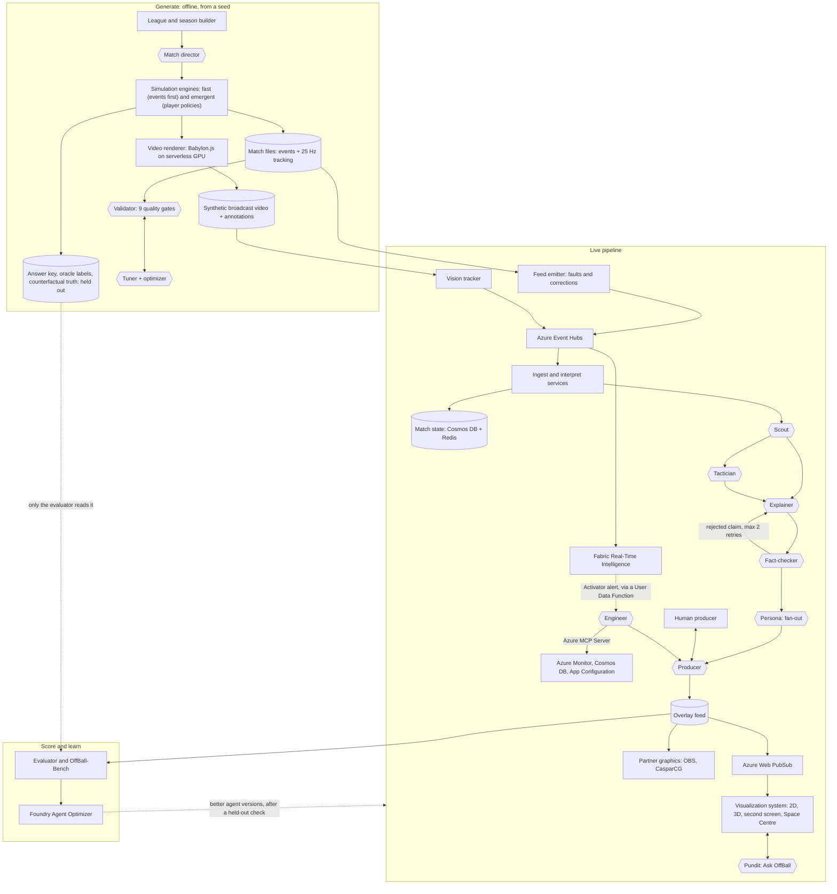
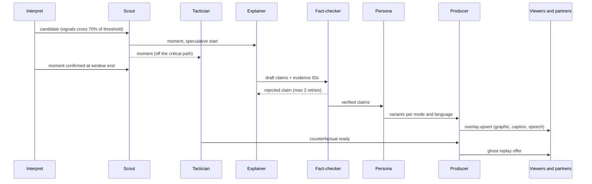
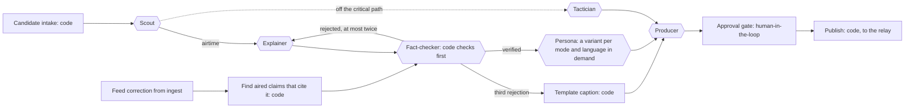
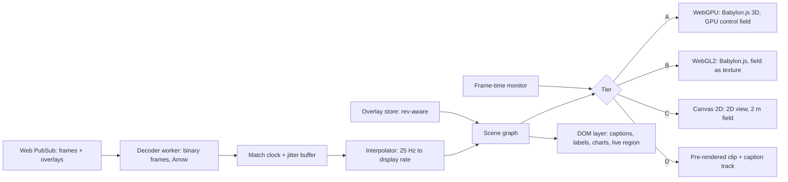
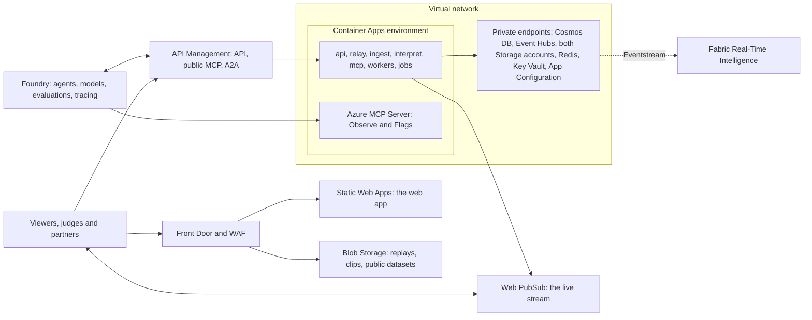
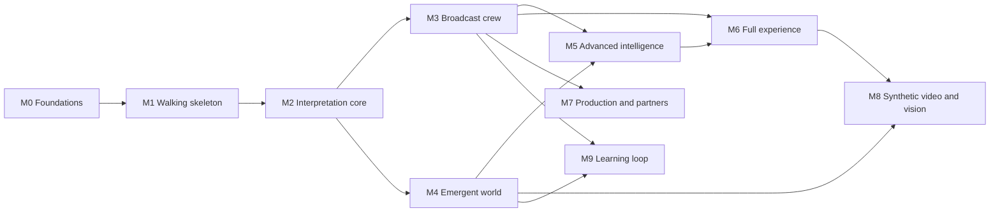

# OffBall: Product Requirements Document

**Making space visible: explainable off-ball match intelligence from synthetic football data**

| | |
| --- | --- |
| Event | Microsoft Premier League Hackathon |
| Document | Product requirements, full-potential plan, 21 October 2026; backend, AI and deployment specified 24 October 2026 |
| Planning basis | Full scope at its highest potential. Work is ordered by dependency, not by date, and nothing is cut to fit a schedule. |
| Prize targets | Grand Prize; Category Prize: Best Multi-Agent System (fallback: Best Use of Microsoft Foundry Project) |
| Technology focus | Priority 1: Microsoft Foundry, Microsoft Agent Framework and MCP (our own server, plus Azure MCP Server at runtime). Priority 2: Microsoft Fabric Real-Time Intelligence. GitHub's developer tools are not part of the plan (section 17). |
| Product name | OffBall (working name, pending a name check) |

All times in this document are Pacific Time (PT) unless stated otherwise. Rule references such as "rule 4.7" point to sections of the hackathon's Official Rules.

---

## Contents

1. [Summary](#1-summary)
2. [Scope at a glance](#2-scope-at-a-glance)
3. [Hackathon context](#3-hackathon-context)
4. [Rules compliance matrix](#4-rules-compliance-matrix)
5. [Problem](#5-problem)
6. [Vision and product principles](#6-vision-and-product-principles)
7. [Goals and non-goals](#7-goals-and-non-goals)
8. [Users, modes and surfaces](#8-users-modes-and-surfaces)
9. [Solution: the five-stage pipeline](#9-solution-the-five-stage-pipeline)
10. [Signature experiences](#10-signature-experiences)
11. [Architecture and backend services](#11-architecture-and-backend-services)
12. [Synthetic data generator](#12-synthetic-data-generator)
13. [Interpretation models](#13-interpretation-models)
14. [Agents](#14-agents)
15. [Experience design](#15-experience-design)
16. [Visualization system](#16-visualization-system)
17. [Microsoft technology](#17-microsoft-technology)
18. [Platform, deployment, operations and trust](#18-platform-deployment-operations-and-trust)
19. [Evaluation and success metrics](#19-evaluation-and-success-metrics)
20. [How we score against the judging criteria](#20-how-we-score-against-the-judging-criteria)
21. [Demo video and judge testing](#21-demo-video-and-judge-testing)
22. [Submission package](#22-submission-package)
23. [Roadmap](#23-roadmap)
24. [Risks](#24-risks)
25. [Submission checklist](#25-submission-checklist)
26. [Open questions](#26-open-questions)
27. [Beyond this PRD](#27-beyond-this-prd)
28. [References](#28-references)

---

## 1. Summary

Most of what decides a goal happens away from the ball, but live graphics and statistics describe only the ball. OffBall makes space visible. It ingests a live synthetic match feed and computes, frame by frame, who controls each part of the pitch, what each square metre is worth, and whose movement created it. Eleven AI agents in three crews, built on Microsoft Foundry and Microsoft Agent Framework and connected through MCP, then find the off-ball moments that create chances, explain why they matter, prove the cause by re-running the moment without the run, fact-check every claim, and tailor the story to each viewer. One of them, the Engineer, keeps the live show healthy through Azure MCP Server, and Microsoft Fabric Real-Time Intelligence turns the live stream into dashboards, alerts and season-scale answers. The agents also learn: their scores on an open benchmark feed Foundry's Agent Optimizer, and a new version goes live only if it scores better on matches it has never seen.

Viewers get that story in the form that suits them: timed overlays on a 2D tactical view or a 3D broadcast view, spoken commentary in ten languages, an audio-described feed for blind and low-vision fans, a second-screen companion, answers to their own questions, and the chance to change one player's decision and watch the moment re-run. A dedicated visualization system keeps every one of those views in sync with the match clock, holds its frame rate, reads clearly in any theme and for colour-blind viewers, and steps down gracefully from a GPU-rendered 3D scene to a plain 2D canvas or a pre-rendered clip on weaker devices, instead of breaking.

The foundation is a synthetic football world: a fictional 20-club league whose matches come from two calibrated simulation engines. Because we own the world, we know the truth. Every planted moment has a known answer, every player's intent is logged, and any moment can be replayed with one thing changed. That lets OffBall show how often its AI is right, and lets anyone measure their own system the same way through an open benchmark.

What we submit:

- A public GitHub repository, newly created for this hackathon
- A hosted web demo that judges can use free until the end of judging, plus one-command local and cloud deployment
- A demo video under two minutes
- A project description naming the Microsoft and Azure technologies used
- OffBall-Bench: an open synthetic dataset and benchmark for off-ball moment detection, with answer keys and a datasheet

---

## 2. Scope at a glance

OffBall is planned at its highest potential. Work is ordered by dependency, not by date, and nothing is cut to fit a schedule. The Official Rules still govern everything (section 4).

| Area | Scope |
| --- | --- |
| Planning | Dependency-ordered milestones, each one demoable (section 23) |
| Simulation | Two engines: an events-first engine for scale, and an emergent engine where 22 player policies make the play happen (12.4) |
| Tracking | 25 Hz with body orientation; a 10 Hz feed derived for calibration checks |
| League | 20 clubs, 500 players, a full 380-match season |
| Story moments | 16 types plus 2 null types, plus emergent moments labelled by the generator's oracle |
| Quality gates | 9, including a discriminator gate and a diversity gate |
| Interpretation | Space control, space value (EPV), off-ball scoring opportunity, off-ball credit, run classification, ghosting and counterfactual credit, plus pass difficulty and xG |
| Agents | 11 in three crews, including an Engineer that uses Azure MCP Server at runtime; human-in-the-loop, checkpoint resume, A2A and a public MCP endpoint |
| Learning | Agents improve against OffBall-Bench through Agent Optimizer, procedural memory and an optional reinforcement-learning track, each gated on held-out matches (14.9) |
| Visualization | A tiered visualization system: WebGPU 3D, WebGL2, Canvas 2D and pre-rendered fallbacks, adaptive quality, declarative charts (section 16) |
| Modes | 6: Casual, Learn, Analyst, Player focus, Audio-described and Broadcaster |
| Languages | 10 launch languages, text and voice |
| Fan features | Ask OffBall voice Q&A, Change one decision, a second-screen companion, the Space Centre whip-around, share cards and vertical clips |
| Broadcaster | Live partner protocol with retractions; OBS and CasparCG reference templates; a producer console with human approval |
| Auto-eventing | From tracking, and from synthetic broadcast video through a vision pipeline |
| Microsoft technology | Four hero technologies used in depth: Foundry, Agent Framework and MCP with Azure MCP Server (priority 1), and Fabric Real-Time Intelligence (priority 2); GitHub's developer tools are not used (section 17) |
| Evaluation | Answer-key scores, a public benchmark, human studies, red-teaming, chaos-recovery and visual-performance scores |

---

## 3. Hackathon context

This section summarises the parts of the Official Rules that shape the product, so this PRD can be read on its own.

### 3.1 The challenge

Build an AI-powered solution that turns **synthetic football events** into **explainable match intelligence**: real-time narratives and automated recaps suitable for studio, broadcast or streaming, which fans in any market can tailor. The solution runs as one pipeline with five stages:

| Stage | What the challenge asks for |
| --- | --- |
| Ingest | Take synthetic match events as they happen: passes, shots, tackles, possession changes, pressure events, match metadata |
| Interpret | Turn events into meaningful statistics, patterns and context |
| Explain | Say why a moment matters, not only that it happened |
| Render | Produce output that can sit on screen alongside the match, timed and machine-readable enough for synchronized overlays |
| Personalize | Make the same intelligence two genuinely different experiences for an analyst and a casual fan: modes, favourite clubs, favourite players, a player-focus mode, language, a chosen metric |

The challenge also lists feature areas to consider: player identification with speed and distance indicators, pass quality, speed metrics, auto-eventing, narrative generation, explainability, data innovation and multi-language storytelling. Section 9.2 maps each one to OffBall.

The rules warn against doing only half the job: a project that only generates metrics has no audience, and one that only personalizes has nothing to personalize. OffBall does both.

### 3.2 Key dates

Listed because some rules depend on them, such as judge access until the end of judging (rule 4.8). They don't set the scope of this plan.

| Milestone | Date and time (PT) |
| --- | --- |
| Registration period | 29 Sep 2026, 9:00 am to 20 Oct 2026, 12:00 pm (closed) |
| Submission and hackathon period | 6 Oct 2026, 9:00 am to 27 Oct 2026, 11:59 pm |
| Judging period | 27 Oct 2026, 9:00 am to 10 Nov 2026, 11:59 pm; the demo must stay live, free and unrestricted throughout |
| Winners announced | By 20 Nov 2026, 11:59 pm; prize forms due 10 business days after Microsoft sends them |

### 3.3 Eligibility and team

- Up to 4 individuals per team, each at the age of majority where they live. One member is the **Representative**, who enters the submission on the team's behalf.
- Residents of places where US or local law prohibits taking part are not eligible. The rules name Brazil, Quebec, Russia, the Crimea region, Cuba, Iran, North Korea, Sudan, Syria and other OFAC-designated countries.
- Also not eligible: employees, representatives and agents of Microsoft or the Premier League, and their immediate family and household members; anyone involved in running the hackathon; judges and their employers; and affiliates of any of these.
- The project must not have received financial or preferential support from Microsoft: funding, a development contract or a commercial licence (rule 4.12).

### 3.4 How we are judged

- **Stage one (pass or fail):** does the project reasonably fit the theme and use the required technologies?
- **Stage two:** five equally weighted criteria, 20% each:
  1. Technological implementation: creative and optimized synthetic data, software quality, use of the hero technologies, clean and documented code
  2. Agentic design and innovation: agentic patterns, orchestration, MCP integration, multi-agent collaboration, novelty
  3. Real-world impact and applicability: problem size, production readiness, impact on users and businesses
  4. User experience and presentation: design, a video that communicates value, a balance of frontend and backend
  5. Adherence to the hackathon category
- **Ties** go to the higher score on criterion 1, then criterion 2, and so on down the list.
- Judges may judge only from the video, description and images, without testing the app. **The video and description must stand on their own.**
- Judges may reassign a project to a better-fitting category.

The hero technologies named in criterion 1 are Microsoft Foundry, Microsoft Agent Framework, Azure MCP, GitHub Copilot agent mode, Microsoft Fabric, the GitHub SDK, the GitHub CLI, Azure app and AI services, and Azure databases.

### 3.5 Prizes we target

A project can win one Grand Prize and up to one Category Prize.

| Prize | Per team member |
| --- | --- |
| Grand Prize, first place | $4,000 cash as an e-gift card, a Premier League match ticket (approx. $1,000), a $50 Premier League store voucher |
| Grand Prize, second place | $2,500 cash as an e-gift card, a Premier League match ticket, a $50 store voucher |
| Category Prize (each) | $1,500 cash as an e-gift card, a $50 store voucher |

**Our category: Best Multi-Agent System** (the prize table in the rules calls it Best Multi-Agent Orchestration). Judges assess whether specialized agents have distinct roles, coordinate through shared state and effective handoffs, recover from failures, and deliver an end-to-end outcome a single agent could not reach as effectively. Accepted orchestration approaches include GitHub Copilot, Microsoft Agent Framework and A2A. Section 14 is written against these tests.

---

## 4. Rules compliance matrix

Every rule that constrains the product, and how OffBall meets it. Owners are named at kickoff (open question 1).

| Rule | Requirement | How OffBall complies | Evidence | Owner |
| --- | --- | --- | --- | --- |
| 1 | Submit within the submission period | Every milestone leaves the project submittable (section 23); the Representative submits on the Projects page within the period | Projects page entry | Representative |
| 3 | Eligible entrants; teams of up to 4; one Representative | Roster checked against the exclusions in 3.3 before submitting | Internal roster (not part of the submission) | Representative |
| 4 | A new solution that answers the challenge and fits at least one category | All five stages implemented (section 9); category Best Multi-Agent System (section 14) | Description, video, repo | All |
| 4.3 | Installs and runs consistently, and works as the video and description show | `docker compose up` locally, `azd up` to any Azure subscription, and the hosted demo; the video is recorded from the deployed build; CI runs smoke tests, visual regression and quality gates on every push | README, CI badges, hosted URL | Platform lead |
| 4.3 | Runs on its intended platform | Web app for current desktop and mobile Chrome, Edge, Safari and Firefox, installable as a PWA; rendering tiers cover devices without WebGPU (16.2); platform stated in the description | Description, device test matrix | Experience lead |
| 4.3 | New projects only, created after the registration period opened on 29 Sep 2026 | New repository created in October 2026; no code carried over from earlier projects | Git history | All |
| 4.3 | Authorized use of third-party SDKs, APIs and data | Calibration data only under MIT and CC BY 4.0 (12.2); 3D models, textures and fonts are our own, CC0 or SIL OFL; dependencies used under their licences | `ATTRIBUTION.md`, `LICENSE`, lockfiles, SBOM | Data lead |
| 4.4 | Pitch: what we built, which Microsoft and Azure technologies, what it does, what problem it solves | Draft in 22.1 | Projects page | Representative |
| 4.4 | Video under 2 minutes, showing the project running on its platform, at a public YouTube, Vimeo, Facebook Video or Youku URL, with no unlicensed third-party marks or music | 1:55 cut recorded from the live app; fictional clubs and players; no league or club marks; no music, or only music we have rights to; synthetic voices only, none imitating a real person | Public video URL | Experience lead |
| 4.4 | A public GitHub repository | Repo public no later than submission; open-source licence (MIT proposed) | Repo URL | Platform lead |
| 4.4 | Not a winner in any other contest; no prohibited content | Not entered elsewhere; no obscene, violent, defamatory, political, alcohol, drug or tobacco content; Content Safety filters on every generated text the Pundit returns | Review before submission | Representative |
| 4.5 | Multiple submissions must differ substantially | One submission only | n/a | Representative |
| 4.6, 4.11 | Original work, solely owned; open source allowed when licences are followed and we build on it | All product code written by the team; open-source libraries used as dependencies, not resubmitted as our own | Repo, `ATTRIBUTION.md` | All |
| 4.7 | Synthetic, football-realistic data; no footage is provided; any footage used must be licensed | All match data is synthetic. Real open data only fits aggregate parameters, and the novelty and discriminator gates show no real sequence is copied (12.10). The only video is our own synthetic broadcast render of our own 3D scene; no real footage is used. | Quality-gate report, `DATASHEET.md`, README "Data provenance" section | Data lead |
| 4.8 | Judges get a working link, free and unrestricted until judging ends; login details if it's private | Public URL with no login, live until 10 Nov, 11:59 pm PT; replay mode served from a CDN; static fallback build and pre-rendered clips in the repo | Testing instructions | Platform lead |
| 4.9 | All materials in English | Description, video narration, README and testing notes in English. Other languages are a feature, and English is always available. | Submission | All |
| 4.10 | One authorized Representative | Named at kickoff (open question 1) | Projects page | Team |
| 4.12 | No financial or preferential support from Microsoft | No Microsoft funding, contract or special licence; Azure used on terms open to every entrant | Team confirmation | Representative |
| 5 | Changes after the submission period only with Microsoft's permission | Submission treated as final at the end of the submission period | n/a | Representative |
| 7 | Promotion Entities get a perpetual, royalty-free, commercial licence to the submission; no malware | Only material we can license that way: our own code and assets, fitted parameters from commercially usable sources (StatsBomb excluded, 12.2), CC0 or OFL assets; code, dependency and secret scanning in CI | `ATTRIBUTION.md`, CI security scans | Platform lead |
| 8.2 | Each winner's role in creating the submission is verified | Internal contribution log kept for affidavits (not published, see rule 14) | Internal log | Representative |
| 14 | No team member's personal data in submission materials | No names, emails or photos of team members in the repo, video or app. The app collects no viewer personal data: preferences stay in the browser, Pundit questions and voice audio are processed in memory and not stored, and pairing codes expire. Human-study results are published only as aggregates. | Repo review | Representative |

---

## 5. Problem

Fans see the pass and the finish, not the gap that made both possible. Take a decoy run that drags a centre-back 10 m out of position: it never appears in the numbers, and the player who made it gets no credit.

| Audience | What they miss today |
| --- | --- |
| Casual fans | The off-ball movement that creates chances; they only see the ball |
| New fans and younger fans | Why anything happens at all; tactical language is a wall |
| Blind and low-vision fans | Audio commentary describes the ball, and almost never the shape of the play or where space is opening |
| Analysts, coaches and scouts | Space and off-ball value, which usually arrive after the match from tactics cameras and tracking tools, and rarely credit the player who made the space |
| Broadcasters | Explainable space graphics live, which today need tracking data, an analyst in the gallery and a graphics operator |
| Fans outside English-speaking markets | Tactical storytelling in their own language and football vocabulary |
| AI builders and researchers | Ground truth: real tracking can't say what a player intended or what would have happened without their run, so football AI is hard to test |
| Everyone | Trust: AI commentary that explains things can't easily be checked, so a wrong story can go to air |

**Problem statement.** During a live match, detect the off-ball moments that create chances, prove why they mattered, and render them as synchronized visuals, words and sound tailored to each viewer, with every claim traceable to the data.

**Pitch.** OffBall makes space visible: watch the gap open before the goal, see what would have happened without the run, and hear it told your way.

---

## 6. Vision and product principles

**Vision.** Every viewer, in any language and at any level of football knowledge, sees the play behind the play, and can trust what they are told about it.

| Principle | What it means in practice |
| --- | --- |
| Show the space, don't just say it | Every explanation has a visual anchored to the pitch: a gap ring, a run arrow, a ghost. Words point at pictures. |
| Every claim is traceable | Each number and statement cites event or frame IDs, and nothing unverified airs. |
| Ground truth by construction | We generate the world, so we can grade the AI against what really happened, including what didn't happen. |
| Deterministic where possible, agentic where judgement is needed | Physics, metrics and verification of numbers are code. Agents decide what matters, how to say it and to whom. |
| Degrade, never lie | Every failure path falls back to something simpler that is still true: a template caption, a lower rendering tier, silence. Never an unchecked claim. |
| Graceful everywhere | Visuals hold their frame rate, stay in sync and stay legible from a phone on 4G to a 4K broadcast output, in light and dark themes, for colour-blind viewers and with reduced motion. |
| One intelligence, many experiences | Casual, learner, analyst, player-focused, audio-described and broadcaster views are different products built on the same verified facts. |
| Open by default | Data contracts, the benchmark, the MCP tools and the overlay protocol are public, so others can build on OffBall. |

---

## 7. Goals and non-goals

### 7.1 Goals

1. **A synthetic football world.** A fictional 20-club league and season; matches from two calibrated engines; 25 Hz tracking with body orientation; a held-out answer key of planted moments, oracle labels for emergent ones, and counterfactual truth for every labelled moment.
2. **Live off-ball intelligence.** Find space-creating moments and put a verified explanation on screen within 3 s (p95) of the moment ending, at 1x match speed, for up to 10 concurrent live matches.
3. **Proven causes.** A counterfactual replay ("what if the run hadn't happened?") for every aired moment, within 15 s, with off-ball credit given as a distribution rather than a single guess.
4. **A multi-agent system that earns its agents.** Eleven agents in three crews with distinct roles, typed handoffs, shared state, human-in-the-loop, recovery from injected failures, and an outcome no single agent matches (section 14).
5. **Graceful visualization.** 2D and 3D match views, overlays and charts that stay frame-synced, hold their frame-time budgets, adapt quality to the device, and have a text equivalent for every visual (section 16).
6. **Six viewing modes in ten languages**, with voice, plus a second-screen companion and the Space Centre whip-around.
7. **Accessibility as a feature.** An audio-described mode designed for blind and low-vision fans, and WCAG 2.2 AA across the product.
8. **Broadcast-ready output.** A timed, revisable overlay protocol with reference templates for OBS and CasparCG, and a producer console with human approval.
9. **Proof in the submission.** A fidelity report for the data, OffBall-Bench scores for the AI, visual-performance scores for the renderer, and an agent trace showing a failure and its recovery, all shown in the video.
10. **Production readiness.** One-command deploys, SLOs, load and chaos tests, security baselines, cost controls and a transparency note.
11. **Four hero technologies, used in depth.** Microsoft Foundry, Microsoft Agent Framework and MCP (with Azure MCP Server at runtime) carry the agent system; Microsoft Fabric Real-Time Intelligence carries live analytics and alerts. Each is visible in the video and named in the description (section 17).
12. **Agents that learn.** OffBall-Bench is the agents' training signal as well as their exam: every released version scores better than the last on held-out matches, and the video shows it (14.9).

### 7.2 Non-goals

- Real match footage, or ingesting real tracking in the submitted demo. No footage is provided (rule 4.7), and the demo stays fully synthetic. A real-data adapter is a production path, described in section 27.
- Real clubs, players, badges, kits, league marks or commentators' voices.
- Betting, odds or fantasy features.
- User accounts or stored viewer data.
- Native app-store apps. The installable PWA covers phones, tablets and TVs with a browser.
- Biomechanics or 3D pose estimation. 3D players are animated from speed and orientation, not from estimated poses.
- A free-form tactics board where viewers place players or draw moves. Change one decision (10.10) covers what-ifs whose results can be checked; arbitrary set-ups could not be.

---

## 8. Users, modes and surfaces

### 8.1 Viewing modes

The same verified intelligence reaches six audiences as genuinely different experiences, not one caption at six lengths.

| Mode | Who | What they see and hear | Example |
| --- | --- | --- | --- |
| Casual fan | Follows the game, not the tactics | One overlay at a time: the runner, the gap, the pass; plain words; voice optional; no numbers they don't need | "Watch No. 9. This run isn't to get the ball. It's to pull a defender away." |
| Learn | New and younger fans | Casual, plus a short definition the first time each idea appears, a pause-and-explain button, and a personal glossary that grows as they watch | "That was a decoy run: a run made so a teammate gets space. You've now seen 2 today." |
| Analyst | Coach, scout, data-literate fan | Space-control field, space value, defender displacement in metres, zone control %, pass difficulty, xG, off-ball credit with intervals, momentum ribbon, counterfactual split view, evidence panel with event and frame IDs, and charts on demand | "Decoy run: No. 9 moves 20 m on a diagonal. CB No. 5 tracks 10.8 m. Space created 41 m² (90% interval 33–48); without the run, the gap stays shut in 29 of 32 re-runs." |
| Player focus | Fan of one player | The view follows that player, with a running tally of off-ball work: runs made, defenders dragged, space and threat created, sprints and distance, and season context | "Your player has dragged 3 defenders and created 41 m² of space, with no shot yet. That's a season high." |
| Audio-described | Blind and low-vision fans, and anyone listening without a screen | A spoken description of shape and space, not just the ball, paced to the play, with optional stereo-panned cues for where on the pitch space is opening | "Kestrel attack left to right. Ball with No. 8 in midfield. No. 9 sprints diagonally to the right wing, and Ashmoor's No. 5 follows. A gap opens in the centre, just outside the box. No. 10 runs into it." |
| Broadcaster | Studio producer, rendering partner | The producer console: a queue of upcoming graphics with confidence and evidence, approve, hold, skip and retract controls, a recap builder, and the live overlay protocol | `overlay.upsert` and `overlay.retract` messages with start and end times and evidence IDs |

### 8.2 Personalization controls

In every mode, without an account and kept on the device:

- Language (10 at launch, 15.3) and voice on or off
- Favourite club: its colours, "your team" framing, and spoiler-safe recaps
- Favourite player: highlighted on the pitch, with milestones called out
- One metric the viewer cares about, for example pass difficulty, sprint speed or space created
- Overlay density (minimal, standard, rich) and reduced motion
- Theme: light, dark or high-contrast
- Adaptive density: the viewer hides or shows groups of pitch graphics from an Overlays menu on the pitch; the app remembers it for each mode and shows fewer graphics in a mode where they hide two groups, on device only (15.2, 15.9)

Viewers set these at first run (15.8) and change them any time in the Personalize drawer (15.9).

### 8.3 Surfaces

| Surface | For | What it does |
| --- | --- | --- |
| Match view (web app, installable PWA) | Everyone | 2D tactical and 3D broadcast views, overlays, captions, voice, the analyst panel, replay controls and Change one decision |
| Second-screen companion | Fans watching on a TV or another screen | Pairs with a 6-character code or QR code; shows player focus, stats, charts and Ask OffBall while the main screen shows the match |
| First run | New viewers | Four skippable choices with a live preview of how captions will read (15.8) |
| Space Centre | Fans following a whole matchday | Live whip-around across up to 10 matches that jumps to the biggest off-ball moment anywhere (15.10) |
| Producer console | Broadcasters | Approves and schedules graphics, retracts corrected ones, builds recaps, and shows latency, cost and agent traces |
| Partner overlay feed | Rendering partners | A live WebSocket and Server-Sent Events protocol plus JSONL files, with JSON Schemas and reference HTML templates for OBS and CasparCG |
| Recap and share | Fans and social teams | Halftime and full-time recaps, share cards, vertical clips and data exports |
| Developer surfaces | Developers and other agents | A read-only REST API, a public read-only MCP endpoint, A2A agent cards for the Pundit and Producer, and TypeScript and Python SDKs |

---

## 9. Solution: the five-stage pipeline

### 9.1 Stage by stage

| Stage | OffBall component | What it does |
| --- | --- | --- |
| Ingest | Feed emitter, Azure Event Hubs, ingest service; vision tracker for synthetic video | Streams events and 25 Hz frames at 1x to 60x with realistic feed faults: late events, duplicates, corrections, frame drops. Or derives tracking from synthetic broadcast video. Deduplicates, reorders within a 2 s window, interpolates frame gaps up to 0.4 s and applies corrections. Mirrors the stream into Fabric Real-Time Intelligence. |
| Interpret | Interpret service and model library (deterministic code and trained models; no LLM) | Space control, space value, off-ball scoring opportunity, off-ball credit, run classification, physical metrics, pass difficulty, xG, team shape and pressure, the control index and momentum, and auto-eventing. Emits candidate moments with signal strengths. |
| Explain | Broadcast crew: Scout, Tactician, Explainer, Fact-checker | The Scout picks moments for airtime. The Tactician proves the cause with counterfactual re-simulations. The Explainer writes structured claims with evidence. The Fact-checker verifies each claim, and re-verifies aired claims after a correction. |
| Render | Producer agent, overlay feed, Azure Web PubSub, visualization system, partner templates | The Producer schedules graphics without collisions, with human approval where configured. The overlay feed carries timed, anchored graphics, voice lines, chart specs and retractions. Renderers draw them in sync with the frame clock at the best quality the device can hold. |
| Personalize | Persona agent, Pundit agent, viewer settings | Re-voices and filters per mode, club, player, metric, language and voice; answers each viewer's own questions; adapts overlay density on device. |

### 9.2 Challenge feature coverage

| Challenge feature area | Coverage | How OffBall delivers it |
| --- | --- | --- |
| Player identification: real-time name tags, speed and distance indicators at thresholds | Full | Name tags on the 2D and 3D views. Badges appear above 25.2 km/h (sprint), at 19.8 km/h for high-speed running in the analyst view, and at each kilometre covered. |
| Pass quality: distance, accuracy, difficulty | Full | Pass distance and completion per player and team. Difficulty on a 0–10 scale from a model trained on the generator's true completion probabilities, so its calibration is measured, not assumed. |
| Speed metrics: ball speed and shot speed | Full | Computed from the ball's tracked 3D path; shown on passes and shots above set thresholds. |
| Auto-eventing: generate metrics automatically rather than by hand-tagging | Full | Events derived automatically from raw tracking, and from synthetic broadcast video through detection, tracking and pitch registration. Both are scored against the generator's ground-truth events (10.9). |
| Narrative generation: key narratives, player-performance context, milestones, recaps | Full | Live moment narratives; season context ("the third defender No. 9 has dragged today, and the 41st this season"); milestones; halftime and full-time recaps with replays, share cards and vertical clips. |
| Explainability: control vs chaos, pressure changes, game rhythm | Full | Every moment explained by its cause and proved by counterfactual. A control index shows control versus chaos. Press-height and line-height shifts mark pressure changes. A momentum ribbon of space value shows game rhythm. |
| Data innovation: create or extend synthetic, football-realistic datasets | Full | The calibrated two-engine generator, orientation-aware tracking, oracle labels, counterfactual truth, synthetic broadcast video with annotations, and OffBall-Bench (section 12) |
| Multi-language storytelling | Full | Ten launch languages in text and voice, with a reviewed football glossary per language and right-to-left layout for Arabic |

---

## 10. Signature experiences

Ten experiences that carry the product. Each lists its acceptance criteria.

### 10.1 The space layer

The core view: a live field showing which team controls each part of the pitch, with gap rings where space opens, run arrows for the runs that opened it, and pass lines into the gap.

- The control field updates at the display's refresh rate from 25 Hz data, with no visible stepping.
- A gap ring appears no later than the pass into the gap.
- Colour is never the only encoding: contested space also shows contour lines (16.3).

### 10.2 "What if they hadn't run?"

For each aired moment, the Tactician re-simulates the moment from the observed state, 32 times with the run and 32 times without it, and shows the difference as translucent ghost players in a split or overlaid replay.

- Ready within 15 s (p95) of the moment ending.
- Credit is a distribution: captions quote the median, and the analyst view shows the 90% interval.
- On OffBall-Bench, the Tactician's estimate is compared with the generator's true counterfactual (19.2).

### 10.3 Off-ball credit

Every player gets **Space Created** (m²) and **Threat Created** (gain in space value) for their off-ball work, per moment, per match and across the season, with a leaderboard per club and for the league.

- Defenders get credit too, for cover shadows and runners correctly passed on (12.7).
- Per-role checks confirm the model doesn't systematically under-credit any position (18.7).

### 10.4 Ask OffBall

Fans ask questions by text or voice ("Why does Ashmoor's left side keep getting overloaded?"). The Pundit plans queries, runs them through MCP tools and the Fabric data agent, may hand off to the Tactician for a what-if, has every claim fact-checked, and answers in the viewer's mode and language, often with a chart.

- Every answer cites evidence; anything it couldn't verify is labelled as such.
- Out-of-scope or unsafe requests are declined.
- Answers that include a chart return a declarative chart spec, rendered in the viewer's theme (16.4).

### 10.5 Audio-described match

A spoken feed that describes shape and space, designed with and for blind and low-vision fans, paced so it never talks over itself, with optional stereo-panned cues for where on the pitch space is opening.

- Works with the screen off.
- Spoken lines never lag the play by more than 4 s.
- Tested with blind or low-vision users where we can recruit them; any part not tested that way is labelled unverified in the report.

### 10.6 Producer console and live corrections

A human producer sees the queue of upcoming graphics with confidence and evidence, and can approve, hold, skip or retract them, or switch to automatic. When the feed corrects an event (for example, a goal reassigned to another scorer), the Fact-checker re-verifies every aired claim that cited it, and the Producer retracts or patches the graphic with a visible "Correction" tag.

- Correction to retraction on screen within 5 s.
- Every producer decision is logged in the trace.
- The Engineer agent's health notes, and any degrade flag it changed, appear in the console with an undo.

### 10.7 Space Centre

A matchday whip-around: the Scout ranks moments across up to 10 concurrent matches, and the view jumps to the biggest off-ball moment anywhere, with a ticker of the others.

- No moment is shown out of its own match's clock.
- A viewer can pin a match to stop the whip-around.

### 10.8 Recap package

Halftime and full-time recaps of the top space moments, a Space Created leaderboard, shareable player cards, and vertical clips rendered from the 3D view with captions burned in and a synthetic-data label.

- Recaps can be made spoiler-safe.
- Clips render headlessly in the cloud and stay under 30 s.

### 10.9 Synthetic broadcast video and vision auto-eventing

The 3D scene is rendered as broadcast-style video with a moving camera, together with exact per-frame annotations: bounding boxes, player IDs, pitch positions and camera parameters. A vision pipeline detects and tracks players, maps them to the pitch, and auto-events the match from video alone. Its output is scored against the generator's truth.

- The video pipeline feeds the same interpret service as the tracking feed.
- The annotated video set is published for computer-vision researchers.

### 10.10 Change one decision

Viewers pick a player at a moment and change one thing they did: make a different run, hold the line instead of following, play a different pass. The Tactician re-runs the moment from that point 32 times with the change, and OffBall shows what would have happened next to what did, on the pitch and in numbers. It turns "what if they hadn't run?" (10.2) from one question OffBall asks into any question a viewer asks, within the options the moment really offered.

- **Only options the moment offered.** The choices are the ones open to that player at that moment, worked out from the observed state: the run types the run classifier knows, a pass to each teammate with its difficulty, and the defending options (track the runner, pass the runner on, hold the line). They are ranked by modelled value. The generator's own decision log stays held out (12.9) and is used only to grade the results.
- **One change per re-run.** Everything else plays out from the observed state as the engine would play it. Changing two decisions at once, or placing players freely, is out of scope (7.2).
- **The same visual grammar.** Ghost players with dashed trails follow the changed path, the control field switches to the changed world, a ring shows where space opens or stays shut, and a changed pass is drawn dashed (15.2). Side by side works as it does for 10.2.
- **Results as distributions.** How often the gap opens, and how many shots and goals, out of 32 re-runs; space created with its 90% interval; the best chance's xG. Each sits beside what happened. Casual and Learn get one plain sentence and the counts; Analyst adds intervals and each option's modelled value.
- **Labelled for what it is.** A simulation of a synthetic match from the observed state, not a prediction or coaching advice; AI-generated and fact-checked like any caption.

Acceptance criteria:

- In replay, every option's result is precomputed and shows within 2 s; live, a result is ready within 15 s (p95), the same budget as 10.2.
- On OffBall-Bench, the Tactician's result for a changed decision is compared with the generator re-running the same change from its checkpoint (19.2).
- Re-runs are rate-limited per viewer. When the Tactician is busy, the viewer gets a place in line, and options already re-run stay one click away (15.11).
- Fully usable by keyboard and screen reader: players and options are listed as well as shown on the pitch, and the result is announced.

---

## 11. Architecture and backend services

This section shows the whole system, then specifies the backend that runs it: the services, the stream and API the finished frontend reads, the data stores, and how replays and live runs are made. The agents are specified in section 14 and deployment in section 18. `INTEGRATION.md` says what the frontend reads; this section says what sends it.

### 11.1 System overview



Hexagons are AI agents in Microsoft Foundry; everything else is deterministic code. Agents reach match data through the OffBall MCP server, and the Engineer and Validator reach Azure resources through Azure MCP Server (most of those lines are left out to keep the diagram readable). The answer key, oracle labels and counterfactual truth live in a separate storage account that no live-pipeline identity can read.

### 11.2 Components

| Component | Runs on | Language and notes |
| --- | --- | --- |
| Calibration fitter | Developer machine, CI, Fabric notebooks | Python; reads downloaded open data, writes `calibration/params.json` |
| League builder, both engines, feed emitter | Azure Container Apps jobs and services | Python and NumPy, with Numba for hot loops where profiling shows it pays; seeded and deterministic |
| Video and clip renderer | Azure Container Apps serverless GPU, headless Babylon.js | TypeScript; the same scene code as the 3D view |
| Vision tracker | Azure Container Apps serverless GPU | Python; detector, tracker and pitch registration |
| Ingest and interpret services | Azure Container Apps | Python; stateless, scale on Event Hubs lag |
| Agents | Microsoft Foundry hosted agents running Microsoft Agent Framework workflows; Container Apps workers as the fallback | Tools through Foundry Toolboxes, one per role; native A2A endpoints for the Pundit and Producer; improved by the learning loop (14.9) |
| OffBall MCP server | Azure Container Apps, behind Azure API Management | Match-data tools for agents; a public read-only subset for developers |
| Azure MCP Server (Observe and Flags instances) | Azure Container Apps, from Microsoft's `azmcp-foundry-aca-mi` template | Azure operations for the Engineer and Validator; each instance has its own managed identity and tool set (14.8) |
| Match state | Azure Cosmos DB, with Azure Managed Redis for hot frames | Partitioned by match; frames, events, metrics, agent messages, workflow checkpoints |
| Analytics | Microsoft Fabric: Eventstream, Eventhouse, Real-Time Dashboards, Activator, data agent, OneLake, notebooks, Power BI | KQL views of possession, territory, momentum, pressure and agent latency; alerts; season-scale questions (17.4) |
| Retrieval | Azure AI Search | Season moments, explanations and glossary, for the Pundit and season context |
| Real-time delivery | Azure Web PubSub, fed by the relay service | Overlay feed and frames to browsers, second screens and partners (11.6) |
| API | Azure Container Apps, behind Azure API Management | Python (FastAPI); the calls the frontend makes (11.7) |
| Counterfactual workers | Azure Container Apps | Python; run the emergent engine from the observed state for the Tactician, 32 re-runs in parallel |
| Web app | Azure Static Web Apps behind Azure Front Door | TypeScript; visualization system (section 16), PWA |
| Evaluator | CI job and an evaluation endpoint | Scores overlay feeds and agent outputs against held-out keys |

### 11.3 Meeting the frontend

The frontend is finished and runs on stand-ins that produce the same messages and answers a backend will (`INTEGRATION.md` section 1). The backend's job is to replace each stand-in with a service that sends the same shapes, so the frontend works unchanged apart from the small changes listed in `INTEGRATION.md` section 9. Every stand-in stays as the fallback when the backend can't be reached, so the demo never breaks.

| Frontend stand-in | Replaced by | Interface | Spec |
| --- | --- | --- | --- |
| `lib/feed/emitter.ts`: frames, graphics, captions, voice lines, clock and score | The live pipeline, delivered by the relay | The stream: Web PubSub, Server-Sent Events, or a JSONL replay file | 11.6 |
| `decide`, `retract`, `queue` and `correct` in `lib/feed/store.ts` | The API's producer actions and the broadcast crew's correction path | `POST …/approvals`; results come back on the stream | 11.7, 14.11 |
| `answer` and `suggestions` in `lib/pundit.ts` | The `ask` workflow, led by the Pundit | `POST …/ask`, streamed | 11.7, 14.11 |
| `DECISIONS` and `scenarioFor` in `lib/decisions.ts` | The `decide` workflow and the counterfactual workers | `GET …/decisions`, `POST …/runs` | 11.7, 14.11 |
| `lib/recap.ts` | The `recap` workflow | `GET` and `PUT …/recaps/{kind}`; `recap.published` on the stream | 11.7, 14.11 |
| `lib/content.ts`, `lib/stats.ts` | The interpret service's metric registry, cached | `GET …/stats/{name}` | 11.7 |
| `MATCHDAY` in `lib/content.ts` | The Scout's ranking across a round's matches | `round.moments` on the round's stream | 11.6 |
| `lib/pairing.ts`, which pairs tabs on one device | A Web PubSub group per pairing code | `GET /api/negotiate?pair=` | 11.6 |
| Sample results in `lib/eval.ts` and `lib/stats.ts` | The evaluator, the quality gates and Foundry evaluations | `GET /api/eval/latest` | 11.7, section 19 |
| The device's own voices in `lib/audio.ts` | The speech service, with Azure AI Speech | `speech[locale].audio_url` | 11.4 |
| `public/clips/*.mp4` | The renderer jobs | Clip URLs in recap moments | 11.4 |

Two frontend changes come on top of `INTEGRATION.md` section 9, both small: the negotiate call also names the viewer's mode and language, so the Persona produces only the variants someone is watching (14.4); and the producer console sends a run's producer token with its actions (11.7).

**New contracts.** These shapes are in use today but not yet published. Each one is added to `offball/contracts`, exported to `contracts/` and checked in CI like the rest (BE-1).

| Contract | Shape taken from | Used by |
| --- | --- | --- |
| `frame-message.schema.json` | `FrameMessage` in `web/src/lib/feed/types.ts` (`INTEGRATION.md` note 1) | Relay, frontend, partners |
| `answer.schema.json` | `Answer` in `web/src/lib/pundit.ts` | Pundit, API |
| `decision-point.schema.json`, `decision-result.schema.json` | `DecisionPoint` and the result in `INTEGRATION.md` 6.2 | Tactician, API |
| `recap.schema.json` | `RecapPackage` and `RecapMoment` in `web/src/lib/recap.ts` | Producer, API |
| `match-script.schema.json` | `MatchScript` in `offball/generator/script.py` | Match director |
| `alert.schema.json` | The typed alert Fabric publishes (17.4) | Engineer, producer stream |
| `round-moments.schema.json` | `MatchdayGame` in `web/src/lib/content.ts`, with positions in metres (`INTEGRATION.md` note 4) | Scout, Space Centre |

Version 2.1 of the contracts settles the other notes in `INTEGRATION.md` section 8. Ghost tracks move to `[t_ms, x, y]` once the frontend loads match windows from the backend; until then the relay converts them to the moment time the frontend reads. `speech[locale]` gains an optional `audio_url`.

### 11.4 Services

All Python services ship in one container image, `offball`, with one command per service (`offball serve api`, `offball serve relay`, and so on), so there is one build, one dependency set and one version to roll back. The renderer has its own image, because it needs Node, Chrome and ffmpeg.

| Service | Runs as | Reads | Writes | Scales on | State |
| --- | --- | --- | --- | --- | --- |
| `generator` | Container Apps job | League, scripts and seeds | Match files to Blob Storage; answer keys, intents and counterfactual truth to the truth account | One job per match | None |
| `emitter` | Container Apps job, one per live match | Match files | Feed messages to the `feed` hub at 1x to 60x, with faults (12.5) | One per match | Its place in the match |
| `ingest` | Container Apps app | `feed` hub | Clean events and frames to the `clean` hub; hot frames to Redis | Event Hubs lag | Reorder window per match, in memory |
| `interpret` | Container Apps app | `clean` hub, hot frames | `candidate` envelopes to match state; metrics to the `insights` hub | Event Hubs lag | Rolling window per match, rebuilt from Redis on restart |
| `crew` | Foundry hosted agents running the Agent Framework workflows (14.11); Container Apps workers as the fallback | Envelopes | Envelopes and overlays | One warm session per live match | Workflow checkpoints in Cosmos DB |
| `relay` | Container Apps app | `clean` hub, overlay changes, match status | Stream messages to Web PubSub; replay files to Blob Storage | Live matches, one owner per match | Last clock and status per match |
| `api` | Container Apps app (FastAPI) | Match state, Redis, Blob Storage | Approvals, run requests, recaps | HTTP requests | None |
| `mcp` | Container Apps app (FastMCP from MCP SDK 1.x, streamable HTTP) | Match state, Redis, the Eventhouse, AI Search | Producer and data-crew actions | HTTP requests | None |
| `cf-workers` | Container Apps app | Counterfactual jobs on a Redis stream | Results to the `runs` container | Queue length | None |
| `speech` | Container Apps app | Persona variants with speech markup | Audio files to Blob Storage | Queue length | None |
| `evaluator` | Container Apps app and CI job | Overlay feeds, the truth account | Scores | Requests | None |
| `renderer` | Container Apps serverless GPU jobs | Match files, overlays | Clips, video and annotations | One job per clip | None |
| `vision` | Container Apps serverless GPU | Synthetic video | Feed messages to the `feed` hub | One per video match | Tracker state |
| `azmcp-observe`, `azmcp-flags` | Container Apps, from Microsoft's template (14.8) | Azure resources | Degrade flags (Flags only) | Fixed | None |
| Sandboxed analysis | Container Apps dynamic sessions | Analysis code from the Pundit | Results | Sessions | Per session |

The code lives in the `offball` package: `offball/services/` (ingest, interpret, relay, api, and the state store that exists today), `offball/mcp/`, `offball/agents/` and `offball/eval/`. Locally every service runs from the same image under Docker Compose (18.15).

### 11.5 Event Hubs

One Event Hubs namespace carries the live data. Every hub is partitioned by `match_id`, so each match's messages stay in order, and every consumer is idempotent on `(match_id, seq)`, so re-reading a partition after a restart creates no duplicates.

| Hub | Written by | Read by (consumer group) | Carries | Retention |
| --- | --- | --- | --- | --- |
| `feed` | Emitter, vision tracker | Ingest (`ingest`); Fabric Eventstream (`fabric`) | Raw feed messages, faults included (12.8) | 1 day |
| `clean` | Ingest | Interpret (`interpret`); relay (`relay`); Fabric (`fabric`) | Deduplicated, reordered events and frames, and corrections | 1 day |
| `insights` | Interpret, crew, relay | Fabric (`fabric`) | Metrics, candidates, overlays and agent hops, for the KQL views (17.4) | 1 day |
| `alerts` | Fabric User Data Function (17.4) | Engineer (`engineer`); relay (`producer`) | Typed alerts | 1 day |

At 10 live matches the namespace carries about 250 frames a second plus events, overlays and metrics: a few megabytes a second at most. It runs on the Standard tier with 16 partitions per hub and auto-inflate, sized by load test (18.3). Locally the Event Hubs emulator stands in (18.15).

Counterfactual and speech jobs are work queues, not streams, so they use Redis streams with consumer groups instead, which also lets their workers scale on queue length.

### 11.6 The stream

The relay turns the pipeline's state into the messages in `INTEGRATION.md` section 4 and sends them to viewers, partners and producers.

**Groups.** One Azure Web PubSub hub, `offball`, with four kinds of group:

| Group | Who joins | Receives | Can send |
| --- | --- | --- | --- |
| `match.{match_id}` | Viewers and the partner template | `frame`, `overlay.upsert`, `overlay.retract`, `clock.sync`, `match.status`, `recap.published` | No |
| `producer.{match_id}` | The producer console, with a producer token (11.7) | Everything the match group gets, plus `pending` and `held` overlays, `incident` (the Engineer's notes and flag changes, 10.6) and `alert` | No; actions go through the API |
| `pair.{code}` | A main screen and its phones (15.5) | `hello`, `state` and `bye`, unchanged from `web/src/lib/pairing.ts` | Yes, to its own group only |
| `round.{round_id}` | The Space Centre | `round.moments`: the moments ranked across the round's matches, whenever the ranking changes and at least every 7 s | No |

**Connecting.** A client asks `GET /api/negotiate` for a client access URL, naming the match, round or pairing code, and its mode and language. The token in the URL lets it join only that group, and send only to a pairing group. Tokens last an hour, or two for pairing to match the code's life, and the frontend fetches a new one when it reconnects (`INTEGRATION.md` section 9). Messages go out as text with no subprotocol, so each WebSocket frame holds whole messages, one per line.

**What the relay guarantees.**

- **Approval before audience.** Overlays that are `pending` or `held` go only to the producer group. The match group first sees an overlay when it is `auto` or `approved`. The frontend already hides unapproved overlays, so nothing changes there, and unapproved graphics never reach a public stream.
- **One writer per match.** Each match is sent by exactly one relay replica, the owner of its Event Hubs partition, so revisions go out in order. A correction sends the replacement upsert first, then the retraction (`INTEGRATION.md` 4.3).
- **The clock never stops.** `clock.sync` goes out every second for every live match, from kick-off until the last viewer leaves, including quiet spells and after full time, because to the frontend silence means a stall.
- **Nothing late.** An upsert whose `t_end_ms` is already behind the viewers' 1.5 s buffer is counted as a late drop and not sent, since the frontend would drop it anyway. The late-drop rate is one of the Engineer's latency signals.
- **Frames in batches.** Frames go out five at a time, every 200 ms, one message per line. That cuts the message count fivefold and stays well inside the 1.5 s buffer.
- **Partners too.** The same messages are served as Server-Sent Events at `GET /api/matches/{match_id}/stream` for partners who prefer them, and as a JSONL file for replays.

**Data rate.** JSON frames, as the frontend reads them today, measure about 740 bytes each: 1.1 MB a minute at 25 Hz, against the 0.5 MB budget in 16.7. Batching doesn't reduce the bytes, so contract 2.1 adds a compact binary frame, quantized and delta-encoded as 16.7 assumes, decoded in the frontend's worker. Until it lands, live viewing uses about twice its data budget (open question 15).

### 11.7 The API

One FastAPI service behind API Management. The paths and shapes are the ones the frontend proposes in `INTEGRATION.md` section 6, which are the TypeScript types it already uses, so a backend that returns them needs no UI change. OpenAPI is generated from the code, and the TypeScript and Python SDKs from OpenAPI (12.8).

| Call | Replaces | Access | Answers |
| --- | --- | --- | --- |
| `GET /api/matches`, `GET /api/matches/{id}` | The fixed match in `web/src/lib/match.ts` | Public | Matches with their round and status; one match's `match.json` with its moment windows, so the frontend can show any match (`INTEGRATION.md` section 9) |
| `GET /api/negotiate` | Direct feed URLs; tab-to-tab pairing | Public | A Web PubSub client URL for one group (11.6) |
| `GET /api/matches/{id}/stream` | `npm run feed:serve` | Public | The match's stream as Server-Sent Events |
| `POST /api/matches/{id}/ask` | `answer` in `pundit.ts` | Public, rate-limited | Server-Sent Events: a `tool` event per tool call, then the `answer` (`INTEGRATION.md` 6.1) |
| `GET /api/matches/{id}/suggestions` | `suggestions` in `pundit.ts` | Public | Three questions about what just happened |
| `GET /api/matches/{id}/decisions` | `DECISIONS` in `decisions.ts` | Public | The decision points in a window, each with its options ranked by modelled value |
| `POST /api/matches/{id}/decisions/{point_id}/runs`, `GET …/runs/{run_id}` | `scenarioFor` in `decisions.ts` | Public, rate-limited | `200` with the result when it was precomputed; `202` with a place in line; `429` when busy |
| `GET /api/matches/{id}/recaps/{kind}` | `useRecapPackage` in `recap.ts` | Public | The recap package and its moments |
| `PUT /api/matches/{id}/recaps/{kind}` | `publishRecap` in `recap.ts` | Producer | Publishes it, and `recap.published` goes out on the stream |
| `GET /api/matches/{id}/stats/{name}` | `content.ts`, `stats.ts` | Public | Panel numbers and chart data, in the frontend's shapes |
| `POST /api/matches/{id}/approvals` | `decide` and `retract` in `store.ts` | Producer | `202`; the result arrives on the stream for every screen at once |
| `GET /api/matches/{id}/overlays/{overlay_id}/trace` | `traceFor()` in `ProducerConsole.tsx` | Producer | The steps behind one graphic: agent, start, end and kind |
| `POST /api/matches/{id}/flags/{flag}/undo` | The console's static undo | Producer | Reverts a degrade flag the Engineer changed (10.6) |
| `POST /api/live-runs` | The live-run limit state (15.11) | Public, fair use | A live match or Space Centre round with a producer token for it, or a place in line |
| `GET /api/eval/latest` | Sample results in `eval.ts` and `stats.ts` | Public | Raw distributions, bins, gate results and benchmark scores; the frontend computes the statistics itself |
| `POST /api/bench/submissions` | Nothing | Public, rate-limited | OffBall-Bench scores for a submitted overlay feed (19.1) |
| `GET /api/matches/{id}/events`, `…/frames`, `…/overlays` | Nothing | Public | Read-only developer access (8.3) |

The public MCP endpoint and the A2A agent cards for the Pundit and Producer sit behind the same API Management instance (14.8, 17.1).

**Producer access without accounts.** Producer actions change what other people see, so they need authority, but judges must be able to try the console freely (rule 4.8, 21.2). Starting a live run returns a producer token, signed by the API and scoped to that run's matches for as long as the run lasts: whoever starts a run produces it, with no account. The showcase replay's console keeps working on the device, as it does today. A broadcaster's own deployment signs producers in with Microsoft Entra ID and an app role instead (open question 18).

**Fair use.** At most 10 live matches run at once (18.3): one Space Centre round, or up to ten single matches, with one run per client at a time. Questions and re-runs are limited per client. API Management enforces the limits with a token bucket keyed on a hash of the client's address, held in memory at the gateway and never logged (18.6). Every limit answers `429` with `queue_position` and `eta_s`, which the frontend already shows as its busy states (15.11).

**Errors map to designed states.** Every failure a backend can cause already has a state in the frontend (15.11, and the table in `INTEGRATION.md` section 9). The API returns those conditions and never invents new ones.

### 11.8 Data stores

| Store | Container, key or index | Holds | Partition or layout | Kept for |
| --- | --- | --- | --- | --- |
| Cosmos DB (NoSQL) | `matches` | Match metadata, status, clock, score and live-run records | `/match_id` | Showcase and benchmark: for good; live runs: 7 days |
| | `envelopes` | Every typed hand-off: the event-sourced log (14.3) that `offball/services/state.py` keeps locally today | `/match_id`; id `{match_id}:{seq}` | As `matches` |
| | `overlays` | The current revision of every overlay, read by the API and the replay export | `/match_id` | As `matches` |
| | `checkpoints` | Agent Framework workflow checkpoints, through our implementation of the framework's checkpoint storage interface | `/match_id` | 1 day after full time |
| | `runs` | Counterfactual and changed-decision results, so an option already re-run stays one click away | `/match_id`; id `counterfactual_id` | As `matches` |
| | `incidents` | The Engineer's incidents and flag changes | `/day` | 30 days |
| | `recaps` | Recap packages, automatic and published | `/match_id` | As `matches` |
| Azure Managed Redis | `frames:{match_id}` | The last 60 s of clean frames: interpret's window, the Tactician's observed state, the API's live numbers | Sorted set by `t_ms` | 60 s, rolling |
| | `jobs:cf`, `jobs:speech` | Work queues | Redis streams with consumer groups | Until acknowledged |
| | `demand:{match_id}` | The modes and languages connected viewers are using, from negotiate | Hash with expiry | While viewers are connected |
| | `cache:*` | Panel stats and suggestions | Keys by match, name and time | Minutes |
| Blob Storage, main account | `datasets` | Match files and benchmark sets (12.11) | `{set}/{match_id}/` | Versioned |
| | `feeds` | Replay streams as JSONL | `{match_id}/{name}.jsonl` | Versioned |
| | `media` | Clips, posters, share cards and speech audio | `{match_id}/…` | Versioned |
| Blob Storage, truth account | `truth` | Answer keys, intents and counterfactual truth (12.9) | `{set}/{match_id}/` | Versioned; only the evaluator reads it |
| Azure AI Search | `moments`, `glossary` | Season moments and explanations; the glossary in each language | One document per moment or term | Rebuilt from the season |
| Fabric | Eventhouse and OneLake | KQL tables from `clean` and `insights`; shortcuts to the datasets (17.4) | By match and time | 30 days in the hot cache |
| App Configuration | `appcfg`, `flags` | Settings and feature flags; the degrade flags alone (14.7) | A label per environment | Current values |

Cosmos DB uses session consistency, autoscale throughput in staging and production, and serverless capacity in dev. Nothing in any store identifies a viewer (18.6).

### 11.9 Replays, live runs and the showcase

**Replays are made by the real pipeline.** `offball replay build {match_id}` runs the whole live pipeline headless at 60x with demand-driven fan-out off, so every mode and language is produced, every counterfactual and changed-decision option is run, speech is synthesised and both recaps are built. It writes the stream to `feeds/{match_id}/replay.jsonl`, with the API's answers beside it. Then it checks the result the way the frontend would: every message against the contracts with the same check as `web/tests/unit/contracts.spec.ts`, and every item in the `INTEGRATION.md` section 10 checklist that a script can check. A replay that fails isn't published, and the web app's built-in replay stays the fallback.

**Live runs draw on a pool.** Generating a directed match takes minutes: the showcase took 718 s with its retries and counterfactual runs. So a judge's live run doesn't generate a match on demand. The generator keeps a pool of matches and rounds made in advance, and a live run emits one at 1x through the real pipeline, with the agents working live. A new match is generated in the background to refill the pool.

**The showcase must match the frontend.** The frontend is built around one moment (`INTEGRATION.md` section 2), and the generated showcase doesn't match it yet:

| Attribute | Frontend | Generated `m07` today |
| --- | --- | --- |
| Goal moment | Period 2 from 63:00 (`t_ms` 1,080,000), with its beats at fixed times after that | Period 2 from 65:39 (`t_ms` 1,239,320) |
| Kestrel Bay's attacking direction in period 2 | Left to right | Right to left |
| Names and roles | For example `kes-01` E. Thorncastle; `kes-10` an attacking midfielder | `kes-01` R. Wexeridge; `kes-10` a central midfielder; 5 of the 22 starters' names agree |
| Space created by the run | 41 m², 90% interval 33–48 (stand-in numbers) | 27.2 m² in the counterfactual truth; 55 m² by the detector's own measure |

The plan is to direct the generator to the frontend's showcase rather than change the finished frontend. The showcase script (`showcase_script` in `offball/generator/director.py`) pins the moment to 63:00, with the beats in `STEP_TIMES` as soft constraints checked to within 0.3 s; sets the attacking directions; and uses the frontend's roster for the two clubs, after the same blocklist check as every generated name (gate 7). The frontend's stand-in numbers then give way to the computed ones arriving on the stream. A CI parity check fails the build if the generated showcase and the frontend's assumptions drift apart again (open question 16).

### 11.10 Backend requirements

| ID | Requirement |
| --- | --- |
| BE-1 | Every message and response validates against the published contracts. CI exports the schemas from code and fails on any difference from `contracts/`, and validates every generated replay with the frontend's own contract test. |
| BE-2 | The frontend needs no change to use the backend beyond the small changes listed in 11.3, and every stand-in stays the fallback. |
| BE-3 | Each match's stream has one writer. Revisions only go up, and a correction sends its replacement before its retraction. |
| BE-4 | `clock.sync` goes out at least once a second for every live match, from kick-off until the last viewer leaves. |
| BE-5 | Unapproved overlays never reach a public group. |
| BE-6 | Nothing from the truth account reaches any service but the evaluator. No other identity has a role on it, and a CI check fails if a live-pipeline module imports the truth contracts or opens `truth/`. |
| BE-7 | Every handler is idempotent on `(match_id, seq)` or `(overlay_id, rev)`, so replaying a partition or resuming a workflow never airs a duplicate. |
| BE-8 | Services are stateless. State lives in Cosmos DB and Redis, and any replica can stop at any moment. |
| BE-9 | A slow subscriber misses messages; it never stalls the pipeline. |
| BE-10 | The backend's share of the latency budget in 14.4: confirmation and candidate scoring within 300 ms (p95) of the moment ending, and the relay within 100 ms. |
| BE-11 | Live data per viewer stays within 0.5 MB a minute (16.7). |
| BE-12 | Costly public calls (questions, re-runs and live runs) queue with a place in line and a wait; they never fail silently. |
| BE-13 | Every number in a response or overlay comes from the metric registry (`offball/models/metrics.py`) or a model in section 13, with its evidence IDs. |
| BE-14 | No viewer data is stored or logged: no question text in telemetry, and client addresses only in memory at the gateway. |
| BE-15 | The whole backend runs locally with `docker compose up` and no Azure subscription, and the showcase plays end to end with no model at all (14.14, 18.15). |

---

## 12. Synthetic data generator

The generator is the project's foundation and its main answer to the "optimized synthetic data creation" criterion.

### 12.1 Principles

- **Fit, don't copy.** Every number the generator draws comes from a fitted or calibrated distribution, never from a real match.
- **An LLM writes the script; seeded engines write the data.** An LLM cannot keep about 1,500 events and 3 million positions per match consistent. Engines are reproducible and testable. The Match director agent never writes a coordinate.
- **The engine steers, it doesn't puppet.** In the emergent engine, scripted moments are requested as intents with soft constraints. The play that results must still obey physics and tactics, and is verified afterwards. If a moment doesn't arise, the engine rewinds to a checkpoint and tries again with new random draws.
- **Ground truth by construction.** Every planted moment, every player decision and every counterfactual is recorded in held-out stores that only the evaluator reads.
- **A fictional league.** 20 clubs with 25-player squads. Names come from multilingual syllable sets, checked against a blocklist built from the calibration rosters and lists of professional clubs and players. No real badges, kits or league marks.
- **Reproducible.** The same seed and generator version produce byte-identical files.

### 12.2 Calibration data and licences

We fit distributions from two permissively licensed open datasets and ship only fitted parameters and reports. No real rows reach the app, the repo or the demo. This matters twice: rule 4.7 requires synthetic data, and rule 7 gives Microsoft and the Premier League a commercial licence to everything we submit.

| Source | Contents | Licence | What we fit | Decision |
| --- | --- | --- | --- | --- |
| [SkillCorner open data](https://github.com/SkillCorner/opendata) | 10 Australian A-League 2024/25 matches: 10 fps tracking of players and ball, dynamic events, phases of play; season aggregates for off-ball runs, physical output and passing | MIT; credit SkillCorner | Speed and acceleration by role; line spacing, team width and depth by phase; run types and how often they happen; how often defenders follow a run; the discriminator gate's real windows | Use |
| [Wyscout event data set (Pappalardo et al., 2019)](https://pmc.ncbi.nlm.nih.gov/articles/PMC6817871/) | 380 English first-division matches from 2017/18 plus six other competitions; events with coordinates | CC BY 4.0, as stated in the paper; cite the paper | Event rates per minute; pass length and angle by zone; possession length; shot locations and outcomes; how tempo shifts with score and time | Use |
| [Metrica Sports sample data](https://github.com/metrica-sports/sample-data) | 3 anonymised matches with tracking and events | No licence file; asks users to acknowledge the source | Laptop sanity checks only | Local only, never committed, nothing derived is shipped |
| [StatsBomb open data](https://github.com/hudl/open-data) | Event data for selected competitions | User agreement; offered for research and genuine interest; logo attribution | None | Excluded, because its terms may not allow rule 7's commercial licence |

**Rules for using calibration data**

- The repo holds download scripts, `calibration/fit.py`, `calibration/params.json` and `ATTRIBUTION.md`. It never holds raw files. CI downloads the sources at run time to compute gates and keeps only the reports.
- Player and club names are stripped at load time and never enter `params.json`.
- Both sources are converted to one pitch, 105 × 68 m. Wyscout uses a 0–100 scale; SkillCorner uses metres from the centre spot.
- SkillCorner sets movement physics, team shape and off-ball behaviour; Wyscout sets event rates and tempo. The Wyscout data is from 2017/18, so we accept some drift in tempo.
- SkillCorner is broadcast tracking: players off camera are missing or extrapolated. Before any comparison, synthetic frames pass through a simulated broadcast-camera mask, so gates compare like with like.
- Wyscout data is downloaded from the figshare original, not a mirror; one catalogue mirror labels it non-commercial.
- Before relying on SkillCorner, the team reads its LICENSE file text to confirm the MIT label in its README.

### 12.3 The OffBall League

- **20 clubs, 500 players, a 380-match season**, so narratives can draw on season context: form, records, milestones and leaderboards.
- **Player attributes:** role, pace, acceleration, stamina, passing, first touch, scanning (how often a player checks over the shoulder), run timing, decoy tendency, defensive discipline (when to track a runner and when to pass one on), composure and aerial ability.
- **Club styles:** press height and intensity, tempo, directness, width, defensive line height, rest-defence shape, build-up shape and how often players rotate positions. A style classifier must be able to tell clubs apart from 10 minutes of tracking (gate 8).
- **Kits and marks:** generated geometric badges and kits, with home and away colours chosen so every pairing passes the colour checks in 16.3.

### 12.4 Two engines

| | Fast engine (events first) | Emergent engine (player policies) |
| --- | --- | --- |
| How play is made | Samples what the ball does, then moves 22 players around those events | 22 player policies perceive, decide and move every tick; events emerge from movement |
| Speed target | 1,000 events-only matches in minutes | A 95-minute match with 25 Hz tracking in under 2 minutes on one CPU core |
| Used for | Season backdrop, calibration runs, CI smoke | Showcase matches, OffBall-Bench, counterfactuals, video |
| Ground truth | Events, planted moments | Events, planted moments, every player's intent, counterfactual truth |

**How the emergent engine works**

1. **Perception.** Each player has a view cone and a scanning rate. Outside the cone, they remember where others were, with delay and noise. This is what makes blind-side runs possible.
2. **Decision.** Every 200 to 400 ms, depending on decision speed, each player picks an option by utility. On the ball: pass, carry, shoot, clear or hold, scored by success probability times gain in space value. Off the ball in attack: support, run in behind, decoy, overlap, underlap, third-man run, check run or hold width, scored by expected space created against effort and fatigue. Off the ball in defence: mark, track the runner, pass the runner on, cover, press or drop, following the team's scheme and the player's discipline.
3. **Motion.** A kinematic model with limits on speed, acceleration, deceleration and turning rate per player. Fatigue lowers top speed and recovery.
4. **Ball.** 3D flight with drag and bounce, and rolling friction on the ground. Execution error grows with pressure and falls with skill.
5. **Duels and restarts.** Tackles and interceptions resolve by position and attributes. Throw-ins, corners, free kicks, penalties, goal kicks and kick-offs use set routines.
6. **Referee.** Offside, fouls, cards and stoppage time.
7. **Team tactics.** A phase machine (build-up, progression, final third, transition, set piece, defensive block) with press triggers.
8. **Directing.** The Match director's story moments are injected as intents for named roles in a time window. The engine checkpoints before each window, plays it, checks the moment's signals, and retries from the checkpoint with new draws until it succeeds (up to 20 times) or reports back to the Match director.
9. **Oracle.** Every decision is logged with its intent label and utility. Any labelled moment can be re-run from its checkpoint with one decision changed, which gives true counterfactual credit, and the truth that Change one decision is graded against (10.10).

### 12.5 Generator layers

1. **League and season builder.** Clubs, squads, attributes, styles and a fixture list.
2. **Match director (Foundry agent).** Turns a brief such as "a derby where the underdog's low block cracks late" into a match script: lineups, tactical changes, and 3–6 story moments with times, roles and intended outcomes. Output is validated against a JSON schema and dry-run in the engine before use.
3. **Tactical state timeline.** Values per team per minute for press height, tempo, line height and fatigue. They change at substitutions, cards, goals and scripted moments.
4. **Engine run.** The fast or emergent engine, as above. Every pass and shot carries its true success probability, which becomes ground truth for pass difficulty and xG.
5. **Feed emitter.** Replays a match as a stream at 1x to 60x, with realistic feed faults: about 1% late events, duplicates, corrections and optional frame drops.
6. **Truth writer.** Writes the answer key, intents and counterfactual truth to the held-out store.
7. **Video renderer.** Renders broadcast-style video and annotations from the 3D scene for selected matches and clips.

### 12.6 Calibration by simulation

Fitting distributions sets starting values. To make whole matches realistic, the engine's parameters (about 40 global ones, such as decision noise, run tendencies and press thresholds) are tuned so its output matches the calibration data.

- **The Tuner agent proposes; an optimizer searches.** The Tuner reads gate reports and fidelity charts, forms a hypothesis ("defenders track decoy runs too often in the final third"), and chooses which parameters to search and within what bounds. An optimizer (Bayesian optimisation with Optuna) does the numeric search. The model never does the arithmetic.
- **Nothing changes unless every gate passes.** The Validator re-runs all nine gates on each candidate. Accepted changes are committed with a calibration report and the Tuner's hypothesis log.

### 12.7 Story moments

Sixteen moment types cover the main ways space is created and denied, plus two null types that test whether the system invents credit. Thresholds are starting values, tuned by the detectability gate.

| Group | Moment | What happens | Signals it must leave |
| --- | --- | --- | --- |
| Runs | Decoy run | A striker runs diagonally wide, a centre-back follows, and a midfielder runs into the gap | CB displaced at least 8 m within 3 s; attackers' control of the gap zone up at least 40 points; a pass into the zone within 2 s |
| Runs | Overlap | A full-back runs outside the winger, and the defender has to choose | Wide-zone control flips to the attackers; a 2 v 1 for at least 1.5 s; a cross or cut-back follows |
| Runs | Underlap | A midfielder or full-back runs inside the winger into the half-space | Half-space control flips; the runner receives with at least 3 m of separation |
| Runs | Third-man run | A passes to B, who lays it off to C running beyond the line | C's run starts before B receives; the defensive line is broken within 2 passes |
| Runs | Blind-side run | An attacker runs across a defender's back while the defender watches the ball | The runner starts outside the defender's view cone; separation grows at least 3 m within 1.5 s |
| Runs | Timed run in behind | A runner times a run to beat the offside line | Onside at release (level or behind the line); at least 3 m beyond the line on receipt |
| Movement | False 9 drop | A striker drops into midfield, a centre-back steps up, and space opens behind | CB steps up at least 10 m; space behind the line grows at least 150 m² |
| Movement | Pinning | One attacker holds two defenders, freeing a teammate | Two defenders within 5 m of one attacker for at least 2 s; a teammate receives with at least 5 m of space |
| Movement | Rotation | Three attackers swap zones, and the defenders lose their marks | Zones swapped within 4 s; at least one defender switches marker; a receiver gains at least 4 m of separation |
| Movement | Set-piece screen | A near-post decoy or a block frees a header | The attacker who heads the ball has at least 2 m more separation than at the delivery's start |
| Team | Switch of play | The ball moves across quickly, and the far winger is isolated 1 v 1 | The block shifts across at least 1.5 s after the ball; the winger has at least 5 m of space on receiving |
| Team | Press broken | A high press commits 4 or more players, and one pass beats it | 4 or fewer defenders goal-side after the pass; attackers in transition at least 2 v 3 |
| Team | Fatigue gap | A tired full-back recovers more slowly after 70', and the opponent targets that flank | Recovery speed down at least 15%; that flank's share of attacks up at least 20 points |
| Team | Space lost | A team sits deeper after a goal or red card and concedes territory | Line height drops at least 8 m for 5 or more minutes; a field-tilt swing in the momentum ribbon |
| Team | Rest defence exposed | A turnover catches a team without cover | Fewer than 3 defenders behind the ball at the turnover; attackers outnumber defenders in a half-space within 3 s |
| Defence | Cover shadow | A defender's position cuts off a pass to an open player | The open player's pass probability drops at least 30 points; the ball goes backwards or sideways |
| Null | Null run | A decoy run where the defender correctly passes the runner on and no gap opens | No control flip; any credit the system gives counts as an invented moment |
| Null | Null overlap | An overlap the defence handles; no 2 v 1 forms | No wide-zone flip; any credit counts as invented |

Each benchmark match plants 3–6 moments, drawn so every type appears at least 10 times across OffBall-Bench. On top of the planted moments, the emergent engine produces moments naturally. The oracle labels those too, from logged intents and counterfactual re-runs, so the benchmark also tests detection in unscripted play.

### 12.8 Data contracts

Every format is versioned with `schema_version` and published as JSON Schema. Streams are documented with AsyncAPI and the REST API with OpenAPI, and the SDKs are generated from both.

- **Coordinates:** metres on a fixed 105 × 68 m pitch; x runs left to right, y bottom to top. Each team's attacking direction per period is stored in `match.json`.
- **Orientation:** radians, 0 facing positive x, counter-clockwise.
- **Time:** milliseconds since the period's kick-off, plus the period number. Frame IDs count 25 Hz frames within a period.
- **IDs:** strings prefixed by match, so they stay unique across a dataset.

| File | One row is | Key fields | Read by |
| --- | --- | --- | --- |
| `match.json` | A match | `match_id`, `seed`, `engine`, `generator_version`, clubs, lineups (`player_id`, name, number, role), kit colours, attacking direction per period, final score | Everything |
| `events.jsonl` | A ball event | `event_id`, `possession_id`, `period`, `t_ms`, `team_id`, `player_id`, `type`, `subtype`, `start_xy`, `end_xy`, `outcome`, `body_part`, `under_pressure`, `ball_speed_mps`, `related_event_ids` | Ingest, interpret, Fact-checker |
| `tracking.parquet` | A 25 Hz frame | `frame_id`, `period`, `t_ms`, ball x/y/z, x/y/orientation for each `player_id`; a 10 Hz derivative for calibration checks | Interpret, renderers |
| Feed message | A message on the stream | `seq`, `match_id`, `kind` (event, frame, correction, status), `sent_at`, `payload`, `corrects_event_id` | Ingest |
| `intents.jsonl` | A player decision | `player_id`, `t_ms`, `intent` (for example `decoy_run`), `utility`, `checkpoint_id` | Evaluator and model training (training split only) |
| `answer_key.json` | A labelled moment | `moment_id`, `source` (planted or oracle), `type`, `period`, `t_start_ms`, `t_end_ms`, `creator_id`, `dragged_ids`, `receiver_id`, `gap_zone` polygon, `expected` signals, `counterfactual`, `is_null` | Evaluator only |
| `overlays.jsonl` | An on-screen graphic or line | `overlay_id`, `rev`, `period`, `t_start_ms`, `t_end_ms`, `kind`, `layer`, `priority`, `anchors`, `mode`, `text` per locale, `speech`, `a11y_text`, `chart` (a declarative spec), `evidence_ids`, `confidence`, `approval`, `counterfactual_id`, `detected_moment_id` | Renderers, partners, evaluator |
| Video set | A clip or match | `video.mp4`, `camera.jsonl` (intrinsics and extrinsics per frame), `annotations.json` (COCO-style boxes with `player_id` and pitch position) | Vision tracker, researchers |

An event on the feed:

```json
{"schema_version": "2.0", "event_id": "m07-e0912", "possession_id": "m07-p0188",
 "period": 2, "t_ms": 1104200, "team_id": "kes", "player_id": "kes-08",
 "type": "pass", "subtype": "ground", "start_xy": [59.2, 40.4], "end_xy": [88.0, 40.3],
 "outcome": "complete", "body_part": "right_foot", "under_pressure": false,
 "ball_speed_mps": 17.6, "related_event_ids": ["m07-e0913"]}
```

An entry in the overlay feed:

```json
{"schema_version": "2.0", "overlay_id": "m07-o0041", "rev": 1, "period": 2,
 "t_start_ms": 1101000, "t_end_ms": 1106500, "kind": "run_arrow", "layer": "pitch",
 "priority": 2, "mode": "casual",
 "anchors": {"player_id": "kes-09", "from_xy": [84.0, 34.0], "to_xy": [91.0, 53.0]},
 "text": {"en": "Watch No. 9. This run is to pull a defender away.",
          "es": "Mira al 9. Esta carrera es para arrastrar a un defensor."},
 "speech": {"en": {"ssml_ref": "m07-s0041-en", "voice": "narrator-1"}},
 "a11y_text": {"en": "No. 9 runs from the centre towards the right touchline."},
 "evidence_ids": ["m07-f27525", "m07-f27650", "m07-e0912"],
 "confidence": 0.91, "approval": "auto", "counterfactual_id": "m07-c0007",
 "detected_moment_id": "live-0007"}
```

A retraction on the partner protocol, after a feed correction:

```json
{"type": "overlay.retract", "overlay_id": "m07-o0052", "reason": "correction",
 "corrects_event_id": "m07-e1033", "replacement_id": "m07-o0052r1",
 "sent_at": "2026-10-21T19:04:11.208Z"}
```

A labelled moment in the answer key:

```json
{"schema_version": "2.0", "moment_id": "m07-k03", "source": "planted", "type": "decoy_run",
 "period": 2, "t_start_ms": 1101000, "t_end_ms": 1106000, "creator_id": "kes-09",
 "dragged_ids": ["ash-05"], "receiver_id": "kes-10",
 "gap_zone": [[84, 34], [93, 34], [93, 46], [84, 46]],
 "expected": {"cb_displacement_m_min": 8, "zone_control_gain_pts_min": 40},
 "counterfactual": {"space_created_m2": 41.0, "epv_gain": 0.062, "gap_opens_without_run": false},
 "is_null": false}
```

Each overlay carries its own start and end time and revision number, so a rendering partner can sync it to the frame clock, and replace or retract it, without our renderer.

### 12.9 Truth isolation

- The answer key, intents and counterfactual truth are written to a separate storage account. Only the evaluator's identity can read it.
- Models that learn from oracle labels (the run classifier, ghosting) train on the **training split only**. Test-split truth never leaves the held-out store.
- The Tactician's counterfactuals start from the **observed** state (tracking and events), not from the generator's hidden state, so it estimates credit the same way it would on real data.

### 12.10 Quality gates

Nine gates decide whether a generated match counts as good synthetic data. All run in CI on every generator change; the Validator turns failures into a plain-language report on the data-quality dashboard in Fabric. Thresholds are starting values.

| Gate | What it checks | Pass threshold |
| --- | --- | --- |
| 1. Realism | Synthetic against calibration distributions: event rates, pass length and angle, possession length, shot locations, player speeds, line spacing, team width | KS statistic at most 0.10 per statistic; team match totals inside the calibration 5th–95th percentile in at least 90% of matches |
| 2. Physics | Speed, acceleration, turning, ball speed, spacing, positions | Players at most 10.5 m/s, 7 m/s² accelerating and 9 m/s² braking, turning at most 15 rad/s; passes at most 35 m/s and shots at most 40 m/s; no two players closer than 0.5 m outside duels; nobody off the pitch except at restarts |
| 3. Consistency | Events and tracking agree, and match facts add up | Passer within 1.5 m of the ball at release and receiver within 1.5 m on arrival; score equals goals in the events; 11 a side minus red cards; offside calls match positions; time only moves forward; every possession ends in a turnover, shot, foul or stoppage |
| 4. Behaviour | Off-ball behaviour matches football | Run rates by type per 90 within SkillCorner season-aggregate ranges; defender follow rates within range; compactness and press metrics within range by phase |
| 5. Discriminator | A model can't tell synthetic from real | A classifier trained to separate 10 s synthetic windows (camera-masked, at 10 Hz) from calibration windows scores ROC AUC at most 0.65 on held-out windows |
| 6. Detectability | Every labelled moment can be found from the data alone | Its signals reach at least 2 standard deviations above the same zone outside moments; an oracle detector given the participants finds at least 95% |
| 7. Novelty | The data is genuinely synthetic (rule 4.7) | No synthetic possession's ball path within a set DTW distance of any calibration possession; no 10 s tracking window within a set nearest-neighbour distance; zero real names against the blocklist |
| 8. Diversity | No collapse into one kind of match | Scorelines, possession shares and style metrics span the calibration range; no two matches above a similarity threshold; every moment type appears at least 10 times; a style classifier names the club from 10 minutes of tracking with at least 80% accuracy |
| 9. Determinism | Runs can be reproduced | Same seed and version produce identical file hashes |

The detectability gate keeps the answer key fair: a moment the data cannot reveal would punish the pipeline for the generator's mistake. The video set has its own checks: projected 3D positions match annotations within 2 px, and every visible player has a box.

### 12.11 Datasets we ship

Every set can be regenerated from its seed. Only the small ones live in git.

| Set | Size | Contents | Purpose | Where it lives |
| --- | --- | --- | --- | --- |
| Showcase match | 1 match, Kestrel Bay v Ashmoor | A directed script with a 63' decoy-run goal and 4 other moments; events, tracking, overlays in every mode and language, voice, counterfactuals, camera paths | Demo video and the judges' live demo | Committed; video in Blob Storage |
| Showcase matchday | 10 matches of one round | Emergent-engine matches played at the same time | Space Centre | Azure Blob Storage, with a OneLake shortcut |
| Smoke set | 3 matches of 10 minutes | One moment of each of 3 types, plus one null run | CI tests, quality gates, visual regression | Committed |
| OffBall-Bench | 100 full matches with tracking | 70 with 3–6 planted moments; 20 with only null moments planted; 10 unscripted with oracle labels only; split into 40 dev and 60 test matches | Scoring OffBall, and anyone else | Azure Blob Storage (public read), with a OneLake shortcut; dev keys public, test keys held privately and scored by the evaluation endpoint |
| Season backdrop | 380 matches, events only | A full season from the fast engine; tracking for any match generated on demand | Season context, leaderboards, Fabric dashboards | Azure Blob Storage, with a OneLake shortcut |
| Video set | 500 clips of 30 s, plus 2 full matches | Broadcast-style 1080p video with annotations and camera parameters | Vision auto-eventing, computer-vision research | Azure Blob Storage, public read, mirrored to OneLake |
| Calibration runs | 1,000 fast-engine matches and 200 emergent-engine matches | Unscripted play across all 20 clubs | Realism, behaviour, discriminator and diversity gates | Regenerated in CI; only reports are kept |

At 25 Hz, a match is about 143,000 frames and 3.1 million player positions, an estimated 25–50 MB in Parquet, so the 100-match benchmark comes to roughly 2.5–5 GB. `DATASHEET.md` documents each set following *Datasheets for Datasets* (Gebru et al., 2021).

---

## 13. Interpretation models

All interpretation is deterministic code or trained models; no LLM computes a number. Models that need labels train on synthetic training-split truth and are validated on the test split.

| Model | Output | Method | Validated against |
| --- | --- | --- | --- |
| Space control | Control share per 1 m cell per team, 25 Hz | Physics-based pitch control (Spearman, 2018): time to intercept from player kinematics and ball flight | The generator's oracle control, from true player capabilities |
| Space value | Value per cell | Expected possession value surface (Fernández et al., 2021) with pass, carry and shot components | Realized possession outcomes; calibration error |
| Off-ball scoring opportunity | Scoring opportunity per attacker | Control × transition × scoring probability (Spearman, 2018) | Realized chances on the test split |
| Off-ball credit | Space Created (m²) and Threat Created per player per moment | Space generation (Fernández and Bornn, 2018), a ghosting baseline (Le et al., 2017) and the Tactician's counterfactual re-runs | The generator's true counterfactual credit |
| Run detection and classification | Run segments with one of 12 attacking run types | Sequence model over player-relative features (position, velocity, orientation, nearest defenders) | Oracle intent labels; macro-F1 |
| Pass difficulty | 0–10 rating and a probability | Gradient-boosted model | True completion probabilities; Brier score against a distance-only baseline; reliability diagram |
| xG | Probability per shot | Gradient-boosted model | True shot probabilities; Brier score against a distance-and-angle baseline |
| Physical | Speed, distance, sprints (above 25.2 km/h), high-speed running (above 19.8 km/h), accelerations, fatigue index | Kinematics from smoothed tracking | Generator truth |
| Team shape and pressure | Line heights, width, compactness, press height, passes allowed per defensive action, counter-press time | Geometry over frames | Generator truth |
| Control index and momentum | Control versus chaos; field tilt; a momentum ribbon of space-value flow | Possession stability against transition rate; rolling space-value sums | Analyst review |
| Auto-eventing from tracking | Passes, carries, shots, duels, interceptions, clearances, crosses, set pieces | Rules plus a learned classifier over ball and player kinematics | Generator events; F1 per type |
| Auto-eventing from video | Detections, IDs, pitch positions, then events | Detector and multi-object tracker, pitch registration by homography, then the tracking eventer | Video annotations (HOTA, position error) and generator events (F1) |
| Candidate moments | Candidate windows with type and signal strength | Signal rules per moment type plus a learned scorer | Answer key recall and invented-moment rate |

The interpret service is the source of truth for every number. The browser computes its own smooth display version of the control field on the GPU from the same model (16.2), but captions and claims only ever use the server's values.

---

## 14. Agents

Eleven agents in three crews, hosted in Microsoft Foundry Agent Service, coordinated as Microsoft Agent Framework workflows and sharing state through the match-state store. This section is written against the Best Multi-Agent System tests: distinct roles, shared state, handoffs, failure recovery, and an outcome one agent could not reach as well.

### 14.1 Crews and roles

| Crew | Agent | Role | Reads | Writes | Tools (via our MCP server) | When it fails |
| --- | --- | --- | --- | --- | --- | --- |
| Data | Match director | Turns a brief into a match script | Brief, league | Match script (JSON) | `league_lookup`, `run_simulator` (dry run), `validate_script` | Invalid script retried up to 3 times, then a template script; if the engine can't realise a moment, the director revises it |
| Data | Tuner | Forms calibration hypotheses and steers the optimizer | Gate reports, fidelity charts | Hypotheses, search spaces | `compare_distributions`, `launch_calibration_job` | A hypothesis that doesn't improve the gates is logged as rejected; parameters only change when every gate passes |
| Data | Validator | Runs the nine gates and explains failures | Generated files, gate results | Plain-language gate report on the data-quality dashboard | `run_gates`, `compare_distributions`; Azure MCP Server to inventory generated files and their content hashes in Storage | Report marked incomplete; CI still fails on the raw gate results |
| Broadcast | Scout | Picks which candidate moments deserve airtime, given score, time, recent airtime, active modes and producer settings | Candidate moments, match state | Ranked moments | `list_candidates`, `query_match_state` | Falls back to a rule: highest signal strength, at most one graphic per 20 s |
| Broadcast | Tactician | Proves cause with counterfactual re-runs and ghosting, and re-runs a viewer's changed decision (10.10) | Moment, observed state, a changed decision | Counterfactual result and ghost tracks | `list_options`, `run_counterfactual`, `get_ghosts`, `compute_metric` | If a re-run times out, the explanation airs without a counterfactual, and the replay follows later or not at all |
| Broadcast | Explainer | Writes why the moment matters as structured claims, each with evidence | Moment, evidence, counterfactual, season context | Draft of claims with evidence IDs | `get_evidence`, `compute_metric`, `search_moments` | Rewrites after a Fact-checker rejection; after 2 rejections, a template caption is used |
| Broadcast | Fact-checker | Verifies every claim independently: recomputes every number, checks every statement against the moment's signals, and re-verifies aired claims after corrections | Draft, evidence | A verdict per claim | `get_evidence`, `compute_metric`, `recheck_overlay` | If it times out, the moment is held back; nothing unverified airs |
| Broadcast | Persona | Re-voices and filters the verified claims per mode, club, player, metric and language; writes speech markup and audio descriptions | Verified claims, viewer settings | Overlay entries and speech | `glossary_lookup`, `translate` | Falls back to Translator output with the glossary, then to English analyst text with a translation notice |
| Broadcast | Producer | Schedules graphics: timing, priority, collisions, density, human approvals, retractions, recaps and Space Centre jumps | Persona output, producer settings, screen state | Scheduled overlay feed, recap packages | `schedule_overlay`, `retract_overlay`, `request_approval`, `render_clip` | Falls back to a deterministic scheduler: first in, first out, at least 20 s between graphics |
| Broadcast | Engineer | Watches the live system's health, diagnoses problems, applies pre-approved mitigations and explains incidents to the producer | Traces and metrics, ingest lag, service health, Activator alerts | Incident notes, degrade-flag changes | Azure MCP Server: Log Analytics and metrics queries, Cosmos DB queries, App Configuration get and set on the degrade-flag store; `query_match_state` | The fixed fallbacks in 14.5 keep working without it, and alerts go straight to the human producer |
| Fan | Pundit | Answers fans' questions by text or voice, grounded in match and season data, with charts where helpful | Question, match state, season, Fabric | Answer with claims, evidence and an optional chart spec | `query_match_state`, `run_kql`, `search_moments`, `run_sandboxed_analysis`, the Fabric data agent; hands off to the Tactician, Fact-checker and Persona | Says what it couldn't verify; declines out-of-scope questions; Content Safety blocks unsafe ones |

### 14.2 Orchestration patterns

| Pattern | Where | Why |
| --- | --- | --- |
| Sequential pipeline | Scout → Explainer → Fact-checker → Persona → Producer | Each step needs the previous step's typed output |
| Concurrent fan-out and fan-in | Persona per mode and language; the Tactician runs in parallel with the Explainer's first draft | Keeps latency low |
| Maker-checker loop | Explainer and Fact-checker, at most 2 retries | A model grading its own claims misses its own mistakes |
| Generator-critic optimisation | Tuner and Validator, with the optimizer | Synthetic data improves by evidence, not by guesswork |
| Handoff | Pundit to Tactician for what-ifs; Pundit to Fact-checker and Persona | Specialists answer what they're best at |
| Human-in-the-loop | Producer and the human producer: approve, hold, skip, retract | Broadcast accountability |
| Event-driven re-entry | A feed correction makes the Fact-checker re-verify aired claims, and the Producer retracts or patches | Live data changes after air |
| A2A | The Pundit and Producer publish A2A agent cards; a broadcaster's own agent can request graphics or ask questions | Interoperability with partners' agents |
| MCP | Every agent's tools; a public read-only endpoint for developers and their agents | One standard tool interface |
| Monitor and remediate | The Engineer watches health through Azure MCP Server and Fabric alerts, and flips pre-approved degrade flags | Recovery is coordinated across the crew, not only retried call by call |
| Evaluate and optimize | OffBall-Bench scores feed Agent Optimizer, and procedural memory feeds past runs back in (14.9) | Agents get measurably better instead of staying as written |

### 14.3 Shared state and handoffs

Agents never pass free text to each other. Each handoff is a typed message (`moment`, `counterfactual`, `draft`, `verdict`, `variant`, `overlay`, `approval`, `incident`) appended to the match-state store and announced on a queue. The store is event-sourced, so every hop is replayable. Agent Framework checkpoints each workflow to Cosmos DB, so a crashed worker resumes where it stopped without airing a duplicate. OpenTelemetry traces of every hop go to Application Insights and Foundry tracing, and the producer console shows the trace for any graphic.

### 14.4 The live loop and latency budget



The Scout and Explainer start speculatively when a candidate's signals cross 70% of its threshold, before the moment ends. If the moment doesn't confirm, the draft is discarded.

| Step (after the moment ends, 1x) | Budget, p95 |
| --- | --- |
| Confirmation and candidate scoring | 300 ms |
| Scout | 300 ms |
| Explainer (most of the draft is already written) | 1,000 ms |
| Fact-checker (deterministic number checks take about 50 ms) | 600 ms |
| Persona, in parallel | 500 ms |
| Producer and delivery through Web PubSub | 200 ms |
| Render on the client | 100 ms |
| **Graphic on screen** | **3,000 ms** |
| Spoken line (speech synthesis adds about 700 ms) | 4,000 ms |
| Counterfactual replay ready | 15,000 ms |

Persona fan-out is demand-driven: in live mode it only produces the language and mode variants that some connected viewer is using, plus English for every mode. Replay mode precomputes every variant.

### 14.5 Failure recovery

| Failure | Detected by | Recovery | What viewers see |
| --- | --- | --- | --- |
| Model timeout or rate limit | Per-call deadline; API Management | One retry with backoff on a secondary deployment in another region, then the fallback in 14.1 | A template caption, or nothing |
| Malformed agent output | Schema validation | Re-ask with the validation error, at most twice | Nothing, until valid |
| Fact-check rejection | Verdict | Explainer rewrites twice, then a template | A simpler caption |
| Tool failure | MCP error | Retry idempotent tools; a circuit breaker per tool | Nothing, or a simpler caption |
| Worker crash mid-workflow | Heartbeat | Resume from the Agent Framework checkpoint | A short delay, never a duplicate |
| Feed gap, late or duplicate message | Sequence numbers | Deduplicate, reorder within 2 s, interpolate gaps up to 0.4 s, flag longer gaps | A "feed interrupted" chip after 2 s |
| Feed correction | Correction message | Re-verify, then retract or patch | A "Correction" tag |
| Token budget exhausted | Per-match token meter | Templates for low-priority moments | Fewer, simpler graphics |
| Region outage | Health probes | AI fails over to a secondary region; replay is served from the CDN | Replay keeps working |
| Latency drifting toward its budget | The Engineer, from Azure Monitor through Azure MCP Server, or a Fabric Activator alert | The Engineer flips a degrade flag: a faster model for the Explainer, fewer live languages, or counterfactuals paused | Simpler graphics, still on time |
| Client can't keep its frame rate | Frame-time monitor | Steps down a rendering tier (16.2) | Simpler visuals, never a frozen screen |

Azure Chaos Studio and the feed emitter's fault modes inject these failures in CI and in a pre-judging soak test. Target: every injected fault ends with no unverified claim on screen.

### 14.6 Why several agents beat one

- A model grading its own claims misses its own mistakes, so the Fact-checker is separate, with separate instructions, tools and model.
- The Tactician's counterfactuals take seconds and must not block the caption, so they run beside the Explainer, not inside it.
- Airtime judgement (Scout), writing (Explainer), voice and language (Persona) and pacing (Producer) are separate concerns. Each prompt stays small, testable and individually evaluated.
- The Pundit reuses the broadcast crew by handoff, so a fan's question gets the same verification as a broadcast graphic.
- Keeping the show running is a different job from making it. The Engineer sees the whole system's telemetry and changes only degrade flags, so recovery decisions are made with everything in view, not inside each agent's retry loop.
- Section 19 measures this: a single-agent baseline with the same tools is scored on OffBall-Bench next to the crew.

### 14.7 Guardrails

- Agents only see the live pipeline's data. Truth stores have no agent credentials.
- Numbers in captions must come from tool calls, and claims are structured, so the Fact-checker can recompute every number.
- Every service runs with its own managed identity and least privilege. Agents call tools through the Foundry project's managed identity, so each agent is given only the MCP connections and tools its role needs: read access to match state, and write access only to its own message types.
- Each agent has a token and time budget per moment, enforced by API Management.
- Azure AI Content Safety, including prompt shields, screens Pundit inputs and any retrieved text before a model sees it.
- The Engineer can only write to a dedicated Azure App Configuration store that holds nothing but degrade flags (`explainer.model_tier`, `persona.live_languages`, `producer.density`, `tactician.enabled`, `voice.enabled`). Every change is logged, shown in the producer console, and reverts after 10 minutes unless the producer keeps it.
- Models are chosen per agent by evaluation in Foundry: a small, fast model for the Scout, Persona, Producer and Engineer; a stronger reasoning model for the Explainer, Fact-checker, Tactician, Match director, Tuner, Validator and Pundit (14.13).
- New agent versions (instructions, skills or models) go live only through the learning loop's gate (14.9).

### 14.8 MCP tools

Two MCP servers. Our own serves match data and OffBall actions; Azure MCP Server serves Azure operations. Agents reach both through Foundry Toolboxes (public preview), one per role, so each agent sees only its own tools. If Toolboxes aren't available to us, agents use direct MCP connections instead.

**OffBall MCP server**

| Tool | What it does | Public read-only? |
| --- | --- | --- |
| `query_match_state` | Match facts, events, frames and metrics for a time range | Yes |
| `get_evidence` | Resolves event and frame IDs into data | Yes |
| `compute_metric` | Computes a named metric deterministically | Yes |
| `list_candidates` | Candidate moments with signal strengths | Yes |
| `search_moments` | Searches season moments and explanations | Yes |
| `run_kql` | Runs a parameterised KQL query on the Fabric Eventhouse | Yes, from an allow-list |
| `list_options` | The options open to a player at a moment, from the observed state, ranked by modelled value (10.10) | Yes |
| `run_counterfactual`, `get_ghosts` | Counterfactual re-runs, including a viewer's changed decision, and ghost tracks | Rate-limited |
| `run_sandboxed_analysis` | Runs analysis code in Azure Container Apps dynamic sessions | No |
| `schedule_overlay`, `retract_overlay`, `request_approval`, `render_clip` | Producer actions | No |
| `run_simulator`, `run_gates`, `compare_distributions`, `launch_calibration_job` | Data crew actions | No |
| `glossary_lookup`, `translate` | Football glossary and translation | Yes |

**Azure MCP Server, at runtime**

Azure MCP Server 2.0, stable since April 2026, runs as a self-hosted remote server. We start from Microsoft's `azmcp-foundry-aca-mi` template, which deploys it to Azure Container Apps with `azd`, and run two instances so each holds only the permissions its job needs.

| Instance | Start options | Managed identity's roles |
| --- | --- | --- |
| Observe | Read-only mode; namespaces `monitor`, `cosmos` and `storage` | Log Analytics Reader and Monitoring Reader on the workspace and resources; Cosmos DB Built-in Data Reader; Storage Blob Data Reader on the generated-data container |
| Flags | Tool filter: only the App Configuration key-value get and set tools | App Configuration Data Owner on the degrade-flag store only |

| Capability | Instance | Used by | What for |
| --- | --- | --- | --- |
| Log Analytics workspace query (KQL) | Observe | Engineer | Request latency, failures, dependency calls and custom metrics such as ingest lag. Application Insights is workspace-based, so its tables live in the workspace. |
| Metrics query | Observe | Engineer | Container Apps replicas and CPU, Cosmos DB throttling, Event Hubs throughput, Application Insights request duration and failures |
| Cosmos DB container query | Observe | Engineer | Which workflows are stuck or retrying, from the agent-message store |
| Blob listing with properties | Observe | Validator | An inventory of generated files with sizes and content hashes, as evidence for the determinism and completeness checks (the generator sets each blob's Content-MD5 on upload) |
| App Configuration key-value get and set | Flags | Engineer | Reading and flipping degrade flags |

**How agents connect.** Each instance has a Microsoft Entra app registration whose app role is granted to the Foundry project's managed identity. Agents reach it through a Foundry MCP connection that authenticates as that identity. Because the identity belongs to the project rather than to one agent, only the Engineer's definition includes the Flags connection. For stronger isolation, the Engineer can run in a Foundry project of its own.

**Gaps, and what covers them.**

- Azure MCP Server can list blobs but not read their contents, so the Validator reads files through our own `run_gates` tool.
- It has no Container Apps namespace, so the Engineer reads Container Apps health through Monitor metrics.
- Its Event Hubs tools only manage hubs and can't read consumer lag, so the ingest service reports its own lag to Application Insights.
- Its Application Insights namespace only lists code-optimization recommendations, so telemetry comes through the Log Analytics query instead.

Checked against Microsoft's documentation on 21 October 2026 (section 28).

During development, the team's MCP-capable coding assistant connects to Azure MCP Server too, to inspect and manage the project's Azure resources.

### 14.9 The learning loop

The agents don't stay as written. OffBall-Bench gives them what most agent systems lack: a score against known truth. Three mechanisms use it, from lightest to heaviest. Statuses are as Microsoft's Foundry blog gave them up to 7 July 2026 and are checked again before dependent work starts (open question 13).

| Mechanism | What changes | Agents | Status |
| --- | --- | --- | --- |
| Agent Optimizer in Foundry | Instructions, reusable skills and model choice; model weights stay frozen | Scout, Explainer, Persona and Pundit first | Private preview; public preview expected July 2026 |
| Procedural memory in Foundry Agent Service | Procedures learned from past runs ("when this happens, do these steps"), recalled in similar situations | Engineer (incident playbooks), Producer (pacing), Tuner (calibration fixes that worked) | Public preview |
| Reinforcement-learning post-training | Model weights, trained on a reward from the benchmark | Scout only, as an optional research track | Described on Microsoft's Foundry blog; no product status given |

**How Agent Optimizer runs**

1. The dev split of OffBall-Bench becomes the optimizer's task set. Each task is a moment window with pass or fail criteria from the answer key (found, right type, right creator, no invented credit, every claim verified), plus caption-quality scores per mode from Foundry's rubric evaluator.
2. A Foundry Routine runs the optimizer nightly. It scores the current version, generates candidate instructions, skills and model choices, and ranks them with per-task results and token cost.
3. Winning skills are stored as versioned skills in the agent's Toolbox.

Agent Optimizer works only with agents set up through `azd ai agent init`, so every agent is scaffolded that way from M3.

**How procedural memory is used.** Memories hold agent procedures, never viewer data. The team reviews new procedures in the Foundry portal and can edit or remove any of them, and a time-to-live retires old, low-value ones. User memory and session memory stay off (18.6).

**The optional reinforcement-learning track.** The Scout's job, choosing which moments get airtime, has a clean reward: planted moments found, minus invented ones, within the airtime limit. That makes it the one agent worth trying reinforcement-learning post-training on. The track runs only if Foundry's managed post-training is available to us at a sensible cost (open question 14), and its result has to beat the Agent Optimizer version to be used.

**The release gate.** Every new version, from any of the three mechanisms, must:

- beat the current version on the held-out test split, scored by the evaluation endpoint; the optimizer never sees test-split answers;
- show no regression on safety, groundedness, latency or cost;
- pass the ASSERT adversarial tests and the AI red teaming agent's run.

Agent versions are numbered, new seeded matches join the benchmark over time so agents can't overfit one set, and the video shows the first and latest agent versions side by side.

### 14.10 Agent contracts and budgets

Each agent reads and writes published contracts (`contracts/agents/` and the additions in 11.3), runs on a model tier (14.13), and has a time and token budget per call that middleware and API Management enforce (14.7). Budgets are starting values, set by measurement.

| Agent | Runs when | Reads | Writes | Tier | Time, p95 | Tokens in / out | Without a model |
| --- | --- | --- | --- | --- | --- | --- | --- |
| Scout | A candidate turns speculative or confirmed | `candidate`, match state | `moment` | Fast | 300 ms | 1,500 / 200 | Highest signal strength, at most one graphic per 20 s |
| Tactician | A picked moment wants a counterfactual, or a viewer changes a decision | `moment`, the observed state, a changed decision | `counterfactual`, `decision-result` | Reasoning, for choosing options and wording the verdict; the numbers come from the workers | 15 s | 3,000 / 300 | The workers' results with template words |
| Explainer | The Scout picks a moment | A moment card (14.12), evidence, the counterfactual if it's ready, season context | `draft` | Reasoning | 1,000 ms after confirmation | 6,000 / 800 | A template caption from `offball/agents/locales` |
| Fact-checker | A draft arrives, or evidence behind an aired claim is corrected | `draft` | `verdict` | Reasoning, for statements; code recomputes the numbers | 600 ms | 5,000 / 400 | Code checks only; a statement it can't check is held back |
| Persona | A draft passes | Verified claims, the modes and languages in demand | A `variant` per mode and language | Fast | 500 ms, in parallel | 2,000 / 600 per variant | Templates and the glossary; then Translator; then English with a translation notice |
| Producer | Variants, a counterfactual or an approval arrives | Variants, screen state, producer settings | Overlays, `approval` requests | Fast | 200 ms | 2,000 / 300 | First in, first out, at least 20 s apart |
| Engineer | An alert, or a latency or error signal crossing its threshold | Telemetry through Azure MCP Server | `incident` | Fast | Mitigated within 60 s | 8,000 / 600 per incident | The fixed rules in 14.5 |
| Pundit | A fan asks a question | The question, match state, the season | `answer` | Reasoning, through the model router | 6 s | 12,000 / 1,200 | Precomputed answers to the suggested questions; anything else declined with the nearest suggestion |
| Match director | A brief | The brief, the league | `match-script` | Reasoning | Offline | 8,000 / 2,000 | A template script |
| Tuner | A gate report | Gate reports, fidelity charts | Hypotheses and search spaces | Reasoning | Offline | 10,000 / 1,500 | No change; the hypothesis is logged as not tried |
| Validator | Generated files | Gate results | Gate report | Reasoning | Offline | 8,000 / 1,000 | The raw gate results |

The `decided_by`, `source`, `checked_by` and `translated_by` fields in the agent contracts record whether a model or a rule made each decision, so the trace always shows which path aired.

A token meter per match adds up every call. At 80% of the match's budget the Producer sends low-priority moments to templates; at 100% everything goes to templates (14.5).

### 14.11 Workflows

Seven Agent Framework workflows carry the crews. Each is a graph of executors, some of them agents and some plain code, joined by typed edges and built with `WorkflowBuilder`. The workflow diagrams in the README are drawn from the code by the framework's visualizer, so they can't drift (17.2).

| Workflow | Starts on | Steps | Patterns (14.2) | Runs on |
| --- | --- | --- | --- | --- |
| `broadcast` | Kick-off of a live match; it runs until full time | Candidate intake (code) → Scout → Explainer, with the Tactician beside it → Fact-checker, with up to two rewrites → Persona fan-out → Producer → approval gate → publish (code); plus a correction path from ingest back to the Fact-checker | Sequential, concurrent fan-out and fan-in, maker-checker, human-in-the-loop, event-driven re-entry | One warm hosted session per match |
| `ask` | A fan's question | Safety screen (code, with Content Safety) → Pundit, with tool calls and an optional handoff to the Tactician → Fact-checker → Persona → answer | Handoff, maker-checker | A session per question |
| `decide` | A viewer re-runs an option, or a replay build | List the options (code, cached) → 32 runs on the counterfactual workers → number checks (code) → Persona for the words → result | Concurrent fan-out | Workers, plus a session for the words |
| `recap` | `match.status` reaching half time or full time, through a Foundry Routine | Producer picks and orders the moments → Persona tells each twice, with its result and spoiler-safe → `render_clip` → a package waiting for the producer | Sequential, human-in-the-loop | A session per recap |
| `engineer` | An alert on the `alerts` hub, or the Engineer's own check every minute | Diagnose through Azure MCP Server (Observe) → choose from the playbook → set a degrade flag (Flags) → incident note → revert after 10 minutes unless the producer keeps it | Monitor and remediate | One long-running session per environment |
| `direct` | A brief, offline | Match director → `validate_script` → dry run → engine → revise any moment the engine can't realise | Generator-critic | Container Apps job |
| `calibrate` | A calibration job, offline | Tuner → optimizer → the Validator's nine gates → accept or reject | Generator-critic optimisation | Container Apps job |



**How the broadcast workflow behaves.**

- **Speculative start.** Candidate intake starts the Scout and Explainer when a candidate reaches 70% of its thresholds (14.4). If the candidate is discarded, intake cancels the run and nothing is published.
- **Checkpoints.** The workflow saves a checkpoint to Cosmos DB after every step, through our Cosmos DB implementation of the framework's checkpoint storage interface. A worker that dies resumes from the last checkpoint.
- **No duplicates.** Overlay IDs are derived from the candidate, mode, kind and position, so a resumed step writes the same IDs, and publish skips any revision already sent (BE-7).
- **Human approval.** The approval gate is the framework's request-and-response step. In automatic mode it answers itself from the producer's thresholds; otherwise it waits for the API's approvals call. A held graphic waits without blocking the moments behind it.
- **Middleware.** Every agent call passes through the same middleware: a budget check (14.10), structured-output validation with up to two re-asks (14.5), and an OpenTelemetry span carrying the envelope's `seq`, the `candidate_id` and any `overlay_id`. Question text is never written to a span (18.6).

### 14.12 Instructions, context and output

**Where each agent lives.**

```text
offball/agents/
  workflows/        broadcast.py, ask.py, decide.py, recap.py, engineer.py, direct.py, calibrate.py
  <agent>/          one folder per agent, scaffolded with `azd ai agent init` (14.9)
    instructions.md the agent's instructions, versioned with the agent
    skills/         reusable skills, including those Agent Optimizer adds
    evals/          its task set and evaluators (14.15)
  locales/          template captions and the glossary in ten languages (exists today)
```

**What an agent sees.** Code builds the context, keeps it small, and makes it the same every time for the same moment, so outputs can be compared across agent versions.

| Part | Contents | Given to |
| --- | --- | --- |
| Moment card | Type, period, clock and score; the players involved with name, number and role; each signal with its value, threshold, unit and evidence IDs; recent airtime | Scout, Explainer, Fact-checker, Persona, Producer |
| Metric catalogue | Every metric's name, unit, parameters and description, from `metrics.catalogue()` | Explainer, Fact-checker, Pundit |
| Voice guide | The mode's voice and limits from `INTEGRATION.md` section 5, with reference lines from the English language pack | Explainer, Persona |
| Glossary | The terms in the target language, from `offball/agents/locales` | Persona, Pundit |
| Season context | Retrieved from AI Search: the player's and club's earlier moments and records | Explainer, Pundit |
| Producer settings | Density, approval mode and airtime spacing | Scout, Producer |

**What an agent writes.** Every output is JSON in its contract's schema, passed to the model as its structured-output format. Claims are typed: a number claim names its metric and parameters, so the Fact-checker recomputes it with `compute_metric` instead of trusting it (14.7). A caption may contain only numbers from verified claims, plus the live placeholders `{pts}`, `{m}` and `{speed}` that the frontend fills from the current frame (`INTEGRATION.md` 4.5). A code check compares every number in every caption, in every language, with the verified claims, and rejects a caption that holds any other.

**Languages.** The Persona writes each language directly, with that language's glossary in context, rather than translating English. Azure AI Translator with the glossary is the fallback, and English is always produced. The language packs in `web/src/lib/i18n/` are drafts awaiting native review (15.3), and the same reviewers check the glossary the agents use.

### 14.13 Models and deployments

| Tier | Agents | Deployed | Failover | Locally |
| --- | --- | --- | --- | --- |
| Fast | Scout, Persona, Producer, Engineer | The Foundry project, primary region | The same model in a secondary region, switched by API Management (14.5) | Foundry Local |
| Reasoning | Explainer, Fact-checker, Tactician, Pundit, Match director, Tuner, Validator | Primary region | Secondary region; then the fast tier, with templates behind it | A Foundry endpoint if one is set, otherwise templates |
| Router | The Pundit's open-ended questions | Foundry model router | The reasoning tier | The reasoning tier |
| Embeddings | AI Search indexing and `search_moments` | Primary region | Secondary region | Keyword search only |
| Speech | Voice lines and audio description | Azure AI Speech neural voices in every launch language (15.3) | The device's own voices, as today | The device's own voices |

Each agent is evaluated on the models available in our regions, and the cheapest that meets its pass bar (14.15) is chosen. The model behind each agent version is recorded in its manifest, and the README's model table is generated from the manifests. Which models those are is open question 19, and quotas for every deployment are confirmed before the work that needs them (open question 2).

### 14.14 Running without a model

The pipeline runs end to end with no model at all: on a laptop with no Foundry endpoint, in CI, and as the last fallback in production. This is the walking skeleton's exit criterion (M1), and it is why every failure in 14.5 can end without an unchecked claim.

| Agent | With no model |
| --- | --- |
| Scout | The airtime rule (14.10) |
| Explainer | Template captions per moment type, mode and beat, in all ten languages (`offball/agents/locales`, which exists today) |
| Fact-checker | Recomputes every number; template captions hold no statement it can't check |
| Persona | The templates already cover every mode and language |
| Producer | First in, first out, at least 20 s apart |
| Tactician | Counterfactuals and changed decisions still run on the workers; their verdicts use template words |
| Pundit | Precomputed answers to the suggested questions; anything else is declined with the nearest suggestion |
| Engineer | The fixed rules in 14.5 |
| Data crew | Template scripts, no new hypotheses, raw gate results |

Every output made this way carries `decided_by: "rule"` or `source: "template"`, and the trace shows the fallback.

### 14.15 Evaluating each agent

Section 19 scores the crew as a whole. Each agent also has its own task set and pass bar, run as Foundry evaluations: a fast subset on every pull request that touches the agent, and the full set nightly. A version that fails its own bar can't reach the release gate (14.9). Pass bars are starting values.

| Agent | Task set | Measured by | Pass bar |
| --- | --- | --- | --- |
| Scout | Candidate streams from the dev split | Answer-key moments picked; null moments aired; airtime spacing | Recall 90% or more of the candidates that match an answer-key moment; 0.3 or fewer invented moments per null match |
| Explainer | Moments with their evidence | Foundry groundedness; claim traceability; the rubric evaluator per mode | Groundedness 4.5 or more; every number claim names its metric |
| Fact-checker | Drafts with planted mistakes: a wrong number, a wrong player, a claim the signals don't support | Mistakes caught; correct claims passed | Catches 99% or more; passes 98% or more of correct claims |
| Persona | Verified claims in every mode and language | Mode named by a classifier; glossary consistency; length limits | Mode named 90% or more of the time; glossary and limits 100% |
| Producer | Busy windows with many moments | Collisions, holds under 2.5 s, late drops, density per mode | None |
| Tactician | Moments and changed decisions from the test split | Error against the generator's counterfactual truth and its own re-runs (19.2) | As in 19.2 |
| Pundit | 300 questions with answers from ground truth, plus out-of-scope questions and attacks | Accuracy, claims verified, refusals, attack success | 90% or more accurate; attack success 2% or less |
| Engineer | Faults injected during a staging soak | Time to mitigate; the right flag; revert on schedule | Within 60 s; every change logged and reverted |
| Match director | Briefs | Scripts valid against the schema; moments the engine realises | All valid; 90% or more realised within 20 attempts |
| Tuner | Gate reports from past calibration runs | Hypotheses that improve the gates | Improves the loss more often than a random search of the same size |
| Validator | Gate results with known failures | Failures named with the right cause | Every failure named |

The Fact-checker's planted-mistake set matters most, because the promise that nothing unverified airs rests on it. Its mistakes are made from real drafts by changing one number, player or relation at a time.

### 14.16 AI requirements

| ID | Requirement |
| --- | --- |
| AI-1 | No number reaches a viewer unless a tool computed it and the Fact-checker recomputed it, or it is a live placeholder filled from the current frame. |
| AI-2 | Agents hand off only typed contracts; free text never crosses an agent boundary (14.3). |
| AI-3 | Every agent has a deterministic fallback, and the pipeline runs end to end with no model (14.14). |
| AI-4 | No agent identity can read the truth account, and no truth reaches an agent's context (12.9). |
| AI-5 | Every call stays within its agent's time and token budget, and every match within its token meter (14.10). |
| AI-6 | Every agent call is traced and linked to its envelope and to any overlay it produced (14.3). |
| AI-7 | Agent versions are numbered and immutable, and only the release gate promotes one (14.9). |
| AI-8 | The six modes are different content, not one caption at six lengths (8.1), as measured by mode distinctness (19.2). |
| AI-9 | Captions keep to each mode's voice and length limits (`INTEGRATION.md` section 5). |
| AI-10 | No viewer data enters a prompt except the fan's own question, which is processed in memory and not stored (18.6). |
| AI-11 | Every generated text, chart and clip is labelled AI-generated, and synthetic data as synthetic (18.7). |
| AI-12 | Every agent passes its own evaluation (14.15) before a new version can reach the release gate. |

---

## 15. Experience design

### 15.1 Match view

- **Layout.** The pitch takes the centre. Around it: the mode switcher, a caption bar, a timeline with moment markers and the momentum ribbon, and a side panel for evidence, stats and charts. On phones in portrait, the pitch turns vertical and the panel becomes a bottom sheet.
- **Header.** The score with a live indicator, the mode switcher, language, the "What if no run?" switch, Ask OffBall, the Personalize drawer (15.9), and a More menu holding the Space Centre (15.10), phone pairing and the keyboard shortcuts.
- **Views.** 2D tactical (top-down), 3D broadcast (a camera that pans and zooms like a TV director's), 3D tactical (high and wide), player cam and behind-goal. Any view can split to show the counterfactual beside the real play.
- **Replay.** Scrub, step frame by frame, jump between moments, and play at 0.25x to 60x. The replay bar also opens Change one decision (15.12).

### 15.2 Overlay grammar

| Kind | Shows | Notes |
| --- | --- | --- |
| `control_field` | Which team controls each area | Diverging colour plus contour lines (16.3) |
| `gap_ring` | Space that has just opened | Pulses once on entry, unless reduced motion is on |
| `run_arrow` | A run; solid for actual, dashed for planned | Draws slightly ahead of the runner |
| `pass_line` | A pass and its difficulty | Line weight carries difficulty; dashed for a pass that wasn't played |
| `ghost` | Counterfactual players | Translucent and desaturated; a dashed trail shows a changed path (15.12) |
| `offside_line`, `shape_lines` | Defensive line, team shape | Analyst view by default |
| `player_tag`, `badge` | Names, speed, distance, milestones | Collision-avoided labels |
| `caption` | The explanation | DOM text, never pixels |
| `stat_card`, `chart` | Numbers and declarative charts | Rendered in the viewer's theme |
| `correction` | A retracted or patched graphic | Always visible for 3 s |

Density per mode: Casual and Learn show one pitch overlay at a time; Analyst shows up to four; Broadcaster follows the producer. Every overlay holds for at least 2.5 s.

Adaptive density (8.2): an Overlays chip on the pitch opens a menu of the groups the current mode draws: space field, space rings, runs, passes, back line and player tags. Captions, cards and charts sit off the pitch and stay. Hiding a group takes it off the pitch at once. A toast confirms it with Undo, and the chip counts what is hidden. With "Adapt to what I hide or show" on, the default, choices are remembered per mode on the device. Hiding two groups in a mode also steps that mode's density down a level. With it off, choices last until the page closes. What-if views and changed decisions always show every group, because the viewer asked to see them.

### 15.3 Languages and voice

- **Ten launch languages:** English, Spanish, Portuguese, French, Arabic, Hindi, Indonesian, Mandarin Chinese, Japanese and Swahili (open question 4).
- **A football glossary per language** of about 300 terms, reviewed by native-speaking football fans, so terms such as "half-space" and "decoy run" stay consistent.
- **Right-to-left layout** for Arabic, with the pitch kept left-to-right for attacking direction and the panels mirrored.
- **Voice** from Azure AI Speech neural voices in every launch language, driven by speech markup from the Persona. No voice imitates a real commentator or person.
- **English is always one tap away** (rule 4.9).

### 15.4 Accessibility

- WCAG 2.2 AA across the product.
- The audio-described mode (10.5).
- A screen-reader live region announces moments at a rate limit, so it never floods.
- Full keyboard control, including moving between players and moments.
- Every chart and pitch overlay has a text equivalent and a data-table view (16.6).
- Reduced motion (16.10), resizable captions, and zoom to 200% without loss.

### 15.5 Second screen

The companion is the same PWA in a compact layout. It pairs by a 6-character code or QR code into a Web PubSub group; the code expires after 2 hours, and nothing identifies the viewer. It shows player focus, stats, charts and Ask OffBall, while the main screen shows the match.

### 15.6 Producer console

- A queue of upcoming graphics with confidence, evidence and a preview
- Approve, hold, skip or retract; automatic mode with thresholds
- A recap builder for halftime and full time
- Latency, cost and verification-rate meters
- The agent trace for any graphic, including retries and fallbacks
- Health notes from the Engineer, with an undo for any degrade flag it changed
- A link to the Fabric Real-Time Dashboard for match and system analytics

### 15.7 Partner integration

- **Protocol:** WebSocket and Server-Sent Events, with message types `overlay.upsert`, `overlay.retract`, `clock.sync` and `match.status`; JSONL files for replays.
- **Reference templates:** one HTML graphics template, `web/public/partner/index.html`, that runs as an OBS Browser Source and as a CasparCG HTML template, open source in the repo. It draws a transparent 1920 × 1080 page inside EBU R 95 graphics-safe: a score bug, a lower third for the commentary, stat cards, and a small tactical radar for pitch-anchored graphics, since a template can't know the broadcast camera. A what-if replay tells its story on the radar, under its ghosts. Captions queue in order and hold long enough to read. It honours producer approvals on a live feed, follows `overlay.retract` at once, and answers CasparCG's `play`, `stop`, `next` and `update`. A key output draws every graphic white on black.
- **SDKs:** TypeScript and Python clients generated from the AsyncAPI and OpenAPI specs.

### 15.8 First run

First launch is four quick choices. Every step can be skipped, and nothing needs an account.

1. **How you watch:** the six modes as cards, each with a one-line description. Casual is preselected.
2. **Club and player:** Kestrel Bay, Ashmoor or no favourite, then a favourite player from that club.
3. **Language and voice:** the ten launch languages, each shown in its own script, and a voice switch.
4. **All set:** a summary of the choices and a button straight into the live match.

A live preview beside the steps plays a short decoy-run scene and rewrites its caption as each choice changes it, so viewers see the effect before they commit. "Skip, use defaults" is always visible. Choices are stored on the device and can be changed any time in the Personalize drawer.

### 15.9 Personalize drawer

A side drawer, opened from the match view's header, holds every control in 8.2.

| Control | Type | Effect |
| --- | --- | --- |
| Your club | Two club cards, or none | Highlights that club in the score and frames captions from its side |
| Favourite player | Select | Player focus follows them, and their milestones are called out |
| The number you care about | Chips: space created, pass difficulty, sprint speed | That metric is shown first wherever it appears |
| Overlay density | Minimal, standard or rich | How many overlays and tags share the pitch, and how strong the control field is |
| Adapt to what I hide or show | Switch, on by default, with what it has learned and a Forget button | Remembers the groups hidden from the pitch's Overlays menu for each mode, and steps a mode's density down after two (15.2) |
| Voice commentary | Switch | Spoken lines on or off |
| Reduced motion | Switch | The same as the system setting (16.10) |
| Caption size | Slider, 16–28 px | Caption and transcript text size |

The drawer is a labelled modal dialog that closes from its own button or the backdrop. Its settings stay on the device.

### 15.10 Space Centre

A matchday view for following up to 10 matches at once (10.7).

- **Spotlight:** the match with the biggest off-ball moment right now, with its pitch, ring, arrow and caption. It jumps to the next biggest every 7 s, and a progress bar shows when.
- **Ranked list:** the top five moments by space value, with the spotlighted one highlighted.
- **Match tiles:** every match with its score, clock, a momentum sparkline and a live "space heat" meter. A pulsing dot marks a live moment. Selecting a tile spotlights it and pins it.
- **Pin:** stops the whip-around; selecting it again resumes.
- **Ticker:** a scrolling line of moments from every match, which pauses on hover.

### 15.11 System states

Every state says what is happening, what OffBall is doing about it, and what the viewer can do.

| State | What viewers see |
| --- | --- |
| Loading a match | A skeleton pitch and three checks that tick off in order: feed connected, space model ready, agents joining |
| Feed stall | After 2 s without data, the picture freezes and dims with "Feed interrupted · holding the last frame"; late graphics are dropped (VIS-9) |
| Back in sync | A short toast saying the feed has recovered and whether anything was missed |
| Quality step-down | A toast naming the new rendering tier and when it will step back up (16.2) |
| Video fallback | Tier D clips with overlays burned in and a live caption track |
| Correction | The old claim struck through and replaced within 5 s, with a Correction tag for 3 s (10.6) |
| Couldn't verify | The Pundit answers what it could prove, marks the claim it couldn't check, and leaves that claim out |
| Out of scope | A one-line decline (for example, no odds or betting) and the nearest useful alternative |
| Empty Ask OffBall | Three suggested questions drawn from what just happened in the match |
| Offline | The last 10 minutes of the match kept on the device, and a note that live moments catch up on reconnect |
| Live-run limit | A place in line with an estimated wait, and the showcase replay ready now (21.2) |
| Re-running a decision | A bar counting the 32 re-runs, with Cancel; the pitch keeps the chosen option's preview (15.12) |
| Re-runs busy | A place in line with an estimated wait; options already re-run stay one click away |
| Reduced motion | Every state above, with fades instead of movement |

### 15.12 Change one decision

The flow for 10.10, inside the match view. The pitch stays in view the whole time, so viewers see what they are changing.

1. **Open it** from the replay bar's "Change a decision" button or the D key. The side panel (the bottom sheet on phones) becomes the decision panel, and the "What if no run?" switch turns off.
2. **Pick a player.** Players with a decision to change get a dashed lime ring on the pitch, and the panel lists them with the moment of each decision. Picking one on the pitch or in the list jumps the clock to that moment and pauses it.
3. **Choose what they do instead.** The options are cards in a radio group: what happened, marked as such, then the others in order of modelled value. Choosing one previews the changed path as a ghost with a dashed trail.
4. **Re-run.** A bar counts the 32 re-runs, and the viewer can cancel. In replay it takes about 2 s, so the step reads as a re-run rather than a jump.
5. **See the result.** The moment replays from the decision in the changed world: ghosts, field and ring. The panel shows a one-sentence verdict, the counts and numbers against what happened, the counterfactual ID and a fact-checked chip. Actions: watch again, side by side, change another decision, and back to the match.

One decision is changed at a time; choosing another starts again from the real match. Everything in the flow is reachable by keyboard, the list of players and options doubles as the screen-reader route, and the verdict is announced.

### 15.13 Design reference

The interactive design canvas covers every surface in this section and the visualization system in section 16: the match view, phone companion, first run, Space Centre, broadcast output, producer console, visual language, motion and system states. It lives at [OffBall output visualization](https://claude.ai/artifact/5EKqQGzUoxoFX78Jp5zJnq) and is private until it is shared from its Share menu.

---

## 16. Visualization system

Visuals are how OffBall makes space visible, so they get a system of their own: one rendering pipeline for every view, explicit quality tiers, rules for colour and motion, performance budgets, and tests. The aim is graceful visualization: every view stays in sync, holds its frame rate, reads at a glance, and steps down rather than breaking.

### 16.1 Requirements

| ID | Requirement |
| --- | --- |
| VIS-1 | Every visual is driven by one match clock and never shows data from a different moment than the pitch. |
| VIS-2 | Motion is smooth at the display's refresh rate (60 or 120 Hz) from 25 Hz data. |
| VIS-3 | Each tier meets its frame-time budget (16.7); when it can't, quality steps down automatically and steps back up when there is headroom. |
| VIS-4 | Every view works without WebGPU, and the essential story (pitch, players, ball, captions) works on any current browser. |
| VIS-5 | Colour is never the only encoding; every palette passes colour-vision-deficiency checks in light, dark and high-contrast themes. |
| VIS-6 | Every chart and overlay has a text equivalent and, for data, a table view. |
| VIS-7 | Agents and services emit declarative specs, never pixels, so the client can render them in the viewer's theme, language and accessibility settings. |
| VIS-8 | Broadcast outputs keep graphics inside EBU R 95 safe areas. |
| VIS-9 | A network stall freezes the picture cleanly with a buffering indicator; late overlays are dropped rather than shown out of sync. |
| VIS-10 | Every animation explains a change or a cause, uses the motion tokens (16.10), and has a reduced-motion version. |

### 16.2 Rendering pipeline and tiers



- **Match clock.** One clock drives every layer. In live mode it runs a 1.5 s jitter buffer and corrects drift from `clock.sync` messages. In replay it supports scrubbing and speeds from 0.25x to 60x.
- **Interpolation.** Positions are interpolated with cubic Hermite curves using velocities; the ball follows its 3D arc. The renderer never extrapolates more than 200 ms ahead.
- **Workers.** Decoding and the client-side control field run off the main thread, in Web Workers with OffscreenCanvas or as WebGPU compute.
- **Layers.** Pitch base (cached), field (control and value), shape, players and ball, annotations, then a DOM layer on top for captions, labels and charts. Text lives in the DOM so it stays sharp, shapes correctly in Arabic, Devanagari and CJK scripts, and is readable by screen readers.

| Tier | Needs | What renders | Target |
| --- | --- | --- | --- |
| A | WebGPU | 3D views with Babylon.js, control field as a GPU shader at 0.5 m display resolution, ghosts, all overlays | 60 fps, or 120 fps where the display supports it |
| B | WebGL2 | 3D views with Babylon.js, control field as a texture, all overlays | 60 fps |
| C | Canvas 2D | 2D view only, control field on a 2 m grid, all overlays | 30 fps or better |
| D | Video playback | Pre-rendered clips of the showcase and recap with overlays burned in, and a live DOM caption track; a static recap page if scripts are off | Plays everywhere |

At start-up, a capability probe and a 2-second benchmark pick a tier. While the app runs, the frame-time monitor steps down when the 95th-percentile frame time stays over budget for 2 s, and back up after 10 s of headroom. Within a tier, level of detail adapts too: player model detail, field resolution, label density and effects. Viewers can lock a tier.

### 16.3 Visual encoding

- **Shape language.** Arrows are movement (solid for actual, dashed for planned or counterfactual); rings are space; lines are passes; ghosts are what would have happened.
- **Control field.** A diverging map between the two teams' colours with a neutral, contested midpoint, interpolated in a perceptually uniform space (OKLab), plus contour lines at 25%, 50% and 75% control, so it reads without hue.
- **Space value.** A sequential single-hue map. No rainbow maps anywhere.
- **Team colours.** Fictional kits map to colour tokens. For each fixture, the system checks that the two teams' colours stay distinguishable under simulated deuteranopia, protanopia and tritanopia and against the pitch. If they don't, it switches to an alternate kit colour or adds a pattern.
- **Legibility over the pitch.** Labels and lines get a halo, and their contrast adapts to the brightness behind them. Text contrast is at least 4.5:1 and graphics at least 3:1.
- **Themes.** Light, dark, high-contrast, a broadcast theme tuned for TV output, and a print and export theme. All colours are tokens, so every theme is a token set.
- **Numbers.** Units always shown; metres to 1 decimal place, areas and percentages as whole numbers; tabular figures so columns align; intervals shown wherever the model gives one.
- **Motion.** Overlays enter with the standard easing and leave with the exit easing; the full motion system is in 16.10.

### 16.4 Charts

Pitch layers use our own renderer. Panel and report charts use one declarative grammar, Vega-Lite, so the same spec renders in the web app, in the README's images, in exported reports, and in Power BI through the Deneb visual. The Pundit and the Producer emit Vega-Lite specs that are validated against a schema; the client applies the theme, language and accessibility settings.

| Chart | Where | Shows |
| --- | --- | --- |
| Momentum ribbon | Timeline | Space-value flow per team over the match (diverging area) |
| Control index | Analyst panel | Control versus chaos over time |
| Space Created leaderboard | Analyst panel, recap | Off-ball credit per player, with intervals |
| Pass network | Analyst panel | Who passes to whom, and where they stand |
| Shot map | Analyst panel, recap | Shots sized by xG |
| Run map | Player focus | A player's runs by type |
| Physical sparklines | Player focus | Speed and distance over time |
| Shape and pressure | Analyst panel | Line heights, width and compactness over time |
| Occupancy and heat maps | Analyst panel, recap | Where players and teams spent time |
| Fidelity charts | README, video, eval dashboard | Synthetic against calibration distributions (overlaid ECDFs) |
| Reliability diagrams | README, eval dashboard | Calibration of pass difficulty, xG and space value |
| Benchmark dashboard | README, eval dashboard | OffBall-Bench scores over time |

### 16.5 Surfaces and screen sizes

| Surface | Layout |
| --- | --- |
| Phone, portrait | Vertical pitch; captions below; panel as a bottom sheet |
| Phone, landscape | Full-bleed pitch; caption overlay; panel as a drawer |
| Tablet | Pitch and a collapsible panel |
| Desktop | Pitch, panel and timeline |
| TV and 4K | A 10-foot layout with larger type and remote-friendly focus |
| Broadcast output | 1080p or 2160p at 16:9 with a transparent background option and EBU R 95 safe areas |
| Embed | An iframe widget in fixed sizes for publishers |

### 16.6 Accessible visuals

- Each chart has a generated, fact-checked text summary and a data-table toggle.
- Each pitch overlay has `a11y_text`, read by the live region.
- Players are keyboard-focusable on the pitch; focus shows their tag and stats.
- An optional sonification plays a stereo-panned tone where space is opening.

### 16.7 Performance budgets

| Measure | Budget |
| --- | --- |
| Time to first frame, replay, broadband | 2 s or less |
| Time to first frame, replay, 4G phone | 4 s or less |
| Frame time p95, tiers A and B, mid-range laptop with integrated graphics | 16.7 ms or less |
| Frame time p95, tier C, a four-year-old mid-range phone | 33 ms or less |
| Overlay drawn after it arrives | 100 ms or less |
| Initial JavaScript, compressed | 300 KB or less; 3D code loads on demand |
| Memory | 500 MB or less |
| Live data per minute of watching | 0.5 MB or less, using quantized, delta-encoded binary frames |

### 16.8 Export and sharing

Snapshots as PNG or SVG, share cards and vertical clips rendered in the cloud with Playwright and the 3D scene, and data as CSV. Every export carries a "synthetic data" and "AI-generated" label.

### 16.9 Visual quality assurance

- Visual regression with Playwright screenshots for every mode, theme, language direction and tier, from a fixed seed and a "golden set" of 50 frames.
- Frame-time benchmarks in CI on a reference scene, failing the build if a tier misses its budget.
- Colour-vision-deficiency snapshots of every palette.
- Automated accessibility checks (axe) plus a manual screen-reader pass per release.
- A device matrix covering Chrome, Edge, Safari and Firefox on desktop and mobile.
- Reduced-motion snapshots of every state in 15.11, and timing tests that fail any animation not built from the motion tokens.

### 16.10 Motion system

Motion shows cause and change: where space opened, what just updated, what the system is doing. If removing an animation loses no meaning, it goes.

**Principles**

- **Explain, don't decorate.** Every animation answers "what changed?" or "why?".
- **Faster than the play.** Interface motion finishes within 340 ms so it never lags the match. Only drawing on the pitch takes longer.
- **One thing at a time.** On the pitch, one overlay enters at a time and everything else holds still, so the eye knows where to go.
- **Reduced motion is a mode.** It is designed, not switched off.

**Duration tokens**

| Token | Duration | Used for |
| --- | --- | --- |
| `press` | 80 ms | Button press, scaling to 96% |
| `quick` | 150 ms | Hover, colour changes and exits |
| `base` | 220 ms | Switches, chips and small entrances |
| `smooth` | 340 ms | Mode pill, panels, drawers and toasts |
| `draw` | 600 ms | Rings and arrows drawing on the pitch |
| `hero` | 900 ms | Goal burst and count-ups, once per event |

**Easing tokens**

| Token | Curve | Used for |
| --- | --- | --- |
| `standard` | `cubic-bezier(0.2, 0, 0, 1)` | Anything entering or moving into place |
| `exit` | `cubic-bezier(0.3, 0, 1, 1)` | Anything leaving |
| `pop` | `cubic-bezier(0.34, 1.56, 0.64, 1)` | Chips, checks, switches and tags: a small overshoot |

**Micro-interactions**

| Interaction | Behaviour | Timing |
| --- | --- | --- |
| Mode switch | A pill slides under the chosen mode; the side panel's cards rise in, staggered | `smooth`, `standard`; 40–60 ms stagger |
| Caption reveal | Each word rises 8 px and unblurs; right to left for Arabic, character by character for Chinese and Japanese | 340 ms per word, 35 ms stagger, capped at 700 ms |
| Gap ring | The stroke draws, then pulses once | `draw`, then one 1.6 s pulse |
| Run arrow | Draws about 0.8 s ahead of the runner, so viewers see where the run is going | Follows the match clock |
| Pass line | Solid behind the ball, dashed ahead; the arrowhead pops on arrival | Follows the ball; `pop` |
| Tags and badges | Pop in with a slight overshoot | 450 ms, `pop` |
| Player hover or focus | The dot grows to 132% and the player's name appears | `quick` |
| Ball trail | Four fading positions behind the ball during passes and shots | Follows the ball |
| Goal | The score digit pops, a banner pops, and 14 particles burst from the ball | `hero`, once per goal |
| Verified chip | The chip pops, then its check mark draws | 450 ms each |
| Count-up | New numbers roll up from zero | `hero`, `standard` |
| Loading | A skeleton shimmer holds the space; content rises in when it arrives | 1.4 s shimmer cycle |
| Switch | The knob slides with a slight overshoot and the track colour fades | 260 ms `pop`; `base` |
| Toast | Rises with an overshoot, holds, then fades | `smooth` in, 3.5 s hold, `quick` out |
| Drawer | Slides in from the side over a fading backdrop | `smooth` |
| Stepper | The connecting line fills, the next step grows to 115%, and content slides in the direction of travel | 500 ms fill, 420 ms slide |
| Spotlight jump | The new match slides in with a soft lime sweep; a bar counts down to the next jump | 500 ms; 7 s cycle |
| Agent trace | Bars grow in the order the agents ran, at true proportions; a rejected step shakes once | Scaled from real timings |
| Live indicators | Live, listening, paired and on-air dots blink or ripple | 1.4–1.6 s loop |
| Broadcast graphics | The score bug slides in once; lower thirds wipe in and out; tags pop; stat cards rise | Each overlay's own start and end times; 600 ms wipes |
| Change one decision | Pickable players get a dashed ring; the chosen option card pops; a bar counts the 32 re-runs; the result's numbers count up as the ghosts draw their trails | `pop`; about 2 s in replay; `hero` |

**Rules**

- Only live indicators loop. Nothing else repeats.
- Movement on the pitch follows the match clock; interface motion never delays it.
- Numbers already on screen update in place; only new numbers count up.
- On the pitch, nothing bounces except a gap ring's single pulse.
- Animations change only transform and opacity, so they stay off the main thread and inside the frame budget (16.7).
- Every animation is built from the duration and easing tokens; there are no one-off values.

**Reduced motion**

- It follows the operating-system setting, or the switch in the Personalize drawer (15.9).
- Transitions become instant or a short fade. There are no pulses, no gliding, no particles and no word-by-word reveals.
- Player and ball movement stays, because it is the match itself.
- Live indicators stop looping and show a steady dot.

---

## 17. Microsoft technology

We concentrate on four hero technologies and use each one in depth, rather than touching every one lightly. Judges score how well the hero technologies are used and may judge from the video and description alone, so each subsection below says where judges see it.

| Priority | Hero technology | Its job in OffBall |
| --- | --- | --- |
| 1 | Microsoft Foundry | Hosts, evaluates, improves, traces and red-teams every agent |
| 1 | Microsoft Agent Framework | Orchestrates the three crews, with recovery and human approval |
| 1 | MCP: the OffBall MCP server and Azure MCP Server | Carries every agent tool call; Azure MCP Server gives the Engineer and Validator their Azure operations at runtime |
| 2 | Microsoft Fabric Real-Time Intelligence | Live analytics, alerts, season-scale questions, and the home of the datasets |

GitHub's developer tools (GitHub Copilot, the GitHub CLI and the GitHub SDK) are hero technologies too, but they are not part of this plan (17.6).

### 17.1 Microsoft Foundry (priority 1)

| Capability | How OffBall uses it | Where judges see it |
| --- | --- | --- |
| Agent Service | Hosts all eleven agents, with versioned instructions and their MCP tools | Architecture slide; the trace at 1:26 in the video |
| Models and model router | Each agent's model is chosen by evaluation; the router serves the Pundit's open-ended questions | README model table |
| Evaluations | Built-in evaluators (groundedness, relevance, fluency, tool-call accuracy) plus custom evaluators that score OffBall-Bench; a fast run on every pull request, a full run nightly | Results at 1:16 in the video; README |
| Tracing | Agent Framework's OpenTelemetry traces, viewed in Foundry and Application Insights | The trace at 1:26 in the video |
| AI red teaming agent | Attacks the Pundit with prompt injection and unsafe requests | README security section |
| Guardrails | Azure AI Content Safety prompt shields on the Pundit; groundedness detection as a second signal for the Fact-checker | README |
| Foundry Local | Runs agents offline in the local build | README quick start |
| Hosted agents (general availability expected July 2026, not confirmed) | Run the Agent Framework workflows in managed, per-session sandboxes, one warm session per live match; Container Apps workers are the fallback | Architecture slide |
| Agent-to-agent, A2A (incoming endpoints: public preview) | Exposes the Pundit and Producer as A2A endpoints, with identity, content safety and audit logging on every hop; the A2A tool calls partners' agents | README; a partner demo script |
| Toolboxes, with Skills and Tool Search (public preview) | One governed MCP endpoint per role, bundling the OffBall and Azure MCP servers and the agents' learned skills; Tool Search keeps the Pundit's long tool list manageable | Architecture slide |
| Routines (public preview) | Nightly benchmark and Agent Optimizer runs, calibration jobs, and halftime and full-time recaps triggered by match status | README operations section |
| Agent Optimizer (private preview; public preview expected July 2026) | Improves instructions, skills and model choice against OffBall-Bench (14.9) | First against latest agent version at 1:16 in the video |
| Memory (procedural memory: public preview) | Learned procedures for the Engineer, Producer and Tuner; user and session memory stay off | README |
| Rubric evaluator (public preview) | Weighted criteria for caption quality in each mode, feeding Agent Optimizer | README |
| ASSERT (open source) | Turns our responsible-AI policies into adversarial tests for the Pundit and Persona | README security section |
| Managed post-training (no product status given) | The optional reinforcement-learning track for the Scout (14.9) | README, if it runs |

Statuses are as Microsoft's Foundry blog gave them up to 7 July 2026. Each is checked again before work that depends on it starts (open question 13), and each has a fallback (section 24).

### 17.2 Microsoft Agent Framework (priority 1)

| Capability | How OffBall uses it | Where judges see it |
| --- | --- | --- |
| Workflows | The three crews as typed workflow graphs: sequential, concurrent fan-out, maker-checker loop, handoff, and monitor and remediate (14.2) | Workflow diagrams generated from code in the README; the trace in the video |
| Hosting | The workflows run as Foundry hosted agents (17.1), or on Container Apps workers as the fallback | Architecture slide |
| Checkpointing | Every workflow checkpointed to Cosmos DB, so a crashed worker resumes without airing a duplicate | Chaos results in the README |
| Human-in-the-loop | Producer approvals, holds and retractions | Producer console in the video |
| A2A | The fallback if Foundry's native A2A (17.1) isn't available to us: the Pundit and Producer publish agent cards from the framework | README |
| MCP integration | Every tool call, on both MCP servers | The trace in the video |
| Middleware | Token and time budgets, structured-output validation, logging | README |
| Telemetry | OpenTelemetry on every hop | The trace in the video |

### 17.3 MCP and Azure MCP Server (priority 1)

| Server | How OffBall uses it | Where judges see it |
| --- | --- | --- |
| OffBall MCP server | Every match-data tool and OffBall action (14.8), plus a public read-only subset that any MCP client can connect to, to query a live match | README "Connect your MCP client"; judge testing notes |
| Azure MCP Server, at runtime | Two instances on Container Apps from Microsoft's `azmcp-foundry-aca-mi` template, each with its own managed identity. A read-only Observe instance gives the Engineer Log Analytics, metrics and Cosmos DB queries, and gives the Validator a blob inventory. A Flags instance lets only the Engineer get and set degrade flags in App Configuration (14.8). | The Engineer's mitigation at 1:26–1:43 in the video |
| Azure MCP Server, in development | The team's MCP-capable coding assistant uses it to inspect and manage Azure resources | README development section |

### 17.4 Microsoft Fabric Real-Time Intelligence (priority 2)

| Capability | How OffBall uses it | Where judges see it |
| --- | --- | --- |
| Eventstream | Takes events, metrics, overlays and agent hops from Event Hubs | Architecture slide |
| Eventhouse (KQL) | Tables and materialized views for possession, territory, momentum, pressure, physical load and agent latency | KQL in `fabric/` |
| Real-Time Dashboards | A producer operations dashboard, an analyst dashboard, and a data-quality and benchmark dashboard | The dashboard at 1:04 in the video; README |
| Activator | Rules for patterns that build over minutes: a fatigue gap forming, a momentum swing, latency trending toward its budget. Each alert reaches the producer console and the Engineer through a User Data Function (below). | The alert at 1:04 in the video |
| Fabric data agent | Answers the Pundit's season-scale questions, connected as a tool in Foundry Agent Service | Ask OffBall at 1:04 in the video |
| OneLake | Home of the benchmark, season and video sets, through shortcuts to Blob Storage | `DATASHEET.md` |
| Notebooks | Calibration fits and benchmark analysis | `fabric/` in the repo |
| Power BI | Post-match and benchmark reports, with Vega-Lite visuals through Deneb | README |

**How Activator alerts reach the agents.** An Activator rule can send an email, send a Teams message, run a Fabric item (a pipeline, notebook, Spark job definition, Dataflow or User Data Function), or start a Power Automate flow. It has no webhook or Event Hubs output. So each rule runs a Fabric User Data Function and passes the alert's properties to it as parameters (parameter passing is in preview). The function publishes a typed `alert` message to an `alerts` hub in Event Hubs, where the Engineer and the producer console pick it up. A Power Automate flow calling our API is the fallback. Activator's latency isn't documented, so it only watches patterns that build over minutes; anything that needs seconds stays in the interpret service and the Engineer's own queries.

### 17.5 Supporting Azure services

These count toward "Azure app and AI services" and "Azure databases" in criterion 1. The last column says what breaks without each one.

| Service | How OffBall uses it | Without it |
| --- | --- | --- |
| Azure Event Hubs | Carries events, frames and corrections | No live feed |
| Azure Container Apps: apps, jobs, serverless GPU, dynamic sessions | Runs the engines, ingest, interpret, both MCP servers and the API; GPUs for video rendering and vision; sandboxed analysis for the Pundit; scales to zero | Nothing runs |
| Azure Cosmos DB | Match state, agent messages and workflow checkpoints | No shared state |
| Azure Managed Redis | Hot frames, caches, and the counterfactual and speech work queues (11.8) | Higher latency; no queued re-runs |
| Azure Container Registry | Images for every service, promoted by digest from dev to production (18.13) | No deploys |
| Azure Blob Storage | Match files, datasets, clips and video; the separate truth store | No datasets |
| Azure Static Web Apps and Azure Front Door | Hosts the web app; CDN and web application firewall | No public app |
| Azure Web PubSub | Real-time delivery to browsers, second screens and partners | No live overlays |
| Azure API Management | AI gateway: token limits per agent, model failover, rate limits on public endpoints | No cost or abuse control |
| Azure App Configuration | The degrade-flag store the Engineer writes to | No safe runtime mitigation |
| Azure AI Speech, including the Voice Live API | Voices in ten languages; speech input for Ask OffBall | No voice or audio description |
| Azure AI Translator | Translation with a custom football glossary | Persona fallback lost |
| Azure AI Search | Search over season moments, explanations and the glossary | No season context |
| Azure AI Content Safety | Prompt shields, content filters and groundedness detection | Pundit unsafe to expose |
| Application Insights (Azure Monitor) | OpenTelemetry traces of every agent hop; latency, cost and frame-time metrics | No traces, and nothing for the Engineer to read |
| Azure Key Vault and Microsoft Entra managed identities | No secrets in code; an identity per agent and service | Weaker security |
| Azure Load Testing and Azure Chaos Studio | Load tests for scale targets; injected failures for recovery tests | Unproven scale and recovery |
| Azure Developer CLI (azd) and Bicep | `azd up` deploys everything to any subscription | Hard to reproduce |
| Babylon.js and Playwright (Microsoft-led open source) | 3D views and the headless video renderer; end-to-end tests, visual regression and clip capture | No 3D, weaker tests |

### 17.6 Not in this plan

GitHub Copilot, the GitHub CLI and the GitHub SDK are not used as part of OffBall or presented to judges. The repository is still hosted on GitHub, because rule 4.4 requires a public GitHub repository, and CI runs alongside it, but neither is presented as a technology the solution uses.

Every service in this section is confirmed available in our subscription before work that depends on it starts (open question 2).

---

## 18. Platform, deployment, operations and trust

### 18.1 Environments and deployment

| Environment | For | Deployed by | AI | Data |
| --- | --- | --- | --- | --- |
| Local, offline | Development, and judges who run it themselves | `docker compose up` (18.15), with the Event Hubs emulator, the Cosmos DB emulator, Azurite and Redis | Templates, or Foundry Local on the host; with neither, the pipeline still runs end to end (14.14) | The showcase and smoke sets from the repo |
| Local with cloud AI | Agent development | The same, pointed at a Foundry project | Foundry | As above |
| Dev | Integration of every merge to main | `azd` from CI | Foundry, primary region only | Generated in place from seeds |
| Staging | Release candidates; soak, load and chaos tests | `azd` from CI | Foundry, both regions | As production |
| Production | The hosted demo judges use (21.2) | `azd` from CI, on a release | Foundry, both regions | The showcase, matchday, benchmark and season sets |

Every cloud environment is deployed from CI using workload identity federation, so no deployment secrets are stored. Sections 18.9 to 18.18 specify the Azure resources, infrastructure code, identities, network, pipeline, configuration, local setup, judging operations and recovery.

### 18.2 Service levels

| Measure | Target |
| --- | --- |
| Replay availability during judging | 99.9% |
| Live-mode availability during judging | 99% |
| Graphic on screen after the moment ends, p95 at 1x | 3 s or less |
| Spoken line, p95 | 4 s or less |
| Counterfactual replay ready, p95 | 15 s or less |
| Correction to retraction on screen | 5 s or less |
| Ask OffBall: first tool call shown, p95 | 1 s or less |
| Ask OffBall: answer, p95 | 6 s or less |
| Changed decision, p95 | 2 s precomputed; 15 s live (10.10) |
| API reads served from cache, p95 | 300 ms or less |
| Client frame-time budgets | As in 16.7 |

### 18.3 Scale

- Up to 10 concurrent live matches (a full matchday).
- 10,000 concurrent replay viewers, served from the CDN and Web PubSub.
- 1,000 concurrent live viewers per match.
- All three proven with Azure Load Testing before judging, with the results in the README.

### 18.4 Cost

- Replay mode is precomputed and costs close to nothing to serve.
- Live runs are behind a fair-use limit and per-match token budgets enforced by API Management.
- Services scale to zero between runs; budget alerts are set on the subscription.
- Cost per live match is measured and published in the README.

### 18.5 Security

- Managed identities everywhere; secrets only in Key Vault.
- Private endpoints for Cosmos DB, Event Hubs, Storage and Redis.
- Public endpoints only through API Management and Front Door, with rate limits and a web application firewall.
- Code, dependency, secret and container image scanning in CI, plus an SBOM.
- The truth store is a separate storage account, readable only by the evaluator's identity.
- `SECURITY.md` explains how to report a vulnerability.

### 18.6 Privacy

- No accounts, no tracking cookies, no stored viewer data.
- Preferences and adaptive density stay in the browser.
- Pundit questions and voice audio are processed in memory and not stored.
- Telemetry is aggregate and contains no question text.
- Pairing codes for the second screen expire after 2 hours.
- Foundry user memory and session memory stay off. Procedural memory holds agent procedures only, never viewer data.

### 18.7 Responsible AI

- Every generated caption, answer and export is labelled as AI-generated, and the app states that all match data is synthetic.
- Confidence and intervals are shown in the analyst view.
- Change one decision results are labelled as simulations of a synthetic match from the observed state, never as predictions or coaching advice.
- No betting, odds or fantasy features.
- No voice imitates a real commentator or person.
- Per-role fairness checks: off-ball credit is calibrated separately for defenders, midfielders and attackers, so no position is systematically under-credited.
- Human control in broadcast: the producer can approve, hold or retract anything.
- `TRANSPARENCY.md` describes what the AI does, how it is checked, its known limits and how to report a problem.

### 18.8 Observability

- Traces: every agent hop, tool call, retry and fallback, linked to the overlay it produced.
- Dashboards: latency per step, verification and fallback rates, tokens and cost per match, client frame times and tier changes.
- Match and system analytics in Fabric Real-Time Dashboards, with Activator alerts.
- Incident notes from the Engineer, linked to the traces they cite.

### 18.9 Azure resources

Each environment is one resource group, `rg-offball-{env}`, in a primary region chosen for the availability of Foundry models, Container Apps serverless GPU and Fabric (open question 2), with AI deployments mirrored in a secondary region. Names follow `{type}-offball-{env}`, and every resource is tagged with its environment and workstream.

| Resource | Production | Dev |
| --- | --- | --- |
| Container Apps environment | Workload profiles: Consumption for services and jobs, serverless GPU for the renderer and vision; integrated with a virtual network | Consumption only, no virtual network |
| Container Registry | One registry for every environment; images promoted by digest | Shared |
| Event Hubs | Standard, auto-inflate, the four hubs in 11.5 | Standard, one throughput unit |
| Cosmos DB | NoSQL API, autoscale, continuous backup | Serverless |
| Azure Managed Redis | The smallest size that holds 10 matches' hot frames and the queues | The smallest size |
| Storage | The main account and the truth account, both with versioning and soft delete | The same |
| Static Web Apps | Standard | Free |
| Front Door | With a WAF policy; managed rule sets need the Premium tier | None; Static Web Apps serves the app |
| API Management | A v2 tier with the AI gateway policies: token limits per agent, and load balancing and failover across regions | The lowest tier with the same policies |
| Web PubSub | Standard, with units set by load test (18.3) | Free |
| Foundry | A Foundry resource and project in the primary region with the agents, models, evaluations and tracing; a second Foundry resource in the secondary region for failover deployments | One project, primary region only |
| Speech, Translator, Content Safety | Through the Foundry resource's AI services | The same |
| AI Search | Basic | Free |
| App Configuration | Two stores, `appcfg` and `flags` (11.8) | The same |
| Key Vault | Standard | The same |
| Log Analytics and Application Insights | One workspace-based pair | The same |
| Fabric | A capacity shared by all environments, with a workspace per environment | A workspace on the shared capacity, or none |
| Load Testing and Chaos Studio | Staging only | None |
| Managed identities | One user-assigned identity per service (18.11) | The same |

### 18.10 Infrastructure as code

`azure.yaml` at the root of the repository describes the azd project, and `infra/` holds the Bicep.

| Part | Source | Hosted on | Image or build |
| --- | --- | --- | --- |
| `web` | `web/` | Static Web Apps | `npm run build`, with the environment's settings (18.14) |
| `api`, `relay`, `ingest`, `interpret`, `mcp`, `cf-workers`, `speech`, `evaluator` | The `offball` package | Container Apps apps | The `offball` image; each sets its own command |
| `generator`, `emitter` | The `offball` package | Container Apps jobs, defined in Bicep | The `offball` image |
| `renderer` | `web/`, with `scripts/render-clips.mjs` | Container Apps serverless GPU jobs, defined in Bicep | The `offball-renderer` image |
| `azmcp-observe`, `azmcp-flags` | `infra/azmcp/`, from Microsoft's template (14.8) | Container Apps apps | Microsoft's Azure MCP Server image |

`infra/main.bicep` composes one module per concern: network, monitoring, identities, registry, storage (both accounts), Event Hubs, Cosmos DB, Redis, App Configuration, Key Vault, Web PubSub, API Management, Container Apps (environment, apps and jobs), Foundry (resources, project, model deployments and connections), AI Search, Front Door, Static Web Apps, and, when asked for, Fabric, Load Testing and Chaos Studio.

| azd hook | What it does |
| --- | --- |
| `preprovision` | Checks quota for the model deployments and serverless GPU in the chosen regions, and stops with a plain message if any is missing |
| `postprovision` | Uploads the showcase and smoke sets and starts generator jobs for the rest; creates the AI Search indexes; registers each agent version in Foundry from its manifest; deploys the Fabric items in `fabric/` through the Fabric REST API when a capacity is given |
| `predeploy` | Builds the web app with the environment's API and feed addresses |
| `postdeploy` | Runs the smoke test: the replay feed loads, the API answers, and a 60x live run of a smoke match puts a verified caption on the stream |

The only required input is `AZURE_LOCATION`. `AZURE_AI_SECONDARY_LOCATION`, `FABRIC_CAPACITY_ID` and `ENABLE_GPU` are optional. Without a Fabric capacity, Fabric is skipped and the live view reads its numbers from the interpret service (section 24); without GPU, the clips come from the pre-rendered ones in the repo.

### 18.11 Identities and access

Each service runs as its own user-assigned managed identity, with only the roles its job needs, each scoped to the one resource or container it uses. Local authentication (keys and connection strings) is turned off on every resource that allows it.

| Identity | Roles |
| --- | --- |
| `generator` | Blob data contributor on `datasets`; a custom role on the truth account that can create and write blobs but not read them |
| `emitter` | Event Hubs data sender on `feed`; blob data reader on `datasets` |
| `ingest` | Event Hubs data receiver on `feed` and sender on `clean`; Redis data access |
| `interpret` | Receiver on `clean`, sender on `insights`; Cosmos DB data contributor on `envelopes`; Redis |
| `relay` | Receiver on `clean` and `alerts`; Cosmos DB data reader; Web PubSub service owner; blob data contributor on `feeds` |
| `api` | Cosmos DB data contributor; Redis; Web PubSub service owner, to sign client tokens; blob data reader; permission to run the Foundry project's agents; Key Vault crypto user, to sign producer tokens with a key that never leaves Key Vault |
| `mcp` | Cosmos DB data contributor on `envelopes`, `overlays` and `runs`, reader on the rest; Redis; blob data reader on `datasets`; viewer on the Eventhouse database; AI Search index data reader |
| `cf-workers`, `speech` | Redis; Cosmos DB data contributor on `runs`; blob data contributor on `media`; Speech user (`speech` only) |
| `evaluator` | Blob data reader on the truth account, the only role anyone holds there; blob data reader on `datasets` and `feeds` |
| Foundry project | The app roles of the OffBall MCP server and both Azure MCP Server instances (14.8); Cosmos DB data contributor on `checkpoints` and `envelopes` |
| `azmcp-observe`, `azmcp-flags` | As in 14.8 |
| CI | Federated credentials for the repository's main branch and release tags; contributor on its environment's resource group, and permission to assign only the roles in this table |

### 18.12 Network



- **Three public doors.** Front Door (the web app, replays, clips and public datasets), API Management (the API, the public MCP endpoint and A2A) and Web PubSub (client connections, with tokens from negotiate). Nothing else of ours accepts traffic from the internet, apart from the two Azure MCP Server instances, which accept only Entra tokens (below).
- **Data stays private.** Cosmos DB, Event Hubs, both Storage accounts, Redis, Key Vault and App Configuration have public network access turned off and are reached through private endpoints from the Container Apps environment's virtual network. Blob content that is public (replays, clips, datasets) is served only through Front Door.
- **Internal ingress.** Container Apps ingress is internal, and API Management reaches the services from inside the network. The one exception is the two Azure MCP Server instances, whose ingress is external as Microsoft's template sets it up.
- **Foundry over Entra.** Foundry reaches the OffBall MCP server through API Management, and the Azure MCP Server instances directly, over HTTPS and authenticated as the Foundry project's identity. Each server accepts only tokens for its own app registration (14.8).
- **Dev is simpler.** Dev runs without private networking, to keep it cheap, but with the same Entra-only authentication.
- How Fabric's Eventstream reaches a private Event Hubs namespace is open question 17.

### 18.13 Build, test and release

| When | What runs | Blocks |
| --- | --- | --- |
| Every pull request | Python: ruff, pytest, the schema export compared with `contracts/` (BE-1) and the truth-import check (BE-6). Web: `npm run check` (types, token lint, unit, browser and visual tests). Data: the smoke set through gates 2, 3 and 9, and a 60x run of a smoke match through the pipeline with templates, checked like a replay (11.9). Agents: the fast evaluation of each agent changed (14.15). Infrastructure: Bicep build and what-if. Security: code, dependency, secret and container image scans, and an SBOM. | The merge |
| Merge to main | The images are built once, tagged with the commit, deployed to dev with `azd deploy`, and checked by the post-deploy smoke test | Promotion to staging |
| Nightly | The full dev split through Foundry evaluations; Agent Optimizer and the release gate (14.9); calibration runs with all nine gates; the frame-time tests (`npm run test:perf`) | Nothing; failures alert |
| Weekly, and before judging | A staging soak: Azure Load Testing at the targets in 18.3, with Chaos Studio injecting the faults in 14.5 | A release |
| Release | The same image digests, agent versions and web build go to staging, then production. Container Apps runs the new revision beside the old one: new live runs start on the new one, running ones finish on the old, and the old one stops when it has none left. | Production, until staging's smoke test passes |

**Rollback.** The previous Container Apps revision takes the traffic back, the previous agent version is made current again in Foundry, and Static Web Apps redeploys the previous build. Each is one command, and together they take under 5 minutes (OPS-6).

### 18.14 Configuration and flags

| Kind | Where | Examples | Changed by |
| --- | --- | --- | --- |
| Service settings | App Configuration `appcfg`, labelled per environment | `stream.frame_batch` (5), `live.max_matches` (10), `ask.per_client_per_minute`, `tokens.per_match` | A release |
| Feature flags | Feature flags in `appcfg` | `live_runs`, `pundit`, `speech.synth`, `fabric`, `bench.submissions` | The team, logged |
| Degrade flags | App Configuration `flags`, which holds nothing else | `explainer.model_tier`, `persona.live_languages`, `producer.density`, `tactician.enabled`, `voice.enabled` (14.7) | The Engineer or the producer; each reverts after 10 minutes unless kept |
| Web build settings | Set at build time by `predeploy` | `VITE_FEED_URL` and `VITE_FABRIC_DASHBOARD_URL`, which exist; `VITE_API_BASE`, to add (`INTEGRATION.md` section 9) | A release |
| Secrets | None in code, CI or settings | The producer-token signing key, which never leaves Key Vault | Nobody reads it |

Services read their settings at start and watch a sentinel key, so a setting or flag changes without a redeploy.

### 18.15 Local development

`docker compose up` runs everything on one machine with no Azure subscription.

| Container | What it is | Port |
| --- | --- | --- |
| `eventhubs` | The Event Hubs emulator, with Azurite for its own storage | 5672 |
| `cosmos` | The Cosmos DB emulator for Linux | 8081 |
| `redis` | Redis | 6379 |
| `azurite` | The Storage emulator, for datasets, feeds and media | 10000 |
| `offball-*` | The `offball` image, one container per service, or all of them in one with `offball serve all` | API and stream 8000; MCP 8001 |
| `web` | The frontend's dev server, `npm run dev` | 5173 |

- `OFFBALL_AI` picks the agents' models: `none` for templates (the default), `local` for Foundry Local, or `foundry` for a Foundry project.
- `uv sync` installs the Python side; `uv run offball showcase` regenerates the showcase, and `uv run offball replay build m07` builds its replay (11.9).
- `http://localhost:5173/#/match?feed=sse:http://localhost:8000/api/matches/m07/stream` shows the local pipeline in the finished frontend. The frontend's own feed server (`npm run feed:serve`, port 8787) keeps working beside it.
- Fabric, Azure MCP Server and the Engineer have no local stand-in. Locally, the fixed rules in 14.5 do the Engineer's job.

### 18.16 Running through judging

The hosted demo must stay free, unrestricted and working from submission until 10 November 2026, 11:59 pm PT (rule 4.8).

- **Frozen after submission.** Production is treated as final at the end of the submission period (rule 5). Until judging ends, only operational changes reach it: scaling, restarts, and switching degrade and feature flags. No code, agent version or infrastructure change is deployed, and the learning loop runs in dev only.
- **Replay first.** The judges' default path is the web app and the replay from Front Door. It doesn't depend on any backend service, and with the backend down the built-in replay still plays (OPS-9).
- **Probes.** Azure Monitor availability tests from several regions every 5 minutes check that the web app, the replay feed and the API answer; once an hour, a live run of a smoke match must put a verified caption on the stream. Any failure alerts the team.
- **Cost.** Budget alerts at 50%, 80% and 100% of the subscription's budget, the fair-use limits in 11.7, token meters per match, and everything except the replay path scaled to zero between runs.
- **On call.** The team keeps a rota through judging, with a runbook for each alert, written from the Engineer's playbooks.
- **After judging.** Production scales down once the winners are announced. The benchmark's evaluation endpoint stays up or comes down as open question 10 decides, and `azd down` removes the rest.

### 18.17 Backup and recovery

| What | How it's protected | Recovery |
| --- | --- | --- |
| Code, infrastructure and agents | The repository, the Bicep and the agent manifests | `azd up` to a new resource group or region, in about an hour |
| Datasets | Regenerable byte for byte from their seeds (gate 9), and kept in Blob Storage with versioning and soft delete | Restore a version, or regenerate |
| Truth | Versioning, soft delete and a delete lock on the truth account | Restore a version, or regenerate from the seed |
| Match state | Cosmos DB continuous backup | Restore to any point in the last 7 days |
| Hot frames and queues | Redis, deliberately not backed up | Rebuilt from Event Hubs and Cosmos DB |
| AI | Deployments in two regions (14.13) | API Management switches region by itself |

Targets: the replay back within 15 minutes of any failure, and live mode within an hour.

### 18.18 Platform requirements

| ID | Requirement |
| --- | --- |
| OPS-1 | `azd up` succeeds in a clean subscription with only a location as input. Optional services (Fabric, GPU, a secondary AI region) are skipped cleanly when absent, and the app says what is off. |
| OPS-2 | `docker compose up` plays the showcase end to end with no Azure subscription (BE-15). |
| OPS-3 | No secrets in code, CI or settings: managed identities and Microsoft Entra everywhere, and local authentication off. |
| OPS-4 | Every resource is tagged and covered by a budget alert. |
| OPS-5 | Every service has health and readiness endpoints and emits OpenTelemetry traces, metrics and logs. |
| OPS-6 | Any release can be rolled back in under 5 minutes, by redeploying a known image digest, agent version and web build. |
| OPS-7 | Production is frozen after the submission period, except for operational changes (rule 5). |
| OPS-8 | The hosted URL, the replay feed and the API are probed every 5 minutes through judging, with alerts. |
| OPS-9 | Everything a judge can reach keeps working with the backend down, and the static recap works with scripts off. |
| OPS-10 | Everything except the replay path scales to zero between runs. |
| OPS-11 | Every deployment can be rebuilt from the repository at a commit: images by digest, locked dependencies (`uv.lock`, `package-lock.json`) and pinned infrastructure versions. |

---

## 19. Evaluation and success metrics

### 19.1 OffBall-Bench

An open benchmark for off-ball moment detection, explanation and credit, built from the datasets in 12.11. The dev split ships with its answer keys. The test split's keys stay private, and an evaluation endpoint scores submitted overlay feeds and returns the metrics below. A single-agent baseline and a rules-only baseline are published next to OffBall's scores.

### 19.2 Metrics

Targets are starting values, confirmed after the first full benchmark run.

| Group | Measure | Target | How we measure |
| --- | --- | --- | --- |
| Detection | Planted moment recall | 85% or more within 3 s of their window | Test split, planted moments |
| Detection | Emergent moment recall | 70% or more | Test split, oracle-labelled moments |
| Detection | Invented moments | 0.3 or fewer per null match | 20 null matches |
| Detection | Moment type accuracy | 80% or more | Answer-key `type` |
| Credit | Creator named correctly | 80% or more | Answer-key `creator_id` |
| Credit | Counterfactual credit error | Within ±25% of truth on 80% or more of moments; rank correlation 0.8 or more | Answer-key `counterfactual` |
| Credit | Changed-decision results | Gap-open, shot and goal rates within ±10 points of the generator's own re-runs of the same change, on 80% or more of changed decisions | Generator re-runs from checkpoints, test split |
| Explanation | Traceable claims | 100% of numbers in captions cite an event or frame ID | Caption audit |
| Explanation | Unverified claims aired | 0 | Fact-checker logs and chaos runs |
| Explanation | Fact-check pass rate | 98% or more of aired claims verified on the first or second try | Fact-checker logs |
| Explanation | Groundedness | 4.5 or more out of 5 | Foundry groundedness evaluator |
| Personalization | Mode distinctness | Raters name the mode from a caption 90% or more of the time | Blind rating study |
| Personalization | Translation quality | 4 or more out of 5 for adequacy per language; glossary terms 100% consistent | Native-speaker review; glossary audit |
| Models | Auto-eventing from tracking | F1 0.95 or more for passes and 0.97 for shots | Generator events |
| Models | Auto-eventing from video | Player detection recall 0.95 or more; median pitch-position error 0.5 m or less; pass F1 0.85 or more | Video annotations and generator events |
| Models | Run classification | Macro-F1 0.80 or more | Oracle intents, test split |
| Models | Pass difficulty and xG | Brier score at least 10% better than their baselines | True probabilities |
| Models | Space value calibration | Expected calibration error 0.02 or less | Realized outcomes |
| Data | Quality gates | All nine pass on every shipped set; discriminator AUC 0.65 or less | Gate report in CI |
| Agents | Crew against single agent | The crew beats the single-agent baseline on recall, invented moments and unverified claims | OffBall-Bench, run as Foundry evaluations |
| Agents | Pundit accuracy | 90% or more on a 300-question set built from ground truth | Question set |
| Agents | Prompt-injection resistance | Attack success 2% or less | Foundry AI red teaming agent |
| Agents | Chaos recovery | 100% of injected faults end with no unverified claim on screen; recovery within 10 s | Chaos Studio runs |
| Agents | Engineer mitigation | Injected latency faults mitigated within 60 s; every flag change logged and reverted on schedule | Chaos Studio runs |
| Learning | Gain per released version | Each released version beats the previous one on the test split for recall, invented moments and credit accuracy, with no safety, latency or cost regression | Evaluation endpoint |
| Learning | Procedural memory | The Engineer and Producer are measured with memory on and off; memory stays on only where it helps | Chaos runs and OffBall-Bench |
| Visualization | Frame-time budgets | Every tier within budget on its reference device | CI benchmark and device matrix |
| Visualization | Tier coverage | The essential story renders on every browser in the device matrix | Visual regression |
| Visualization | Colour and contrast | Every palette passes colour-vision-deficiency and contrast checks | Automated checks |
| Visualization | Motion | Every animation is built from the motion tokens, and every state in 15.11 passes in reduced motion | Timing tests and reduced-motion snapshots |
| Experience | Fan comprehension | 70% or more of casual viewers can explain why the showcase goal happened, against a ball-only baseline | Small A/B study, at least 20 people |
| Experience | Usability | System Usability Scale 75 or more | Same study |
| Experience | Accessibility | No critical axe violations; a manual screen-reader pass | Audits |
| Operations | Latency and availability | As in 18.2 | Feed timestamps against render timestamps; uptime probes |

### 19.3 Human studies

Small, real and documented: a fan comprehension A/B test, interviews with coaches or analysts about usefulness, a producer walkthrough of the console, and sessions with blind or low-vision listeners where we can recruit them. Everyone gives consent, and only aggregate results are published (rule 14).

### 19.4 Continuous evaluation

Every pull request runs the smoke set through the gates, visual regression and a fast eval. A nightly Foundry Routine scores the full dev split, runs Agent Optimizer, and sends candidate versions through the release gate (14.9), with rubric-evaluator scores and ASSERT adversarial tests alongside. Any metric that drops past a set margin fails the run and raises an alert.

---

## 20. How we score against the judging criteria

**Stage one (pass or fail).** It fits the theme: synthetic football events become explainable match intelligence. It uses the required technologies: Microsoft Foundry, Microsoft Agent Framework, MCP including Azure MCP Server, Microsoft Fabric and Azure services.

| Criterion (20% each) | What judges look for | Our evidence |
| --- | --- | --- |
| Technological implementation | Creative, optimized synthetic data; quality engineering; hero technologies; maintainable code | Two calibrated engines with oracle truth and counterfactuals; nine CI gates including a discriminator; agent-steered calibration; typed, published contracts; a tiered visualization system with budgets enforced in CI; tests, docs, ADRs; four hero technologies used in depth and shown in the video |
| Agentic design and innovation | Agentic patterns, orchestration, MCP, multi-agent collaboration, novelty | Eleven agents, three crews, eleven orchestration patterns in Agent Framework; our own MCP server with a public subset, and Azure MCP Server at runtime; native A2A; counterfactual proof of cause; evaluation against planted truth and a single-agent baseline; a learning loop that makes each released version measurably better |
| Real-world impact and applicability | Problem size, production readiness, impact | A broadcast protocol with retractions and reference templates; off-ball credit for players; audio description for blind and low-vision fans; ten languages; SLOs, load and chaos tests; cost controls; an open benchmark and video set for researchers |
| User experience and presentation | Intuitive design, a clear video, frontend and backend balance | 2D and 3D views that stay smooth on any device, six modes, voice, second screen, Space Centre, producer console, Change one decision; a 1:55 video built around one goal |
| Adherence to category (Best Multi-Agent System) | Distinct roles, shared state, handoffs, failure recovery, an outcome one agent couldn't reach | Section 14; a live Foundry trace with a rejection, a retry, and an injected failure the Engineer mitigates; and the crew-against-single-agent result |

Ties are broken on technological implementation first, which is why the generator, its gates and the visualization system's engineering are in the earliest milestones.

---

## 21. Demo video and judge testing

### 21.1 Video shot list (1:55 total)

All footage is screen capture of the deployed app playing the showcase match, scripted with Playwright so it can be re-recorded exactly. There is no third-party music and no real club or league marks. Narration and on-screen text are in English.

| Time | Shot | What it proves |
| --- | --- | --- |
| 0:00–0:10 | The 63' goal with only ball statistics on screen: "the stats missed the player who made it" | The problem |
| 0:10–0:28 | Casual mode in the 3D broadcast view: the decoy run, the gap ring, the pass, the goal, with a spoken caption | Ingest, explain, render, voice |
| 0:28–0:40 | "What if they hadn't run?": ghost players replay the moment, and the gap never opens | Counterfactual proof |
| 0:40–0:52 | Analyst mode in 2D: control field, space value, off-ball credit with an interval, the Space Created leaderboard | Interpretation and personalization |
| 0:52–1:04 | Player focus with club colours; the caption and voice switch to Arabic, right to left; a few seconds of the audio-described mode; the same view on a phone at tier C | Personalization, languages, accessibility, graceful rendering |
| 1:04–1:16 | Ask OffBall by voice, answered with a chart from the Fabric data agent; an Activator alert on the Fabric Real-Time Dashboard flags a fatigue gap forming; a feed correction retracts a graphic in the producer console | Fan Q&A, Fabric, live corrections |
| 1:16–1:26 | Fidelity charts, then OffBall-Bench scores from Foundry evaluations: the single-agent baseline, the first crew, and the latest crew after Agent Optimizer | Data quality, AI accuracy and learning, with numbers |
| 1:26–1:43 | The trace in Foundry: Scout, Tactician, Explainer, a Fact-checker rejection and retry; then an injected latency fault, which the Engineer diagnoses through Azure MCP Server and mitigates with a degrade flag | Multi-agent design, MCP and recovery |
| 1:43–1:55 | Architecture with the four hero technologies highlighted, `azd up`, and the repo link | Technology and openness |

### 21.2 Judge testing (rule 4.8)

- **A public URL with no login**, live until 10 Nov 2026, 11:59 pm PT. No viewer data collected.
- **Replay mode by default:** the showcase match plays with precomputed agent outputs in every mode and language, so it always works and costs almost nothing.
- **Live mode on request:** a judge can start a live run of a generated match or a 10-match Space Centre round and watch the agents work live. Matches come from a pool the generator fills in advance, because directing a match takes minutes (11.9). The judge who starts a run produces it in the producer console, with no account (11.7). A fair-use limit protects against runaway cost without blocking testing.
- **Producer console and Ask OffBall** are open to judges, with suggested questions.
- **Two ways to run it yourself:** `docker compose up` locally, or `azd up` to your own subscription.
- **Connect your own MCP client** to the public read-only endpoint to query a live match.
- **Testing instructions** in the README and on the Projects page: what to click, what each mode and view shows, how to switch rendering tiers, and how to start a live run.

---

## 22. Submission package

### 22.1 Project description (draft)

> **OffBall makes space visible.** Most goals are created off the ball, but live graphics only track the ball. OffBall ingests a synthetic match feed, computes who controls space and what it's worth frame by frame, and uses eleven AI agents in Microsoft Foundry, orchestrated with Microsoft Agent Framework and connected through MCP, to find the runs that create chances. The agents explain why each one matters, prove it by re-running the moment without the run, fact-check every claim, and tailor the story to casual fans, learners, analysts, player-focused fans, blind and low-vision fans and broadcasters, in ten languages with voice. An Engineer agent keeps the live show healthy through Azure MCP Server, and Microsoft Fabric Real-Time Intelligence powers live dashboards, alerts and season-scale answers. Graphics render in sync on 2D and 3D views that adapt smoothly from a 4K screen to a phone, and as a live overlay protocol a broadcaster can render. Our synthetic football world is calibrated to open data and records the truth behind every moment, so we can show how often the AI is right, and we publish it as an open benchmark, scored with Foundry evaluations. The agents learn from it too: Foundry Agent Optimizer improves them against the benchmark, and a new version goes live only if it scores better on held-out matches. Built with Microsoft Foundry, Microsoft Agent Framework, MCP and Azure MCP Server, Microsoft Fabric Real-Time Intelligence, Azure Event Hubs, Azure Container Apps, Azure Cosmos DB, Azure Web PubSub, Azure API Management, Azure App Configuration, Azure AI Speech, Azure AI Translator, Azure AI Search, Azure AI Content Safety, Azure Static Web Apps and Application Insights.

### 22.2 Repository contents

```text
offball/                   the repository
  README.md  LICENSE  ATTRIBUTION.md  DATASHEET.md  TRANSPARENCY.md  SECURITY.md
  PRD.md                   this document
  INTEGRATION.md           what the frontend reads and what the backend and AI must send
  pyproject.toml  uv.lock  the Python project
  azure.yaml               azd project (18.10)
  infra/                   Bicep modules; azmcp/ for the two Azure MCP Server instances
  Dockerfile               the offball image (11.4)
  docker-compose.yml       the local stack (18.15)
  contracts/               JSON Schemas exported from offball/contracts; OpenAPI; AsyncAPI
  calibration/             download scripts, fit.py, params.json, reports
  offball/                 the Python package
    contracts/             every format, as Pydantic models
    generator/             league, emergent engine, fast engine, director, moments, emitter, writer, video
    models/                pitch_control, metrics, runs, candidates, epv, obso, credit, xpass, xg, eventing, vision
    calibration/           realism metrics and the tuner
    services/              state, ingest, interpret, relay, api
    agents/                workflows, one folder per agent, locales (14.12)
    mcp/                   the OffBall MCP server
    eval/                  gates, bench, scorers, baselines, human-study protocols
    cli.py                 the offball command
  tests/                   Python tests
  web/                     the frontend: app, renderers and tiers, charts, console, companion, Space Centre,
                           the partner template for OBS and CasparCG (public/partner/), tests
  sdk/                     ts, python
  fabric/                  KQL, dashboards, Activator rules, the User Data Function
  datasets/                showcase, smoke
  truth/                   answer keys for the committed sets, public like the dev split's (19.1)
  design/                  design canvas sources
  docs/                    architecture.md, quality-gates.md, visualization.md, adr/
  .github/                 CI workflows
  .devcontainer/
```

The benchmark, matchday, season and video sets live in Azure Blob Storage, with OneLake shortcuts.

---

## 23. Roadmap

The roadmap is ordered by dependency, not by date. Every milestone ends with something that runs end to end and can be shown, so the product is always demoable and always submittable, and later milestones only add to it.

### 23.1 Milestones

| Milestone | Scope | Exit criteria | Depends on |
| --- | --- | --- | --- |
| M0 Foundations | Repo, contracts and schemas, Bicep and `azd`, CI, calibration fits, league and season builder, design tokens and themes | `azd up` provisions an empty environment; schemas published; calibration report in CI | None |
| M1 Walking skeleton | Fast engine and showcase script; feed emitter, Event Hubs, ingest, basic interpret; template captions; overlay feed; Web PubSub; 2D view at tiers B and C with the match clock and interpolation; gates 2, 3 and 9 | The showcase match plays live and in replay on the hosted URL with no LLM, smoothly on a laptop and a phone | M0 |
| M2 Interpretation core | Space control, physical metrics, run detection, pass difficulty, xG, auto-eventing from tracking, candidate moments; the first 8 moment types and the null run; gates 1, 6 and 7; analyst charts in Vega-Lite; Fabric Eventstream and Eventhouse with the first KQL views | Candidate recall measured on the smoke set; analyst panel shows real metrics; KQL views update live | M1 |
| M3 Broadcast crew | OffBall MCP server and the two hosted Azure MCP Server instances; Scout, Explainer, Fact-checker, Persona, Producer and Engineer, scaffolded with `azd ai agent init` and run as Foundry hosted agents on Agent Framework; Toolboxes per role; Foundry tracing, evaluations and the rubric evaluator in CI; Fabric Real-Time Dashboards, and Activator alerts through a User Data Function; the original four modes; three languages; corrections and retractions; producer console | Verified captions within 3 s; a traced rejection and retry; a correction retracts a graphic; the Engineer mitigates an injected latency fault | M2 |
| M4 Emergent world | Emergent engine, oracle and counterfactual truth; Match director, Tuner and Validator; gates 4, 5 and 8; the full moment library; the season; OffBall-Bench and its evaluation endpoint | All nine gates pass; benchmark published with baselines | M2 |
| M5 Advanced intelligence | Space value, off-ball scoring opportunity, off-ball credit, run classifier, ghosting; the Tactician and counterfactual replays; Change one decision | Counterfactual credit error within target; ghost replay on screen within 15 s; a viewer's changed decision re-runs within 15 s | M3, M4 |
| M6 Full experience | 3D views with Babylon.js at tiers A and B, adaptive tier switching, tier D clips; Learn and Audio-described modes; ten languages and voice; second screen; Space Centre; Pundit with the Fabric data agent; recaps, share cards and vertical clips; first run, the Personalize drawer, every system state and the full motion system | Every mode and view works across the device matrix within its frame-time budget | M3, M5 |
| M7 Production and partners | Public API and MCP; native A2A endpoints in Foundry; API Management, Content Safety; ASSERT adversarial tests; OBS and CasparCG templates; load, chaos and red-team runs; SLO dashboards; human studies | All section 18 targets met; partner template runs in OBS | M3 |
| M8 Synthetic video and vision | Video renderer on serverless GPU; annotations; vision tracker; auto-eventing from video; video set published | Video auto-eventing scored against truth; video set public | M4, M6 |
| M9 Learning loop | Agent Optimizer on the dev split, run nightly by a Foundry Routine; procedural memory for the Engineer, Producer and Tuner; the release gate; the optional reinforcement-learning track for the Scout | A released agent version beats the first one on the held-out test split with no safety, latency or cost regression | M3, M4 |

The submission package (README, description, testing notes, video) is refreshed at the end of each milestone, so it always matches what the app does.



After M2, three tracks run in parallel: the broadcast crew (M3), the emergent world (M4), and the visualization work for M6, which needs only M1's tracking and overlay feed to start building the 3D views and the tier system.

### 23.2 Workstreams

| Workstream | Owns |
| --- | --- |
| Data | Calibration, both engines, truth, gates, datasets, benchmark |
| Intelligence | Interpretation models, auto-eventing, vision |
| Agents | All eleven agents, both MCP servers, Agent Framework workflows, Foundry evaluations, the learning loop |
| Experience and visualization | Visualization system, modes, languages and voice, console, companion, Space Centre, video |
| Platform | Infrastructure, CI, security, observability, Fabric, scale and chaos testing |

A team of up to four covers five workstreams by pairing; owners are named at kickoff (open question 1).

### 23.3 How we work

- **Contracts first.** Schemas are agreed and published before the components that use them, so workstreams can build in parallel against fixtures.
- **Decisions are recorded** as short architecture decision records in `docs/adr/`.
- **Azure MCP Server from the start.** The team's MCP-capable coding assistant uses Azure MCP Server to inspect and manage Azure resources, the same server the Engineer uses in production.
- **Main always deploys.** Trunk-based development with feature flags; CI gates every merge.

### 23.4 Where the build stands

As checked on 24 October 2026. The frontend is complete against its stand-ins; the backend, the agents and the deployment are the work that remains.

| Area | Built | Not built yet |
| --- | --- | --- |
| Frontend (`web/`) | Every screen, mode, view, rendering tier, state and language; the partner template; the motion system. Type-check, token lint and build pass, and all 146 unit and browser tests pass. It runs on stand-ins (11.3). | The small changes in `INTEGRATION.md` section 9 and 11.3, which wait for the backend |
| Contracts | 21 schemas exported from Pydantic models, in sync with the code | The seven new contracts and version 2.1 (11.3) |
| Generator | The league builder; the emergent engine with checkpoints, retries, oracle intents, true probabilities and 32-run counterfactual truth; the director; the writer with content hashes. The league and the showcase (`m07`) are generated. | The fast engine; plans for 14 of the 16 moment types (decoy run and null run exist); the feed emitter; the video renderer; the smoke set, whose command exists |
| Calibration | Realism metrics and an Optuna tuner with a hypothesis log: 80 trials cut the loss from 80.8 to 6.9 (12.2 on confirmation) | `fit.py` and the downloads, so the targets are still placeholder norms. Tuned matches remain outside them on passes (1,402 a match against 850–1,050), long-pass share (0.26 against 0.08–0.15) and shots (37 against 22–30). The nine gates have no runner yet. |
| Interpretation | Pitch control (fast and Spearman), 18 named metrics with evidence IDs, run detection and a decoy-run detector. On `m07` it finds both planted decoy runs, flags neither null run, and adds three candidates the answer key doesn't cover, which oracle labels will settle. | Space value, xG, pass difficulty, run classification, credit, ghosting, auto-eventing and vision; live (streaming) detection; the other 15 detectors |
| Agents | Template captions and the glossary in ten languages (`offball/agents/locales`); the agent contracts; the event-sourced state store; Agent Framework, the MCP SDK and the Azure SDKs installed | Every agent, workflow, instruction set and evaluation, and the learning loop |
| Services and MCP | The state store | Everything else in 11.4 |
| Platform and Fabric | Nothing yet | Everything in 18.9 to 18.18, and the Fabric items |
| Repository | Nothing yet | The project isn't under version control yet. The public GitHub repository (rule 4.4) still has to be created, and the README is a title only; `LICENSE` and the other files in 22.2 don't exist yet. |
| Code quality | Every Python module imports cleanly; lint has 5 small findings, 4 of them fixable automatically | Python tests: `tests/` doesn't exist yet |

**What comes next, by dependency.** The backend and AI work, in the order its dependencies allow. Each step ends with something the finished frontend can show.

1. **Repository and CI.** Create the public repository and push everything (rule 4.4), then the pull-request checks in 18.13 that can run today: ruff, pytest, the schema sync, the truth-import check and `npm run check`.
2. **Showcase alignment.** Direct the showcase to the frontend's moment, and add the parity check (11.9).
3. **Walking skeleton, backend half (M1).** Emitter, ingest, interpret, the broadcast workflow with templates only (14.14) and the relay, end to end into the finished frontend through `?feed=sse:`, then under `docker compose up` (18.15).
4. **Replay build.** `offball replay build` makes a replay that passes the frontend's contract test (11.9).
5. **API, read side.** Matches, stats, recaps and decisions served from computed data, so the panels show real numbers (11.7).
6. **Infrastructure and Fabric.** Bicep and `azd up` for dev, the post-deploy smoke test, and the hosted URL serving the replay; the Fabric Eventstream and the first KQL views (M2; 18.9 to 18.13).
7. **MCP and the broadcast crew (M3).** The OffBall MCP server; the Scout, Explainer, Fact-checker, Persona and Producer in Foundry with their evaluations (14.15); then the Engineer with Azure MCP Server and Activator alerts.
8. **Fan pipelines.** The Pundit (`ask`), the Tactician with the counterfactual workers (`decide`), recaps and synthesised speech.
9. **The emergent world (M4, M5).** `fit.py`, the gate runner, the remaining moment types and detectors, the models in section 13, and OffBall-Bench.
10. **Production and learning (M7, M9).** Staging, load and chaos tests, partner and public endpoints, and the learning loop.

Steps 3 to 6 need only code that exists today. Steps 7 and 8 need the Foundry previews confirmed first (open question 13).

---

## 24. Risks

| Risk | Impact | Mitigation |
| --- | --- | --- |
| Integration complexity across many components | High | Contracts first; a walking skeleton before depth; every milestone runs end to end; feature flags |
| The emergent engine doesn't look realistic enough | High | Calibration by simulation with the Tuner; behaviour and discriminator gates; the fast engine stays as a fallback for any match |
| Judges challenge the data as real (rule 4.7) | High | Novelty and discriminator gates, fictional names, `DATASHEET.md` and a "Data provenance" README section |
| Agents state wrong facts on screen | High | Evidence IDs on every claim, the Fact-checker loop, numbers only from tools, templates after 2 failures, chaos tests |
| Demo down or costly during judging (rule 4.8) | High | Replay mode from the CDN, scale to zero, fair-use limits, budget alerts, local and `azd` fallbacks |
| Visuals stutter or break on judges' devices | High | Tiered rendering with automatic step-down, frame-time budgets in CI, a device matrix, tier D clips that play anywhere |
| Counterfactuals are wrong or unconvincing | Medium | Estimated from observed state, validated against true counterfactuals, shown as distributions with intervals |
| Many agents add latency and cost | Medium | Speculative starts, Tactician off the critical path, demand-driven Persona fan-out, small models where evals allow, token budgets |
| Translation or voice quality varies by language | Medium | Reviewed glossaries, native-speaker review, Translator fallback, English always available |
| Licence problem with calibration data, 3D assets or fonts | Medium | Only MIT and CC BY data sources; own, CC0 or OFL assets; `ATTRIBUTION.md`; SBOM; SkillCorner LICENSE text checked |
| Prompt injection or unsafe output through the Pundit | Medium | Content Safety prompt shields, scope limits, sandboxed analysis, red-team runs |
| Synthetic video looks too clean to test vision honestly | Medium | Randomised camera, lighting, motion blur, occlusion and compression; results reported as synthetic-only |
| Azure quota, GPU or regional availability | Medium | Check quotas before dependent work; local emulators; a secondary region |
| Azure MCP Server's hosted setup or tools change, or another gap appears | Medium | Hosting and the needed tools are confirmed, and known gaps are covered by our own tools (14.8); our MCP server can wrap any further Azure SDK call; the Engineer's mitigations also exist as fixed rules |
| Activator alerts are slow, or User Data Function parameters change while in preview | Medium | Activator only watches minute-scale patterns; a Power Automate flow is the fallback route; the interpret service and the Engineer cover anything time-critical |
| A Foundry preview feature changes, slips or isn't available to us | Medium | Each has a fallback: Container Apps workers for hosted agents, direct MCP connections for Toolboxes, CI schedules for Routines, hand-tuned prompts for Agent Optimizer, no memory, the framework's own A2A; statuses checked before dependent work (open question 13) |
| The learning loop overfits the benchmark | Medium | Tune on the dev split only; release only on held-out test gains; test keys stay private; new seeded matches join the benchmark over time; rubric scores and human review alongside |
| Hosted-agent session start-up adds latency to live moments | Medium | One warm session per live match, started at kick-off; Container Apps workers as the fallback |
| Fabric capacity or a Real-Time Intelligence feature isn't available | Medium | Confirm capacity early (open question 2); the live view reads core metrics from the interpret service, so the show runs without Fabric |
| The video fails to land in two minutes | Medium | Built around one goal; scripted capture with Playwright so revisions are cheap; storyboard reviewed at each milestone |
| The project isn't under version control, and rule 4.4 needs a public GitHub repository created after 29 Sep 2026 | High | Create the repository before any other backend work, push everything and keep its history (23.4) |
| The generated showcase and the frontend's showcase disagree on time, direction, names and numbers | High | Direct the generator to the frontend's moment, and fail CI if they drift apart (11.9) |
| Calibration targets are placeholder norms, and tuned matches still fall outside them | High | Write `fit.py` against the real sources and tune again; gate 1 blocks any set that fails (12.6, 12.10) |
| Live JSON frames use about twice the data budget | Medium | Frames in batches now; a binary frame in contract 2.1 (11.6) |
| Judges need the producer console unrestricted, but producer actions change what others see | Medium | Producer tokens scoped to the live run the judge started (11.7) |
| Directing a match takes minutes, too long for an on-demand live run | Medium | Live runs draw on a pool of matches made in advance (11.9) |
| Persona cost grows with every mode and language when nobody says what they watch | Medium | Negotiate records each viewer's mode and language, with English in every mode as the floor (11.6, 14.4) |

---

## 25. Submission checklist

- [ ] Team registration confirmed (registration closed 20 Oct 2026, 12:00 pm PT)
- [ ] Every member eligible under section 3.3; Representative named
- [ ] New public GitHub repository, created after 29 Sep 2026, with no code from earlier projects
- [ ] `LICENSE`, `ATTRIBUTION.md`, `DATASHEET.md`, `TRANSPARENCY.md` and `SECURITY.md` present; calibration sources, 3D assets and fonts credited; no raw calibration data committed
- [ ] No real player or club names, badges, kits, league marks or imitated voices in the repo, app or video
- [ ] All nine quality gates pass on the showcase, smoke and benchmark sets
- [ ] Visual regression and frame-time budgets pass on every tier
- [ ] Demo video under 2 minutes, at a public YouTube or Vimeo URL, recorded from the deployed app, with no copyrighted music
- [ ] Project description covers what we built, Microsoft and Azure technologies, what it does and the problem it solves
- [ ] Foundry, Agent Framework, MCP with Azure MCP Server, and Fabric Real-Time Intelligence each appear in the video and are named in the description
- [ ] Learning-loop results (first against latest agent version) in the video and README
- [ ] Hosted demo live with no login, plus testing instructions; planned to stay up until 10 Nov 2026, 11:59 pm PT
- [ ] OffBall-Bench and the video set published
- [ ] All materials in English
- [ ] No team members' personal data in any submission material; human-study results aggregate only
- [ ] Internal contribution log kept for prize verification
- [ ] Submitted on the Projects page within the submission period

---

## 26. Open questions

1. Who are the team members (up to 4), who is the Representative, and who owns each workstream?
2. Do we have an Azure subscription with enough credit and quota, including Microsoft Foundry, Container Apps serverless GPU and Fabric capacity, on standard terms open to all entrants (rule 4.12)?
3. Category: Best Multi-Agent System, or Best Use of Microsoft Foundry Project?
4. Are the ten launch languages right for the audience, and who reviews each glossary?
5. Is "OffBall" free to use as a product name?
6. Does SkillCorner's LICENSE file text match the MIT label in its README?
7. Which open-source licence for the repo: MIT or Apache-2.0?
8. Do we make the 3D player models and stadium ourselves, or use CC0 assets, and from where?
9. Can we recruit blind or low-vision testers, coaches or analysts, and casual fans for the human studies, and on what consent terms?
10. Should the OffBall-Bench evaluation endpoint stay up after judging, and who pays for it?
11. What are the exact start-option spellings (read-only, namespace and tool filters) and the transport for the hosted Azure MCP Server, and does its Log Analytics query reach our Application Insights tables? Hosting, Foundry managed-identity auth and the needed tools are already confirmed (14.8).
12. How should the User Data Function authenticate to our `alerts` hub in Event Hubs, and how long does an Activator alert take end to end? The route itself is settled (17.4).
13. Which Foundry previews are available to our tenant and region today: hosted agents (and have they reached general availability), Agent Optimizer, procedural memory, Toolboxes, Routines, the rubric evaluator and incoming A2A?
14. Is Foundry's managed post-training available to us, for which models, and at what cost for the Scout's reinforcement-learning track?
15. Does Web PubSub offer per-message compression to browser clients, and when does the binary frame in contract 2.1 replace JSON frames to meet the 0.5 MB a minute budget (11.6)?
16. Do we confirm directing the generator to the frontend's showcase (11.9), rather than changing the finished frontend to fit the generated match?
17. Can Fabric's Eventstream read an Event Hubs namespace whose public access is off, through a managed private endpoint, or does that traffic need another route (18.12)?
18. In a broadcaster's own deployment, do producers sign in with Microsoft Entra ID in our tenant, or with their own organisation's accounts (11.7)?
19. Which models in our regions meet each agent's pass bar at the lowest cost, and with what quota (14.13)?

---

## 27. Beyond this PRD

Directions that follow from this plan but sit outside it:

- **Real tracking adapter.** The interpret service and agents depend only on our contracts, so an adapter from a commercial tracking provider's format would let OffBall run on real matches. It stays out of the submitted demo (rule 4.7).
- **Learned player policies.** Reinforcement learning or imitation learning for the emergent engine's policies, with the novelty gate guarding against memorised sequences.
- **More football.** Calibration for women's, youth and lower-league football as open data allows.
- **A broadcast pilot.** Running the producer console and partner templates alongside a real production's graphics workflow.
- **On-device intelligence.** Running the Persona and Pundit on device for offline viewing.

---

## 28. References

- Microsoft Premier League Hackathon Official Rules, as provided to entrants; Hackathon Website: [aka.ms/insidethegame](https://aka.ms/insidethegame)
- [SkillCorner open data](https://github.com/SkillCorner/opendata): broadcast tracking data, MIT licence
- Pappalardo, L. et al. (2019). [A public data set of spatio-temporal match events in soccer competitions](https://pmc.ncbi.nlm.nih.gov/articles/PMC6817871/). *Scientific Data*. Data on [figshare](https://figshare.com/collections/_/4415000), CC BY 4.0.
- [Metrica Sports sample data](https://github.com/metrica-sports/sample-data)
- [StatsBomb open data](https://github.com/hudl/open-data) (excluded; listed for completeness)
- Spearman, W. (2018). *Beyond Expected Goals.* MIT Sloan Sports Analytics Conference. Pitch control and off-ball scoring opportunity.
- Fernández, J. and Bornn, L. (2018). *Wide Open Spaces: A statistical technique for measuring space creation in professional soccer.* MIT Sloan Sports Analytics Conference.
- Fernández, J., Bornn, L. and Cervone, D. (2021). A framework for the fine-grained evaluation of the instantaneous expected value of soccer possessions. *Machine Learning*, 110.
- Le, H. M., Carr, P., Yue, Y. and Lucey, P. (2017). *Data-Driven Ghosting using Deep Imitation Learning.* MIT Sloan Sports Analytics Conference.
- Gebru, T. et al. (2021). Datasheets for Datasets. *Communications of the ACM*, 64(12).
- EBU R 95: Safe areas for 16:9 television production.
- Web Content Accessibility Guidelines (WCAG) 2.2, W3C.
- Microsoft Learn: [Deploy Azure MCP Server as a remote MCP server for Microsoft Foundry](https://learn.microsoft.com/en-us/azure/developer/azure-mcp-server/how-to/deploy-remote-mcp-server-microsoft-foundry) and [Azure MCP Server tools](https://learn.microsoft.com/en-us/azure/developer/azure-mcp-server/tools), read 21 October 2026
- Azure SDK Blog (10 April 2026): [Announcing Azure MCP Server 2.0 stable release](https://devblogs.microsoft.com/azure-sdk/announcing-azure-mcp-server-2-0-stable-release)
- Microsoft Learn: [Create Activator rules](https://learn.microsoft.com/en-us/fabric/real-time-intelligence/data-activator/activator-create-activators) and [Trigger Fabric items from Activator](https://learn.microsoft.com/en-us/fabric/real-time-intelligence/data-activator/activator-trigger-fabric-items), read 21 October 2026
- Microsoft Foundry Blog: [What's new in Microsoft Foundry, Build 2026](https://devblogs.microsoft.com/foundry/whats-new-in-microsoft-foundry-build-2026/) and [Foundry Agent Service at Build 2026](https://devblogs.microsoft.com/foundry/agent-service-build2026/) (2 June 2026); [Memory in Foundry Agent Service](https://devblogs.microsoft.com/foundry/memory-build2026/) (3 June 2026); [Outcome-driven learning systems: enterprise RL with OpenEnv and Foundry](https://devblogs.microsoft.com/foundry/outcome-driven-learning-systems-enterprise-rl-with-openenv-and-foundry/) (18 June 2026); [What's new in Microsoft Foundry, June 2026](https://devblogs.microsoft.com/foundry/whats-new-in-microsoft-foundry-june-2026/) (7 July 2026)
- [Babylon.js](https://www.babylonjs.com/), [Vega-Lite](https://vega.github.io/vega-lite/), [Playwright](https://playwright.dev/), [Optuna](https://optuna.org/)
