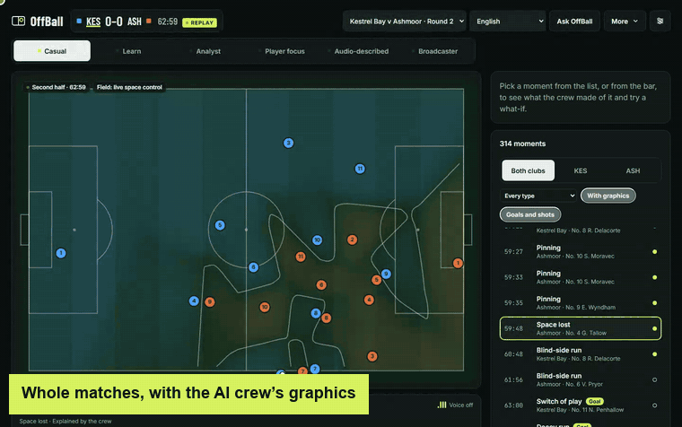
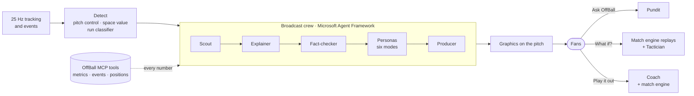
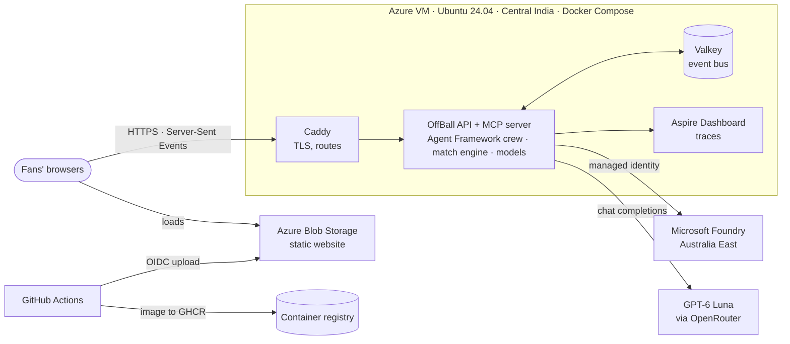

<div align="center">


# OffBall

**Making off-ball football visible.**

An AI broadcast crew that finds the runs that create space, explains them in plain words, fact-checks every number,<br>
and lets fans ask questions and play out what-ifs on the pitch.

[](https://github.com/FelixMatrixar/OffBall/actions/workflows/ci.yml)
[](https://offballwebihlv6k6nlvamk.z29.web.core.windows.net/#/match)
[](infra/foundry.bicep)
[](offball/agents/broadcast.py)
[](offball/mcp/server.py)



**[▶ Watch the full demo (MP4)](docs/media/offball-demo.mp4)** · **[Open the live app](https://offballwebihlv6k6nlvamk.z29.web.core.windows.net/#/match)**

</div>

---

Broadcast graphics follow the ball, but most of what decides a match happens away from it: the decoy run that drags a defender, the pin that holds a full-back, the movement that opens a gap. OffBall reads the tracking data, finds those moments, and has a crew of AI agents explain them on the pitch for six kinds of viewer, with every number checked before it airs.

All match data is synthetic, generated by OffBall's own match engine. Every caption, answer and plan is AI-generated and labelled as such.

## What you can do

| | |
| --- | --- |
| **Watch whole matches** | Pick any of ten matches and play or scrub all 90 minutes, both halves, at 1× to 8×. The control field shows who owns the space, frame by frame. |
| **See the off-ball game** | Every moment the models found (300 or so a match) is on the timeline and in a list. The broadcast crew's graphics play on the pitch: the run, the defender pulled away, the gap that opens, the caption. |
| **Watch your way** | Casual, Learn, Analyst, Player focus, Audio-described and Broadcaster modes each get their own graphics and words, in a UI available in ten languages. |
| **Ask OffBall** | Ask about any moment in your own words (“what did No. 9 do at 63:01?”). The Pundit answers with checked facts, then the pitch jumps there, rings the players and plays it. |
| **What if?** | For any moment, see what would have happened had the player held his place, come inside or dropped to the ball: the match engine replays it 16 times, the ghosts show where everyone would have been, and the Tactician says what it means. |
| **Play it out** | Freeze any moment and take over: drag players, give the ball to anyone, tap to order runs, passes, shots, presses and marks, or ask the Coach for a plan. The engine plays it eight times; watch every run and score points, then defend what just worked. |

## How it works



1. **Detect.** Models for pitch control, space value, off-ball scoring opportunity and the type of run find every off-ball moment in the tracking (`offball/models/`).
2. **Explain.** The Scout decides what airs; the Explainer drafts claims from tool results; the Personas write the words for each mode in English, Spanish and French; the Producer times the graphics (`offball/agents/broadcast.py`).
3. **Verify.** Every number comes from an OffBall MCP tool, and the Fact-checker recomputes it independently. A claim it can't confirm never airs, and a later correction to the feed retracts and patches what's on screen. There are no templates to fall back on: an agent that fails says nothing.
4. **Play.** The same engine that generated the matches replays them from the observed state for what-ifs and for Play it out. The Coach tries its plans in the engine before showing them.

### The agents

| Agent | What it does | Model tier |
| --- | --- | --- |
| Scout | Decides which moments air, and how important each is | fast |
| Explainer | Drafts the explanation as checkable claims, with tool calls | reasoning |
| Fact-checker | Recomputes every claim, and checks every line of script | reasoning |
| Persona | Writes each viewing mode's words in English, Spanish and French | fast |
| Producer | Times the graphics against the play | fast |
| Pundit | Answers fans' questions, and picks the play that shows the answer | reasoning |
| Tactician | Puts a what-if replay into words, quoting only its numbers | fast |
| Coach | Plans an attack or a defence for Play it out, and tests it in the engine | fast |
| Engineer | Watches the crew's health and applies the playbook's mitigations | fast |

## Architecture on Azure



- **Web app:** a React and Vite single-page app, served from an Azure Blob Storage static website. The Site workflow builds it and uploads it with OIDC on every push to `main` (ADR 0007).
- **API and crew:** one Azure VM (Standard B2als v2, Central India) runs the stack with Docker Compose: Caddy for TLS, the OffBall API and MCP server, Valkey as the event bus and the Aspire Dashboard for traces (ADR 0006, `deploy/`).
- **Models:** the agents run on GPT-6 Luna through OpenRouter, a fast tier at low effort and a reasoning tier at high effort, with the Foundry project in Australia East holding the model connection and the VM signing in with its managed identity (ADR 0004).
- **Infrastructure as code:** `infra/main.bicep` creates the VM, the storage account and Foundry; `deploy/up.sh` brings the stack up and `deploy/README.md` walks through it all.

## Run it

You need Python 3.12 with [uv](https://docs.astral.sh/uv/), and Node 22.6 or later for the frontend.

```bash
uv sync
```

```bash
uv run offball serve all
```

That starts the API on port 8000 and the OffBall MCP server on port 8001. With Docker, `docker compose up --build` runs the same two with the Valkey event bus and the Aspire Dashboard, as the VM does. Then start the frontend:

```bash
npm run dev --prefix web
```

Open the match view on your API: **`http://localhost:5173/#/match?api=http://localhost:8000`**. Pick a match in the header, play or scrub the whole match, open any moment, ask OffBall, try a what-if, or press **🎮 Play it out**. Without `?api=` (or `VITE_API_BASE` at build time), the match view plays the scripted showcase moment on its own, with no backend at all.

### Give the agents a model

Every caption, graphic and answer comes from a model; there are no templates to fall back on. Without one the match still plays and the numbers are still computed, but nothing an agent would write airs.

1. Get an OpenRouter key.
2. Copy `.env.example` to `.env` (git ignores it) and set `OPENROUTER_API_KEY`. The defaults are GPT-6 Luna for both tiers, at low effort and up to 4,000 tokens a call for the fast tier and high effort and up to 16,000 for the reasoning tier; `.env.example` shows how to choose others, or a model deployed in Foundry.
3. Restart `offball serve all`, and run `uv run offball eval agents` to score each agent on its own task set.

### Commands

| Command | What it does |
| --- | --- |
| `uv run offball serve all` | The API and the MCP server (`serve api` or `serve mcp` for one) |
| `uv run offball graphics m07` | Takes every moment of a whole match through the crew ahead of time, at a graphic a minute within a token budget; picks up where it stopped |
| `uv run offball replay m07 --period 2 --from-ms 1225000 --to-ms 1252000` | Runs a window of a match through the live pipeline and the crew, and writes the stream to `replays/` |
| `uv run offball golden run` | Puts the golden render cases through the pipeline and checks what reaches the frontend |
| `uv run offball eval agents` | Scores each agent against the model in `.env`, and writes `calibration/reports/agents.md` |
| `uv run offball gates smoke` | Runs the quality gates on the smoke set |
| `uv run offball schemas` | Exports the JSON Schemas in `contracts/` from the code |
| `uv run pytest` | The Python tests, including the schema and truth-isolation checks |
| `npm run check --prefix web` | The frontend's typecheck, token lint and tests |

CI (`.github/workflows/ci.yml`) runs the lint and tests for both sides, tests the event bus against a real Valkey, checks the deployment files and builds the image on every push and pull request; on `main` it pushes the image to GitHub Container Registry. The Site workflow (`.github/workflows/site.yml`) publishes the web app.

### Settings

| Setting | What it does |
| --- | --- |
| `OFFBALL_MAX_MOMENTS` | Moments the crew works on at once in a live run (default 2) |
| `TOKENS_PER_MATCH` | A live match's token budget: past 80% only priority-0 moments air, at 100% none (default 2,000,000) |
| `OFFBALL_ASKED_TOKENS` | The token budget per match for moments viewers ask the crew to explain (default 4,000,000) |
| `OFFBALL_MATCHES_IN_MEMORY` | Whole matches kept in memory at once, about 80 MB each (default 4) |
| `OFFBALL_PLAYOUTS_AT_ONCE` | Play it out playouts the API runs at once (default 2) |
| `OFFBALL_TRACE=console` | Prints a trace of every agent call; `OTEL_EXPORTER_OTLP_ENDPOINT` sends them to the Aspire Dashboard instead |
| `VALKEY_URL` | Sends each live run's feed through the Valkey event bus; without it the feed goes straight to ingest |
| `OFFBALL_WEB_ORIGINS` | The web app's origins that may call the API from a browser (default `*`) |

## Project layout

| Folder | What's in it |
| --- | --- |
| `offball/generator/` | The league, the emergent match engine and the director that plants moments |
| `offball/models/` | Pitch control, space value, off-ball scoring opportunity, credit, the run classifier, the moment detectors, the counterfactual workers and Play it out's playouts |
| `offball/agents/` | Every agent's instructions and code: the broadcast workflow on Microsoft Agent Framework, the Pundit, the Tactician, the Coach, corrections and the Engineer |
| `offball/mcp/` | The OffBall MCP server and its tools |
| `offball/services/` | The API, the feed emitter, the event bus, the live service, whole-match playback, panel stats, degrade flags and tracing |
| `offball/eval/` | Golden render tests and the per-agent evaluations |
| `web/` | The frontend (`web/README.md`) |
| `contracts/` | JSON Schemas for every message between the backend and the frontend |
| `deploy/`, `infra/` | The VM's stack and scripts, and the Bicep for Azure |
| `datasets/`, `truth/` | The generated matches, and their answer keys, which only evaluation reads |

## Documentation

- [`PRD.md`](PRD.md): what OffBall does and why, and where the build stands.
- [`INTEGRATION.md`](INTEGRATION.md): every message and call between the frontend, the backend and the AI.
- [`TRANSPARENCY.md`](TRANSPARENCY.md): what the AI does, how it's checked, and its limits.
- [`DATASHEET.md`](DATASHEET.md): how the synthetic data is made.
- [`docs/adr/`](docs/adr/): the design decisions, from hosting to the counterfactual workers.
- [`deploy/README.md`](deploy/README.md): deploying to Azure.
- [`SECURITY.md`](SECURITY.md): reporting a vulnerability.

## Limits worth knowing

- **Speed.** The crew takes a minute or more to explain a moment, far over its live budget, so whole matches use graphics built ahead of time and viewers' requests take one to three minutes.
- **Credit.** Off-ball credit, how much space a run created, is not yet within its accuracy target (ADR 0008); what-ifs and Play it out show the engine's estimates with their spread.
- **Synthetic football.** Every club, player and match is made up, and the engine's players use league-typical attributes when replaying a real position.

<div align="center">

<sub>Built with Microsoft Foundry, Microsoft Agent Framework and the Model Context Protocol. All match data is synthetic.</sub>

</div>
